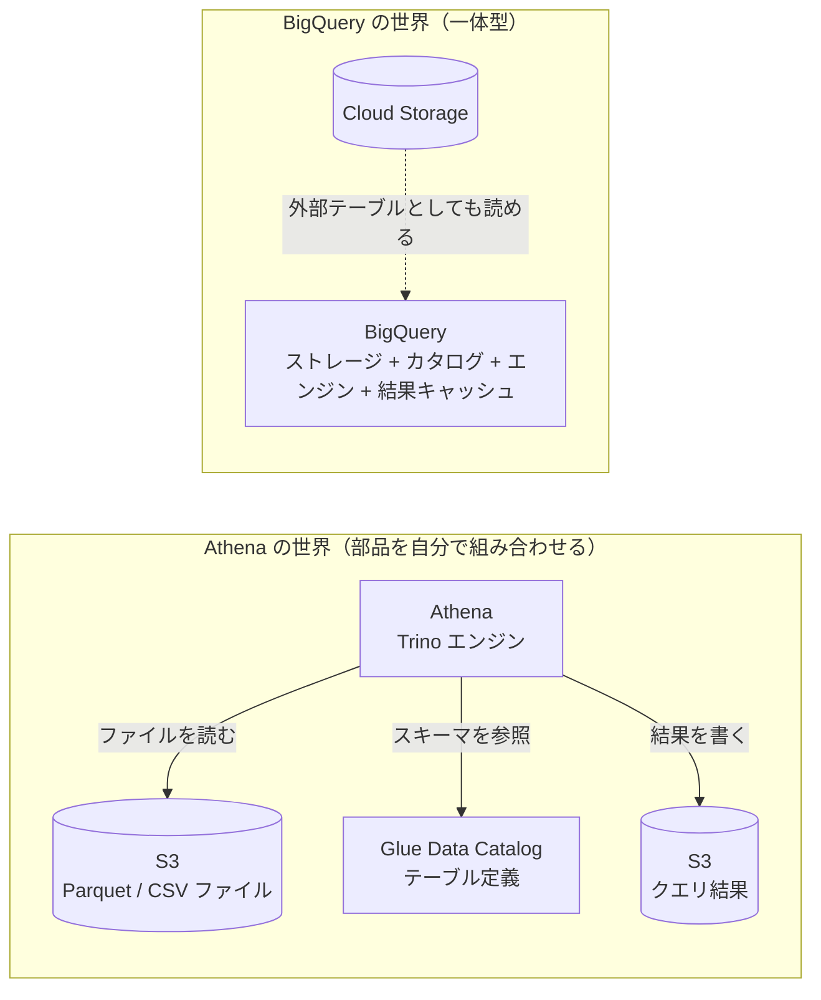
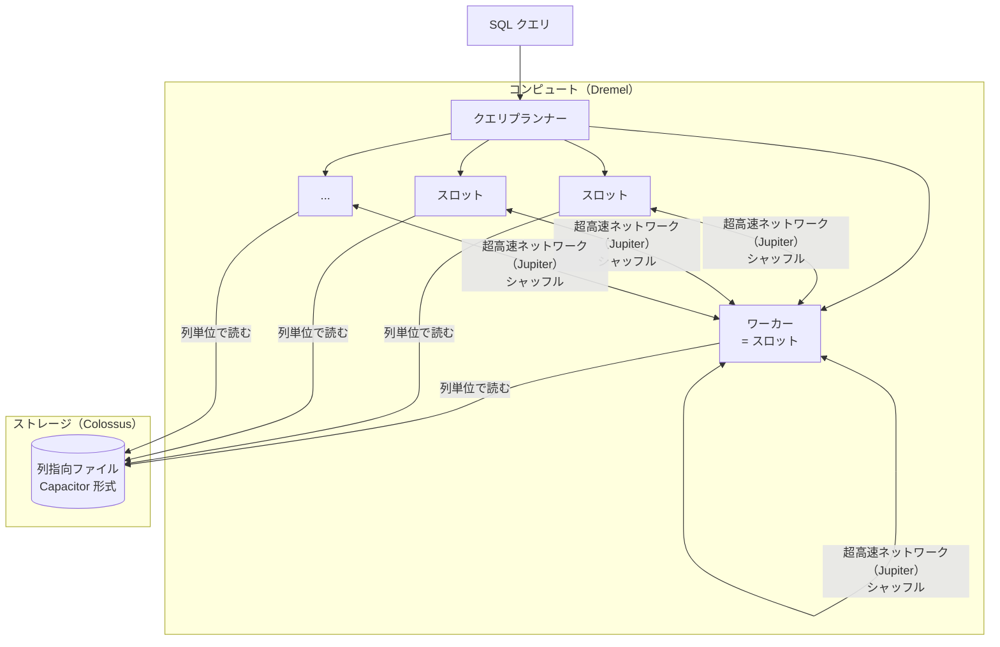
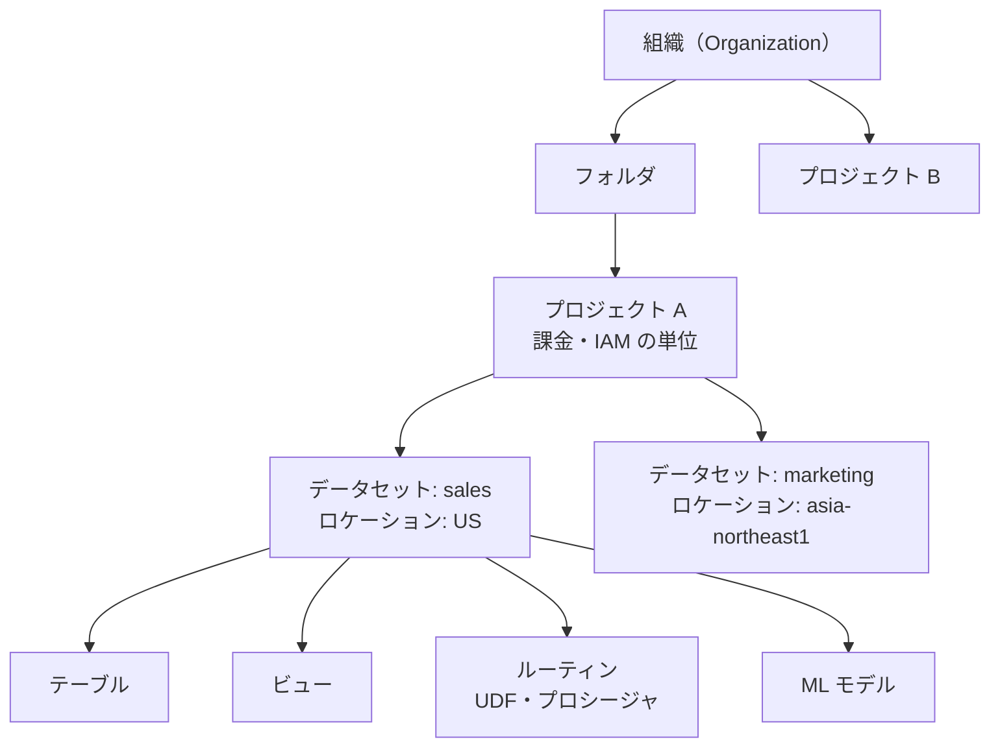

# 第1章 BigQuery の全体像 — Athena と比べて掴む

> **この章のゴール**
> - BigQuery が「何をどこまで面倒を見てくれるサービスか」を、Athena と比較して説明できる
> - ストレージとコンピュートの分離、列指向ストレージ、スロットという3つの仕組みを理解する
> - プロジェクト → データセット → テーブルという階層と、ロケーションの制約を知る
> - 料金がどう決まるかの全体像（スキャン量課金とスロット課金）を掴む
>
> この章は概念が中心です。手を動かすのは第2章からです。

## 1.1 たとえ: Athena + S3 + Glue を1つにまとめたサービス

Athena を使ったときのことを思い出してください。クエリを投げるまでに、次の3つのサービスを組み合わせていたはずです。



| 観点 | Athena | BigQuery |
|---|---|---|
| データの置き場所 | **自分の S3 バケット**（ファイル形式も自分で選ぶ） | **BigQuery 管理のストレージ**（形式は意識しない）。外部テーブルで GCS も読める |
| テーブル定義 | Glue Data Catalog（Crawler や DDL で登録） | BigQuery 自身が持つ（テーブルを作れば定義も一緒にできる） |
| クエリエンジン | Trino（旧 Presto） | Dremel |
| 書き込み | 基本は読み取り専用（DML は Iceberg テーブルなどに限られる） | 普通の DB のように INSERT / UPDATE / DELETE / MERGE できる |
| クエリ結果 | 指定した S3 の場所に出力 | 一時テーブルに保存され、同じクエリは24時間キャッシュから返る |
| 料金（クエリ） | スキャン量課金（$5 / TB） | スキャン量課金（$6.25 / TiB、毎月 1 TiB 無料）**または** スロット（計算資源）課金 |

一言でいえば、**Athena は「S3 にあるファイルに SQL を投げる道具」、BigQuery は「SQL で使えるデータベースそのもの」** です。
BigQuery ではファイル形式・パーティションのパス・カタログの登録を考える必要がほぼありません。そのぶん、BigQuery 独自の設計ポイント（パーティション列、クラスタリング、ネスト構造）を学ぶことになります。

アプリ開発でたとえるなら、こうなります。

| | アプリ開発 |
|---|---|
| Athena | **SQLite のファイルを自分で S3 に置き、クエリライブラリで読む** 構成。ファイルの管理は自分の責任 |
| BigQuery | **マネージドな RDB（Cloud SQL / RDS）** のような使い勝手で、しかもサーバの台数を気にしなくてよい |

## 1.2 仕組み①: ストレージとコンピュートの分離

BigQuery の内部は、大きく3つの部品でできています。



| 部品 | 役割 | Athena で近いもの |
|---|---|---|
| **Colossus** | 分散ファイルシステム。データを列指向形式で保存 | S3 |
| **Dremel** | クエリを数千のワーカーに分散して実行するエンジン | Trino |
| **Jupiter** | ストレージとワーカー、ワーカー同士をつなぐ高速ネットワーク | — |

ストレージとコンピュートが分離しているため、次のような性質があります。

- **データ量が増えても、サーバを足す作業は不要**（ストレージだけが増える）
- **クエリを投げた瞬間だけ計算資源を借りる**（何もしていなければ計算の課金は発生しない）
- 同じデータに対して、何人が同時にクエリを投げても互いのストレージを奪い合わない

Athena も「S3（ストレージ）と Trino（コンピュート）が分かれている」という点では同じ構造です。違うのは、BigQuery では **ストレージの形式まで BigQuery が最適化して管理する** ことです。

## 1.3 仕組み②: 列指向ストレージ

BigQuery（そして Athena で Parquet を使った場合）のデータは、**列ごと** に保存されます。プログラマには次のたとえが分かりやすいでしょう。

```ts
// 行指向（Array of Structs）: 一般的な RDB、CSV
const rows = [
  { orderId: 1, userId: 10, status: 'Complete', createdAt: '...' },
  { orderId: 2, userId: 11, status: 'Shipped',  createdAt: '...' },
]

// 列指向（Struct of Arrays）: BigQuery、Parquet
const columns = {
  orderId:   [1, 2, ...],
  userId:    [10, 11, ...],
  status:    ['Complete', 'Shipped', ...],
  createdAt: ['...', '...', ...],
}
```

`select status, count(*) from orders group by status` を実行するとき、列指向なら **`status` の配列だけを読めば済みます**。
しかも同じ列には似た値が並ぶので、圧縮がよく効きます（`'Complete'` が何万回も続く、など）。

この性質から、**料金と性能に関する BigQuery の大原則** が導かれます。

| 原則 | 理由 |
|---|---|
| **`SELECT *` は高い** | すべての列の配列を読むことになる |
| **`LIMIT` を付けても安くならない** | 「列を読む量」は変わらない（多くの場合、全行を読んでから絞る） |
| **読む列を減らすと安くなる** | 読まない列の配列は、まったく触らない |
| **`WHERE` だけでは安くならないことがある** | 行を絞っても、列は全行分読む。行を読み飛ばすにはパーティション・クラスタリング（第4章）が必要 |

> 💡 **Athena との違い**
> Athena で CSV のまま置いていた場合、`SELECT` する列を減らしてもスキャン量は変わりません（行指向なので、ファイル全体を読みます）。
> Parquet に変換すると列単位で読めるようになるので、スキャン量が劇的に減ります。
> BigQuery は **最初から「Parquet 化済み」の状態** だと考えてください。

## 1.4 仕組み③: スロット = 計算の単位

**スロット** は、BigQuery がクエリを実行するときに使う計算資源の単位です。おおまかには「仮想的な CPU とメモリのセット」と考えてください。

Java でたとえると、BigQuery 全体が **巨大な `ForkJoinPool`** で、スロットはその **ワーカースレッド** です。

```java
// クエリ = 並列ストリームのパイプライン
orders.parallelStream()                       // ステージ1: 各スロットがデータの一部を読む
      .filter(o -> o.status().equals("Complete"))
      .collect(groupingByConcurrent(           // ステージ2: シャッフルしてキーごとに集約
          Order::userId, counting()));
```

- クエリは **ステージ** に分割され、各ステージが多数のスロットで並列に実行されます
- ステージの間では、データを再配置する **シャッフル** が起きます（`GROUP BY` や `JOIN` のキーごとにデータを集める）
- 実行計画（第8章）を見ると、各ステージで使ったスロット時間が分かります

課金方式によって、スロットの扱いが変わります。

| 課金方式 | スロットの扱い | たとえ |
|---|---|---|
| **オンデマンド**（既定） | 必要なだけ自動で割り当てられる（プロジェクトあたりの上限あり）。**読んだバイト数** で課金 | タクシー（距離で払う） |
| **Editions**（容量課金） | 事前に、または自動スケールで確保した **スロット × 時間** で課金 | レンタカー（時間で払う） |

学習中や小規模なうちは、オンデマンドで十分です。第7章で詳しく扱います。

## 1.5 リソースの階層



| BigQuery | AWS / Athena で近いもの | Java で近いもの |
|---|---|---|
| プロジェクト | AWS アカウント（課金と権限の境界） | Maven の groupId / モジュール |
| データセット | Glue のデータベース | パッケージ |
| テーブル / ビュー | Glue のテーブル | クラス |
| ルーティン（UDF） | Athena の UDF（Lambda） | static メソッド |

テーブルは **`プロジェクト.データセット.テーブル`** の3つの部分からなる名前で参照します。

```sql
select * from `bigquery-public-data.thelook_ecommerce.orders`
--             └─ プロジェクト ──────┘└─ データセット ──┘└ テーブル ┘
```

プロジェクト名にハイフンが含まれるので、名前全体をバッククォートで囲みます。
他人のプロジェクト（ここでは Google の公開データ用プロジェクト）のテーブルも、権限さえあれば同じように読めます。
このとき、**課金されるのはクエリを実行した側のプロジェクト** です。

### ロケーション（リージョン）の制約 ⚠️

データセットは作成時に **ロケーション**（`US`、`EU` などのマルチリージョン、または `asia-northeast1`（東京）などのリージョン）を決め、あとから変更できません。
そして、**原則として、異なるロケーションのデータセット同士を1つのクエリで JOIN できません。**

Athena でも、別リージョンの S3 バケットを読むのは面倒だったと思います。BigQuery ではこれがより厳格です。
公開データセット（`bigquery-public-data`）の多くは `US` にあるので、学習用に自分のデータセットを作るときは **`US` を選ぶ** と楽です（第2章）。

## 1.6 料金の全体像

BigQuery の料金は、大きく **ストレージ** と **コンピュート（クエリ）** に分かれます。

| 項目 | 課金のしかた（2026年11月時点、US の例） | 無料枠（毎月） |
|---|---|---|
| ストレージ | 保存しているデータ量。90日間更新されないテーブルは **長期保存料金**（約半額）に自動で下がる | 10 GiB |
| クエリ（オンデマンド） | **読んだバイト数**: $6.25 / TiB。テーブルごとに最低 10 MB | 1 TiB |
| クエリ（Editions） | 確保したスロット × 時間 | — |
| ストリーミング挿入など | 取り込み方法によって別料金 | — |

Athena（$5 / TB、クエリごとに最低 10 MB）と、ほぼ同じ感覚です。
ただし BigQuery では、**クエリを実行する前に「何バイト読むか」が分かります**（第2章のドライラン）。
Athena で「流してみたら思ったよりスキャンしていた」という経験があるなら、これは大きな違いです。

> 💡 **学習中は sandbox を使う**
> 課金を有効にしていないプロジェクトは **BigQuery sandbox** として動きます。上の無料枠の範囲で、クレジットカードなしに使えます。
> 代わりに、テーブルは60日で自動的に消える、DML（INSERT / UPDATE など）が使えない、などの制限があります（第2章）。

## 1.7 BigQuery と Athena、どちらを使うか

どちらが優れているかではなく、**データがどこにあり、誰が管理するか** で選びます。

| こういうときは | 向いているもの | 理由 |
|---|---|---|
| データがすでに S3 に大量にあり、AWS で完結している | Athena | データを動かさずにクエリできる |
| 分析用の DWH を新しく作る。DML や細かい権限管理もしたい | BigQuery | 管理の手間が少なく、DB としての機能がそろっている |
| BI ツールから多数のユーザーが頻繁に使う | BigQuery | キャッシュ、BI Engine、容量課金で安定させやすい |
| Google Analytics 4 や Google 広告のデータを分析したい | BigQuery | 公式のエクスポート先が BigQuery |
| ファイル形式やテーブル形式（Iceberg など）を自分で統制したい | Athena（BigQuery も BigLake で対応） | オープンなフォーマット中心の設計 |

## 演習

**1-1.** 次の Athena の作業は、BigQuery ではどうなるでしょうか？
(a) S3 に Parquet で置き、Glue Crawler でテーブル登録する　(b) クエリ結果の出力先 S3 を設定する　(c) ワークグループで、1クエリあたりのスキャン量に上限を設ける

<details><summary>解答</summary>

- (a) テーブルを作ってデータをロードするだけです（`CREATE TABLE ... AS SELECT` やファイルのロード）。ファイル形式もカタログ登録も BigQuery が管理します。GCS に置いたまま読みたい場合は、外部テーブルを定義します（第5章）。
- (b) 不要です。結果は自動で一時テーブルに保存されます。残したい場合は、宛先テーブルを指定するか CTAS を使います。
- (c) クエリの設定で **最大課金バイト数**（maximum bytes billed）を指定します。プロジェクトやユーザーごとに、1日あたりの **カスタムクォータ** も設定できます（第2・7章）。

</details>

**1-2.** 10 列・1 億行のテーブルがあります。各列はだいたい同じサイズです。次のクエリのうち、オンデマンド料金が最も安いのはどれでしょうか？
(a) `select * from t limit 10`　(b) `select col1, col2 from t`　(c) `select col1 from t where col2 = 'x'`

<details><summary>解答</summary>

**(c)** です（`col1` と `col2` の2列分を読みます）。
(b) も同じく2列分です。(a) は `LIMIT` があっても10列分すべてを読むので、最も高くなります。
`WHERE` で行を絞っても、それだけでは読むバイト数は減らない点に注意してください（行を読み飛ばすにはパーティション・クラスタリングが必要です。第4章）。

</details>

**1-3.**（考察）Java の `ForkJoinPool` のたとえで、「オンデマンド」と「Editions（容量課金）」の違いを説明してみてください。

<details><summary>解答例</summary>

オンデマンドは、Google が持っている巨大な共有プールから、クエリのたびに必要なスレッドを借りる方式です。支払いは「処理したデータ量」で決まり、スレッドを何本使ったかは関係ありません。
Editions は、自分専用のプール（スレッド数）を確保し、プールを確保していた時間で支払う方式です。データ量は関係なくなりますが、プールが小さいとクエリが待たされます。

</details>

## つまずきポイント

- **「サーバーレスだから、どんなクエリも安い」と思う** … 読んだバイト数で課金されます。大きなテーブルへの `SELECT *` は、1回で数千円かかることもあります。第2章で、実行前にバイト数を確認する習慣をつけましょう。
- **ロケーションを気にせずデータセットを作る** … 東京リージョンに作ったデータセットは、`US` にある公開データセットと JOIN できません。
- **「BigQuery = Google Analytics のツール」と思う** … GA4 のエクスポート先として有名ですが、汎用の DWH です。

## まとめ

- BigQuery は、Athena + S3 + Glue をひとまとめにしたような **サーバーレス DWH**。DML もでき、DB として使える
- 3つの仕組み: **ストレージとコンピュートの分離**、**列指向ストレージ**（SELECT する列が料金を決める）、**スロット**（並列実行のワーカー）
- 階層は **プロジェクト → データセット → テーブル**。データセットのロケーションは変更できず、ロケーションをまたぐ JOIN は原則できない
- 料金は、ストレージ + クエリ（オンデマンドならスキャン量、Editions ならスロット時間）。毎月の無料枠がある

Sources: [BigQuery pricing](https://cloud.google.com/bigquery/pricing), [Enable the BigQuery sandbox](https://cloud.google.com/bigquery/docs/sandbox)

➡️ 次章: [第2章 環境構築とはじめてのクエリ](02-first-query.md)
