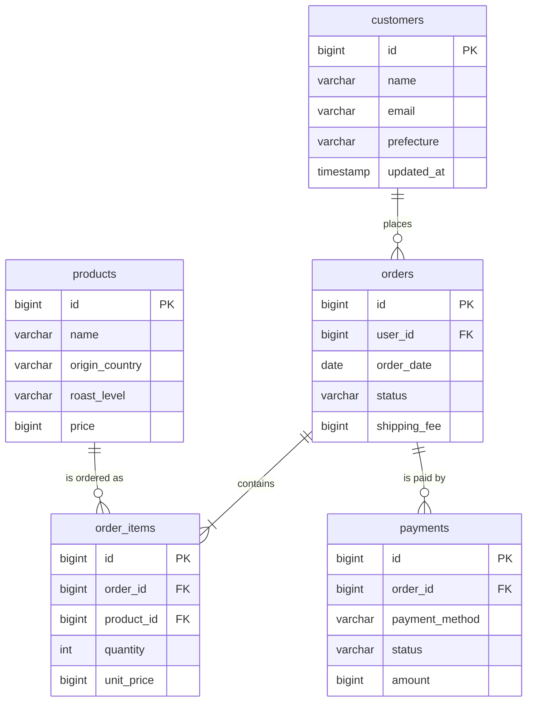
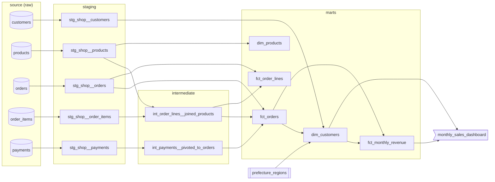

# 第0章 完成形を先に見る

> **この章のゴール**
> - 完成版プロジェクト `coffee_shop` を動かし、最終的に何を作るのかを把握する
> - 「生データ → 分析用テーブル」という流れを、リネージグラフで目にする
> - 自分の学習のチェックリスト（逆算の終点）を手に入れる

## 0.1 なぜ最初に完成形を見るのか

フレームワークを学ぶとき、チュートリアルを1章ずつ積み上げていくと「いま何のためにこれをやっているのか」を見失いがちです。
Spring Boot を学ぶなら、まず動くサンプルアプリを起動して画面を触ってから、コントローラやリポジトリの説明を読む方が頭に入りやすいはずです。

この教材も同じで、**まず完成品を動かし、そこから逆算して各章を学びます**。

## 0.2 題材: コーヒー豆 EC「Bean Voyage」

Bean Voyage は、世界各地のスペシャルティコーヒー豆をネット販売している架空の EC サイトです。
業務アプリ（EC サイト本体）の DB には、次の5つのテーブルがあります。



経営陣からは、こんな要望が来ています。

- 「**月別・地方別の売上**を毎朝ダッシュボードで見たい」
- 「**リピーター**がどれくらいいるか知りたい。優良顧客（loyal）は何人？」
- 「**値上げ前後**で売れ行きが変わったか知りたい」
- 「引っ越した顧客は、**注文した時点の住所**で集計してほしい」

業務アプリの DB はこうした分析を想定した形になっていません。ステータスの表記ゆれ（`COMPLETED` / `completed `）、
アプリ都合の命名（`user_id`）、上書きされて消える履歴などがあります。
これを **分析しやすく、信頼できる形** に変換するのが、この教材で dbt を使って作るものです。

## 0.3 ハンズオン: 完成版を動かす

[README のセットアップ](../README.md#セットアップ) を済ませてから、`study-dbt/` で次を実行します。

```bash
make load-day1   # 生データを raw スキーマへ
make build       # dbt build を実行
```

最後にこう表示されれば成功です。

```text
Done. PASS=75 WARN=0 ERROR=0 SKIP=0 NO-OP=1 REUSED=0 TOTAL=76
```

76個の「ノード」が処理されました。内訳はこうです。

| 種類 | 数 | 何をしたか |
|---|---|---|
| seed | 1 | CSV（都道府県→地方マスタ）をテーブルとしてロード |
| model（view / table / incremental） | 10 | SELECT 文を実行し、テーブルやビューを作成 |
| snapshot | 2 | 顧客・商品の変更履歴を記録 |
| data test | 60 | 「主キーが一意」「金額が正」など、データの不変条件を検証 |
| unit test | 2 | モデルのロジックをモックデータで検証 |
| exposure | 1 | 「このダッシュボードが使っている」という宣言（実行はしない） |

### 結果を覗いてみる

```bash
cd coffee_shop
dbt show --select fct_monthly_revenue --limit 5
dbt show --inline "select customer_segment, count(*) from {{ ref('dim_customers') }} group by 1"
```

`{{ ref('dim_customers') }}` という見慣れない書き方が出てきました。これが dbt の核心で、第3章で詳しく扱います。

### リネージグラフ（DAG）を見る

```bash
make docs        # study-dbt/ で実行。http://localhost:8080 が開く
```

ブラウザでドキュメントサイトが開いたら、右下の **青いボタン（View Lineage Graph）** を押してください。



**左から右へデータが流れ、段階的に「分析しやすい形」に整えられていく**のが分かります。
これを Java のビルドにたとえると、`*.java` から `*.class`、そして `*.jar` が作られていく依存グラフと同じです。
dbt はこのグラフを **SQL の中に書かれた `ref()` / `source()` から自動で組み立てます**。

## 0.4 完成版プロジェクトのファイル構成

```text
coffee_shop/
├── dbt_project.yml          # ビルド設定（≒ build.gradle / package.json）
├── profiles.yml             # 接続設定（≒ application-{profile}.yml）
├── models/
│   ├── staging/shop/        # 第3・5章: 生データの整形（1 source = 1 model）
│   ├── intermediate/        # 第5章: 部品（非公開）
│   └── marts/               # 第4・5章: 分析者に公開するテーブル
│       ├── core/            #   fct_orders, dim_customers ...
│       └── finance/         #   fct_monthly_revenue
├── seeds/                   # 第3章: 小さなマスタ CSV
├── snapshots/               # 第11章: 履歴管理
├── macros/                  # 第9章: SQL を生成する関数
├── tests/                   # 第6章: 自作テスト
└── analyses/                # 第9章: アドホック分析用 SQL
```

## 0.5 学習チェックリスト（逆算の終点）

最終章までに、次の問いに **TS / Java のたとえを交えて** 答えられるようになるのが目標です。
今は分からなくて構いません。各章を終えるたびに戻ってきてチェックしてください。

- [ ] dbt は ETL ツールではない。では何をするツールか？（第1章）
- [ ] `ref()` を使わずにテーブル名を直接書くと、何が困るか？（第3章）
- [ ] `fct_orders` の「粒度（grain）」は何か？ なぜ最初に粒度を決めるのか？（第4章）
- [ ] staging で JOIN をしないのはなぜか？（第5章）
- [ ] data test と unit test は何が違うか？（第6章）
- [ ] model contract を付けると、何が守られるのか？（第7章）
- [ ] マクロは「実行時」に動くのか「コンパイル時」に動くのか？（第9章）
- [ ] view / table / incremental をどう使い分けるか？（第10章）
- [ ] 「注文した時点の住所」で集計するには何が必要か？（第11章）
- [ ] PR で変更したモデルだけをテストするにはどうするか？（第12章）
- [ ] 生データの取り込みが止まったことに、どうやって気づくか？（第13章）

## 0.6 やり直したくなったら

```bash
make reset       # DuckDB ファイルとビルド成果物を削除
make load-day1 && make build
```

## まとめ

- この教材では、架空のコーヒー豆 EC の生データを、分析用のファクト / ディメンションへ変換する
- dbt は SQL の中の `ref()` から依存グラフ（DAG）を組み立て、正しい順序でビルド・テストする
- 完成版 `coffee_shop/` は模範解答。第2章から、自分の `my_coffee_shop/` を育てていく

➡️ 次章: [第1章 dbt の立ち位置](01-what-is-dbt.md)
