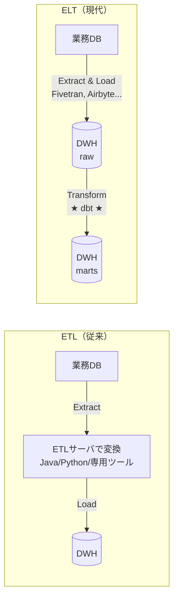
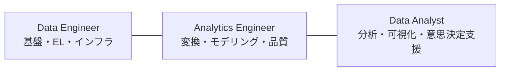

# 第1章 dbt の立ち位置

> **この章のゴール**
> - ETL と ELT の違い、その中で dbt が担当する範囲を説明できる
> - 「Analytics Engineering」という役割を理解する
> - dbt v1 / v2、OSS / dbt platform（旧 dbt Cloud）の関係を整理する

## 1.1 たとえ: dbt は「SQL のためのビルドツール」

| アプリ開発 | dbt |
|---|---|
| `*.ts` / `*.java` のソースコード | `models/*.sql`（SELECT 文） |
| `tsc` / `javac` / Gradle | `dbt` |
| `import` / `@Autowired` で依存を宣言 | `{{ ref('...') }}` で依存を宣言 |
| ビルド成果物 `dist/` / `*.jar` | DWH 上のテーブル・ビュー |
| `npm test` / `mvn test` | `dbt test` |
| `mvn verify`（ビルド＋テスト） | `dbt build` |
| Javadoc / TypeDoc | `dbt docs generate` |

dbt を使うと **SELECT 文を書くだけ** で済みます。`CREATE TABLE`、実行順序の管理、テスト、ドキュメント生成は dbt が引き受けます。
Gradle が「どのクラスをどの順でコンパイルするか」を依存関係から決めてくれるのと同じ発想です。

## 1.2 ETL から ELT へ

データ基盤の処理は、昔から3つのステップで説明されます。

- **E**xtract: 業務システムからデータを取り出す
- **T**ransform: 分析しやすい形に変換する
- **L**oad: 分析用のデータベース（DWH）に格納する



**ETL** の時代は DWH が高価で非力だったため、DWH に入れる前に別サーバで変換していました。
その変換処理は、Java のバッチや専用 GUI ツールで書かれることが多く、データアナリストには手を出しにくいものでした。

**ELT** では、生データをまず DWH に **そのまま** ロードし、変換は DWH の中で **SQL で** 行います。
Snowflake / BigQuery / Databricks のようなクラウド DWH が安く強力になったことで、この方式が主流になりました。

**dbt は ELT の「T」だけを担当します。** データを取り出したりロードしたりはしません。
この教材では [`scripts/load_raw.py`](../scripts/load_raw.py) が EL ツールの役を演じています。

> 💡 **アプリエンジニア向けの補足**
> dbt は「SQL を DWH に投げる」だけで、データ自体は dbt のプロセスを通りません。
> 計算はすべて DWH（この教材では DuckDB）のエンジンで行われます。
> JPA で `EntityManager.createNativeQuery()` を発行するとき、計算するのは DB であって JVM ではないのと同じです。

## 1.3 dbt が解決する課題

dbt がない現場では、変換処理は次のように書かれがちでした。

```sql
-- daily_batch_01.sql（実行順は Wiki に書いてある…）
CREATE TABLE tmp_orders AS SELECT ... FROM raw.orders ...;
-- daily_batch_02.sql
DROP TABLE IF EXISTS sales_summary;
CREATE TABLE sales_summary AS SELECT ... FROM tmp_orders JOIN ...;
```

| 課題 | よくある症状 | dbt の解決策 |
|---|---|---|
| 実行順の管理 | 「02 を 01 より先に流して壊れた」 | `ref()` から DAG を自動構築 |
| DDL の重複 | `DROP` / `CREATE` の定型文がコピペで散らばる | SELECT だけ書けば、DDL は dbt が生成 |
| テストがない | 主キーの重複に1か月気づかない | `dbt test` で不変条件を宣言的に検証 |
| ドキュメントがない | 「この列の意味は〇〇さんしか知らない」 | YAML に書いた説明からサイトを生成 |
| 環境分離がない | 本番テーブルを直接いじって壊す | target（dev / prod）でスキーマを切替 |
| レビューできない | GUI ツールの差分が見えない | 全部テキスト。Git でレビュー・CI ができる |

まとめると、dbt は **ソフトウェアエンジニアリングのプラクティス（バージョン管理、テスト、モジュール化、CI/CD、ドキュメント）をデータ変換に持ち込んだ** ツールです。
そのため、アプリエンジニアには多くの概念がなじみやすいはずです。

## 1.4 Analytics Engineering という役割

dbt の普及とともに、**Analytics Engineer** という職種が生まれました。



- **Data Engineer**: パイプライン基盤、EL、DWH の運用を担う（インフラ寄り）
- **Analytics Engineer**: 生データを **信頼できる分析用データモデル** に変換する（dbt の主戦場）
- **Data Analyst**: データモデルを使って問いに答える（ビジネス寄り）

アプリ開発でたとえると、Analytics Engineer は「**社内向け API（データモデル）を設計・実装・テストするバックエンドエンジニア**」です。
API の利用者がアナリストや BI ツールになり、エンドポイントがテーブルになった、と考えると分かりやすいでしょう。
**ドメインモデリングの力がそのまま活きる職種**でもあります（第4章）。

## 1.5 dbt の製品ラインナップ（2026年時点）

dbt にはいくつかの呼び名があり、混乱しやすいので整理します。

| 名前 | 何か | この教材では |
|---|---|---|
| **dbt v1（dbt Core）** | Python 製の OSS 版 CLI。`pip install dbt-core dbt-<adapter>` で入る | ✅ 使用（1.12） |
| **dbt v2** | Rust 製の新エンジン（旧称 **dbt Fusion engine**）。高速なパースと、SQL を理解した静的解析が特徴。2026年時点では新規インストールの既定 | 第14章で紹介 |
| **dbt platform**（旧 dbt Cloud） | dbt Labs の SaaS。Web IDE、ジョブスケジューラ、Semantic Layer、Mesh などを提供 | 第13・14章で紹介 |
| **アダプタ** | DWH ごとの接続ドライバ（JDBC ドライバのようなもの）。`dbt-duckdb`、`dbt-snowflake` など | ✅ `dbt-duckdb` |

> 📝 **なぜ v1 で学ぶのか**
> dbt v2 は既定のエンジンになりましたが、v1 も引き続きサポートされており、既存の現場では v1 のプロジェクトがまだ多く動いています。
> v1 と v2 は **同じプロジェクト形式（YAML / SQL / Jinja）を扱う** ので、ここで学ぶ内容はほぼそのまま v2 でも通用します。
> 本教材のコードは v1.12 で非推奨警告ゼロ、`dbt parse --use-v2-parser`（v2 パーサでの検証）も通る書き方にしてあります。
> 最新のインストール方法や差分は [公式の移行ガイド](https://docs.getdbt.com/docs/dbt-versions/core-upgrade/upgrading-to-v2) を参照してください。

アダプタは、Java の **JDBC ドライバ** や TS の **Prisma の provider** にたとえられます。
同じ dbt プロジェクトでも、アダプタを差し替えれば別の DWH で動きます（ただし SQL 方言の差は残ります）。

## 1.6 DuckDB について

この教材の DWH には **DuckDB** を使います。

- SQLite の「分析版」のような組み込み DB。ファイル1つで動き、サーバ不要
- 列指向で集計が速く、Snowflake / BigQuery と近い SQL 方言（`date_trunc`、`qualify` など）が使える
- 本番の DWH と違ってお金がかからないので、何度壊してもやり直せる

アプリ開発でいえば、**テスト用の H2 Database や SQLite** のような位置づけです。
ただし DuckDB は本番の分析用途でも十分に使われています。

## 演習

**1-1.** あなたの職場（または想像上の職場）のデータ処理を1つ思い浮かべ、E / L / T のどれにあたるか分類してください。dbt が担当できるのはどれですか？

<details><summary>解答例</summary>

例: 「毎晩 MySQL の注文テーブルを BigQuery にコピーし、日次売上テーブルを作って Looker で表示」
- MySQL → BigQuery へのコピー: **E + L**（Datastream、Fivetran、自前バッチなど）
- 日次売上テーブルを作る: **T** ← dbt が担当
- Looker で表示: dbt の外（dbt からは exposure として宣言できる。第8章）

</details>

**1-2.** 1.3 節の表のうち、あなたが一番「あるある」と感じた課題はどれですか？ アプリ開発ではそれをどんな道具で解決していましたか？

<details><summary>解答例</summary>

「テストがない」→ アプリ開発では JUnit / Jest、CI での自動実行、型システム（TS / Java のコンパイラ）で解決していた。
dbt ではそれぞれ data test / unit test（第6章）、CI（第12章）、model contract（第7章）が対応する。

</details>

## つまずきポイント

- **「dbt がデータを運ぶ」と思い込む** … dbt はデータを運びません。SQL を組み立てて DWH に送るだけです。raw にデータがなければ何もできません。
- **「dbt = dbt Cloud」と思い込む** … CLI（v1 / v2）だけで、ここまで挙げた機能のほぼすべてが使えます。dbt platform はその上に乗る SaaS です。
- **「SQL しか書けないから表現力が低い」と思い込む** … Jinja（第9章）で SQL を生成でき、TS のテンプレートリテラルや Java のコード生成に近いことができます。

## まとめ

- dbt は ELT の **T** を担う「SQL のビルドツール」。SELECT 文から DDL・実行順・テスト・ドキュメントを生成する
- ソフトウェアエンジニアリングのプラクティスをデータ変換に持ち込んだ点が革新的だった
- Analytics Engineer ＝ 社内向けデータ API の設計者。ドメインモデリングの力が活きる
- この教材は dbt v1.12 + DuckDB で学ぶ。内容はほぼそのまま v2 にも通用する

Sources: [Upgrading to v2 (dbt Docs)](https://docs.getdbt.com/docs/dbt-versions/core-upgrade/upgrading-to-v2), [Supported data platforms (dbt Docs)](https://docs.getdbt.com/docs/supported-data-platforms), [DuckDB Now Ships inside dbt v2 (DuckDB Blog)](https://duckdb.org/2026/09/22/dbt-fusion)

⬅️ 前章: [第0章](00-goal.md) ／ ➡️ 次章: [第2章 環境構築と最初のモデル](02-setup-first-model.md)
