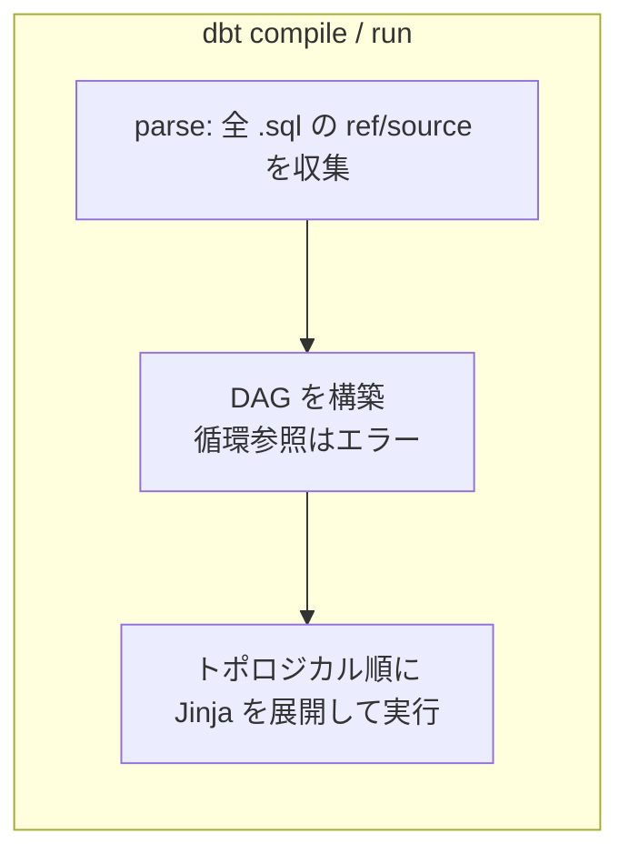

# 第3章 model・ref・source・seed

> **この章のゴール**
> - `source()` で外部データを宣言し、`ref()` でモデル同士をつなげられる
> - dbt が `ref()` / `source()` から DAG を構築する仕組みを説明できる
> - seed の使いどころと、使ってはいけない場面を判断できる
> - ノード選択構文（`--select`）で、必要な範囲だけを実行できる

## 3.1 たとえ: dbt の部品と TS / Java の対応

| dbt | TS / Java | 説明 |
|---|---|---|
| **model**（`.sql`） | **純粋関数** | 入力（他のテーブル）を受け取り、出力（SELECT 結果）を返す。副作用なし |
| **`ref('model')`** | **`import` / DI（`@Autowired`）** | 「このモデルに依存する」という宣言。実体の場所は dbt が解決する |
| **source**（`sources.yml`） | **外部 API の型宣言（`.d.ts`）／境界インタフェース** | dbt の外から来るデータの宣言 |
| **`source('shop', 'orders')`** | 外部クライアントの呼び出し | 宣言した source への参照 |
| **seed**（`.csv`） | **テストフィクスチャ / 定数ファイル** | リポジトリに置いた小さな CSV をテーブル化 |
| **DAG** | **モジュール依存グラフ**（webpack / Gradle） | `ref` / `source` から自動で作られる |

## 3.2 なぜテーブル名を直書きしてはいけないのか

第2章ではこう書きました。

```sql
select ... from raw.orders
```

これは TS でいえば、`import` を使わずにグローバル変数を参照しているのと同じです。

```ts
// ❌ 依存が暗黙。ビルドツールは順序を知らない
const total = window.__orders.reduce(...)

// ✅ 依存が明示。ビルドツールが順序と存在を保証する
import { orders } from './orders'
```

テーブル名を直書きすると、次の問題が起きます。

1. **実行順序が分からない** … dbt は依存関係を知らないので、上流より先に実行してしまうかもしれない
2. **環境を切り替えられない** … dev では `dev.stg_orders`、prod では `staging.stg_orders` を参照したいのに、名前が固定されている
3. **リネージが追えない** … 「このテーブルを変えたら、どこに影響するか」が分からない

`ref()` と `source()` はこの3つをすべて解決します。

## 3.3 source: 外部データの宣言

### ハンズオン: `sources.yml` を書く

まずディレクトリを整理します（理由は第5章で説明します）。

```bash
mkdir -p models/staging/shop
mv models/stg_shop__*.sql models/staging/shop/
```

`models/staging/shop/_shop__sources.yml` を作成します。

```yaml
sources:
  - name: shop                 # source('shop', ...) の第1引数
    description: EC サイトの業務 DB を EL ツールが raw スキーマへ同期したもの
    schema: raw                # 実際のスキーマ名
    tables:
      - name: customers        # source('shop', 'customers')
      - name: products
      - name: orders
      - name: order_items
      - name: payments
```

### モデルを書き換える

`stg_shop__orders.sql` を、CTE（`with` 句）を使った dbt の定番スタイルに書き換えます。

```sql
with source as (

    select * from {{ source('shop', 'orders') }}

),

renamed as (

    select
        id                  as order_id,
        user_id             as customer_id,
        order_date          as ordered_on,
        lower(trim(status)) as order_status,
        shipping_fee        as shipping_fee_jpy,
        created_at          as ordered_at,
        updated_at
    from source

)

select * from renamed
```

`{{ ... }}` は **Jinja** というテンプレート言語の構文です（第9章で詳しく扱います）。
`dbt compile` すると、`"my_coffee_shop"."raw"."orders"` のように実際のテーブル名へ展開されます。

```bash
dbt compile --select stg_shop__orders
cat target/compiled/my_coffee_shop/models/staging/shop/stg_shop__orders.sql
```

> 💡 **「import CTE → ロジック CTE → 最終 select」スタイル**
> dbt 界隈では、ファイル冒頭で `ref` / `source` をすべて CTE として「import」し、
> その後にロジックを積み上げ、最後に `select * from final` で終えるスタイルが推奨されています。
> TS / Java のファイル冒頭に `import` 文を並べるのと同じで、**依存がファイルの先頭で一目で分かる** ようになります。

## 3.4 ref: モデル同士をつなぐ

残りの staging モデルも作りましょう（演習 3-1）。そのうえで、2つのモデルを組み合わせるモデルを書いてみます。

`models/order_status_summary.sql`（あとで消す練習用モデル）

```sql
with orders as (

    select * from {{ ref('stg_shop__orders') }}

),

customers as (

    select * from {{ ref('stg_shop__customers') }}

)

select
    customers.prefecture,
    orders.order_status,
    count(*) as order_count
from orders
inner join customers
    on orders.customer_id = customers.customer_id
group by 1, 2
```

```bash
dbt run
```

```text
 Succeeded model dev.stg_shop__orders (view) [1 of 3 in 0.06s]
 Succeeded model dev.stg_shop__customers (view) [2 of 3 in 0.04s]
 Succeeded model dev.order_status_summary (view) [3 of 3 in 0.02s]
```

**依存先（staging）が先に、依存元（summary）が後に** 実行されます。順序はどこにも書いていません。
依存関係の無い2つの staging モデルは、`threads` の数まで **並列に** 実行されます（だから、終わる順番は実行のたびに変わることがあります）。

### ref の正体

`ref()` は、コンパイル時に次の2つを行う関数です。

1. **依存関係を DAG に登録する**（静的解析。DB には接続しない）
2. **現在の target に応じた完全修飾名に置き換える**（dev なら `"my_coffee_shop"."dev"."stg_shop__orders"`）

Spring の DI コンテナが、`@Autowired` されたフィールドに **環境に応じた実装** を注入するのとよく似ています。



> ⚠️ **循環参照は禁止**
> A が B を `ref` し、B が A を `ref` すると、dbt は `Found a cycle` エラーを出します。
> モジュール間の循環 import を禁止する ESLint の `import/no-cycle` のようなものですが、dbt では言語仕様として禁止されています。

## 3.5 seed: リポジトリに置く小さな CSV

都道府県から地方区分を引くマスタを、seed として追加します。

```bash
mkdir -p seeds
cp ../coffee_shop/seeds/prefecture_regions.csv seeds/
dbt seed
```

```sql
-- ref() で参照できる
select * from {{ ref('prefecture_regions') }}
```

### seed の使いどころ

| ✅ 向いている | ❌ 向いていない |
|---|---|
| 都道府県→地方、国コード→国名などの静的マスタ | 業務データ（注文、会員など） |
| 社内の分類ルール（勘定科目の対応表など） | 数万行を超える大きなデータ |
| テスト用の期待値 | 頻繁に更新されるデータ |
| | 個人情報を含むデータ（Git に残るため） |

基準は「**Git でバージョン管理したい、人が手でメンテする小さな表**」です。
Java でいえば `src/main/resources/` に置く定数ファイル、TS でいえば `constants.ts` に近い存在です。

## 3.6 ノード選択構文

プロジェクトが大きくなると、毎回全部を実行するのは非効率です。`--select`（`-s`）で範囲を絞ります。

| 構文 | 意味 | 例 |
|---|---|---|
| `model_name` | そのモデルだけ | `-s stg_shop__orders` |
| `+model_name` | そのモデルと **上流すべて** | `-s +order_status_summary` |
| `model_name+` | そのモデルと **下流すべて** | `-s stg_shop__orders+` |
| `+model_name+` | 上流と下流の両方 | |
| `1+model_name` | 1階層上流まで | |
| `path:models/staging` | ディレクトリ配下 | `-s path:models/staging` |
| `tag:daily` | タグが付いたもの | |
| `source:shop+` | source の下流すべて | |
| `resource_type:seed` | 種類で選ぶ | |
| `--exclude` | 除外 | `--exclude path:models/staging` |

```bash
dbt ls -s stg_shop__orders+          # 実行前に、何が選ばれるか確認できる
dbt run -s +order_status_summary
```

`dbt ls` は Gradle の `--dry-run` のようなもので、**実行せずに対象だけを表示** します。範囲指定に自信がないときは、まず `ls` で確認しましょう。

## 演習

**3-1.** `stg_shop__products`、`stg_shop__order_items`、`stg_shop__payments` を `source()` を使って作ってください。
列名の方針: 主キーは `<エンティティ>_id`、金額は `_jpy` サフィックス、日時は `_at`、日付は `_on`。
`products.roast_level` は `L / LM / M / MD / D` → `light / medium_light / medium / medium_dark / dark` に変換してください。

<details><summary>解答</summary>

完成版の [`coffee_shop/models/staging/shop/`](../coffee_shop/models/staging/shop/) を参照してください。
`roast_level` の変換は `case roast_level when 'L' then 'light' ... end` で書きます。
完成版では `lower(trim(...))` を `clean_string` マクロにしていますが、これは第9章で扱います。

</details>

**3-2.** `dbt ls -s +order_status_summary` と `dbt ls -s stg_shop__customers+` の結果を予想してから実行し、答え合わせをしてください。

<details><summary>解答</summary>

- `+order_status_summary` → `source:shop.orders`、`source:shop.customers`、`stg_shop__orders`、`stg_shop__customers`、`order_status_summary`（source は `dbt ls` の出力に `source:` 付きで表示されます）
- `stg_shop__customers+` → `stg_shop__customers`、`order_status_summary`

</details>

**3-3.** `order_status_summary` に `prefecture_regions` を `ref` で JOIN し、地方別の集計に変えてください。終わったら、このモデルは削除してかまいません（第5章で正式な marts を作ります）。

<details><summary>解答</summary>

```sql
with orders as ( select * from {{ ref('stg_shop__orders') }} ),
customers as ( select * from {{ ref('stg_shop__customers') }} ),
regions as ( select * from {{ ref('prefecture_regions') }} )

select
    regions.region,
    orders.order_status,
    count(*) as order_count
from orders
inner join customers on orders.customer_id = customers.customer_id
left join regions on customers.prefecture = regions.prefecture
group by 1, 2
```

</details>

**3-4.**（考察）`ref()` を使わず `dev.stg_shop__orders` と直書きした場合、`--target prod` で実行すると何が起きるでしょうか？

<details><summary>解答</summary>

prod 環境のモデルが、**dev スキーマのテーブルを読みにいきます**。開発者のサンドボックスのデータが本番に混入する、最悪の事故につながります。
しかも DAG に依存が登録されないため、実行順序も保証されません。

</details>

## つまずきポイント

- **`ref` の引数にファイルパスを書く** … `ref('staging/shop/stg_shop__orders')` ではなく、`ref('stg_shop__orders')` です。モデル名はプロジェクト内で一意である必要があります。
- **source の `name` と `schema` の混同** … `source('shop', ...)` の `shop` は論理名で、実際のスキーマは `schema: raw` です。`schema` を省略すると、`name` がスキーマ名として使われます。
- **seed を変更したのに反映されない** … `dbt run` では seed は読み込まれません。`dbt seed` または `dbt build` を実行してください。列の型が変わったときは `dbt seed --full-refresh` が必要です。

## まとめ

- **source** = 外部データの宣言、**ref** = モデル間の依存宣言。どちらも DAG の辺になる
- `ref()` は依存の登録と、環境に応じた名前解決を同時に行う（DI のように動く）
- seed は「Git で管理したい小さな静的マスタ」専用
- `--select` の `+` で上流・下流を選択。迷ったら `dbt ls` で確認

⬅️ 前章: [第2章](02-setup-first-model.md) ／ ➡️ 次: [補講A 分析 SQL](appendix-a-analytical-sql.md) ／ [第4章 ドメインモデリング](04-dimensional-modeling.md)
