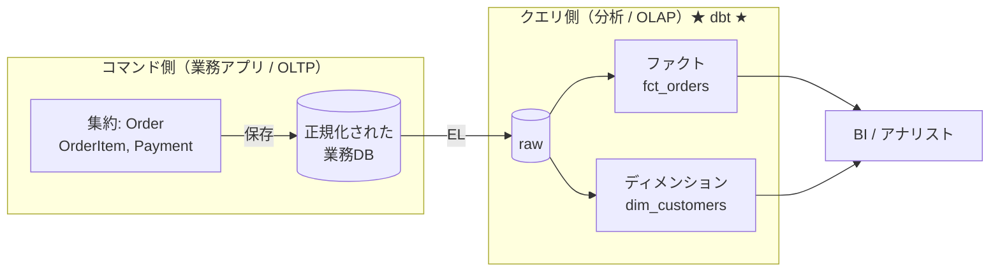
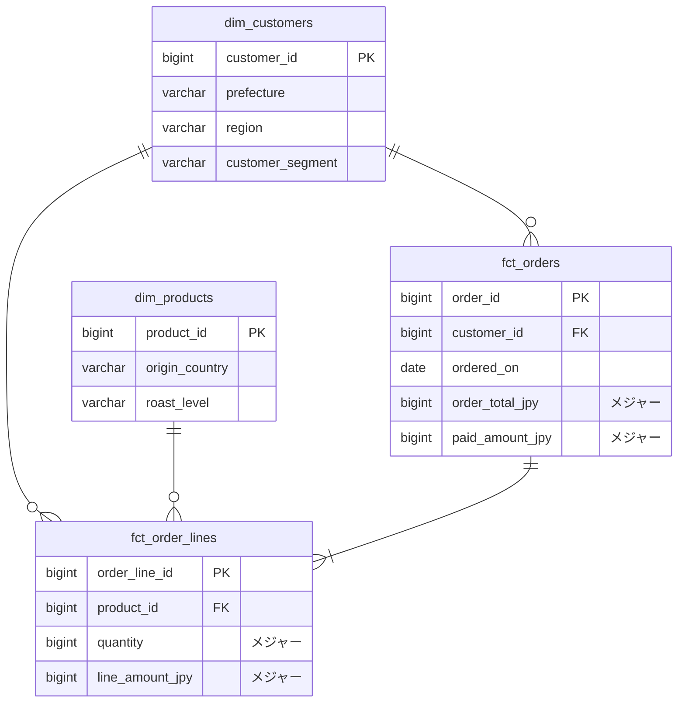

# 第4章 分析のためのドメインモデリング

> **この章のゴール**
> - 業務アプリのデータモデル（OLTP）と分析用データモデル（OLAP）の違いを説明できる
> - ディメンショナルモデリングの4ステップ（業務プロセス → 粒度 → ディメンション → ファクト）で設計できる
> - DDD の概念（ドメインイベント、エンティティ、境界づけられたコンテキスト）と対応づけられる
> - Bean Voyage の分析モデルを **コードを書く前に** 設計する

この章はコードをほとんど書きません。**設計してから実装する** ための章です。

## 4.1 たとえ: 分析モデルは CQRS の「リードモデル」

DDD / CQRS を知っているなら、次のたとえが一番の近道です。



| | 業務アプリのモデル（OLTP） | 分析モデル（OLAP） |
|---|---|---|
| 目的 | 1件ずつ **正しく書き込む** | 大量の行を **速く・分かりやすく読む** |
| 正規化 | 高い（第3正規形）。重複を排除 | 低い（非正規化）。JOINを減らす |
| 典型的なクエリ | `where id = ?` | `group by month, region` |
| 変更 | UPDATE で上書き | 追記・履歴を残す |
| 設計の単位 | 集約（整合性の境界） | 業務プロセス × 粒度 |
| CQRS でいうと | **コマンドモデル** | **リードモデル（クエリ専用の投影）** |

アプリ開発で「一覧画面が遅いので、表示専用の非正規化テーブル（リードモデル）を作る」経験があれば、それがまさにディメンショナルモデリングの発想です。

## 4.2 ファクトとディメンション

ディメンショナルモデリング（Ralph Kimball 提唱）では、テーブルを2種類に分けます。

| | ファクト（fact） | ディメンション（dimension） |
|---|---|---|
| 何を表すか | **出来事**（いつ・何が・いくら起きたか） | 出来事の **文脈**（誰が・何を・どこで） |
| 例 | 注文、決済、出荷、ページビュー | 顧客、商品、店舗、日付 |
| 列の中身 | 外部キー + **数値（メジャー）** | **説明的な属性**（名前、分類、地域） |
| 行数 | 多い・増え続ける | 比較的少ない |
| 分析での役割 | `sum()` / `count()` される | `group by` / `where` される |
| 命名 | `fct_` | `dim_` |
| **DDD でいうと** | **ドメインイベント** | **エンティティ** |



中心にファクトがあり、周りをディメンションが囲む形から、これを **スター（星形）スキーマ** と呼びます。

「地方別の月次売上」は、分析の言葉に直すとこうなります。

```sql
select dim.region, date_trunc('month', fct.ordered_on), sum(fct.order_total_jpy)
from fct_orders fct join dim_customers dim using (customer_id)
group by 1, 2
```

**ファクトの数値を、ディメンションの属性で切って集計する。** 分析のほとんどがこの形です。

## 4.3 設計の4ステップ

Kimball の設計手順は4ステップです。これはそのまま **逆算の設計** になっています。

### Step 1: 業務プロセスを選ぶ

「何を分析したいか」から逆算し、**計測したい業務プロセス（＝出来事）** を選びます。
「顧客」や「商品」のような名詞ではなく、「注文する」「決済する」「出荷する」のような **動詞** で考えるのがコツです。

> DDD のイベントストーミングで、オレンジ色の付箋（ドメインイベント）を並べる作業に近いです。

Bean Voyage の場合:

| 業務プロセス（ドメインイベント） | 分析したいこと |
|---|---|
| 注文された（OrderPlaced） | 売上、注文数、客単価 |
| 注文明細（商品が買われた） | 商品別・産地別の売れ行き |
| 決済された（PaymentSucceeded） | 決済手段の比率 |
| 会員の住所が変わった | 引っ越し前後の購買傾向（第11章） |

### Step 2: 粒度（grain）を宣言する ⭐ 最重要

**「このテーブルの1行は何を表すか」** を、日本語の1文で宣言します。

- `fct_orders`: **1行 = 1注文**
- `fct_order_lines`: **1行 = 1注文明細**
- `fct_monthly_revenue`: **1行 = 1か月 × 1地方**

粒度は、Java クラスでいえば **「このクラスの1インスタンスは何を表すか」**、つまり同一性の定義です。
ここが曖昧だと、補講Aで見た fan-out（二重計上）が必ず起きます。

> 💡 完成版のモデルファイルの冒頭には、必ず `-- 粒度(grain): 1行 = ...` とコメントを書いています。真似してください。

**原則: できるだけ細かい（アトミックな）粒度で作る。**
細かい粒度からは集計して粗い粒度を作れますが、その逆はできません。
`fct_order_lines` があれば商品別にも注文別にも集計できますが、`fct_monthly_revenue` から商品別は作れません。

### Step 3: ディメンションを決める

ファクトの各行について「誰が？ 何を？ いつ？ どこで？」に答える属性を集めます。

| 問い | ディメンション | 主な属性 |
|---|---|---|
| 誰が | `dim_customers` | 都道府県、地方、顧客セグメント、登録日 |
| 何を | `dim_products` | 産地、焙煎度、ブレンドか、現在価格 |
| いつ | （日付）※ | 年、月、曜日、祝日 |

※ 日付ディメンション（`dim_dates`）は第14章の課題で作ります。

### Step 4: ファクト（メジャー）を決める

ファクトに持たせる数値を決めます。このとき、**足し算できるかどうか** を必ず確認します。

| 種類 | 説明 | 例 | 注意 |
|---|---|---|---|
| 加算型（additive） | どの軸でも合計できる | 売上金額、数量 | 安心して `sum()` できる |
| 半加算型（semi-additive） | 一部の軸では合計できない | 在庫数、口座残高 | 日付方向に合計すると無意味 |
| 非加算型（non-additive） | 合計できない | 客単価、率、単価 | **分子と分母を別々に持ち、最後に割る** |

客単価（AOV）を月ごとに平均して年間 AOV にするのは間違いです。
年間売上 ÷ 年間注文数で計算しなければいけません。
そのため `fct_monthly_revenue` には、`average_order_value_jpy` だけでなく `revenue_jpy` と `order_count` も持たせています。

## 4.4 DDD との対応表

| DDD | ディメンショナルモデリング / dbt | Bean Voyage の例 |
|---|---|---|
| ドメインイベント | ファクト | `fct_orders`（注文された） |
| エンティティ | ディメンション | `dim_customers` |
| 値オブジェクト | ディメンションの属性（の集まり） | `prefecture` + `region`（住所） |
| ユビキタス言語 | 列名・モデル名・`description` | 「LTV」「loyal」の定義を YAML に書く |
| 境界づけられたコンテキスト | marts のサブフォルダ / group（第7章） | `marts/core`、`marts/finance` |
| 腐敗防止層（ACL） | staging レイヤー（第5章） | `user_id` → `customer_id` への翻訳 |
| 集約 | （分析側では分解される） | Order 集約 → `fct_orders` + `fct_order_lines` |
| 公開ホストサービス / 公表された言語 | public な marts + contract（第7章） | `fct_orders` の列と型を固定 |

> 📝 **「顧客」の意味はコンテキストごとに違う**
> マーケティング部門にとっての顧客は「メールを送れる人」（見込み客を含む）です。
> 経理部門にとっての顧客は「請求先」（購入者のみ）です。
> DDD でいう境界づけられたコンテキストの違いで、dbt では `marts/marketing/` と `marts/finance/` に別モデルを作って表現します。
> 全社で共有するもの（`dim_customers` など）を **conformed dimension（適合ディメンション）** と呼び、`marts/core/` に置きます。

## 4.5 スター型か、ワイドテーブル（OBT）か

現代のクラウド DWH は列指向で JOIN も速いため、ファクトにディメンションの属性を全部 JOIN した **1つの巨大な表（One Big Table, OBT）** を作る流派もあります。

| | スター型（fct + dim） | OBT（ワイドテーブル） |
|---|---|---|
| 利用者の使いやすさ | JOIN が必要 | JOIN 不要で BI に直結 |
| 一貫性 | 属性はディメンションに1か所だけ | 属性が複数の OBT に重複 |
| 変更への強さ | 強い | 弱い（作り直しが多い） |
| おすすめ | **core（土台）** に | 用途特化の **最終出力** に |

実務では「**core はスター型、BI 向けの最終出力は必要に応じて OBT**」という組み合わせが定番です。
完成版の `fct_monthly_revenue` は、集計済みの BI 向け最終出力の例です。

## 4.6 バスマトリクス: 全体設計を1枚で

「どのファクトが、どのディメンションを使うか」を表にしたものを **バスマトリクス** と呼びます。
アプリ開発でいえば、ユースケース × エンティティの CRUD 表のような設計ドキュメントです。

| ファクト ＼ ディメンション | 顧客 | 商品 | 日付 | 決済手段 |
|---|:-:|:-:|:-:|:-:|
| `fct_orders`（1行 = 1注文） | ✅ | | ✅ | ✅（列として横持ち） |
| `fct_order_lines`（1行 = 1明細） | ✅ | ✅ | ✅ | |
| `fct_monthly_revenue`（1行 = 月×地方） | ✅（地方） | | ✅（月） | |

## 4.7 ハンズオン: 設計を YAML に書き出す

コードを書く前に、設計を YAML の `description` として書き出しておきます。
**ドキュメントが先、実装が後** です。TS で、実装前に `interface` を書くのと同じ発想です。

`my_coffee_shop/models/marts/core/_core__models.yml` を作ります（SQL ファイルはまだ作りません）。

```yaml
models:
  - name: fct_orders
    description: |
      注文ファクト。粒度: 1行 = 1注文。
      キャンセルを含む全注文を持ち、is_valid_order で有効な注文を判定する。
    columns:
      - name: order_id
        description: 注文ID（主キー）
      - name: customer_id
        description: 注文した会員（dim_customers への外部キー）
      - name: order_total_jpy
        description: 注文合計 = 商品小計 + 送料（加算型メジャー）
      # ... 演習 4-2 で続きを書く

  - name: dim_customers
    description: 会員ディメンション。粒度: 1行 = 1会員（購入実績ゼロも含む）
```

このファイルは第5章で SQL を実装するときの **仕様書** になります。

## 演習

**4-1.** 次のそれぞれについて、ファクトかディメンションか、ファクトなら粒度を答えてください。
(a) 商品の在庫数を毎日記録した表　(b) Web サイトのページ閲覧ログ　(c) 店舗マスタ　(d) 顧客ごとの累計購入額

<details><summary>解答</summary>

- (a) ファクト（**定期スナップショット型**）。粒度: 1行 = 1日 × 1商品。在庫数は **半加算型**（日付方向に足してはいけない）
- (b) ファクト（**トランザクション型**）。粒度: 1行 = 1ページビュー
- (c) ディメンション
- (d) 顧客の属性として `dim_customers` に持たせるのが一般的（完成版の `lifetime_value_jpy`）。時系列で追いたいなら「1行 = 1日 × 1顧客」の定期スナップショット型ファクト

</details>

**4-2.** `fct_orders` に持たせるべき列を、[`coffee_shop/models/marts/core/_core__models.yml`](../coffee_shop/models/marts/core/_core__models.yml) を **見ずに** 列挙してください。各メジャーが加算型か非加算型かも答えてください。

<details><summary>解答例</summary>

キー: `order_id`、`customer_id`。日時: `ordered_on`、`ordered_at`。状態: `order_status`、`is_valid_order`。
加算型メジャー: `item_quantity`、`items_subtotal_jpy`、`shipping_fee_jpy`、`order_total_jpy`、決済手段別の金額、`paid_amount_jpy`。
完成版と比べて、足りないもの・余計なものを確認してください。
「送料無料かどうか」（`is_free_shipping`）などを足すのも良い設計です。

</details>

**4-3.** 経営陣が「**商品別の客単価**」を求めてきました。どのファクトを使い、どう計算しますか？ どんな注意点がありますか？

<details><summary>解答</summary>

「客単価」は注文単位の指標です。一方、商品は明細の粒度にある属性です。
1つの注文に複数商品が含まれるため、「商品Aを含む注文の平均注文額」なのか「商品Aの明細金額の平均」なのか、**定義を確認する** 必要があります。
前者なら `fct_order_lines` から商品Aを含む `order_id` を distinct で取り、`fct_orders` と JOIN して平均します。
定義が曖昧なまま実装しないこと（ユビキタス言語を決める）が、最大のポイントです。

</details>

**4-4.**（考察）業務アプリで `Order` 集約は `OrderItem` と `Payment` を内包しています。分析モデルでは、なぜこれを `fct_orders` と `fct_order_lines` に「分解」するのでしょうか？

<details><summary>解答</summary>

集約は「書き込み時の整合性の境界」なので、1つにまとまっている必要があります。
一方、分析では **粒度ごとに** テーブルを分けないと、集計時に fan-out が起きます。
注文単位の分析（客単価）と明細単位の分析（商品別売上）は粒度が違うので、別のファクトにします。
コマンドモデルとリードモデルで、最適な形は違うということです。

</details>

## つまずきポイント

- **粒度を決めずに JOIN を始める** … 最も多い失敗です。SQL を書く前に「1行 = ？」を1文で書きましょう。
- **業務 DB のテーブル構成をそのまま写す** … それはモデリングではなくコピーです。分析の問いから逆算して形を決めます。
- **非加算型メジャーだけを持つ** … 率や平均は、分子・分母と一緒に持たせます。
- **完璧な設計を目指して手が止まる** … dbt はリファクタリングしやすいツールです。まず core の fct / dim を作り、テストで守りながら育てましょう。

## まとめ

- 分析モデルは CQRS のリードモデル。書き込みではなく **読むため** に最適化する
- ファクト = ドメインイベント（数値を持つ）、ディメンション = エンティティ（属性を持つ）
- 設計の4ステップ: **業務プロセス → 粒度 → ディメンション → ファクト**。粒度が最重要
- メジャーは加算型か確認する。非加算型は分子・分母を残す
- 設計は YAML の `description` に先に書く（interface first）

⬅️ 前章: [第3章](03-models-ref-source.md) ／ ➡️ 次章: [第5章 レイヤー設計](05-layers.md)
