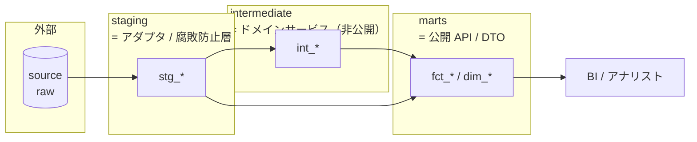

# 第5章 レイヤー設計

> **この章のゴール**
> - staging / intermediate / marts の3層の責務を説明できる
> - dbt Labs 推奨の命名規約とディレクトリ構成に従ってモデルを配置できる
> - `dbt_project.yml` でディレクトリ単位の設定（`+materialized` / `+schema`）を書ける
> - 第4章の設計に沿って、`my_coffee_shop` の marts を実装する

## 5.1 たとえ: レイヤードアーキテクチャ / ヘキサゴナル



| レイヤー | 責務 | アプリ設計でいうと | 既定の実体化 |
|---|---|---|---|
| **staging** | 1 source = 1 model。改名・型変換・表記ゆれの正規化だけ | **アダプタ / 腐敗防止層（ACL）**。外部の都合をここで吸収する | view |
| **intermediate** | staging を組み合わせて、marts の部品を作る | **ドメインサービス / package-private クラス** | ephemeral |
| **marts** | 利用者に公開する fct / dim | **公開 API・DTO**。利用者との契約 | table |

アプリのレイヤードアーキテクチャと同じく、**依存の方向は一方向** です。

- ✅ staging → intermediate → marts
- ✅ staging → marts（intermediate を飛ばすのは OK）
- ❌ marts → staging への逆流、staging 同士の ref
- ❌ marts から `source()` を直接参照（ACL を迂回することになる）

## 5.2 各レイヤーのルール

### staging: 「翻訳」だけをする

```sql
-- ✅ staging でやってよいこと
id as order_id                         -- 改名（アプリの命名 → 分析のユビキタス言語）
user_id as customer_id
cast(amount as bigint)                 -- 型変換
lower(trim(status)) as order_status    -- 表記ゆれの正規化
case roast_level when 'L' then 'light' ... end   -- コード値のデコード
price / 100.0 as price_jpy             -- 単位変換

-- ❌ staging でやらないこと
join ...        -- 他テーブルとの結合 → intermediate / marts へ
group by ...    -- 集約 → intermediate / marts へ
where status <> 'cancelled'   -- 業務的な絞り込み → 下流で（staging は「全件」が原則）
```

なぜ JOIN しないのでしょうか？
staging は「**外部データ1つを、きれいな形にした唯一の場所**」です。
ここに JOIN を入れると、同じ source を別の切り口で使いたい下流モデルが、余計な JOIN の影響を受けてしまいます。
Java でいえば、Repository に業務ロジックを書かないのと同じ理由です。

### intermediate: 再利用される部品

- 複数の marts で使う JOIN や集約の部品を置く
- 「1注文あたりの決済」のように、**粒度をそろえるための集約** を行う（補講Aの fan-out 対策）
- 利用者には見せない。完成版では `access: private`（第7章）で、他チームからの参照を禁止している

### marts: 利用者との契約

- 第4章で設計した fct / dim
- 部署・ドメインごとにサブフォルダを分ける（`core/`、`finance/`、`marketing/`）
- 列名・型を安定させる（第7章の contract で固定する）

## 5.3 命名規約

dbt Labs のスタイルガイドに沿った命名です。**ファイル名がそのままテーブル名になる** ので、命名は特に重要です。

| レイヤー | パターン | 例 |
|---|---|---|
| staging | `stg_<source>__<entity>s` | `stg_shop__orders`（アンダースコア **2つ** で source と entity を区切る） |
| intermediate | `int_<entity>s__<verb>s` | `int_payments__pivoted_to_orders`、`int_order_lines__joined_products` |
| marts（ファクト） | `fct_<event>s` | `fct_orders`、`fct_order_lines` |
| marts（ディメンション） | `dim_<entity>s` | `dim_customers` |
| YAML | `_<dir>__models.yml`、`_<source>__sources.yml` | `_shop__sources.yml` |

列の命名規約（この教材のルール）:

| 種類 | 規約 | 例 |
|---|---|---|
| 主キー | `<entity>_id` | `order_id` |
| 真偽値 | `is_` / `has_` | `is_valid_order` |
| 日時（timestamp） | `_at` | `ordered_at` |
| 日付（date） | `_on` | `ordered_on` |
| 金額 | 単位をサフィックスに | `order_total_jpy` |
| 件数 | `_count` | `lifetime_order_count` |

## 5.4 ディレクトリ構成と `dbt_project.yml`

```text
models/
├── staging/
│   └── shop/                      # source システムごとにフォルダを分ける
│       ├── _shop__sources.yml
│       ├── _shop__models.yml
│       ├── stg_shop__customers.sql
│       └── ...
├── intermediate/
│   ├── int_order_lines__joined_products.sql
│   └── int_payments__pivoted_to_orders.sql
└── marts/
    ├── core/                      # 全社共通（conformed）
    │   ├── _core__models.yml
    │   ├── fct_orders.sql  fct_order_lines.sql
    │   └── dim_customers.sql  dim_products.sql
    └── finance/                   # 経理コンテキスト
        └── fct_monthly_revenue.sql
```

ディレクトリ単位の既定設定は、`dbt_project.yml` に書きます。

```yaml
models:
  my_coffee_shop:              # ← プロジェクト名
    staging:                   # ← models/staging/ 配下すべて
      +materialized: view
      +schema: staging
    intermediate:
      +materialized: ephemeral
    marts:
      +materialized: table
      +schema: marts
```

`+` は「**このディレクトリ配下に継承される設定**」という意味です。CSS のカスケードや、Spring の `@ComponentScan` のパッケージ単位の設定に近いものです。
個別のモデルで `{{ config(materialized='incremental') }}` と書けば、上書きできます（優先順位: モデル内 `config()` > YAML の `config:` > `dbt_project.yml`）。

### `+schema` とスキーマ名

`+schema: staging` を指定すると、dbt の既定動作では `<target.schema>_staging`（例: `dev_staging`）に作られます。
「prod では `staging` という名前にしたい」といった制御は `generate_schema_name` マクロの上書きで行います。
完成版はこれを実装済みです（[`macros/generate_schema_name.sql`](../coffee_shop/macros/generate_schema_name.sql)、第9章で解説）。

## 5.5 ハンズオン: marts を実装する

`my_coffee_shop` で、第4章の設計どおりに実装します。

### 1. `dbt_project.yml` に 5.4 のレイヤー設定を追加

### 2. staging を完成させる

第3章の演習 3-1 で作った5つの staging モデルがそろっていることを確認してください。

### 3. intermediate を作る

`models/intermediate/int_order_lines__joined_products.sql`

```sql
-- 粒度(grain): 1行 = 1注文明細
with order_items as (
    select * from {{ ref('stg_shop__order_items') }}
),

products as (
    select * from {{ ref('stg_shop__products') }}
),

joined as (
    select
        order_items.order_item_id,
        order_items.order_id,
        order_items.product_id,
        products.product_name,
        products.origin_country,
        products.roast_level,
        order_items.quantity,
        order_items.unit_price_jpy,
        order_items.quantity * order_items.unit_price_jpy as line_amount_jpy
    from order_items
    left join products
        on order_items.product_id = products.product_id
)

select * from joined
```

`models/intermediate/int_payments__pivoted_to_orders.sql`（第9章でマクロを使ってリファクタリングします）

```sql
-- 粒度(grain): 1行 = 1注文（成功した決済がある注文のみ）
with payments as (
    select * from {{ ref('stg_shop__payments') }}
    where payment_status = 'success'
),

pivoted as (
    select
        order_id,
        sum(case when payment_method = 'credit_card'   then amount_jpy else 0 end)::bigint as credit_card_amount_jpy,
        sum(case when payment_method = 'konbini'       then amount_jpy else 0 end)::bigint as konbini_amount_jpy,
        sum(case when payment_method = 'bank_transfer' then amount_jpy else 0 end)::bigint as bank_transfer_amount_jpy,
        sum(case when payment_method = 'gift_card'     then amount_jpy else 0 end)::bigint as gift_card_amount_jpy,
        sum(amount_jpy)::bigint as paid_amount_jpy
    from payments
    group by order_id
)

select * from pivoted
```

> 💡 `::bigint` は DuckDB / PostgreSQL のキャスト構文です（`cast(x as bigint)` と同じ）。
> DuckDB では `bigint` の `sum()` が `hugeint`（128bit 整数）になるので、明示的に戻しています。第7章の contract で効いてきます。

### 4. marts を作る

`fct_orders`、`fct_order_lines`、`dim_products`、`dim_customers` を作ります（演習 5-1）。
ヒントとして、`fct_orders` の骨格を示します。

```sql
-- 粒度(grain): 1行 = 1注文
with orders as (
    select * from {{ ref('stg_shop__orders') }}
),

order_lines as (
    select * from {{ ref('int_order_lines__joined_products') }}
),

payments as (
    select * from {{ ref('int_payments__pivoted_to_orders') }}
),

order_line_summary as (
    -- 明細を「1行 = 1注文」に集約してから JOIN する（fan-out 対策）
    select
        order_id,
        count(*)                     as line_count,
        sum(quantity)::bigint        as item_quantity,
        sum(line_amount_jpy)::bigint as items_subtotal_jpy
    from order_lines
    group by order_id
),

final as (
    select
        orders.order_id,
        -- ... ここを埋める
    from orders
    left join order_line_summary on orders.order_id = order_line_summary.order_id
    left join payments on orders.order_id = payments.order_id
)

select * from final
```

### 5. ビルドして確認

```bash
dbt build
dbt show -s fct_orders --limit 5
```

ここで `dbt build` を使ったのは、seed（`prefecture_regions`）もまとめて処理するためです。

## 演習

**5-1.** `fct_orders`、`fct_order_lines`、`dim_products`、`dim_customers` を完成させてください。
`dim_customers` の `customer_segment` は、有効な注文数が 0 回 → `prospect`、1 回 → `new`、2〜4 回 → `repeat`、5 回以上 → `loyal` とします。

<details><summary>解答</summary>

[`coffee_shop/models/marts/core/`](../coffee_shop/models/marts/core/) を参照してください。
完成版の `fct_orders` は第10章で incremental に、`dim_customers` の「5回」は第9章で変数 `var()` にしています。
ここでは `materialized` は既定の `table` のまま、数値も直書きでかまいません。

</details>

**5-2.** 完成版の `fct_monthly_revenue`（月 × 地方の売上）を、`marts/finance/` に自分で実装してください。売上は `completed` の注文だけを対象とします。

<details><summary>解答</summary>

[`coffee_shop/models/marts/finance/fct_monthly_revenue.sql`](../coffee_shop/models/marts/finance/fct_monthly_revenue.sql) を参照してください。
`dim_customers` から `region` を引くために、`fct_orders` と `dim_customers` を JOIN します（どちらも「1行 = 1注文」「1行 = 1顧客」なので fan-out は起きません）。

</details>

**5-3.**（レビュー演習）次の staging モデルの問題点を指摘してください。

```sql
-- models/staging/shop/stg_shop__orders.sql
select o.id as order_id, c.prefecture, o.status
from {{ source('shop', 'orders') }} o
join {{ source('shop', 'customers') }} c on o.user_id = c.id
where o.status != 'cancelled'
```

<details><summary>解答</summary>

1. **staging で JOIN している** … `stg_shop__orders` は orders だけを扱うべきです。顧客情報は marts の段階で `dim_customers` と JOIN します。
2. **業務的な絞り込みをしている** … キャンセルを除外すると、「キャンセル率」の分析ができなくなります。staging は全件を保持します。
3. **表記ゆれを正規化していない** … `'CANCELLED'` や `'cancelled '` が除外されずに残ります（補講Aの NULL の罠と同じく、意図しない漏れになります）。
4. **改名が不十分** … `status` → `order_status`、`user_id` → `customer_id` などのユビキタス言語化をしていません。

</details>

## つまずきポイント

- **`Compilation Error: dbt found two models with the name ...`** … 練習で作った `order_status_summary` などを消し忘れていませんか？ モデル名はプロジェクト内で一意です。
- **ephemeral モデルを `dbt show -s` できない** … ephemeral は実体が無いため、`dbt show` で直接は確認しにくいことがあります。開発中は一時的に `view` にするか、下流モデルで確認してください。
- **marts で source を直接参照してしまう** … 動きはしますが、腐敗防止層を迂回しています。必ず staging を経由しましょう。

## まとめ

- **staging**（翻訳）→ **intermediate**（部品）→ **marts**（公開 API）。依存は一方向
- staging は「1 source = 1 model」。JOIN・集約・業務的な絞り込みはしない
- 命名規約: `stg_<source>__<entity>s` / `int_<entity>s__<verb>s` / `fct_` / `dim_`
- `dbt_project.yml` の `+設定` で、ディレクトリ単位の既定値を決める

⬅️ 前章: [第4章](04-dimensional-modeling.md) ／ ➡️ 次章: [第6章 テスト](06-testing.md)
