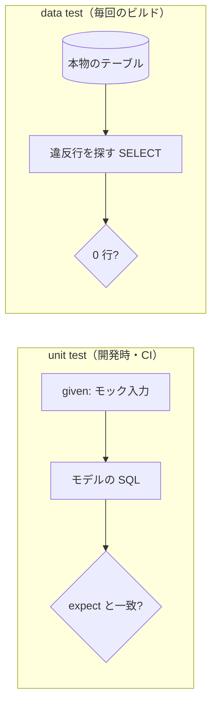
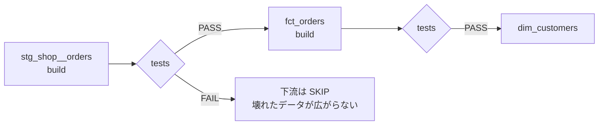
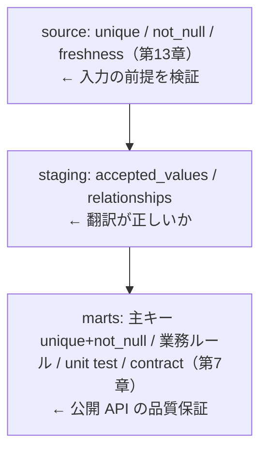

# 第6章 テスト

> **この章のゴール**
> - **data test**（データの不変条件）と **unit test**（ロジックの仕様）の違いを説明できる
> - 組み込みの generic test、自作の generic test、singular test を書き分けられる
> - unit test で、境界値を含むビジネスルールを固定できる
> - `severity` や `store_failures` などのテスト設定を使いこなせる

## 6.1 たとえ: 2種類のテスト

| | data test | unit test |
|---|---|---|
| 何を検証するか | **実データ** が不変条件を満たすか | **SQL ロジック** が仕様どおりか |
| 入力 | 本物のテーブル（全行） | モックデータ（`given`） |
| いつ壊れるか | 上流のデータがおかしくなったとき | 自分がロジックを壊したとき |
| アプリ開発でいうと | DB 制約 / Bean Validation / 本番の監視アラート | **JUnit / Jest のテストケース** |
| 例 | 「`order_id` が一意」「金額が正」 | 「注文 5 回以上なら `loyal`」 |



アプリ開発に置き換えると、unit test は「**コードが正しいか**」、data test は「**入力データが前提どおりか**」を確かめます。
データ基盤では **入力（上流のデータ）が自分のコントロール外で勝手に変わる** ので、data test がアプリ開発より重要になります。

## 6.2 data test の正体: 「違反行を返す SELECT」

dbt のデータテストは、すべて **「違反している行を返す SELECT 文」** です。

- 0 行 → ✅ PASS
- 1 行以上 → ❌ FAIL（または ⚠️ WARN）

たとえば `unique` テストは、コンパイルするとこうなります。

```sql
select order_id as unique_field, count(*) as n_records
from "coffee_shop"."dev_marts"."fct_orders"
where order_id is not null
group by order_id
having count(*) > 1
```

JUnit の `assertTrue(x > 0)` を、**全行に対して一括で** 実行しているイメージです。

## 6.3 組み込みの generic test（4種）

YAML で、列に宣言的に付けます。

```yaml
models:
  - name: fct_orders
    columns:
      - name: order_id
        data_tests:
          - unique          # 重複なし（主キーの必須テスト）
          - not_null        # NULL なし
      - name: order_status
        data_tests:
          - accepted_values:          # 列挙値のどれか
              arguments:
                values: ["placed", "shipped", "completed", "returned", "cancelled"]
      - name: customer_id
        data_tests:
          - relationships:            # 外部キー制約（参照整合性）
              arguments:
                to: ref('dim_customers')
                field: customer_id
```

| テスト | 検証内容 | Java / TS でいうと |
|---|---|---|
| `unique` | 値が一意 | `Set` に重複なし / `@Id` |
| `not_null` | NULL が無い | `@NotNull` / `strictNullChecks` |
| `accepted_values` | 決められた値のどれか | `enum` / ユニオン型 `'placed' \| 'shipped'` |
| `relationships` | 参照先に存在する | 外部キー / `@ManyToOne` |

> 📝 **`arguments:` について**
> dbt 1.10 以降、テストの引数は `arguments:` の下に書くのが正式な書き方になりました。
> 古い記事では `accepted_values: { values: [...] }` と直接書いていますが、それは非推奨です。
> また 1.8 以降は、unit test と区別するため `tests:` ではなく `data_tests:` と書きます。

> 💡 **主キーには必ず `unique` + `not_null`**
> この2つは、第4章の「粒度」を機械的に保証するテストです。
> fan-out が起きると `unique` が真っ先に失敗するので、**粒度のテスト** と言い換えてもよいくらいです。

## 6.4 自作の generic test

組み込みに無い検証は、自分で generic test を書けます。`tests/generic/` に置きます。

```sql
-- tests/generic/positive_value.sql


select {{ column_name }}
from {{ model }}
where {{ column_name }} <= 0


```

```yaml
      - name: order_total_jpy
        data_tests:
          - positive_value      # 自作テストも同じように使える
```

`model` と `column_name` は dbt が自動で渡す引数です。それ以外の引数も定義できます（完成版の [`unique_combination`](../coffee_shop/tests/generic/unique_combination.sql) を参照）。
Java でいえば、独自の Bean Validation アノテーション（`@Positive` 相当）を作るのと同じです。

> 💡 実務では、**dbt_utils** や **dbt-expectations** パッケージ（第9章）に便利な generic test が多数あります。
> 例: `dbt_utils.unique_combination_of_columns`、`dbt_utils.expression_is_true`、`dbt_expectations.expect_column_values_to_be_between`

## 6.5 singular test: そのプロジェクト固有のルール

1つのファイルが1つのテストになる、使い捨てのアサーションです。`tests/` に SQL を置くだけです。

```sql
-- tests/singular/assert_valid_orders_are_fully_paid.sql
-- 「有効な注文は、注文合計と同額が決済されている」
select order_id, order_total_jpy, paid_amount_jpy
from {{ ref('fct_orders') }}
where is_valid_order
  and order_total_jpy <> paid_amount_jpy
```

複数テーブルにまたがる業務ルールや、再利用しない検証に使います。

## 6.6 テストの設定

```yaml
      - name: order_total_jpy
        data_tests:
          - positive_value:
              config:
                severity: warn                      # 失敗しても WARN 扱い（ビルドを止めない）
                where: "order_status <> 'cancelled'" # 対象行を絞る
          - not_null:
              config:
                warn_if: ">0"           # 1行でも違反があれば WARN
                error_if: ">100"        # 100行を超えたら ERROR
                store_failures: true    # 違反行をテーブルに保存（調査用）
```

| 設定 | 用途 |
|---|---|
| `severity: warn` | 「気づきたいが止めたくない」検証。ログ監視の WARN レベル |
| `warn_if` / `error_if` | 違反行数のしきい値。「数件の欠損は許容」などの現実的な運用に |
| `where` | 一部の行だけを検証する |
| `store_failures: true` | 違反行を `<schema>_dbt_test__audit` スキーマに保存。失敗時の調査が楽になる |

## 6.7 `dbt build` とテストの関係

`dbt build` は、**モデルを作った直後に、そのモデルのテストを実行** します。
テストが ERROR になると、**下流のモデルはスキップ** されます。



CI のパイプラインで、ユニットテストが落ちたらデプロイしないのと同じ発想です。
**壊れたデータを下流（BI ダッシュボード）に流さない** のが最大の価値です。

## 6.8 unit test: ロジックの仕様を固定する

dbt 1.8 で導入された unit test は、**モックの入力に対して期待する出力を宣言** します。
JUnit の Arrange-Act-Assert、Jest の `expect(...).toEqual(...)` そのものです。

```yaml
unit_tests:
  - name: test_dim_customers_segment_classification
    description: 注文回数に応じてセグメント分けされる。キャンセルは数えない
    model: dim_customers                # テスト対象（Act）
    given:                              # Arrange: 入力をモック
      - input: ref('stg_shop__customers')
        rows:
          - { customer_id: 1, prefecture: "東京都" }
          - { customer_id: 3, prefecture: "大阪府" }
      - input: ref('prefecture_regions')
        rows:
          - { prefecture: "東京都", region: "関東" }
          - { prefecture: "大阪府", region: "近畿" }
      - input: ref('fct_orders')
        rows:
          - { order_id: 20, customer_id: 3, is_valid_order: true,  order_total_jpy: 1000 }
          - { order_id: 21, customer_id: 3, is_valid_order: true,  order_total_jpy: 1500 }
          - { order_id: 22, customer_id: 3, is_valid_order: false, order_total_jpy: 9999 }
    expect:                             # Assert
      rows:
        - { customer_id: 1, region: "関東", lifetime_order_count: 0, customer_segment: "prospect" }
        - { customer_id: 3, region: "近畿", lifetime_order_count: 2, customer_segment: "repeat" }
```

ポイント:

- **必要な列だけ書けばよい**。書かなかった列は NULL として扱われます（Mockito の部分モックに近い）
- `expect` も、検証したい列だけ書けばよいです
- 完成版の全文は [`_core__models.yml`](../coffee_shop/models/marts/core/_core__models.yml) にあり、境界値（4回 → `repeat`、5回 → `loyal`）も検証しています

### 入力のフォーマット

| `format` | 書き方 | 使いどころ |
|---|---|---|
| `dict`（既定） | YAML のリスト | 普通はこれ |
| `csv` | CSV 文字列、またはファイル（`fixture:`） | 行が多いとき |
| `sql` | SELECT 文 | **ephemeral モデルを入力にするとき（必須）**、型を細かく指定したいとき |

### incremental モデルや変数のテスト

```yaml
    overrides:
      macros:
        is_incremental: false      # 「初回ビルド」として検証（true にすると差分ビルドを検証）
      vars:
        loyal_customer_min_orders: 3
```

Spring の `@TestPropertySource` や、Jest の `jest.mock()` で環境を差し替えるのと同じです。

### 何を unit test すべきか

すべてのモデルに unit test を書く必要はありません。次のような **ロジックが複雑な箇所** に絞りましょう。

- `case when` による分類（セグメント、ステータス判定）
- 境界値があるロジック（「5回以上」「5,000円以上で送料無料」）
- 正規表現、日付計算、ウィンドウ関数
- 過去にバグが出た箇所（回帰テスト）

```bash
dbt test --select "test_type:unit"     # unit test だけ実行
dbt test --select "test_type:data"     # data test だけ実行
dbt build --exclude-resource-type unit_test   # 本番では unit test を省略する
```

> ⚠️ **unit test は「上流のテーブルが DB に存在していること」が必要**
> dbt は、モック入力の列の型を知るために、本物の上流テーブルの定義を参照します。
> まっさらな環境で unit test だけを実行すると `Not able to get columns for unit test ... because the relation doesn't exist` になります。
> CI では、先に **`dbt run --empty`**（データを0行にして構造だけを作る）を実行するのが定番です。

## 6.9 テスト戦略: どこに何を書くか



- **すべてのモデルの主キー** に `unique` + `not_null`（最低限のルール）
- **source** にもテストを付ける。上流の異変に、いちばん早く気づける
- **marts** は手厚く。利用者との契約だから
- **unit test** は複雑なロジックにだけ書く

## 6.10 ハンズオン

1. `my_coffee_shop` の staging と marts の YAML に、主キーの `unique` + `not_null`、`order_status` の `accepted_values`、`customer_id` の `relationships` を追加し、`dbt build` を実行する
2. `tests/generic/positive_value.sql` を作り、金額と数量の列に適用する
3. **わざと壊す**: `fct_orders` の `order_line_summary` CTE の `group by order_id` を消して、明細と直接 JOIN するように書き換える。`dbt build` すると `unique_fct_orders_order_id` が失敗し、下流が SKIP されることを確認する。確認したら元に戻す
4. `dim_customers` の unit test を書いて実行する（`dbt test -s test_type:unit`）

## 演習

**6-1.** `stg_shop__payments` の `payment_method` に `accepted_values` テストを付けてください。値は `credit_card`、`konbini`、`bank_transfer`、`gift_card` です。

<details><summary>解答</summary>

```yaml
      - name: payment_method
        data_tests:
          - accepted_values:
              arguments:
                values: ["credit_card", "konbini", "bank_transfer", "gift_card"]
```

完成版では第9章のマクロを使い、`values: "{{ payment_methods() }}"` としてリストを一元管理しています。

</details>

**6-2.** 「送料は、商品小計が 5,000 円以上なら 0 円、未満なら 550 円」という業務ルールを検証する singular test を書いてください。

<details><summary>解答</summary>

```sql
-- tests/singular/assert_shipping_fee_rule.sql
select order_id, items_subtotal_jpy, shipping_fee_jpy
from {{ ref('fct_orders') }}
where (items_subtotal_jpy >= 5000 and shipping_fee_jpy <> 0)
   or (items_subtotal_jpy <  5000 and shipping_fee_jpy <> 550)
```

day1 のデータでは PASS します。
もし将来、送料が改定されたら（例: 600円）このテストが落ちて、改定に気づけます。
「仕様の変化に気づくためのテスト」も data test の大事な役割です。

</details>

**6-3.** `fct_orders` に unit test を追加してください。検証内容は「決済が無い注文は `paid_amount_jpy` が 0 になる」です。

<details><summary>解答</summary>

完成版の `test_fct_orders_totals_and_payment_pivot` を参照してください。
ポイントは2つあります。ephemeral な intermediate モデルを入力にするので `format: sql` を使うこと、incremental を初回ビルドとして検証するために `overrides.macros.is_incremental: false` を指定することです。

</details>

**6-4.**（考察）`relationships` テストで、`fct_orders.customer_id` → `dim_customers.customer_id` を検証しています。これは DB の外部キー制約と何が違いますか？

<details><summary>解答</summary>

DB の外部キー制約は **書き込み時に** 違反を拒否します。dbt の `relationships` テストは **ビルド後に** 違反を検出します。
多くのクラウド DWH は外部キー制約を強制しない（宣言だけで、チェックはしない）ので、dbt のテストで検証するのが現実的です。
アプリで例えるなら、「書き込み時の DB 制約」ではなく「夜間バッチの整合性チェック」に近いものです。

</details>

## つまずきポイント

- **`accepted_values` が NULL を通してしまう** … `accepted_values` は NULL を検証しません。NULL も禁止したいときは `not_null` と併用します。
- **テストが遅い** … 巨大なテーブルの `unique` はコストが高くつきます。`where` で直近だけに絞る、`severity: warn` にして頻度を下げる、などで調整します。
- **unit test の `expect` で行の順序を気にする** … 順序は比較されません（集合として比較されます）。
- **unit test が `relation doesn't exist` で失敗** … 6.8 節の注意を参照してください。`dbt run --empty` を先に実行します。

## まとめ

- data test = 「違反行を返す SELECT」。**データ** の不変条件を全行に対して検証する
- unit test = given / expect による **ロジック** の仕様テスト。複雑な分類や境界値に使う
- 主キーには必ず `unique` + `not_null`（＝粒度のテスト）
- `dbt build` はテストが落ちると下流をスキップし、壊れたデータの伝播を防ぐ

⬅️ 前章: [第5章](05-layers.md) ／ ➡️ 次章: [第7章 contract・access・version](07-contracts-access.md)
