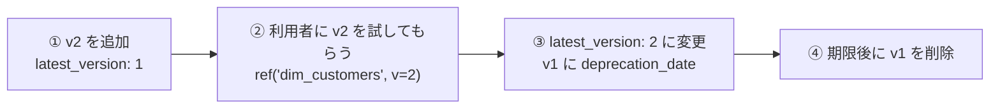

# 第7章 contract・access・version

> **この章のゴール**
> - model contract でモデルに「型」を与え、意図しない変更をビルド時に防げる
> - group と access（public / protected / private）でモデルの可視性を制御できる
> - model version で、破壊的変更を段階的に公開できる
>
> この章は「**データモデルを API として扱う**」ための機能群です。アプリエンジニアがいちばん得意な領域です。

## 7.1 たとえ: モデルを「公開 API」として設計する

| dbt | TS / Java | 守るもの |
|---|---|---|
| **contract**（`contract.enforced: true`） | `interface` / 戻り値の型宣言 | 列名・型・列数 |
| **constraints** | DB 制約 / `@NotNull` | NOT NULL・主キーなど |
| **group** | パッケージ / モジュールの所有チーム | 所有者 |
| **access**（`public` / `protected` / `private`） | `public` / package-private / `private` | 誰が `ref` できるか |
| **version**（`v: 1`, `v: 2`） | `/api/v1`, `/api/v2` / `@Deprecated` | 破壊的変更の段階的移行 |

marts は BI ツールや他チームが使う **公開 API** です。
API の戻り値の型が予告なく変わったら利用者は困ります。データモデルも同じです。

## 7.2 model contract: 列に型を付ける

### 何が起きるか

contract を付けたモデルは、**ビルド時に列名・型・列数が YAML の宣言と一致するか** をチェックされます。
一致しなければ、テーブルを作る **前に** エラーで止まります。

```yaml
models:
  - name: dim_customers
    config:
      contract:
        enforced: true
    columns:
      - name: customer_id
        data_type: bigint
        constraints:
          - type: not_null
      - name: customer_name
        data_type: varchar
      - name: registered_at
        data_type: timestamp
      # ... すべての列に data_type が必要
```

### 体験: contract を破ってみる

`dim_customers.sql` の `registered_at` を `date` 型にキャストしてみます。

```sql
customers.created_at::date as registered_at,
```

```text
$ dbt run -s dim_customers
  This model has an enforced contract that failed.
  Please ensure the name, data_type, and number of columns in your contract match the columns in your model's definition.

  | column_name   | definition_type | contract_type | mismatch_reason    |
  | ------------- | --------------- | ------------- | ------------------ |
  | registered_at | DATE            | TIMESTAMP     | data type mismatch |
```

TS で `interface` に合わない値を返したときのコンパイルエラーと、まったく同じ体験です。
**「うっかり型を変えてダッシュボードを壊す」事故を、ビルドの時点で防げます。**

### contract と data test の違い

| | contract | data test |
|---|---|---|
| 検証のタイミング | テーブルを作る **前**（スキーマのみ） | テーブルを作った **後**（データの中身） |
| 検証対象 | 列名・型・列数 | 値（一意性、範囲、参照整合性） |
| たとえ | **コンパイル時の型チェック** | **実行時のアサーション** |

両方を組み合わせて使います。

### constraints について

`constraints` に書いた `not_null` や `primary_key` は、DB の DDL（`create table ... (customer_id bigint not null)`）として出力されます。
ただし、**DB によっては宣言されるだけで強制されない** ことに注意してください。
たとえば Snowflake や BigQuery の主キー制約は強制されません。値の検証は data test に任せ、constraints は「DB に意図を伝えるメタデータ」と考えるのが安全です。

### 型の罠: DuckDB の `sum()` は `hugeint`

完成版で `sum(...)::bigint` とキャストしているのは、contract のためです。
DuckDB では `bigint` 列の `sum()` が `hugeint`（128bit 整数）を返すので、キャストしないと contract の `bigint` と一致しません。
contract を付けると、こうした **DB ごとの暗黙の型変換** に気づけるのも利点です。

## 7.3 group と access: 可視性の制御

### group = 所有チーム

```yaml
# models/_groups.yml
groups:
  - name: commerce
    owner:
      name: Commerce Analytics Team
      email: commerce-analytics@example.com
  - name: finance
    owner:
      name: Finance Analytics Team
      email: finance-analytics@example.com
```

### access = 誰が ref できるか

| access | 誰が `ref` できるか | Java でいうと |
|---|---|---|
| `private` | **同じ group** のモデルだけ | `private` / package-private |
| `protected`（既定） | **同じプロジェクト** のモデル | `protected` |
| `public` | **他のプロジェクト** からも（dbt Mesh、第14章） | `public` |

完成版の設定（`dbt_project.yml`）:

```yaml
models:
  coffee_shop:
    +group: commerce
    staging:
      +access: protected
    intermediate:
      +access: private      # commerce チームの内部実装
    marts:
      +access: public       # 公開 API
```

`fct_monthly_revenue` だけは YAML で `group: finance` に上書きしています。

### 体験: private を参照してみる

finance グループのモデルから、commerce の private モデルを `ref` すると:

```sql
-- models/marts/finance/bad_ref.sql
{{ config(group='finance') }}
select * from {{ ref('int_payments__pivoted_to_orders') }}
```

```text
$ dbt parse
Parsing Error
  Node model.coffee_shop.bad_ref attempted to reference node model.coffee_shop.int_payments__pivoted_to_orders,
  which is not allowed because the referenced node is private to the 'commerce' group.
```

DB に接続する前の **パース時点** でエラーになります。Java で `private` メソッドを呼ぶとコンパイルエラーになるのと同じです。
大規模なプロジェクトでは、「他チームの内部実装に依存してしまい、変更できなくなる」問題を防げます。

## 7.4 model version: 破壊的変更の段階的移行

### シナリオ

個人情報保護の方針で、`dim_customers` から `email` 列を削除することになりました。
しかし、マーケティングチームのダッシュボードがまだ `email` を使っています。

REST API なら `/v2` を新設し、`/v1` に非推奨の期限を付けて移行してもらうでしょう。dbt でも同じことができます。

```yaml
models:
  - name: dim_customers
    latest_version: 1              # ref('dim_customers') が指すバージョン
    config:
      contract:
        enforced: true
    columns:
      # ... v1 の全列定義
    versions:
      - v: 1
        defined_in: dim_customers  # 既存の dim_customers.sql を v1 として扱う
        deprecation_date: 2027-03-31
      - v: 2                       # dim_customers_v2.sql
        columns:
          - include: all
            exclude: [email]       # v1 から email を除いたもの
```

- `dim_customers_v2.sql` を作る（v1 から `email` 列を除いた SQL）
- DB には `dim_customers_v1` と `dim_customers_v2` の **2つのテーブル** が作られる
- `ref('dim_customers')` → `latest_version`（v1）を指す
- `ref('dim_customers', v=2)` → v2 を明示的に指す
- v1 を参照しているモデルは、ビルド時に **非推奨の警告** が出る

```text
[WARNING]: While compiling 'fct_monthly_revenue': Found a reference to dim_customers.v1,
which is slated for deprecation on '2027-03-31T00:00:00+00:00'.
```

### 移行の流れ



Java の `@Deprecated(since = "...", forRemoval = true)` を付けて、次のメジャーバージョンで消すのと同じ流れです。

> 📝 **version は「重い」道具**
> すべての変更にバージョンを切る必要はありません。**列の追加** は破壊的変更ではないので、そのまま変更できます。
> 列の削除・改名・型変更のように、**利用者が多い public モデルの破壊的変更** にだけ使いましょう。

## 7.5 ハンズオン

1. `my_coffee_shop` の `fct_orders` と `dim_customers` に contract を付ける（全列に `data_type` を書く）
   - ヒント: `dbt show -s fct_orders --limit 1` では型が分かりません。`dbt run` して contract エラーの表を見ると、実際の型（`definition_type`）が分かります
2. `models/_groups.yml` を作り、`dbt_project.yml` に `+group` / `+access` を設定する
3. finance グループのモデルから private モデルを ref して、パースエラーになることを確認する

## 演習

**7-1.** contract を付けた `fct_orders` に、新しい列 `is_free_shipping`（送料無料なら true）を追加してください。何をすればビルドが通りますか？

<details><summary>解答</summary>

SQL に `orders.shipping_fee_jpy = 0 as is_free_shipping` を追加し、**YAML にも** `- name: is_free_shipping` と `data_type: boolean` を追加します。
SQL だけを変更すると、contract エラー（列数の不一致）になります。
「実装を変えたら interface も変える」ことを強制されるわけです。

`fct_orders` は incremental モデル（第10章）なので、既存テーブルに列を足すには `on_schema_change: append_new_columns` の設定が必要です（完成版では設定済み）。

</details>

**7-2.** `stg_shop__orders` に `access: private` を設定すると、何が起きるでしょうか？ 予想してから試してください。

<details><summary>解答</summary>

`stg_shop__orders` が `commerce` グループに属している限り、同じグループの `fct_orders` などからは引き続き参照できます。
もし `fct_monthly_revenue`（finance グループ）が直接参照していたら、パースエラーになります。
完成版の `fct_monthly_revenue` は public な `fct_orders` を経由しているので、影響を受けません。

</details>

**7-3.**（考察）contract を **すべて** のモデルに付けるべきでしょうか？

<details><summary>解答例</summary>

付ける価値が高いのは、**利用者が多い public モデル**（marts）です。
staging や intermediate は内部実装なので、頻繁に変わります。そこに contract を付けると変更のたびに YAML の更新が必要になり、コストに見合いません。
アプリ開発でも、公開 API には厳密な型と互換性ポリシーを設けますが、内部のヘルパー関数にはそこまでしないのと同じです。

</details>

## つまずきポイント

- **contract を付けたら全列に `data_type` が必要** … 1列でも欠けるとパースエラーになります。
- **型名の表記ゆれ** … `int` / `integer` / `bigint`、`text` / `varchar` など、DB ごとに別名があります。エラーの表に出る `definition_type` に合わせるのが確実です。
- **ephemeral モデルには contract を付けられない** … 実体が無いので、型を検証できません。
- **version を切ったらテーブル名が変わった** … `dim_customers_v1` / `dim_customers_v2` になります。BI ツールが `dim_customers` を直接参照していた場合は、`alias` 設定でテーブル名を維持するなどの対策が必要です。

## まとめ

- **contract** = モデルの interface。列名・型・列数をビルド前に検証する（コンパイル時の型チェック）
- **access** = 可視性。private / protected / public で、内部実装への依存を防ぐ
- **version** = API バージョニング。破壊的変更を、非推奨期間を設けて段階的に公開する
- 道具の重さに応じて使い分ける。public な marts には手厚く、内部モデルは軽く

⬅️ 前章: [第6章](06-testing.md) ／ ➡️ 次章: [第8章 ドキュメントとリネージ](08-docs-lineage.md)
