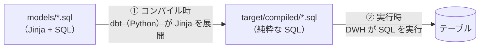

# 第9章 Jinja・マクロ・パッケージ

> **この章のゴール**
> - 「コンパイル時（Jinja）」と「実行時（SQL）」の2段階を区別して説明できる
> - Jinja の基本構文（式・制御構文・フィルタ）と、dbt が提供するコンテキスト変数を使える
> - マクロで SQL の重複を取り除き、`var()` で設定値を外に出せる
> - パッケージ（dbt_utils など）を導入・利用できる

## 9.1 たとえ: Jinja は「SQL を生成するテンプレートエンジン」

| dbt | TS / Java |
|---|---|
| Jinja | テンプレートリテラル / EJS / Thymeleaf / JSP |
| マクロ（``） | ユーティリティ関数（ただし **文字列としての SQL を返す**） |
| コンパイル（`dbt compile`） | テンプレートのレンダリング / Lombok などのアノテーションプロセッサ |
| `var('x')` | `@Value("${x}")` / `process.env.X` の設定値 |
| パッケージ（`dbt deps`） | npm / Maven の依存ライブラリ |

最重要ポイントは **2段階で動く** ことです。



TS のテンプレートリテラルで SQL 文字列を組み立てるコードを思い浮かべてください。

```ts
const methods = ['credit_card', 'konbini']
const sql = `select ${methods.map(m => `sum(case when method='${m}' then amount end) as ${m}`).join(', ')} from payments`
```

`methods.map` が動くのは **SQL を組み立てる時点** です。DB が SQL を実行する時点では、もう「完成した文字列」になっています。
Jinja もまったく同じで、**Jinja のループや if は、データを1行も見ていません。**

## 9.2 Jinja の基本構文

| 構文 | 意味 | 例 |
|---|---|---|
| `{{ ... }}` | 式を評価して **出力** する | `{{ ref('fct_orders') }}`、`{{ 1 + 1 }}` |
| `` | 制御構文（出力しない） | ``、``、`` |
| `{# ... #}` | Jinja のコメント（コンパイル後に残らない） | `{# TODO #}` |
| `-`（``） | 前後の空白・改行を削除する | `` |
| `\|`（フィルタ） | 値を変換する | `{{ cols \| join(', ') }}`、`{{ name \| upper }}` |

```sql


select
    order_id,
    
    sum(case when payment_method = '{{ method }}' then amount_jpy else 0 end) as {{ method }}_amount_jpy,
    
    sum(amount_jpy) as paid_amount_jpy
from {{ ref('stg_shop__payments') }}
group by order_id
```

`loop.index`（1始まりの番号）、`loop.first`、`loop.last` も使えます。
「最後の要素の後にだけカンマを付けない」ときは `,` と書きます。

### dbt が提供するコンテキスト変数・関数

| 名前 | 中身 | 使いどころ |
|---|---|---|
| `ref()` / `source()` | 依存の宣言と名前解決 | 第3章 |
| `this` | このモデル自身のテーブル名 | incremental（第10章） |
| `target.name` / `target.schema` | 実行中の target（dev / prod） | 環境ごとの分岐 |
| `var('name', default)` | プロジェクト変数 | 閾値などの設定値 |
| `env_var('NAME', default)` | 環境変数 | 接続情報、CI の設定（第13章） |
| `is_incremental()` | 差分ビルド中か | 第10章 |
| `config(...)` | モデルの設定 | `{{ config(materialized='table') }}` |
| `run_started_at` | 実行開始時刻 | 監査列 |
| `execute` | 実行フェーズか（パース中は False） | `run_query` を使うとき（9.5節） |

## 9.3 マクロ: SQL を返す関数

### 定義と呼び出し

```sql
-- macros/clean_string.sql

    lower(trim({{ column_name }}))

```

```sql
-- models/staging/shop/stg_shop__orders.sql
{{ clean_string('status') }} as order_status,
-- ↓ コンパイル後
lower(trim(status)) as order_status,
```

TS で書くとこうなります。**値ではなく SQL の断片（文字列）を返す** 関数だと理解してください。

```ts
const cleanString = (columnName: string) => `lower(trim(${columnName}))`
```

### リストを返すマクロ: `return()`

```sql
-- macros/payment_methods.sql

    {{ return(['credit_card', 'konbini', 'bank_transfer', 'gift_card']) }}

```

`return()` を使うと、文字列ではなく **Python の値（リストや辞書）** を返せます。
完成版では、このマクロを次の3か所で使っています。

- `int_payments__pivoted_to_orders`（pivot の列生成）
- `fct_orders`（決済手段ごとの列）
- `_shop__models.yml` の `accepted_values`（`values: "{{ payment_methods() }}"`）

決済手段を追加するときは、**このマクロ1か所を直すだけ** で済みます。Java の `enum PaymentMethod` に相当します。

### 引数の既定値と環境による分岐

```sql
-- macros/limit_in_dev.sql

    
        limit {{ n }}
    

```

```sql
select * from {{ ref('fct_orders') }} {{ limit_in_dev(100) }}
-- dev では limit 100 が付き、prod では何も付かない
```

### 組み込みマクロの上書き: `generate_schema_name`

dbt の多くの挙動は、**組み込みマクロとして実装されています**。同名のマクロを定義すると、挙動を上書きできます（Java の `@Override`）。

完成版の [`macros/generate_schema_name.sql`](../coffee_shop/macros/generate_schema_name.sql):

```sql

    
    
        {{ default_schema }}
    
        {{ custom_schema_name | trim }}                    {# prod: staging, marts #}
    
        {{ default_schema }}_{{ custom_schema_name | trim }} {# dev: dev_staging, dev_marts #}
    

```

| target | `+schema: marts` の作成先 |
|---|---|
| dev（既定の挙動と同じ） | `dev_marts` |
| prod（上書き後） | `marts` |

本番のスキーマ名はきれいに保ち、開発者は自分のサンドボックス（`dev_*`）で安全に作業できるようにする、定番の上書きです。
チーム開発では `schema: dev_<名前>` のように開発者ごとに target.schema を変えると、互いの作業が衝突しません。

## 9.4 `var()`: 設定値を外に出す

```yaml
# dbt_project.yml
vars:
  free_shipping_threshold_jpy: 5000
  loyal_customer_min_orders: 5
```

```sql
when customer_orders.lifetime_order_count >= {{ var('loyal_customer_min_orders') }} then 'loyal'
```

コマンドラインから上書きできます。Spring の `--spring.config.xxx=...` や、`NODE_ENV=... npm run` と同じ使い方です。

```bash
dbt run -s dim_customers --vars '{loyal_customer_min_orders: 3}'
```

> 💡 **マジックナンバーを `var()` にするかの判断**
> 「ビジネス側の判断で変わりうる値」（閾値、期間、対象日）は `var()` にする価値があります。
> 「仕様として固定された値」まで外に出すと、かえって読みにくくなります。

## 9.5 `run_query`: DB に問い合わせてから SQL を生成する

コンパイル時に DB へクエリを投げ、その結果を使って SQL を生成することもできます。

```sql
-- macros/get_payment_methods_from_db.sql

    
        select distinct lower(trim(payment_method)) from {{ source('shop', 'payments') }} order by 1
    

    
        
        {{ return(results.columns[0].values()) }}
    
        {{ return([]) }}
    

```

`execute` が必要な理由: dbt は最初に全ファイルを **パース**（依存関係の収集）します。このときは DB に接続しないので、`run_query` は使えません。
`execute` は、パース中は `False`、実行フェーズでは `True` になります。

> ⚠️ **便利だが乱用しない**
> 決済手段が DB に追加されると、列が勝手に増えます。これは contract（第7章）と相性が悪く、利用者にとっても予測しにくい挙動です。
> 完成版では、あえて `payment_methods()` に **固定のリスト** を持たせ、未知の値は `accepted_values` テストで検出する設計にしています。
> 「動的生成」より「明示的なリスト + テスト」を優先しましょう。

## 9.6 クロス DB マクロ

DWH ごとの SQL 方言の差は、dbt 組み込みのクロス DB マクロで吸収できます。

```sql
{{ dbt.date_trunc('month', 'ordered_on') }}                   -- 月初に切り捨て
{{ dbt.datediff('first_ordered_on', 'last_ordered_on', 'day') }}   -- 日数差
{{ dbt.safe_cast('amount', api.Column.translate_type('integer')) }}
{{ dbt.concat(['first_name', "' '", 'last_name']) }}
```

アダプタごとに実装が切り替わる仕組みは `adapter.dispatch` です。Java のインタフェースと、DB ごとの実装クラス（Strategy パターン）の関係にあたります。
**複数の DWH で動くパッケージを作る** ときに重要になります。

## 9.7 パッケージ: 他人のマクロ・モデルを使う

### インストール

```yaml
# packages.yml（プロジェクト直下）
packages:
  - package: dbt-labs/dbt_utils
    version: [">=1.3.0", "<2.0.0"]     # npm の semver 範囲指定と同じ考え方
  - package: dbt-labs/codegen
    version: [">=0.13.0", "<1.0.0"]
```

```bash
dbt deps     # dbt_packages/ にダウンロードされ、package-lock.yml が生成される
```

| npm / Maven | dbt |
|---|---|
| `package.json` の dependencies | `packages.yml` |
| `package-lock.json` | `package-lock.yml` |
| `npm install` | `dbt deps` |
| `node_modules/` | `dbt_packages/`（Git 管理しない） |
| npmjs.com | [hub.getdbt.com](https://hub.getdbt.com) |

### 定番パッケージ

| パッケージ | 主な機能 |
|---|---|
| **dbt_utils** | `generate_surrogate_key`（複合キーのハッシュ）、`date_spine`（連続した日付の生成）、`pivot`、`star`（列の一括選択）、`union_relations`、テスト（`unique_combination_of_columns`、`expression_is_true` など） |
| **dbt_expectations** | Great Expectations 風の豊富なデータテスト（値の範囲、正規表現、行数の変化など） |
| **codegen** | `generate_source`、`generate_base_model`、`generate_model_yaml` で、**staging モデルや YAML の雛形を自動生成** |
| **dbt_project_evaluator** | プロジェクト構成のアンチパターン検出（第8章） |

```bash
# codegen で staging の雛形を生成する例
dbt run-operation generate_base_model --args '{source_name: shop, table_name: orders}'
```

> 📝 **この教材の完成版はパッケージを使っていません**
> オフライン環境でも動くように、`dbt_utils` 相当の機能を自前のマクロで実装しています（[`surrogate_key`](../coffee_shop/macros/surrogate_key.sql)、[`unique_combination`](../coffee_shop/tests/generic/unique_combination.sql)）。
> 実務では、迷わず `dbt_utils` を使ってください。自分の手元でネットワークが使えるなら、`packages.yml` を作って `dbt deps` を試してみましょう。

## 9.8 フック: モデルの前後で SQL を実行する

```yaml
models:
  coffee_shop:
    marts:
      +post-hook: "grant select on {{ this }} to role bi_reader"   # テーブル作成後に権限付与

on-run-end:
  - "{{ log('ビルド完了: ' ~ results | length ~ ' ノード', info=True) }}"
```

| フック | タイミング | たとえ |
|---|---|---|
| `pre-hook` / `post-hook` | 各モデルの前後 | AOP の `@Before` / `@After` |
| `on-run-start` / `on-run-end` | `dbt run` 全体の前後 | JUnit の `@BeforeAll` / `@AfterAll` |

## 9.9 ハンズオン

1. `macros/clean_string.sql` を作り、staging の `lower(trim(...))` をすべて置き換える
2. `macros/payment_methods.sql` を作り、`int_payments__pivoted_to_orders` を `for` ループでリファクタリングする
3. `dbt compile -s int_payments__pivoted_to_orders` で、コンパイル後の SQL がリファクタリング前と同等か確認する
4. `dim_customers` の「5回」を `var('loyal_customer_min_orders')` にし、`--vars` で 3 に変えて結果がどう変わるか `dbt show` で確認する
5. `generate_schema_name` を上書きし、`dbt run --target prod` で `marts` スキーマに作られることを確認する（`profiles.yml` に prod target の追加が必要）

## 演習

**9-1.** 次のマクロを書いてください: `yen_to_tax_excluded(column, rate=0.08)` … 税込金額の列から、税抜金額（円未満切り捨て）を計算する SQL を返す。

<details><summary>解答</summary>

```sql

    floor({{ column }} / (1 + {{ rate }}))::bigint

```

`{{ yen_to_tax_excluded('order_total_jpy') }}` → `floor(order_total_jpy / (1 + 0.08))::bigint`。
軽減税率の8%を既定値にして、10%の商品には `rate=0.10` を渡せるようにしています。

</details>

**9-2.** 次の Jinja をコンパイルすると、どんな SQL になるでしょうか？ 実行せずに予想してから、`dbt compile --inline "..."` で確認してください。

```sql
select  {{ c }},   from t
```

<details><summary>解答</summary>

`select a, b, c from t`（空白制御 `-` によって余計な改行・空白が削られます）

</details>

**9-3.**（考察）次のマクロの問題点を指摘してください。

```sql

     true  false 

```

<details><summary>解答</summary>

`order_total_jpy` は **DB の列** であり、コンパイル時の Jinja からは見えません（未定義の変数になります）。
Jinja の `if` は「SQL を生成する時点」で評価されるので、行ごとに分岐させたいなら **SQL の `case when`** を生成する必要があります。

```sql

    ({{ column }} > {{ threshold }})

```

これは「コンパイル時」と「実行時」の混同で、アプリエンジニアがいちばん陥りやすい罠です。

</details>

## つまずきポイント

- **Jinja でデータの値を参照しようとする** … 演習 9-3 のとおりです。Jinja が扱えるのは SQL の **文字列** だけです。
- **抽象化しすぎて読めない** … マクロだらけの SQL は、レビューもデバッグも困難です。dbt 界隈では「**DRY より可読性**」が合言葉です。同じ処理が3回出てきてから、マクロ化を検討しましょう。
- **コンパイル結果を見ずに悩む** … 困ったら、まず `dbt compile` して `target/compiled/` を読みましょう。生成された SQL を見れば、たいていの問題はすぐに分かります。
- **`{{ }}` と `` の取り違え** … `` は何も出力しません。出力したいものは `{{ }}` で書きます。

## まとめ

- Jinja は **コンパイル時** に SQL 文字列を生成する。データは見えない
- マクロは「SQL の断片を返す関数」。`return()` でリストなどの値も返せる
- 組み込みマクロ（`generate_schema_name` など）は上書きできる
- `var()` で設定値を外に出し、パッケージ（dbt_utils、codegen）で車輪の再発明を避ける
- 抽象化は控えめに。迷ったら `dbt compile` で生成結果を確認する

⬅️ 前章: [第8章](08-docs-lineage.md) ／ ➡️ 次章: [第10章 マテリアライゼーションと incremental](10-materializations.md)
