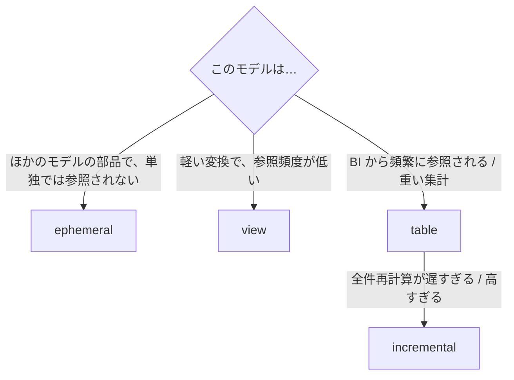
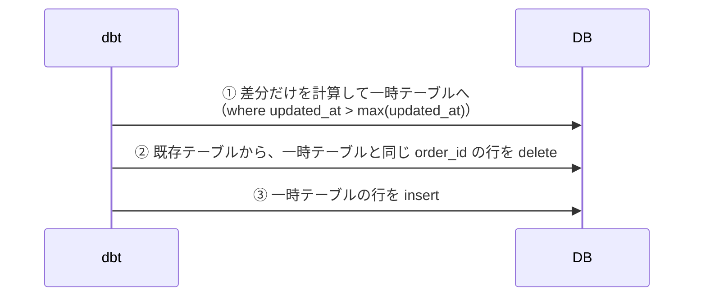

# 第10章 マテリアライゼーションと incremental

> **この章のゴール**
> - view / table / ephemeral / incremental の違いと使い分けを説明できる
> - incremental モデルの仕組み（`is_incremental()`、`unique_key`、戦略）を理解し、実装できる
> - day2 のデータで差分ビルドを体験し、`--full-refresh` との違いを確かめる
> - 遅れて届くデータ・削除・スキーマ変更といった incremental の落とし穴を知る

## 10.1 たとえ: 「いつ計算するか」の選択

マテリアライゼーション（materialization）とは、**モデルの SELECT 文を、DB 上にどういう形で実体化するか** の設定です。
SQL は1文字も変えずに、設定だけで切り替えられます（第2章の演習 2-2）。

| materialization | 実体 | プログラミングでいうと | 計算するタイミング |
|---|---|---|---|
| **view** | ビュー | **getter / 遅延評価**（`get total() { return ... }`） | 参照されるたび |
| **table** | テーブル | **キャッシュ / メモ化**（結果を保存して使い回す） | ビルドのたびに全件 |
| **ephemeral** | なし（CTE として埋め込まれる） | **インライン展開**（コンパイラの関数インライン化） | 参照元のモデルの一部として |
| **incremental** | テーブル（差分で更新） | **差分ビルド**（Gradle のインクリメンタルコンパイル、webpack のキャッシュ） | 変更された行だけ |
| materialized_view | マテリアライズドビュー（DB 依存） | 自動更新されるキャッシュ | DB が管理 |



## 10.2 それぞれの特徴

| | view | table | ephemeral | incremental |
|---|---|---|---|---|
| ビルド時間 | ほぼ 0 | 全件計算 | 0（実体なし） | 差分だけ |
| 参照時の速さ | 遅い（毎回計算） | 速い | — | 速い |
| データの新しさ | 常に最新 | 最後のビルド時点 | — | 最後のビルド時点 |
| ストレージ | 使わない | 使う | 使わない | 使う |
| 複雑さ | 低 | 低 | 低 | **高** |
| 完成版での用途 | staging | marts | intermediate | `fct_orders` |

### 推奨の出発点

dbt Labs のおすすめは「**まず view、遅ければ table、それでも遅ければ incremental**」です。
最初から incremental にするのは、時期尚早な最適化です。アプリ開発でも、最初からキャッシュを入れたりしないのと同じです。

### ephemeral の正体

```bash
dbt compile -s fct_orders
cat target/compiled/coffee_shop/models/marts/core/fct_orders.sql
```

```sql
with  __dbt__cte__int_order_lines__joined_products as (
-- intermediate モデルの中身がそのまま埋め込まれる
...
), orders as (
```

ephemeral モデルは、参照元の SQL に **CTE としてインライン展開** されます。
DB にオブジェクトが増えないので見通しがよくなる一方、多くのモデルから参照されると同じ計算が何度も行われます。

## 10.3 incremental の仕組み

### 基本形

完成版の [`fct_orders.sql`](../coffee_shop/models/marts/core/fct_orders.sql) です。

```sql
{{
    config(
        materialized='incremental',
        unique_key='order_id',
        incremental_strategy='delete+insert',
        on_schema_change='append_new_columns'
    )
}}

with orders as (

    select * from {{ ref('stg_shop__orders') }}

    
        -- 前回ビルド以降に更新された注文だけを対象にする
        where updated_at > (
            select coalesce(max(this_model.updated_at), '1900-01-01')
            from {{ this }} as this_model
        )
    

),
...
```

### `is_incremental()` が true になる条件

次の **すべて** を満たすときだけ true になります。

1. モデルが `materialized='incremental'` である
2. DB にこのモデルのテーブルが **すでに存在する**
3. `--full-refresh` フラグが付いて **いない**

つまり、初回は普通の table と同じく全件を作り、2回目以降は `where` 句が加わって差分だけを処理します。
`{{ this }}` は「このモデル自身の既存テーブル」を指します。

### 2回目以降の動き（delete+insert）



`unique_key` を指定しているので、**ステータスが更新された注文は、古い行が新しい行に置き換わります**（upsert）。
`unique_key` を指定しないと、ただ追記されて重複が生じます。

### incremental 戦略

| 戦略 | 動き | 向いているケース |
|---|---|---|
| `append` | 追記のみ | ログのように **更新が起きない** データ |
| `delete+insert` | キーが一致する行を削除して挿入 | 更新があるデータ（完成版で採用） |
| `merge` | `MERGE` 文で upsert | 更新があるデータ（対応 DB で一般的） |
| `insert_overwrite` | パーティション単位で置き換え | BigQuery / Spark などのパーティション表 |
| `microbatch` | 時間で区切ったバッチ単位で処理（dbt 1.9+） | 巨大な時系列データ、過去分の再処理 |

使える戦略はアダプタによって違います。DuckDB アダプタ（このバージョン）では `append`、`delete+insert`、`merge`、`microbatch` が使えます。

### `on_schema_change`: 列を追加したとき

| 値 | 列が増減したときの挙動 |
|---|---|
| `ignore`（既定） | 新しい列は **無視される**（既存テーブルの列のまま） |
| `fail` | エラーで止まる |
| `append_new_columns` | 新しい列を追加する（既存行は NULL） |
| `sync_all_columns` | 追加・削除の両方を反映する |

既定の `ignore` は、**列を追加したのにテーブルに反映されない** という分かりにくい事故の元です。明示的に設定しましょう。

## 10.4 ハンズオン: day2 で差分ビルドを体験する

`my_coffee_shop` の `fct_orders` を incremental に変更してから進めます（10.3 節のコードを参考に）。
完成版 `coffee_shop` で試しても構いません。

### Step 1: day1 の状態を確認

```bash
dbt build                    # 初回は全件ビルド
dbt show --inline "
  select count(*) as orders,
         count(*) filter (where order_status in ('placed', 'shipped')) as open_orders,
         max(updated_at) as last_updated
  from {{ ref('fct_orders') }}"
```

```text
| orders | open_orders | last_updated        |
| 1342   | 38          | 2025-12-30 23:47:00 |
```

### Step 2: day2 のデータをロード

day2 は、day1 の2週間後の状態です。

- day1 時点で未完了（placed / shipped）だった **38件の注文が completed に** なった
- 2026年1月の **新規注文が67件** 増えた

```bash
# study-dbt/ で
python scripts/load_raw.py --day day2 --db my_coffee_shop/my_coffee_shop.duckdb
```

### Step 3: 差分ビルド

```bash
dbt run -s fct_orders --debug 2>&1 | grep -A3 "updated_at >"   # 差分条件が付いていることを確認
dbt run -s fct_orders
```

```text
| orders | open_orders | last_updated        |
| 1409   | 22          | 2026-01-14 04:50:51 |
```

- 注文数: 1,342 → 1,409（新規 67件が **追加**）
- 未完了: 38 → 22（day1 の 38件が completed に **更新** され、day2 の新規注文のうち22件が未完了）

処理されたのは「更新された38件 + 新規67件」だけです。数百万件規模のテーブルでは、これが数十秒と数時間の差になります。

### Step 4: full-refresh と結果を比べる

incremental の正しさは、「**差分で作った結果 == 全件で作り直した結果**」で検証できます。

```bash
# 差分ビルドの結果を退避
python -c "import duckdb; c=duckdb.connect('my_coffee_shop.duckdb'); c.execute('create or replace table main.fct_orders_incr as select * from dev_marts.fct_orders')"
dbt run -s fct_orders --full-refresh     # 全件作り直し
python -c "
import duckdb; c=duckdb.connect('my_coffee_shop.duckdb')
print(c.sql('(select * from main.fct_orders_incr except select * from dev_marts.fct_orders) union all (select * from dev_marts.fct_orders except select * from main.fct_orders_incr)').fetchall())"
# [] なら一致
```

> 💡 スキーマ名（`dev_marts`）は、`generate_schema_name` の設定によって変わります。自分の環境に合わせてください。

## 10.5 incremental の落とし穴

### ① 遅れて届くデータ（late-arriving data）

EL ツールの遅延などで、`updated_at` が「前回の最大値」より **古い** 行が後から届くことがあります。単純な `>` 比較では、その行を取りこぼします。

```sql

    -- ✅ 3日分さかのぼって再処理する（ルックバックウィンドウ）
    where updated_at > (select max(updated_at) - interval 3 day from {{ this }})

```

`unique_key` があるので、重複して処理しても置き換わるだけです（**冪等性**）。
「少し多めに再処理しても結果が変わらない」設計にするのが、incremental の鉄則です。

### ② 削除は検知できない

業務 DB で行が **物理削除** されても、差分の `where` 句には引っかかりません。incremental テーブルには残り続けます。

- 対策1: 業務 DB 側で論理削除（`deleted_at`）にしてもらう
- 対策2: 定期的に `--full-refresh` する（週1回など）
- 対策3: snapshot の `hard_deletes` 設定で削除を検知する（第11章）

### ③ 上流ロジックの変更

`int_order_lines__joined_products` の計算式を変えても、incremental の `fct_orders` では **過去の行は再計算されません**。
ロジックを変えたら `--full-refresh` が必要です。Gradle で、ビルドスクリプトを変えたらクリーンビルドするのと同じです。

### ④ ネストした依存

`dim_customers` は `fct_orders` から集計しています。`fct_orders` が incremental でも、`dim_customers`（table）は毎回全件を再計算します。
これは正しい動きです。incremental にするのは、**本当に重いモデルだけ** にしましょう。

## 10.6 microbatch（参考）

dbt 1.9 で追加された `microbatch` 戦略では、`is_incremental()` の `where` 句を自分で書く必要がありません。

```sql
{{ config(
    materialized='incremental',
    incremental_strategy='microbatch',
    event_time='ordered_at',      -- 時間で区切る列
    batch_size='day',             -- 1日単位で処理
    begin='2025-01-01',
    lookback=3                    -- 直近3バッチを再処理（遅延データ対策）
) }}
select * from {{ ref('stg_shop__orders') }}
```

```bash
dbt run -s fct_orders --event-time-start 2025-06-01 --event-time-end 2025-07-01   # 過去の期間だけ再処理
```

日付ごとに独立したバッチとして処理されるので、失敗したバッチだけを再実行したり、過去の特定期間だけを作り直したり（バックフィル）できます。
上流のモデルにも `event_time` を設定すると、上流側も自動で期間が絞り込まれます。

## 演習

**10-1.** 次のモデルに最適な materialization を選んでください。
(a) `stg_shop__customers`（300行、変換は改名のみ）　(b) 1日1億行増えるアクセスログのファクト　(c) BI が毎朝参照する `dim_customers`　(d) 2つの marts からだけ参照される、JOIN の部品

<details><summary>解答</summary>

- (a) **view**。軽く、参照される頻度も低い
- (b) **incremental**（ログで更新が無いなら `append`、遅延データがあるなら `microbatch` + `lookback`）
- (c) **table**。全件再計算でも十分速い。incremental にする必要はない
- (d) **ephemeral**（2か所からの参照なら計算の重複は許容範囲）、または重いなら **table**

</details>

**10-2.** 10.5 節 ① のルックバックウィンドウを `fct_orders` に実装し、日数を `var('incremental_lookback_days', 3)` で変えられるようにしてください。

<details><summary>解答</summary>

```sql

    where updated_at > (
        select max(this_model.updated_at) - interval {{ var('incremental_lookback_days', 3) }} day
        from {{ this }} as this_model
    )

```

</details>

**10-3.** `fct_orders` の unit test に、`is_incremental: true` のケースを追加してください。既存テーブル（`this`）に古い状態の行があり、入力に更新後の行がある場合に、更新後の値が出力されることを確認します。

<details><summary>解答</summary>

```yaml
  - name: test_fct_orders_incremental_picks_up_updates
    model: fct_orders
    overrides:
      macros:
        is_incremental: true
    given:
      - input: ref('stg_shop__orders')
        rows:
          - { order_id: 1, order_status: "shipped",   updated_at: "2025-12-30 10:00:00" }  # 古い（対象外）
          - { order_id: 2, order_status: "completed", updated_at: "2026-01-05 10:00:00" }  # 新しい（対象）
      - input: this                       # 既存テーブルの状態
        rows:
          - { order_id: 1, updated_at: "2025-12-31 00:00:00" }
      - input: ref('int_order_lines__joined_products')
        format: sql
        rows: select 1 as order_id, 1 as quantity, 1000 as line_amount_jpy
      - input: ref('int_payments__pivoted_to_orders')
        format: sql
        rows: |
          select 1 as order_id, 1000 as credit_card_amount_jpy, 0 as konbini_amount_jpy,
                 0 as bank_transfer_amount_jpy, 0 as gift_card_amount_jpy, 1000 as paid_amount_jpy
    expect:
      rows:
        - { order_id: 2, order_status: "completed" }   # 差分として出力されるのは order_id 2 だけ
```

注意点が2つあります。

- unit test の `expect` は「このビルドで **新たに出力される行**（差分）」です。テーブル全体ではありません。
- `format: sql` の入力では、dict 形式と違って省略した列が NULL で補われません。**モデルが参照する列をすべて** SELECT に書く必要があります（ここでは決済手段ごとの列）。

</details>

## つまずきポイント

- **incremental にしたのに毎回全件処理される** … `is_incremental()` の `where` 句を書き忘れていませんか？ `config` だけでは差分になりません。
- **列を追加したのに反映されない** … `on_schema_change` が既定の `ignore` になっていませんか？ または `--full-refresh` を実行してください。
- **`unique_key` を付けずに重複** … 更新があるデータでは `unique_key` が必須です。主キーの `unique` テストで検知できます。
- **dev で incremental の挙動を確かめにくい** … dev のテーブルを消す（または `--full-refresh`）と初回ビルドに戻ります。両方のパスを試しましょう。

## まとめ

- materialization は「いつ計算するか」の選択。view（遅延）→ table（キャッシュ）→ incremental（差分）の順に検討する
- incremental = 初回は全件、2回目以降は `is_incremental()` の `where` で差分だけを処理し、`unique_key` で upsert する
- 正しさの基準は「差分の結果 == 全件の結果」。遅延データにはルックバック、削除やロジック変更には full-refresh で対処する
- 巨大な時系列データには microbatch も検討する

⬅️ 前章: [第9章](09-jinja-macros.md) ／ ➡️ 次章: [第11章 スナップショット](11-snapshots.md)
