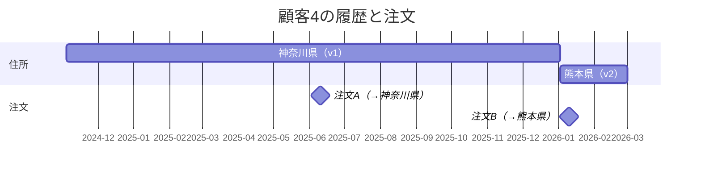

# 第11章 スナップショット

> **この章のゴール**
> - 「上書きされて消える履歴」の問題と、SCD（Slowly Changing Dimension）の型を説明できる
> - snapshot を YAML で定義し、timestamp 戦略と check 戦略を使い分けられる
> - 履歴テーブルとの **ポイントインタイム結合** で「注文した時点の住所」を取得できる

## 11.1 たとえ: 行ごとの Git 履歴 / イベントソーシング

業務アプリの DB は、たいてい **最新の状態だけ** を持っています。

```sql
-- 顧客 4 が神奈川県から熊本県へ引っ越した
update customers set prefecture = '熊本県', updated_at = now() where id = 4;
-- → 「神奈川県に住んでいた」という事実は DB から消える
```

アプリとしてはこれで正しいのですが、分析では困ります。
「この顧客が **神奈川県に住んでいた頃の注文** は、関東の売上に入れたい」といった要望に応えられません。

| 仕組み | 考え方 |
|---|---|
| **Git** | ファイルの全バージョンをコミットとして残す |
| **イベントソーシング** | 状態ではなく「変化のイベント」を記録し、任意の時点の状態を再現する |
| **Hibernate Envers / テンポラルテーブル** | エンティティの変更履歴を自動で別テーブルに残す |
| **dbt snapshot** | **定期的に source を見に行き、変化した行の旧バージョンに有効期間を付けて残す** |

dbt snapshot は、Hibernate Envers の「後付け版」です。アプリのコードを変えずに、DWH 側だけで履歴を作れます。

## 11.2 SCD（Slowly Changing Dimension）の型

ディメンションの属性が変化したとき、どう扱うかには定番の型があります。

| 型 | 扱い | 例 | dbt では |
|---|---|---|---|
| Type 0 | 変更しない（初期値を保持） | 初回登録時の都道府県 | — |
| **Type 1** | **上書き**（履歴なし） | 誤字の修正 | 普通の table / view |
| **Type 2** | **行を追加して履歴を残す**（有効期間を持つ） | 引っ越し、価格改定 | **snapshot** |
| Type 3 | 「前の値」列を追加（1世代だけ） | `previous_prefecture` | 自前で実装 |

dbt snapshot は **Type 2** を実装する仕組みです。

## 11.3 snapshot の定義（dbt 1.9 以降の YAML 形式）

完成版の [`snapshots/snapshots.yml`](../coffee_shop/snapshots/snapshots.yml) です。

```yaml
snapshots:
  - name: snap_customers
    description: 会員の履歴（引っ越しによる都道府県の変化を追える）
    relation: source('shop', 'customers')   # 何の履歴を取るか
    config:
      unique_key: id
      strategy: timestamp        # updated_at が進んだら「変化あり」
      updated_at: updated_at

  - name: snap_products
    description: 商品の価格・販売状況の履歴
    relation: source('shop', 'products')
    config:
      unique_key: id
      strategy: check            # 指定列の値が変わったら「変化あり」
      check_cols: ["price", "is_active"]
```

> 📝 dbt 1.8 以前は、`snapshots/*.sql` に `` ブロックで書く形式でした。古い記事ではこちらをよく見かけます。

### 2つの戦略

| 戦略 | 変化の判定 | `dbt_valid_from` に入る時刻 | 向いているケース |
|---|---|---|---|
| `timestamp` | `updated_at` 列が前回より新しい | **業務上の更新日時**（`updated_at` の値） | 信頼できる更新日時の列がある |
| `check` | `check_cols` の値が前回と違う | **snapshot を実行した時刻** | 更新日時の列が無い・信頼できない |

**可能なら timestamp 戦略を選びましょう。** 業務上の時刻で履歴を記録できるからです。
check 戦略は「dbt が変化に **気づいた** 時刻」しか分かりません。snapshot の実行間隔が1日なら、最大1日のずれが生じます。

### 追加される列

snapshot テーブルには、元の列に加えて次の列が追加されます。

| 列 | 意味 |
|---|---|
| `dbt_valid_from` | このバージョンが有効になった時刻 |
| `dbt_valid_to` | このバージョンが無効になった時刻（**現行バージョンは NULL**） |
| `dbt_scd_id` | バージョンごとの一意なID |
| `dbt_updated_at` | 変化の判定に使った時刻 |

```text
 id | prefecture | dbt_valid_from      | dbt_valid_to
----+------------+---------------------+---------------------
  4 | 神奈川県   | 2024-11-04 08:04:20 | 2026-01-02 18:00:00   ← 旧バージョン
  4 | 熊本県     | 2026-01-02 18:00:00 | NULL                  ← 現行バージョン
```

### その他の設定（dbt 1.9+）

| 設定 | 用途 |
|---|---|
| `hard_deletes: invalidate` | source から **削除された行** の `dbt_valid_to` を埋める（既定は `ignore` で、削除を無視） |
| `hard_deletes: new_record` | 削除を「削除されたことを示す新しい行」として記録する |
| `dbt_valid_to_current: "'9999-12-31'"` | 現行バージョンの `dbt_valid_to` を NULL ではなく遠い未来の日付にする（範囲 JOIN が書きやすくなる） |
| `snapshot_meta_column_names` | `dbt_valid_from` などの列名を変更する |

## 11.4 snapshot の鉄則

### ① source に対して取る

snapshot は **staging ではなく、source（raw）に対して** 取るのが原則です。
staging のロジック（改名・変換）は後から変わる可能性がありますが、snapshot は **作り直せません**。
変換前の生データの履歴を残しておけば、変換ロジックは後からいくらでも適用し直せます。

### ② 作り直せない ⚠️

snapshot は、**実行した時点の状態しか記録できません**。テーブルを消すと、履歴は二度と戻りません。

- 本番の snapshot テーブルは、**バックアップ対象のデータ** として扱う
- `dbt build --full-refresh` を実行しても、snapshot は作り直されない（意図的な仕様）
- 開発環境で試すときは、target を分けて本番の snapshot に触れないようにする

アプリ開発でいえば、**イベントストアのイベントは削除しない** のと同じ原則です。

### ③ 定期的に実行する

snapshot を実行していない間に2回変化すると、中間の状態は記録されません。
変化の頻度に合わせて、`dbt snapshot`（または `dbt build`）を定期実行します（第13章）。

## 11.5 ハンズオン: 引っ越しと値上げを記録する

day1 → snapshot → day2 → snapshot の順で実行する必要があります。
第10章で day2 をロード済みの場合は、いったんリセットしてから始めてください。

```bash
# study-dbt/ で（my_coffee_shop の場合は PROJECT=my_coffee_shop を付ける）
make reset
make load-day1
make build          # 初回の snapshot も取られる（全行が「現行バージョン」として記録）

make load-day2      # 12人の顧客が引っ越し、3産地の商品が10%値上げ
make snapshot       # 変化を検知して履歴を追加
```

### 履歴を確認する

```bash
cd coffee_shop
dbt show --inline "
  select id, prefecture, dbt_valid_from, dbt_valid_to
  from {{ ref('snap_customers') }}
  where id in (select id from {{ ref('snap_customers') }} group by id having count(*) > 1)
  order by id, dbt_valid_from" --limit 6
```

`snap_customers` は 312 行になります（300人 + 引っ越した12人の旧バージョン）。

```bash
dbt show --inline "
  select id, name, price, dbt_valid_from, dbt_valid_to
  from {{ ref('snap_products') }} where id = 1 order by dbt_valid_from"
```

check 戦略の `snap_products` では、`dbt_valid_from` が **snapshot を実行した時刻** になっていることを確認してください（業務上の値上げ日 2026-01-05 ではありません）。

## 11.6 ポイントインタイム結合: 「注文した時点の住所」

snapshot の真価は、**ファクトの発生時刻と、ディメンションの有効期間を突き合わせる** ことにあります。

```sql
with orders as (
    select * from {{ ref('fct_orders') }}
),

customer_history as (
    select * from {{ ref('snap_customers') }}
)

select
    orders.order_id,
    orders.ordered_at,
    customer_history.prefecture as prefecture_at_order    -- 注文時点の住所
from orders
inner join customer_history
    on  orders.customer_id = customer_history.id
    and orders.ordered_at >= customer_history.dbt_valid_from
    and orders.ordered_at <  coalesce(customer_history.dbt_valid_to, timestamp '9999-12-31')
```



JOIN の条件は「**同じ顧客** かつ **注文時刻がバージョンの有効期間内**」です。
有効期間は重ならないように作られているので、各注文に対応するバージョンは必ず1つです（fan-out しません）。

day2 のデータでは、引っ越した12人の注文 81件のうち **78件が引っ越し前の住所** で注文されていました。
`dim_customers`（現在の住所）で集計すると、この78件は誤った地方に計上されます。

## 演習

**11-1.** 11.6 節の SQL を使って、`fct_orders` に `prefecture_at_order` と `region_at_order` を追加したモデル `fct_orders_with_address_history` を作ってください。地方は `prefecture_regions` から引きます。

<details><summary>解答</summary>

```sql
-- models/marts/core/fct_orders_with_address_history.sql
-- 粒度(grain): 1行 = 1注文
with orders as ( select * from {{ ref('fct_orders') }} ),
customer_history as ( select * from {{ ref('snap_customers') }} ),
regions as ( select * from {{ ref('prefecture_regions') }} )

select
    orders.*,
    trim(customer_history.prefecture) as prefecture_at_order,
    regions.region                    as region_at_order
from orders
left join customer_history
    on  orders.customer_id = customer_history.id
    and orders.ordered_at >= customer_history.dbt_valid_from
    and orders.ordered_at <  coalesce(customer_history.dbt_valid_to, timestamp '9999-12-31')
left join regions
    on trim(customer_history.prefecture) = regions.prefecture
```

主キー `order_id` に `unique` テストを付けて、fan-out していないことを確認しましょう。
snapshot は raw の値なので、staging と同じ `trim()` をここでも適用しています。

</details>

**11-2.** 「値上げ前後で売れ行きが変わったか」を分析したいと考えました。`snap_products` だけで十分でしょうか？

<details><summary>解答</summary>

商品の価格 **履歴** は `snap_products` で分かります。
ただし check 戦略なので、有効期間は「snapshot を実行した時刻」基準です。業務上の値上げ日時とずれる可能性があります。
実は `order_items.unit_price` に **注文時点の単価** が記録されているので、売れ行きの分析はファクト側の単価で十分です。
「ファクトに当時の値を持たせる」のも、履歴を扱う有力な方法です。snapshot が常に必要なわけではありません。

</details>

**11-3.** `snap_customers` に `hard_deletes: invalidate` を設定すると、何が変わりますか？ 退会（物理削除）された顧客は、どう記録されるでしょうか？

<details><summary>解答</summary>

source から消えた行について、snapshot の現行バージョンの `dbt_valid_to` に、削除を検知した時刻が入ります。
「いつ退会したか」が分かるようになり、現行バージョン（`dbt_valid_to is null`）の一覧から退会者が自動で外れます。
既定の `ignore` では、退会者も現行バージョンとして残り続けます。

</details>

## つまずきポイント

- **day2 をロードしてから初めて snapshot を取った** … 変化前の状態を知らないので、履歴は記録されません。snapshot は「変化する前」から取り始める必要があります。
- **`dbt_valid_to` の NULL を範囲 JOIN で扱い忘れる** … 現行バージョンが JOIN から漏れます。`coalesce(dbt_valid_to, timestamp '9999-12-31')`、または `dbt_valid_to_current` 設定を使います。
- **check 戦略で `check_cols: all` にしたら履歴が爆発した** … `_loaded_at` のように毎回変わる列があると、毎回「変化あり」と判定されます。監視対象の列を明示しましょう。
- **staging に対して snapshot を取った** … staging のロジックを変えると、履歴の途中で値の意味が変わります。source に対して取ります。

## まとめ

- 業務 DB は上書きで履歴を失う。snapshot は SCD Type 2 で、変化した行に有効期間を付けて残す（後付けの Envers / イベントソーシング）
- timestamp 戦略（業務時刻）を優先し、更新日時が無ければ check 戦略（検知時刻）
- snapshot は **作り直せない**。source に対して、定期的に取り、本番データとして守る
- ポイントインタイム結合で「その時点の属性」を取り出す。ファクトに当時の値を持たせる方法も検討する

⬅️ 前章: [第10章](10-materializations.md) ／ ➡️ 次章: [第12章 チーム開発と CI](12-ci.md)
