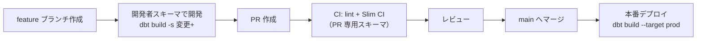
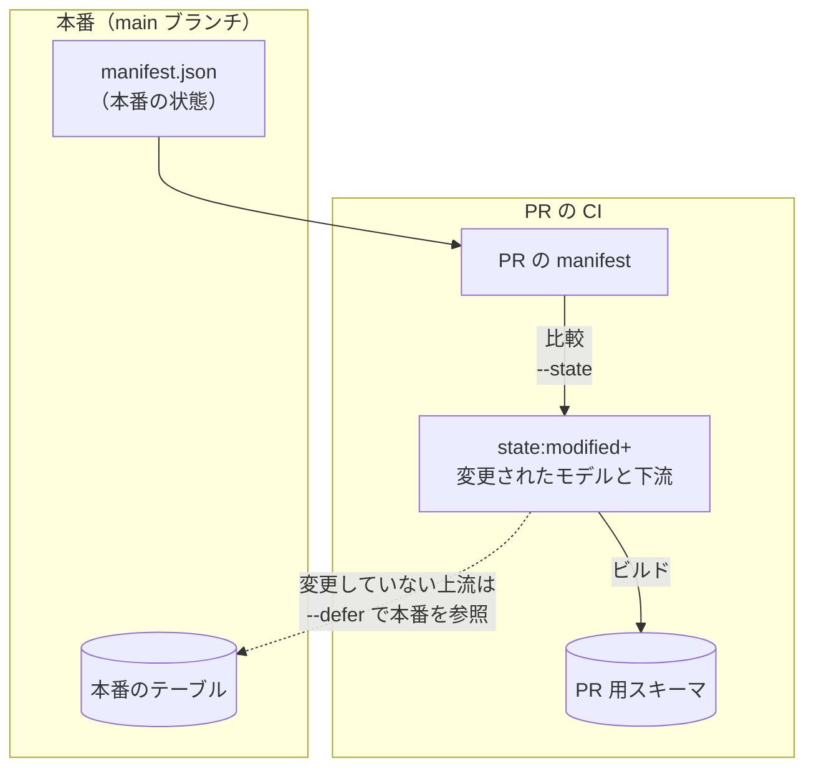

# 第12章 チーム開発と CI

> **この章のゴール**
> - dbt プロジェクトでの Git ワークフロー（開発者ごとのスキーマ、PR、レビュー観点）を説明できる
> - SQLFluff で SQL のスタイルを統一できる
> - Slim CI（`state:modified+` と `--defer`）で、変更の影響範囲だけをビルド・テストできる
> - GitHub Actions で dbt の CI を組める

## 12.1 たとえ: アプリ開発の CI と同じものを、データにも

| アプリ開発 | dbt |
|---|---|
| feature ブランチ | 同じ |
| ローカル開発環境（自分の DB） | **開発者ごとのスキーマ**（`dev_alice_marts` など） |
| ESLint / Checkstyle / Prettier | **SQLFluff** |
| `npm test` を CI で実行 | `dbt build` を CI で実行 |
| Nx affected / Gradle のビルドキャッシュ | **Slim CI**（`state:modified+`） |
| モックサーバ / テスト用スタブ | **`--defer`**（変更していないモデルは本番を参照） |
| PR のレビュー | 同じ（SQL・YAML・ドキュメントの差分を見る） |

## 12.2 開発フロー



### 開発者ごとのスキーマ

チームで同じ DWH を使う場合、全員が `dev` スキーマに書き込むと作業が衝突します。
`profiles.yml`（各自の `~/.dbt/` にある）で、target の schema を個人ごとに変えます。

```yaml
dev:
  type: snowflake
  schema: dev_alice        # → dev_alice_staging, dev_alice_marts ...
```

アプリ開発で、各自がローカルに Docker で DB を立てるのと同じ考え方です。DuckDB なら各自がローカルファイルを持つので、最初から分離されています。

### PR レビューの観点

| 観点 | チェックすること |
|---|---|
| 粒度 | 新しいモデルの「1行 = 何」が明記され、主キーに `unique` + `not_null` があるか |
| レイヤー | staging で JOIN していないか。marts から source を直接参照していないか |
| fan-out | JOIN の前に粒度をそろえているか |
| 破壊的変更 | public モデルの列の削除・改名・型変更はないか（contract が守ってくれる） |
| ドキュメント | 新しい列に description があるか |
| 性能 | 巨大なテーブルを毎回全件ビルドしていないか |
| 影響範囲 | リネージ上の下流（特に exposure）への影響は想定どおりか |

## 12.3 SQLFluff: SQL の Linter / Formatter

```bash
make setup-dev            # sqlfluff と sqlfluff-templater-dbt をインストール
cd coffee_shop
sqlfluff lint models      # 違反を報告（ESLint）
sqlfluff fix models       # 自動修正（Prettier / eslint --fix）
```

設定は [`coffee_shop/.sqlfluff`](../coffee_shop/.sqlfluff) にあります。

```ini
[sqlfluff]
dialect = duckdb
templater = dbt              # Jinja を dbt でコンパイルしてから lint する
max_line_length = 120

[sqlfluff:rules:capitalisation.keywords]
capitalisation_policy = lower   # select / from / where は小文字

[sqlfluff:rules:aliasing.table]
aliasing = explicit             # テーブル別名には as を付ける
```

| よく出るルール | 内容 |
|---|---|
| `LT01` | スペースの位置（`as` の前は1つ、など） |
| `LT02` | インデント |
| `CP01` | キーワードの大文字・小文字 |
| `RF02` | JOIN があるのに列名をテーブル名で修飾していない |
| `AM04` | `select *` の結果の列が不明確 |

> 💡 チームで「大文字派 vs 小文字派」のような議論に時間を使わないために、Linter にルールを決めさせるのは、アプリ開発と同じ知恵です。

## 12.4 Slim CI: 変更した部分だけをテストする

### 問題

モデルが500個あるプロジェクトで、PR のたびに全モデルをビルドすると、CI に1時間かかり、DWH のコストもかさみます。
1つのモデルを直しただけなら、**そのモデルと下流だけ** をビルド・テストすれば十分です。

### 仕組み



1. **`state:modified`**: 本番の `manifest.json` と比べて、SQL や設定が変わったノードを選ぶ
2. **`+`**: その下流も選ぶ（第3章の選択構文）
3. **`--defer`**: 選ばれなかった上流モデルへの `ref()` を、**本番のテーブル** に向ける

```bash
dbt build --select state:modified+ --defer --state path/to/prod-manifest/
```

`--defer` は、テストで依存先を本物のサービス（ここでは本番テーブル）に向けるようなものです。
PR のスキーマに上流を全部作り直さなくても、変更したモデルを本番と同じ入力でテストできます。

### ハンズオン: ローカルで Slim CI を再現する

`coffee_shop/` で実行します。

```bash
# 1. 「本番」をビルドし、その manifest を prod-state/ に保存
dbt build --target prod --target-path prod-state

# 2. モデルを1つ変更（例: dim_products に列を追加）
#    models/marts/core/dim_products.sql に  origin_country = 'Ethiopia' as is_ethiopian,  を追加

# 3. 何が「変更あり」と判定されるか確認
dbt ls --select state:modified --state prod-state
#    → coffee_shop.marts.core.dim_products

# 4. 変更と下流だけを dev にビルド（上流は prod のテーブルを参照）
dbt build --select state:modified+ --defer --state prod-state
```

```text
1 of 4 OK created sql table model dev_marts.dim_products ......... [OK]
2 of 4 PASS not_null_dim_products_product_id ...
...
Done. PASS=4 WARN=0 ERROR=0 SKIP=0 NO-OP=0 REUSED=0 TOTAL=4
```

`dbt compile -s dim_products` で、`ref('stg_shop__products')` が `"coffee_shop"."staging"."stg_shop__products"`（**prod のスキーマ**）に解決されていることを確認してください。

> ⚠️ **パースキャッシュに注意**
> SQLFluff の dbt テンプレータなどを実行した後に、`state:modified` が **変更していないモデルまで** 選ぶことがあります。
> 古いパースキャッシュ（`target/partial_parse.msgpack`）が原因です。おかしいと思ったら、`--no-partial-parse` を付けて再実行してください。

### `state:modified` の細分化

| セレクタ | 検出する変更 |
|---|---|
| `state:modified.body` | SQL の本文 |
| `state:modified.configs` | `materialized` などの設定 |
| `state:modified.contract` | contract（列・型）の変更 |
| `state:modified.macros` | 参照しているマクロの変更 |
| `state:new` | 新規追加されたノード |

## 12.5 GitHub Actions で CI を組む

サンプルが [`ci/dbt-ci.yml`](../ci/dbt-ci.yml) にあります。リポジトリ直下の `.github/workflows/` に置くと動きます。

```yaml
env:
  DBT_DUCKDB_PATH: /tmp/ci.duckdb    # profiles.yml の env_var() で参照（使い捨て DB）

steps:
  - run: pip install -r requirements-dev.txt
  - run: sqlfluff lint models tests analyses                  # ① Lint
  - run: python scripts/load_raw.py --day day1 --db "$DBT_DUCKDB_PATH"   # ② テストデータ投入
  - run: |                                                     # ③ main で「本番相当」をビルド
      git worktree add /tmp/main origin/main
      cd /tmp/main/study-dbt/coffee_shop
      dbt build --target prod --target-path /tmp/main-state
  - run: dbt build --select state:modified+ --defer --state /tmp/main-state   # ④ Slim CI
```

### 本物の DWH での構成

DuckDB の CI は使い捨てなので、③で本番相当を毎回作っています。本物の DWH（Snowflake / BigQuery など）では、構成が次のように変わります。

| | DuckDB（教材） | 本物の DWH |
|---|---|---|
| 本番 manifest | CI の中で main をビルドして作る | **本番デプロイ時に保存** しておいたもの（S3 / GCS / Actions の artifact）をダウンロード |
| `--defer` 先 | CI の中で作った prod スキーマ | **本物の本番スキーマ** |
| ビルド先 | 使い捨ての DuckDB ファイル | **PR 専用スキーマ**（`ci_pr_123`）。PR が閉じたら削除 |
| 接続情報 | 不要 | GitHub Secrets に置き、`env_var()` で参照 |

> 💡 **`dbt build --empty` で高速な構造チェック**
> `--empty` を付けると、すべての `ref` / `source` が0行に置き換えられて実行されます。
> SQL の構文エラー、列の不一致、contract 違反を **ほぼコストゼロで** 検出できます。CI の最初のステップとして有効です。

## 12.6 dbt プロジェクトの Git 管理

```gitignore
target/          # ビルド成果物（dist/ と同じ）
dbt_packages/    # パッケージ（node_modules/ と同じ）
logs/
*.duckdb
.user.yml
```

`profiles.yml` は、**秘密情報を含むなら Git 管理しない**（`~/.dbt/` に置く）。
この教材のように秘密情報が無い場合や、すべての値を `env_var()` で外から渡す場合は、リポジトリに置いても構いません。

## 演習

**12-1.** `coffee_shop/.sqlfluff` の `capitalisation_policy` を `upper` に変えて `sqlfluff lint models` を実行し、何件の違反が出るか確認してください。確認したら元に戻します。

**12-2.** ローカルの Slim CI で、`stg_shop__products` を変更したときに選ばれるノード数を `dbt ls --select state:modified+ --state prod-state` で数えてください。なぜその数になるのか、リネージから説明してください。

<details><summary>解答</summary>

`stg_shop__products` の下流（`int_order_lines__joined_products` → `fct_orders` / `fct_order_lines` → `dim_customers` → `fct_monthly_revenue`、さらに `dim_products`）と、それぞれに付いたテスト・unit test、exposure が選ばれます。
staging の変更は影響範囲が広いことが、数字で分かります。

</details>

**12-3.**（考察）CI で `dbt build` が通っても、本番で失敗することがあります。どんなケースが考えられるでしょうか？

<details><summary>解答例</summary>

- CI のデータ（テストデータ・サンプル）に無いパターンが、本番データにある（新しいステータス値など）→ data test が本番で初めて落ちる
- 本番のデータ量では、タイムアウトやメモリ不足が起きる
- incremental モデルの「2回目以降」のパスが CI で試されていない
- 権限（grant）の違い

対策として、本番で `dbt build` を実行してテストまで通すこと（第13章）、source freshness で上流の異変を早く検知することが大切です。

</details>

## つまずきポイント

- **`--state` に指定した manifest が古い** … 本番デプロイのたびに manifest を保存し直さないと、無関係なモデルまで「変更あり」になります。
- **`--defer` したのに上流が見つからない** … defer 先（本番）のテーブルが存在しないと失敗します。本番が一度もビルドされていない新規プロジェクトでは、フルビルドにフォールバックしてください（サンプルの CI はそうしています）。
- **CI で unit test が `relation doesn't exist`** … 第6章のとおり、上流のテーブルが必要です。`--defer` するか、先に `dbt run --empty` を実行します。

## まとめ

- 開発者ごとのスキーマで衝突を防ぎ、PR で SQL・YAML・ドキュメントをレビューする
- SQLFluff は SQL 版の ESLint。スタイルの議論は Linter に任せる
- Slim CI = `state:modified+`（変更と下流だけ）+ `--defer`（変更していない上流は本番を参照）
- 本番の manifest をデプロイ時に保存しておくことが、Slim CI の前提

⬅️ 前章: [第11章](11-snapshots.md) ／ ➡️ 次章: [第13章 本番運用](13-production.md)
