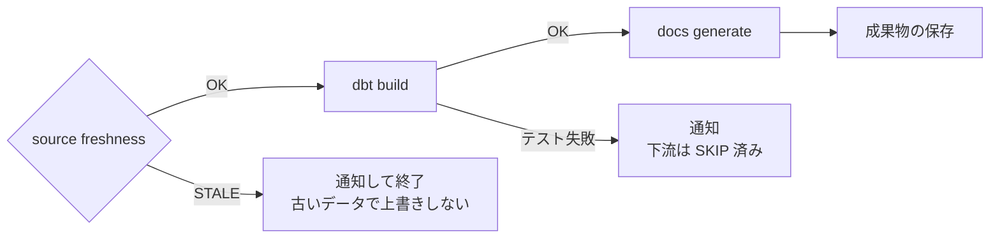

# 第13章 本番運用

> **この章のゴール**
> - target・`env_var()` で環境を切り替え、秘密情報をコードから追い出せる
> - 本番ジョブの典型的な構成（freshness → build → docs）を組み立てられる
> - source freshness で、上流のデータ取り込みの停止に気づける
> - `run_results.json` と `dbt retry` を使って、失敗を監視・復旧できる

## 13.1 たとえ: アプリの本番運用と同じ道具立て

| アプリ運用 | dbt 運用 |
|---|---|
| `spring.profiles.active=prod` / `NODE_ENV=production` | `--target prod` |
| 環境変数で秘密情報を注入（12-Factor App） | `env_var('DBT_PASSWORD')` |
| cron / Kubernetes CronJob / Airflow | dbt のスケジュール実行 |
| ヘルスチェック・死活監視 | **source freshness**（上流データの鮮度） |
| アクセスログ・APM | `run_results.json`、各モデルの実行時間 |
| 失敗したジョブの再実行 | `dbt retry` |
| Blue-Green デプロイ | スキーマの切り替え / `dbt clone` |

## 13.2 環境と秘密情報

### target で環境を切り替える

```yaml
# ~/.dbt/profiles.yml（本物の DWH の例）
coffee_shop:
  target: dev
  outputs:
    dev:
      type: snowflake
      account: "{{ env_var('SNOWFLAKE_ACCOUNT') }}"
      user: "{{ env_var('DBT_USER') }}"
      password: "{{ env_var('DBT_PASSWORD') }}"     # ← 秘密情報はコードに書かない
      schema: "dev_{{ env_var('USER') }}"           # ← 開発者ごとのスキーマ
      ...
    prod:
      type: snowflake
      user: "{{ env_var('DBT_PROD_USER') }}"
      password: "{{ env_var('DBT_PROD_PASSWORD') }}"
      schema: prod
      threads: 16
```

完成版の `profiles.yml` でも、DuckDB ファイルのパスを `env_var('DBT_DUCKDB_PATH', 'coffee_shop.duckdb')` にしています（第2引数は既定値）。
CI で使い捨てのファイルを指定するためです（第12章）。

> 💡 名前が `DBT_ENV_SECRET_` で始まる環境変数は、ログや `manifest.json` に値が出力されないよう、dbt がマスクします。パスワードやトークンに使いましょう。

### モデルの中で環境を分岐する

```sql

    from {{ source('shop', 'orders') }}

    from {{ source('shop', 'orders') }} where ordered_on >= current_date - interval 90 day  -- dev は直近だけ

```

開発環境のビルドを速く・安くする定番テクニックです（第9章の `limit_in_dev` も同じ発想）。
ただし、分岐が増えると「本番でしか起きないバグ」の温床になるので、最小限にしましょう。

## 13.3 本番ジョブの構成

典型的な本番ジョブは、次の順序で実行します。

```bash
#!/usr/bin/env bash
set -euo pipefail

dbt deps                                  # パッケージを取得
dbt source freshness                      # ① 上流のデータは新しいか？（古ければここで止める）
dbt build --target prod                   # ② seed → run → snapshot → test を DAG 順に
dbt docs generate --target prod           # ③ ドキュメントを更新
# ④ target/ の manifest.json・run_results.json を保存（Slim CI と監視のため）
```



**`dbt run` と `dbt test` を分けずに `dbt build` を使う** のがポイントです。
テストが失敗した時点で下流がスキップされるので、壊れたデータが BI まで届きません（第6章）。

### スケジューラの選択肢

| ツール | 特徴 | アプリ開発でいうと |
|---|---|---|
| cron / GitHub Actions の `schedule` | 最も手軽。小規模向け | crontab |
| **dbt platform**（旧 dbt Cloud）のジョブ | dbt 専用。UI、通知、Slim CI、ドキュメントのホスティングまで一式 | マネージドサービス（Heroku 的） |
| **Airflow**（+ astronomer-cosmos） | 汎用ワークフローエンジン。EL と T を1つの DAG で管理 | Jenkins のパイプライン |
| **Dagster**（+ dagster-dbt） | dbt のモデルを「アセット」として扱い、リネージを統合 | — |

EL ツールの完了をトリガーに dbt を起動する **イベント駆動** にすると、「データが届く前に変換して空振り」を防げます。

### 実行頻度を分ける: タグ

```yaml
# dbt_project.yml
models:
  coffee_shop:
    marts:
      finance:
        +tags: ["daily"]
      core:
        +tags: ["hourly", "daily"]
```

```bash
dbt build -s tag:hourly    # 毎時
dbt build -s tag:daily     # 毎朝
```

## 13.4 source freshness: 上流の異変に気づく

「dbt のジョブは成功しているのに、ダッシュボードの数字が3日前から変わらない」というのは、データ基盤で最も多い障害の一つです。
**EL ツールが止まっていても、dbt は古いデータで正常に動いてしまう** からです。

source freshness は、raw のデータが **いつロードされたか** を監視します。

```yaml
# models/staging/shop/_shop__sources.yml
sources:
  - name: shop
    schema: raw
    config:
      loaded_at_field: _loaded_at          # ロード時刻の列（EL ツールが付与）
      freshness:
        warn_after:  { count: 24, period: hour }
        error_after: { count: 48, period: hour }
```

```bash
dbt source freshness
```

```text
    Passed source shop.products (last updated 4s ago) [0.07s]
    Passed source shop.orders (last updated 4s ago) [0.07s]
    ...
Successfully wrote sources.json
```

### 体験: 古いデータを検知させる

`loaded_at_field` を、わざと業務上の日時（`created_at`、最新でも2025年末）に変えてみます。

```yaml
      - name: orders
        config:
          loaded_at_field: created_at      # ← 一時的に変更
```

```text
     Stale source shop.orders (last updated 10months 21days 8m 3s ago) [0.12s]
    Passed source shop.order_items (last updated 14m 56s ago) [0.12s]
    ...
[warning] [Unexpected (dbt9002)]: Source 'source.coffee_shop.shop.orders' loaded_at_field has a timestamp type
without a timezone, we will assume a UTC timezone
[error] [StaleSource (dbt1063)]: Stale source source.coffee_shop.shop.orders
```

最終更新から48時間以上たっているので、ERROR になりました。確認したら元に戻してください。

警告も出ています。`created_at` はタイムゾーンの無い timestamp なので、dbt は UTC とみなして比較しています。
ロード時刻の列は、タイムゾーン付き（完成版の `_loaded_at` は `timestamp with time zone`）にしておくと、こうした曖昧さがありません。

> 💡 **どの列を `loaded_at_field` にするか**
> 「EL ツールがロードした時刻」（`_loaded_at`、Fivetran なら `_fivetran_synced`）が理想です。
> 業務上の日時（`created_at`）を使うと、「夜間は注文が無いだけ」なのに STALE と判定されることがあります。

## 13.5 監視と復旧

### `run_results.json`

`dbt build` の後、`target/run_results.json` に各ノードの結果が出力されます。

```python
import json
r = json.load(open("target/run_results.json"))
for x in sorted(r["results"], key=lambda x: -x["execution_time"])[:5]:
    print(f'{x["unique_id"]:60} {x["status"]:6} {x["execution_time"]:.2f}s')
```

- **status**: `success` / `error` / `fail` / `warn` / `skipped`
- **execution_time**: 遅いモデルの特定（incremental 化の候補探し）
- **failures**: テストの違反行数

これを Slack 通知やダッシュボードに流せば、APM のような監視になります。
dbt 向けのデータオブザーバビリティツール（Elementary など）は、こうした成果物を集めて可視化してくれます。

### `dbt retry`: 失敗したところから再実行

```bash
dbt build --target prod          # 例: dim_customers でエラー → 下流10個が SKIP
# ...原因を修正...
dbt retry                        # 失敗したノードとスキップされたノードだけを再実行
```

```text
==================== Execution Summary =====================
Finished 'retry' successfully for target 'dev' [1.2s]
```

前回の `run_results.json` を読み、**成功したノードは再実行しません**。
CI/CD で、失敗したジョブを途中から再開できる機能と同じです。

### 冪等性: 何度実行しても同じ結果に

本番ジョブは「途中で落ちたら、もう一度実行すればよい」状態にしておくべきです。

- table / view: 毎回作り直すので、もともと冪等
- incremental: `unique_key` とルックバックウィンドウで冪等にする（第10章）
- snapshot: 同じ状態で何度実行しても、履歴は増えない

## 13.6 デプロイと性能

### スキーマの切り替え（Blue-Green 的な発想）

本番のテーブルを直接作り直すと、ビルド中に BI が中途半端な状態を見てしまうことがあります。
大規模な環境では、次のような手法が使われます。

- 別スキーマにすべてビルド → テストが通ったら、ビュー（またはスキーマ名）を切り替える
- `dbt clone`: 本番のテーブルを（ゼロコピークローンに対応した DWH では一瞬で）別スキーマに複製する。CI 環境の準備や、ロールバックに使う

### threads

`profiles.yml` の `threads` は、**DAG 上で並列に実行できるノードの最大数** です。
依存関係の無いモデルは同時に実行されます。DWH の同時実行枠やコストと相談して決めます。

## 13.7 ハンズオン

1. `study-dbt/` に、13.3 節の本番ジョブスクリプト `scripts/prod_job.sh` を作り、`coffee_shop` に対して実行する
2. source freshness の STALE を体験する（13.4 節）
3. `dim_customers.sql` をわざと壊して `dbt build` → 修正 → `dbt retry` を体験する
4. `run_results.json` から、実行時間の長いモデル上位5件を表示する

## 演習

**13-1.** 「EL ツールが止まっているのに、dbt のジョブが成功し続けた」障害を防ぐため、本番ジョブに何を組み込みますか？

<details><summary>解答</summary>

ジョブの先頭で `dbt source freshness` を実行し、ERROR なら `dbt build` を実行せずに通知します。
`loaded_at_field` には、EL ツールのロード時刻の列を使います。
あわせて、`warn_after` / `error_after` を、EL の実行間隔に合わせて設定します（毎時同期なら warn 2時間 / error 6時間など）。

</details>

**13-2.** `fct_monthly_revenue` は月1回の経営会議でしか使われません。一方、`fct_orders` は CS チームが1時間ごとに参照しています。どうスケジュールしますか？

<details><summary>解答例</summary>

`fct_orders` とその上流に `tag:hourly` を付けて毎時 `dbt build -s +tag:hourly` を実行し、全体は毎朝 `dbt build` を実行します。
`+tag:hourly` の `+` で上流も含めることで、「hourly のモデルが古い上流を読む」ことを防ぎます。
dbt platform などのジョブ管理機能を使う場合も、考え方は同じです。

</details>

**13-3.**（考察）`profiles.yml` に本番のパスワードを直接書いて Git にコミットしてしまいました。何をすべきですか？

<details><summary>解答</summary>

1. **パスワードを直ちに無効化・変更する**（履歴から消すだけでは不十分。すでに漏れたものとして扱う）
2. 履歴からの削除（`git filter-repo` など）を検討する
3. `env_var('DBT_ENV_SECRET_...')` で注入する方式に改め、`profiles.yml` を `~/.dbt/` へ移す、または Git 管理から外す

アプリ開発で `.env` をコミットしてしまったときと、まったく同じ対応です。

</details>

## つまずきポイント

- **本番で `dbt run` だけを実行している** … テストが実行されず、壊れたデータがそのまま公開されます。`dbt build` を使いましょう。
- **freshness の閾値が厳しすぎる** … 週末や夜間にアラートが鳴り続け、誰も見なくなります（オオカミ少年）。業務のリズムに合わせて設定します。
- **`run_results.json` が上書きされて消える** … 次の dbt コマンドで上書きされます。ジョブの最後に保存しておきましょう。

## まとめ

- 環境は target で切り替え、秘密情報は `env_var()`（`DBT_ENV_SECRET_` 接頭辞）で注入する
- 本番ジョブ: **freshness → build → docs → 成果物の保存**。`run` と `test` を分けずに `build` を使う
- source freshness で「上流が止まっているのに成功し続ける」障害を防ぐ
- `run_results.json` で監視し、`dbt retry` で失敗した箇所から復旧する。ジョブは冪等に保つ

⬅️ 前章: [第12章](12-ci.md) ／ ➡️ 次章: [第14章 総仕上げと発展](14-capstone-next.md)
