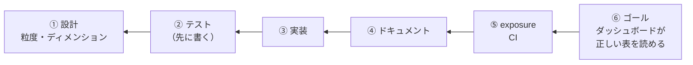

# 第14章 総仕上げと発展

> **この章のゴール**
> - これまでの全章を使い、「要件 → 設計 → テスト → 実装 → ドキュメント → CI」の流れで新しい marts を追加する
> - dbt v1 との違い、Semantic Layer、dbt Mesh など、この先に学ぶべき領域の地図を持つ
> - 第0章のチェックリストに、自分の言葉で答えられる

## 14.1 総仕上げの課題: 「日次売上ダッシュボード」の PR を出す

### 要件（ビジネス側からの依頼）

> CS チームのリーダーより:
> 「**毎日の売上と注文数** を、曜日別の傾向も含めて見たいです。
> 注文が無かった日も **0 円の日として** グラフに出してほしい。
> 今のダッシュボード（月次）だと、どの日に何が起きたのか分かりません。」

### 進め方（逆算）

この課題は、ゴール（ダッシュボードに出る表）から逆算して進めます。
答えを見る前に、各ステップを自分で考えてから実装してください。



#### ① 設計（第4・5章）

- どんなモデルが必要か。それぞれの **粒度** は何か
- 「注文が無い日も 0 円で出す」には、何が足りないか
- どのレイヤー・フォルダに置くか

<details><summary>設計例</summary>

| モデル | 粒度 | 置き場所 | 理由 |
|---|---|---|---|
| `dim_dates` | 1行 = 1日 | `marts/core/` | **連続した日付の「枠」** が必要（注文が無い日は `fct_orders` に存在しないため）。全社共通の日付ディメンション |
| `fct_daily_revenue` | 1行 = 1日 | `marts/finance/` | `dim_dates` に日次集計を left join し、売上の無い日は 0 で埋める |

「注文が無い日」は、ファクトをいくら集計しても出てきません。
**「存在しないものを数える」には、ディメンション側に枠が必要** です。これがディメンショナルモデリングの醍醐味です。

</details>

#### ② テスト（第6・7章）— 実装より先に YAML に書く

- 粒度を保証するテストは？
- 「0 円の日がある」ことを、unit test でどう表現するか？

<details><summary>テスト例</summary>

```yaml
models:
  - name: fct_daily_revenue
    description: 日次売上。**1行 = 1日**。完了した注文のみ。注文の無い日は 0 円
    config:
      group: finance
      contract: { enforced: true }
    columns:
      - name: date_day
        data_type: date
        data_tests: [unique, not_null]
      - name: order_count
        data_type: bigint
      - name: revenue_jpy
        data_type: bigint
        data_tests: [not_null]

unit_tests:
  - name: test_fct_daily_revenue_fills_zero_days
    model: fct_daily_revenue
    given:
      - input: ref('dim_dates')
        rows:
          - { date_day: 2025-01-01 }
          - { date_day: 2025-01-02 }
          - { date_day: 2025-01-03 }
      - input: ref('fct_orders')
        rows:
          - { order_id: 1, ordered_on: 2025-01-01, order_status: completed, order_total_jpy: 1000 }
          - { order_id: 2, ordered_on: 2025-01-03, order_status: completed, order_total_jpy: 2000 }
          - { order_id: 3, ordered_on: 2025-01-03, order_status: cancelled, order_total_jpy: 9999 }
    expect:
      rows:
        - { date_day: 2025-01-01, order_count: 1, revenue_jpy: 1000 }
        - { date_day: 2025-01-02, order_count: 0, revenue_jpy: 0 }     # ← 注文の無い日
        - { date_day: 2025-01-03, order_count: 1, revenue_jpy: 2000 }  # ← キャンセルは除外
```

テストを先に書くと、「キャンセルはどう扱う？」「売上の無い日の order_count は 0 か NULL か？」といった **仕様の曖昧さ** が実装前に表に出ます。
TDD と同じ効果です。

</details>

#### ③ 実装（第3・5・9・10章）

<details><summary>実装例: dim_dates</summary>

```sql
-- models/marts/core/dim_dates.sql
-- 粒度(grain): 1行 = 1日
with spine as (

    select cast(d as date) as date_day
    from range(
        date '{{ var("calendar_start", "2025-01-01") }}',
        date '{{ var("calendar_end", "2026-12-31") }}' + interval 1 day,
        interval 1 day
    ) as t(d)

)

select
    date_day,
    date_trunc('month', date_day)::date     as month_start,
    extract(year from date_day)::int        as year_number,
    extract(month from date_day)::int       as month_number,
    dayname(date_day)                       as day_name,
    extract(isodow from date_day) in (6, 7) as is_weekend
from spine
```

`range()` は DuckDB の関数です。他の DWH では `dbt_utils.date_spine` マクロを使うと、方言の差を気にせずに書けます（第9章）。
祝日を扱いたい場合は、祝日の一覧を seed にして left join するのが定番です。

</details>

<details><summary>実装例: fct_daily_revenue</summary>

```sql
-- models/marts/finance/fct_daily_revenue.sql
-- 粒度(grain): 1行 = 1日（注文が無い日も 0 円として 1 行を持つ）
with dates as (

    select date_day from {{ ref('dim_dates') }}
    where date_day <= (select max(ordered_on) from {{ ref('fct_orders') }})

),

daily as (

    select
        ordered_on,
        count(*)                     as order_count,
        sum(order_total_jpy)::bigint as revenue_jpy
    from {{ ref('fct_orders') }}
    where order_status = 'completed'
    group by ordered_on

)

select
    dates.date_day,
    coalesce(daily.order_count, 0) as order_count,
    coalesce(daily.revenue_jpy, 0) as revenue_jpy
from dates
left join daily
    on dates.date_day = daily.ordered_on
```

day2 のデータでビルドすると、378日分の行ができ、そのうち19日が「完了した注文が無い日（0 円）」になります。

</details>

#### ④ ドキュメント・⑤ exposure と CI（第8・12章）

- `description` に粒度と「売上の定義（completed のみ）」を書く
- `_exposures.yml` に「日次売上ダッシュボード」を追加する
- `dbt lint` と `dbt fmt --check models` を通し、`dbt build -s state:modified+ --defer --state prod-state` で影響範囲だけをテストする

#### ⑥ 完了の定義（Definition of Done）

- [ ] `dbt build` が全件 PASS
- [ ] 新しいモデルの主キーに `unique` + `not_null`、unit test で「0 円の日」を検証
- [ ] public モデルに contract
- [ ] description に粒度と定義
- [ ] exposure を追加し、`dbt ls -s +exposure:<名前>` で依存関係を確認
- [ ] `dbt lint` と `dbt fmt --check models` が通る
- [ ] 余力があれば、`dim_dates` を使って `fct_monthly_revenue` も「売上の無い月 × 地方」を 0 で埋めるよう改修する

## 14.2 追加の課題（自由研究）

| 課題 | 使う章 | ヒント |
|---|---|---|
| 顧客のコホート分析（初回購入月ごとのリピート率）を marts 化 | 4, 5, A | [`analyses/repeat_rate_by_first_order_month.sql`](../coffee_shop/analyses/repeat_rate_by_first_order_month.sql) を出発点に |
| 注文時点の地方で集計した月次売上 | 11 | 第11章の演習 11-1 を marts に組み込む |
| 商品別・産地別の売上ランキング（月次） | A, 4 | ウィンドウ関数 `rank()` |
| `dim_customers` の v2（`email` を除外）を作って移行 | 7 | 第7章 7.4 節 |
| パッケージ（dbt_utils / dbt_expectations）を導入してテストを強化 | 6, 9 | ネットワークが使える環境で |

## 14.3 この先の地図

### dbt v1 との違い（既存の現場で v1 に出会ったら）

この教材は dbt v2 で書きましたが、既存の現場では Python 製の **dbt v1（dbt Core）** のプロジェクトもまだ多く動いています。
プロジェクト形式（YAML / SQL / Jinja）は共通なので、この教材の知識はほぼそのまま通用します。主な違いは次のとおりです。

| | dbt v2（この教材） | dbt v1 |
|---|---|---|
| 実装・インストール | Rust 製の単体バイナリ。公式インストーラで入れる | Python 製。`pip install dbt-core dbt-<adapter>` |
| アダプタ | 主要な DWH 向けが本体に組み込み（DuckDB は内蔵） | DWH ごとのパッケージを別途インストール |
| SQL の理解 | SQL を **解析** し、列の存在や型をビルド前に検証（`static_analysis`） | SQL は文字列。DWH に投げて初めてエラーに気づく |
| Lint / 整形 | `dbt lint` / `dbt fmt` が組み込み | SQLFluff を別途インストール |
| 列単位のリネージ | `--generate-info-schema` で出力できる（第8章） | 標準では無い |
| ドキュメントサイト | 静的サイト。ブラウザ内の DuckDB-WASM でメタデータを読む | `catalog.json` などを読む従来のサイト |
| Python モデル | **DuckDB では使えない**（2.0.12 で確認。下記） | DuckDB などで使える |
| 出力の見た目 | `Summary: 77 total \| 75 success \| 2 no-op` | `Done. PASS=75 WARN=0 ERROR=0 SKIP=0 ...` |

アプリ開発でたとえるなら、**JavaScript から TypeScript に移ったときの変化** に近いものです。
文字列として扱っていた SQL を、コンパイラが型レベルで理解するようになりました。
実際、完成版を v2 の strict モードに通したところ、v1 では素通りしていた `coalesce(timestamp, '文字列')` という型の甘い書き方が2か所見つかりました（第10・11章）。

**v1 のプロジェクトを v2 に移行するとき**（公式ガイドの要点）:

1. まず v1 の最新版（1.12 系）に上げ、**非推奨の警告をすべて解消** する
2. v1.12 の `dbt parse --use-v2-parser` で、v2 のパーサで解析できるか確認する
3. 自動修正ツール **dbt-autofix** で、非推奨の書き方を機械的に直す
4. 使っている DWH・パッケージ・機能（Python モデルなど）が v2 に対応しているか確認する

最新の情報は、[公式の移行ガイド](https://docs.getdbt.com/docs/dbt-versions/core-upgrade/upgrading-to-v2) で確認してください。

### Semantic Layer（MetricFlow）

「売上」「客単価」「リピート率」といった **指標（メトリクス）の定義を、dbt の中で一元管理する** 仕組みです。

- marts のモデルに「エンティティ（結合キー）」「ディメンション（切り口）」「集計方法」を宣言する
- それを組み合わせて「売上 = 完了した注文の `order_total_jpy` の合計」のようなメトリクスを定義する
- BI ツールは SQL を書かずに「売上を月 × 地方で」と問い合わせ、MetricFlow が SQL を生成する
- 日付の切り口のために、日付ディメンション（**time spine** モデル、14.1 節の `dim_dates` に相当）が必要になる

> 📝 Semantic Layer の YAML 形式は、dbt v2 の時期に新しい形式へ更新されました（古い形式で書くと、v2 は非推奨の警告を出します）。v2 には `dbt sl` コマンドも用意されています。
> 書き方は [公式ドキュメント](https://docs.getdbt.com/docs/build/about-metricflow) の最新版を参照してください。

BI ツールごとに「売上」の計算式が微妙に違う、という問題を解決します。
アプリ開発でいえば、各画面に散らばっていた計算ロジックを **ドメインサービスに集約し、API として公開する** ことに相当します。

### dbt Mesh: 複数プロジェクトへの分割

プロジェクトが巨大になったら、ドメイン（チーム）ごとに複数の dbt プロジェクトに分割し、
**public モデル + contract + version** で互いに参照し合います。

```sql
-- finance プロジェクトから、commerce プロジェクトの public モデルを参照
select * from {{ ref('commerce', 'fct_orders') }}
```

第7章で学んだ access / contract / version は、まさにこのための準備です。
モノリスをマイクロサービスに分割し、サービス間を **公開 API と互換性ポリシー** でつなぐのと同じ発想です。
（プロジェクトをまたぐ `ref` は、主に dbt platform の機能です。）

### Python モデル

一部の DWH（Snowflake、Databricks、BigQuery など）では、SQL の代わりに Python でモデルを書けます。

> ⚠️ dbt v2（2.0.12）の DuckDB では、Python モデルは **使えません**（`Python models are not supported` というエラーになります）。
> v1 の dbt-duckdb では使えていた機能なので、v1 から移行するときの注意点の一つです。

```python
# models/marts/ml/customer_features.py
def model(dbt, session):
    df = dbt.ref("dim_customers").df()      # DataFrame として受け取る
    df["ltv_rank"] = df["lifetime_value_jpy"].rank(ascending=False)
    return df
```

SQL で書きにくい処理（機械学習の前処理、複雑な文字列処理）に使います。
ただし、まず SQL で書けないかを考えましょう。SQL のほうが DWH で最適化されやすく、チームの誰でも読めます。

### データ品質・オブザーバビリティ

- **Elementary**: dbt のテスト結果や実行時間を集計し、異常検知やダッシュボードを提供する
- **dbt-expectations**: 統計的なデータテスト（値の分布、行数の急変など）

## 14.4 参考資料

| 種類 | 資料 | 特徴 |
|---|---|---|
| 書籍（日本語） | 『実践dbt入門』（技術評論社, 2026） | 日本語で体系的に学べる。テスト・CI/CD・モデリングまで |
| 書籍（英語） | *Analytics Engineering with SQL and dbt*（O'Reilly, 2023） | モデリングと分析 SQL に厚い。この教材の構成の参考元 |
| 書籍（英語） | *Data Engineering with dbt*（Packt, 2023） | 保守性・運用・パターン集 |
| 公式 | dbt Docs「Best practices」→ *How we structure our dbt projects* | レイヤー設計・命名規約の原典（第5章） |
| 公式 | dbt Learn（無料のオンラインコース） | dbt Fundamentals ほか |
| 古典 | Ralph Kimball『The Data Warehouse Toolkit』 | ディメンショナルモデリングの原典（第4章） |

## 14.5 最終チェック

[第0章のチェックリスト](00-goal.md#05-学習チェックリスト逆算の終点) に戻り、すべての問いに、TS / Java のたとえを交えて答えてみてください。

模範解答の一例:

| 問い | 一言で |
|---|---|
| dbt は何をするツールか | ELT の T を担う「SQL のビルドツール」。SELECT から DDL・実行順・テスト・ドキュメントを生成する |
| `ref()` を使わないと何が困るか | import せずにグローバル変数を参照するのと同じ。実行順・環境の切り替え・リネージが壊れる |
| なぜ粒度を最初に決めるか | クラスの同一性の定義と同じ。曖昧だと JOIN で fan-out（二重計上）が起きる |
| staging で JOIN しない理由 | 腐敗防止層は「翻訳」だけを担う。組み合わせは下流の責務 |
| data test と unit test の違い | データの不変条件（実行時アサーション）と、ロジックの仕様（JUnit / Jest） |
| contract で何が守られるか | 列名・型・列数。公開 API の interface |
| マクロはいつ動くか | コンパイル時。SQL 文字列を生成するだけで、データは見えない |
| view / table / incremental | 遅延評価 / キャッシュ / 差分ビルド |
| 「注文時点の住所」で集計するには | snapshot（SCD Type 2）とのポイントインタイム結合 |
| PR で変更分だけをテストするには | Slim CI: `state:modified+` と `--defer` |
| 上流の停止にどう気づくか | source freshness をジョブの先頭で実行する |

お疲れさまでした。🎉
ここまで来れば、dbt プロジェクトに参加して **設計からレビューまで** を担えるはずです。

⬅️ 前章: [第13章](13-production.md) ／ 🏠 [目次に戻る](../README.md)
