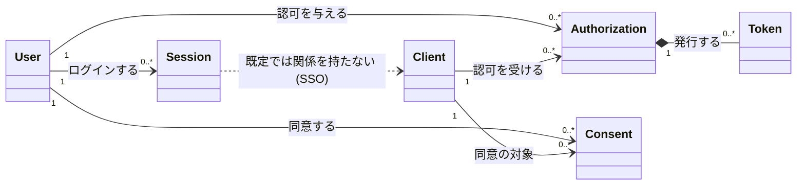
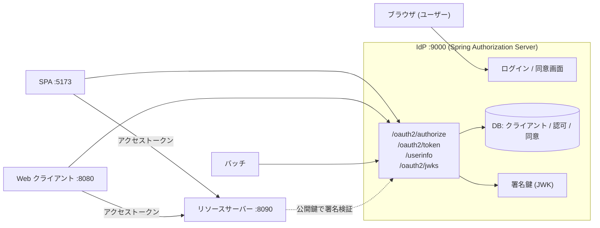
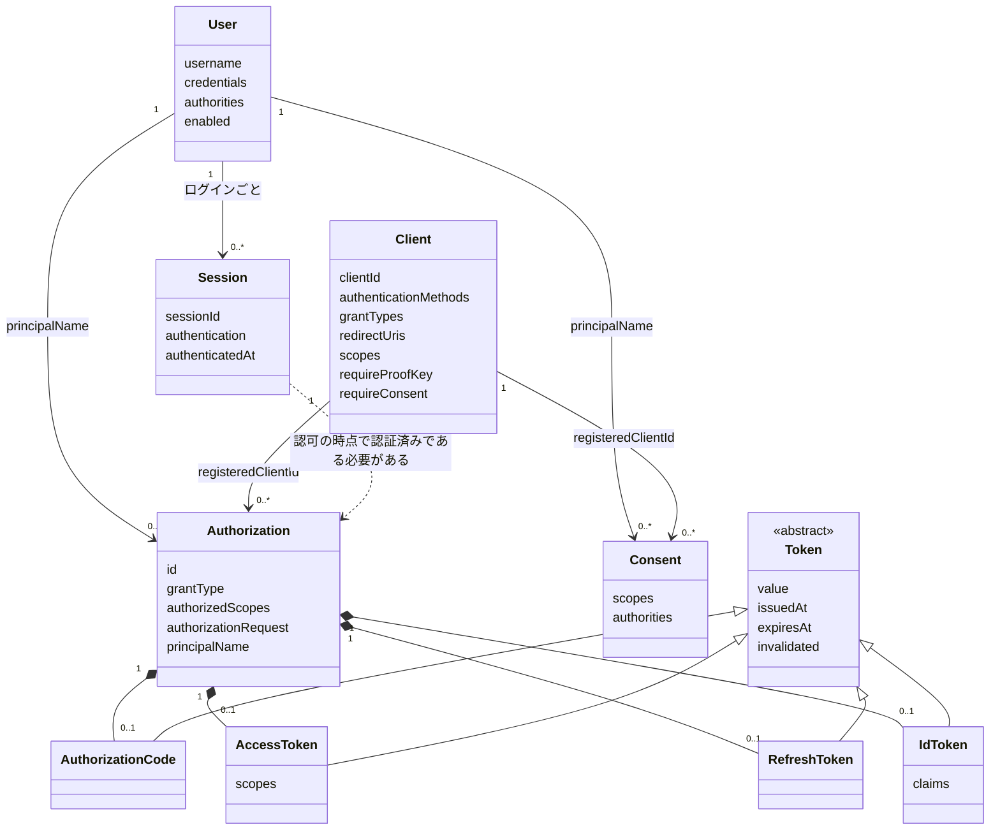
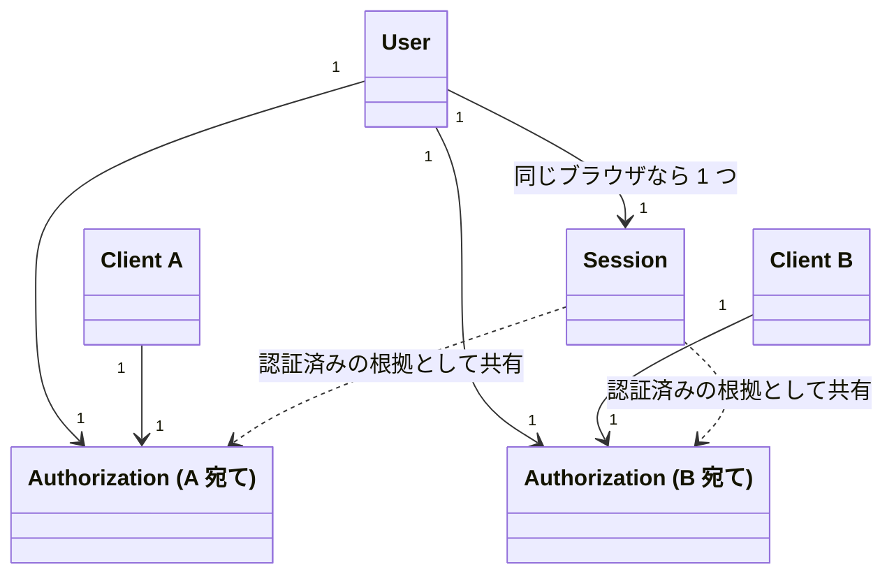
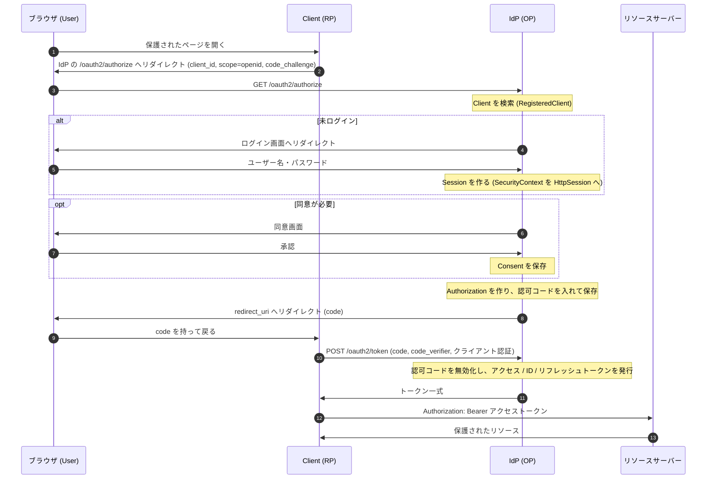

# 第1章 全体像とドメインモデル

この章は教材全体の地図です。コードは書きません。最初に完成形を見せ、そこから OAuth 2.1 / OpenID Connect (OIDC) の概念を導き、IdP のドメインモデルを描きます。2 章以降は「このモデルのどこを扱う章か」を毎回この章の図に戻って確認できます。

## この章のゴール

- 教材の完成形 (複数のクライアントが接続する IdP) を構成図で説明できる。
- OAuth の 4 つの登場人物と、OIDC が足す要素 (OpenID Provider / Relying Party / ID トークン / UserInfo) を区別でき、「認可」と「認証」の違いを説明できる。
- IdP のドメインモデル (User / Client / Authorization / Consent / Session / Token) の責務・ライフサイクル・関連を説明できる。
- 各モデルが Spring のどのクラスに対応するかを引ける。
- 「既定ではログインセッションは IdP に 1 つで、全クライアントで共有される (SSO)」ことを、モデル上の関係として説明できる。これは応用編 10 章の前提です。

## ドメインモデル上の位置づけ

この章は特定の一部ではなく、モデル全体を扱います。以降の章が扱う範囲を先取りして、全体を 1 枚で示します。



詳しい図は後ろの「ドメインモデル」節で描きます。まずは完成形から見ていきます。

## 完成形: この教材で作る IdP

README の完成形を構成図にするとこうなります。



完成形の特徴は README にあるとおり次の 3 点です。

- OIDC 準拠: 認可コード + PKCE、リフレッシュトークン、ログアウトを備える。
- 複数種類のクライアント (SPA / Web アプリ / バッチ) が接続し、`client_id` ごとにセッションと認証ポリシーが独立する (応用編 10・11 章)。
- DB 永続化、鍵ローテーション、多要素認証、監査ログを備える。

### なぜ IdP を自作して学ぶのか

IdP (Identity Provider。ユーザーの認証と、トークンの発行を担うサーバー) は商用サービスや OSS を使えば自作しなくて済みます。それでも作りながら学ぶ理由は 3 つあります。

1. **ドメインが濃い**: ユーザー、クライアント、同意、セッション、トークンという性質の違うオブジェクトが、寿命も所有者も違う形で絡み合います。業務アプリの設計題材として手応えがあります。
2. **セキュリティ要件が設計に直結する**: 「コードは 1 回しか使えない」「リダイレクト先は完全一致」といった制約が、モデルの不変条件になります。
3. **Spring の構造がそのまま見える**: Spring Authorization Server は、モデルごとにインターフェース (Repository / Service) を用意しています。差し替えながら学ぶ教材に向いています。

## OAuth 2.1 と OIDC の登場人物

### OAuth の 4 つの役割

OAuth 2.0 (RFC 6749 §1.1) は次の 4 つの役割を定義しています。

| 役割 | 意味 | この教材での実体 |
|---|---|---|
| resource owner | リソースへのアクセスを許可できる主体。通常はエンドユーザー | ブラウザを操作する人 |
| client | resource owner の許可を得てリソースにアクセスするアプリ | SPA / Web アプリ / バッチ |
| authorization server | resource owner を認証し、client にトークンを発行するサーバー | 作る IdP |
| resource server | トークンを受け取って保護されたリソースを返すサーバー | リソースサーバー :8090 |

ここでの client は「サーバー側かクライアント側か」ではなく「資源を要求する側」という役割名です。RFC 6749 §2.1 は client を、認証情報を安全に保持できる confidential client と、保持できない public client (SPA など) に分けます。

### OAuth 2.1 はドラフト

OAuth 2.1 は、IETF の Internet-Draft (`draft-ietf-oauth-v2-1`) です。RFC として確定した仕様ではありません。ドラフトの狙いは、OAuth 2.0 (RFC 6749) とその後に積み上がったセキュリティ上のベストプラクティス (RFC 7636 PKCE、RFC 9700 OAuth 2.0 Security Best Current Practice など) を 1 つにまとめることです。主な違いは次のとおりです (ドラフトの内容であり、版により変わりうる)。

- 認可コードフローでは PKCE (RFC 7636) を必須にする。
- Implicit グラントと Resource Owner Password Credentials グラントを削除する。
- リダイレクト URI は完全一致で比較する。
- アクセストークンを URL のクエリで渡さない。

Spring Authorization Server のクライアント設定に `requireProofKey(true)` (PKCE を必須にする) があります。2 章のサンプルもこれを有効にしています。OAuth 2.1 の方針を設定で表現できるわけです。

### OIDC が足すもの

OAuth 2.0 はアクセス権限の委譲の仕様で、「ユーザーが誰か」を伝える手段を標準化していません。OpenID Connect Core 1.0 は、OAuth 2.0 の上にユーザー認証の結果を運ぶ層を足します。

| OAuth の用語 | OIDC での呼び方 | OIDC が足すもの |
|---|---|---|
| authorization server | OpenID Provider (OP) | ユーザーを認証した結果を ID トークンで返す |
| client | Relying Party (RP) | ID トークンを検証してログイン状態を作る |
| (なし) | ID トークン | 認証イベントを表す JWT (RFC 7519)。`iss` `sub` `aud` `exp` `iat` を必ず含む (OIDC Core §2) |
| (なし) | UserInfo エンドポイント | アクセストークンで、ユーザーの属性 (name, email など) を取得する (OIDC Core §5.3) |
| scope | `openid` スコープ | これを要求すると OIDC のリクエストになる (OIDC Core §3.1.2.1) |

IdP は OAuth の言葉では authorization server、OIDC の言葉では OP です。この教材では、両方を兼ねるものとして「IdP」と呼びます。

### 認可と認証の違い

- **認証 (authentication)**: 「あなたは誰か」を確かめること。IdP のログイン画面で行います。結果は ID トークンとして RP に伝わります。
- **認可 (authorization)**: 「このクライアントに何を許すか」を決めること。結果はアクセストークンとして、リソースサーバーが解釈します。

OAuth 自体は認可の仕様です。アクセストークンを持っていることは「誰かが許可した」ことの証明であって、「ユーザーが今ここにいる」ことの証明ではありません。ログインの目的でアクセストークンだけを使う実装が危険とされる理由です。ログインには ID トークンを使います。

## たとえると

全章共通の舞台は **ホテル** です。

| ホテルの世界 | 認可サーバーの世界 |
|---|---|
| フロント | IdP (認証して、カードキーを渡す) |
| 宿泊客 | User (resource owner) |
| 提携施設 (併設のレストラン、外部のスパ) | Client |
| カードキー | アクセストークン |
| 客室やジムの扉 | リソースサーバー |
| 宿泊者名簿への記帳・本人確認 | ユーザー認証 (ログイン) |
| 「スパに私の宿泊情報を共有してよいか」の確認 | 同意 (Consent) |
| 宿泊中の滞在記録 | Session |

流れを物語にすると、宿泊客がフロントで本人確認を済ませると、提携施設 (クライアント) の求めに応じて、フロントが「この施設の、この範囲だけ」を許可したカードキーを発行します。施設の扉 (リソースサーバー) はカードキーを読み取り機にかざして、中身を見て通すか決めます。フロントに毎回問い合わせません。この性質は、アクセストークンを JWT にしたときの検証と同じです。

### このたとえが合わない点

- **カードキーは扉ごとに作り分ける必要があるが、アクセストークンは 1 つで複数のリソースサーバーに使える設計もできる**。何を対象にするかは `aud` (audience。トークンの宛先) と scope の設計次第です。
- **ホテルのカードキーは客が持っている限り使えるが、トークンは短命**です。Spring の既定でアクセストークンは 5 分で失効します (`TokenSettings` の既定値。確認済み)。そのため、延長のためのリフレッシュトークンという別の仕組みが必要になります。ホテルには対応物がありません。
- **ID トークンに対応する物がホテルには無い**。強いて言えば「フロントが施設に渡す宿泊客の紹介状」ですが、紹介状は宿泊客本人ではなく施設宛てで、施設が検証して使い捨てます。
- **ホテルでは宿泊客はフロントに 1 回名乗れば、館内の全施設で通用する**。これは SSO の説明には都合が良いのですが、「施設ごとに別の宿泊記録を持たせる」(10 章) 設計は、たとえにすると不自然になります。そこは 10 章で取り上げます。

## ドメインモデル

### クラス図

6 つの概念を、関連の多重度つきで描きます。Token は 4 種類あります。



読み方のポイントは次の 3 点です。

- **Authorization が中心**: 「どのユーザーが、どのクライアントに、どの範囲を許したか」を 1 件の記録にします。Token は Authorization の部品で、単独では存在しません。
- **Consent は (User, Client) の組に 1 件**: 同意は個々の認可の記録ではなく、「このユーザーがこのクライアントに許した範囲」という恒久的な記憶です。次回以降の認可で同意画面を省略する根拠になります。
- **Session は Client と関連を持たない**: 点線の `Session ..> Authorization` は「認可は、認証済みのセッションの上でしか始まらない」という依存だけを表します。Session から Client への線が無いことが、SSO のモデル上の表現です。詳細は後述します。

### 各モデルの責務とライフサイクル

| モデル | 責務 | 作られるとき | 消えるとき | 寿命の目安 |
|---|---|---|---|---|
| User | 「誰か」を表す。資格情報 (パスワードなど) と権限を持つ | ユーザー登録 | 退会・削除 | 長い (年単位) |
| Client | 「どのアプリが」を表す。許可された redirect URI、グラント、スコープ、認証方式を持つ | クライアント登録 | 登録削除 | 長い (登録する人が管理) |
| Authorization | 1 回の認可の記録。発行済みトークンをまとめて保持する | 認可コードの発行時 (同意が必要なときは同意待ちの時点) | 失効・削除。リフレッシュトークンが有効な間は残る | 認可コードの有効期間からリフレッシュトークンの寿命まで |
| Consent | (User, Client) への同意済みスコープを記憶する | 同意画面で承認したとき | 同意の取り消し | 長い |
| Session | ユーザーが IdP に対してログイン済みであることを表す | ログイン成功 | ログアウト・タイムアウト | 短い (分〜時間) |
| Token | 各トークン。種類ごとに用途と寿命が違う | Authorization の進行中に順次 | 有効期限切れ・失効 | 種類による (下表) |

Token の 4 種類は次のとおりです。

| Token | 宛先 | 用途 | 使用回数 | 既定の寿命 (Spring) |
|---|---|---|---|---|
| 認可コード (authorization code) | IdP 自身 (クライアント経由で戻ってくる) | トークンと交換する一時的な引換券 | 1 回だけ (RFC 6749 §4.1.2) | 5 分 |
| アクセストークン | リソースサーバー | 保護されたリソースへのアクセス | 期限内なら何回でも | 5 分 |
| リフレッシュトークン | IdP 自身 | 新しいアクセストークンの取得 | 既定では再利用される (`reuseRefreshTokens(true)`) | 60 分 |
| ID トークン | クライアント (RP) | ユーザー認証の結果の伝達 | クライアントが検証して使う | 30 分 (固定) |

「既定の寿命」は `TokenSettings` のソースで確認した値です (5 章で詳しく扱います)。ID トークンだけは `TokenSettings` に設定項目が無く、`JwtGenerator` が発行時刻の 30 分後を有効期限にします。

### 関連の多重度の根拠

- **User 1 : 0..* Authorization / Client 1 : 0..* Authorization**: 同じユーザーが同じクライアントに何度でも認可を与えられます。認可は独立した記録です。
- **Authorization 1 : 0..1 (各 Token)**: 1 件の Authorization が持つ各種類のトークンは最大 1 つです。リフレッシュトークンで更新すると、アクセストークンは同じ Authorization の中で入れ替わります。
- **User 1 : 0..* Consent / Client 1 : 0..* Consent**: 一意になるのは (User, Client) の組です。Spring の `OAuth2AuthorizationConsentService.findById(registeredClientId, principalName)` が 2 つのキーを取ることが対応します (確認済み)。
- **User 1 : 0..* Session**: 1 人が複数のブラウザや端末でログインできます。

## Session と Client の関係 (SSO)

この教材で最も重要な点の 1 つです。

### 既定の挙動

Spring Authorization Server は、認証を Spring Security のログイン機構に任せています。ログイン成功後の `SecurityContext` は `HttpSession` に保存されます (`HttpSessionSecurityContextRepository`、キーは `SPRING_SECURITY_CONTEXT`。確認済み)。この `HttpSession` は、IdP のドメインに対するブラウザの Cookie (`JSESSIONID`) で識別されます。

ここに `client_id` は出てきません。結果として、

1. ユーザーがクライアント A 経由で IdP にログインする。
2. 次にクライアント B が `/oauth2/authorize` にユーザーを送る。
3. ブラウザは同じ IdP の Cookie を持っているので、IdP は既にログイン済みと判断し、ログイン画面を出さずに認可コードを返す。

これが **SSO (シングルサインオン)** です。「セッションは IdP に 1 つで、全クライアントで共有される」というのは、モデル上は次のとおりです。



Session には Client への参照がありません。Authorization は Client ごとに分かれていますが、その根拠になるログインは 1 つを共有します。

### OIDC の仕様上の位置づけ

「ログインセッションを持つかどうか」は OIDC Core 1.0 では OP の実装に委ねられています。仕様が定めるのは、RP が `prompt=login` (再認証を要求) や `max_age` (認証からの許容経過時間) で再認証を求められることです (OIDC Core §3.1.2.1)。SSO は仕様が強制する機能ではなく、OP の実装が選べる挙動です。ログアウトまわりは別の仕様 (OpenID Connect RP-Initiated Logout 1.0 など) で扱います。12 章で扱います。

### Authorization と Session の弱い結び付き

ID トークンには、認証が行われた時刻を示す `auth_time` と、IdP 側のセッションを識別する `sid` (OpenID Connect Front-Channel / Back-Channel Logout 1.0 で定義) を入れられます。Spring のソース (`JwtGenerator`) は、`SessionInformation` がコンテキストにあるときに `sid` と `auth_time` を ID トークンに入れます。2 章の最小構成で発行した ID トークンにも、この 2 つが入っています。

```json
{"sub":"user","aud":"web-client","azp":"web-client","auth_time":1794303597,"iss":"http://localhost","exp":1794305398,"iat":1794303598,"jti":"c0991168-...","sid":"a4ayc_80_OGda4BO_1o_V0etpOqiLx1JwB5S3beHW0s"}
```

ただし結び付きはこの 2 つのクレームだけです。Authorization (トークン群) は Session が終わっても残りますし、Session は自分がどの Client のために使われたかを知りません。Session を `client_id` ごとに分けたいとき (10 章) は、この弱い結び付きの部分に手を入れます。

## モデルと Spring のクラスの対応

次のクラス名・メソッドは、すべて `spring-security-*-7.1.2.jar` に対する `javap` またはソース jar で実在を確かめたものです。

| ドメインモデル | Spring のクラス | 主なフィールド / メソッド | 保管するインターフェース |
|---|---|---|---|
| User | `org.springframework.security.core.userdetails.UserDetails` | `getUsername()` `getPassword()` `getAuthorities()` `isEnabled()` | `UserDetailsService` |
| Client | `org.springframework.security.oauth2.server.authorization.client.RegisteredClient` | `getId()` `getClientId()` `getClientSecret()` `getClientAuthenticationMethods()` `getAuthorizationGrantTypes()` `getRedirectUris()` `getScopes()` `getClientSettings()` `getTokenSettings()` | `RegisteredClientRepository` (`save` / `findById` / `findByClientId`) |
| Client の設定 | `ClientSettings` / `TokenSettings` (`...authorization.settings`) | `isRequireProofKey()` `isRequireAuthorizationConsent()` / `getAccessTokenTimeToLive()` `getRefreshTokenTimeToLive()` `getAccessTokenFormat()` | `RegisteredClient` が保持 |
| Authorization | `org.springframework.security.oauth2.server.authorization.OAuth2Authorization` | `getId()` `getRegisteredClientId()` `getPrincipalName()` `getAuthorizationGrantType()` `getAuthorizedScopes()` `getAccessToken()` `getRefreshToken()` `getToken(Class)` `getAttributes()` | `OAuth2AuthorizationService` (`save` / `remove` / `findById` / `findByToken(String, OAuth2TokenType)`) |
| Consent | `OAuth2AuthorizationConsent` | `getRegisteredClientId()` `getPrincipalName()` `getScopes()` `getAuthorities()` | `OAuth2AuthorizationConsentService` (`save` / `remove` / `findById(registeredClientId, principalName)`) |
| Session | `jakarta.servlet.http.HttpSession` と `org.springframework.security.core.context.SecurityContext` | `SecurityContext#getAuthentication()` | `HttpSessionSecurityContextRepository` |
| Session の追跡 | `org.springframework.security.core.session.SessionRegistry` | `registerNewSession` `getAllSessions` `removeSessionInformation` | 設定したときだけ |
| Token (共通) | `org.springframework.security.oauth2.core.OAuth2Token` / `AbstractOAuth2Token` | `getTokenValue()` `getIssuedAt()` `getExpiresAt()` | `OAuth2Authorization` の中 |
| 認可コード | `OAuth2AuthorizationCode` (`...authorization` パッケージ) | (共通のみ) | 同上 |
| アクセストークン | `org.springframework.security.oauth2.core.OAuth2AccessToken` | `getTokenType()` `getScopes()` | 同上 |
| リフレッシュトークン | `org.springframework.security.oauth2.core.OAuth2RefreshToken` | (共通のみ) | 同上 |
| ID トークン | `org.springframework.security.oauth2.core.oidc.OidcIdToken` | `getClaims()` | 同上 |
| UserInfo の応答 | `org.springframework.security.oauth2.core.oidc.OidcUserInfo` | `getClaims()` | 保管しない (リクエストごとに生成) |

対応表を読むうえで押さえたい点が 4 つあります。

- **Token は Authorization の中に入る**。`OAuth2Authorization.Token<T extends OAuth2Token>` という内部クラスが、トークン本体 (`getToken()`) に加えて、失効済みかの判定 (`isInvalidated()` `isExpired()` `isActive()`)、`getClaims()` やメタデータを持ちます。ドメインモデル上の `Token.invalidated` は、この状態に対応します。
- **認可リクエストと Principal は Authorization の attributes に入る**。ソースでは `OAuth2Authorization.withRegisteredClient(...)` に `principalName` を渡し、`attribute(Principal.class.getName(), principal)` と `attribute(OAuth2AuthorizationRequest.class.getName(), authorizationRequest)` を設定しています (確認済み)。図の `authorizationRequest` の実体です。
- **Session に専用のドメインクラスは無い**。サーブレットの `HttpSession` と Spring Security の `SecurityContext` が事実上の Session です。専用のクラスが無いことが、10 章で独自のモデルを足す理由になります。
- **Authorization Server は ID トークンを `OAuth2Authorization` に保管する**。`OAuth2AuthorizationCodeAuthenticationProvider` のソースは、ID トークンを `OidcIdToken` として生成しトークンの一種として登録します (確認済み)。

Spring の既定の保管先として、メモリ上の `InMemoryOAuth2AuthorizationService` / `InMemoryOAuth2AuthorizationConsentService`、DB 向けの `JdbcOAuth2AuthorizationService` / `JdbcOAuth2AuthorizationConsentService` が jar に存在します (確認済み)。7 章で JDBC 版に切り替えます。

## 認可コードフロー全体の概観

最も標準的な、認可コードフロー + PKCE の全体像です。詳細は 4 章で扱うので、ここではどのモデルがどこで登場するかを見ます (根拠: RFC 6749 §4.1、RFC 7636、OIDC Core §3.1)。



ポイントは次のとおりです。

- `alt 未ログイン` の分岐 (未ログインなら Session を作る) が、SSO の分かれ目です。既にログイン済みなら、ここはスキップされます。
- 認可コードは URL (ブラウザ) を経由して渡るため、傍受されても無害であるように「1 回限り・短命・PKCE と対」になっています。PKCE の `code_verifier` は、`code_challenge` を作った本人しか持たないため、コードが盗まれても交換できません (RFC 7636 §1)。
- リソースサーバーが Bearer トークンで認可する方式は RFC 6750 です。

## 各章がモデルのどこを扱うか

README の章立て 1〜19 章と、モデルの対応です。◎は主題、○は関連して触れる範囲です。

| 章 | テーマ | User | Client | Authorization | Consent | Session | Token |
|---|---|:-:|:-:|:-:|:-:|:-:|:-:|
| 1 | 全体像とドメインモデル | ○ | ○ | ○ | ○ | ○ | ○ |
| 2 | 開発環境と最小構成 | ○ | ○ | ○ | | ○ | ○ |
| 3 | Spring Security の基礎 | ◎ | | | | ◎ | |
| 4 | 認可コードフロー + PKCE | | ○ | ◎ | | ○ | ◎ (認可コード) |
| 5 | トークン | | | ○ | | | ◎ |
| 6 | ユーザー認証と同意画面 | ◎ | ○ | | ◎ | ○ | |
| 7 | 永続化 | ○ | ◎ | ◎ | ◎ | | ○ |
| 8 | クライアントとリソースサーバーをつなぐ | | ◎ | ○ | | ○ | ◎ (アクセストークン) |
| 9 | トークンのカスタマイズ | ○ | | | | | ◎ |
| 10 | client_id ごとのユーザーセッション分離 | | ◎ | ○ | | ◎ | |
| 11 | クライアント別の認証ポリシー | ○ | ◎ | | | ○ | |
| 12 | ログアウト設計 | | ○ | ○ | | ◎ | ○ (ID トークン、リフレッシュトークン) |
| 13 | 多要素認証 | ◎ | | | | ○ | |
| 14 | 外部 IdP 連携 | ◎ | | | | ○ | ○ |
| 15 | マルチテナント | ○ | ◎ | | | | |
| 16 | 追加のグラントとクライアント管理 | | ◎ | ◎ | | | ○ |
| 17 | セキュリティ強化 | | ○ | ○ | | ○ | ◎ |
| 18 | 運用と可観測性 | | | ○ | | ○ | |
| 19 | テストと仕上げ | ○ | ○ | ○ | ○ | ○ | ○ |

この表は README のテーマ名から割り当てた初期の見取り図です。各章の本文が確定したら、ずれがあれば更新します。8 章が基礎編の完成形 (基礎編で作る IdP とそれにつなぐ周辺) にあたります。

## 用語集

| 用語 | 説明 |
|---|---|
| IdP (Identity Provider) | ユーザーの認証とトークンの発行を担うサーバー。OAuth では authorization server、OIDC では OpenID Provider を兼ねる |
| OpenID Provider (OP) | OIDC で、ユーザーを認証して ID トークンを発行するサーバー |
| Relying Party (RP) | OIDC で、OP の認証結果に依存するクライアント |
| resource owner | リソースへのアクセスを許可できる主体。通常はエンドユーザー (RFC 6749 §1.1) |
| client | resource owner の代理でリソースにアクセスするアプリ。confidential と public がある (RFC 6749 §2.1) |
| authorization server | resource owner を認証し、client にトークンを発行するサーバー |
| resource server | アクセストークンを受け取って保護されたリソースを返すサーバー |
| 認証 (authentication) | 「あなたは誰か」を確かめること |
| 認可 (authorization) | 「このクライアントに何を許すか」を決めること |
| scope | クライアントが要求する権限の範囲。`openid` を含めると OIDC リクエストになる |
| consent (同意) | ユーザーが「このクライアントにこの範囲を許す」と承認した記録 |
| authorization code (認可コード) | 認可の結果としてクライアントに渡される一時的な引換券。1 回限り (RFC 6749 §4.1.2) |
| access token | リソースサーバーに提示してリソースにアクセスするためのトークン (RFC 6749 §1.4、RFC 6750) |
| refresh token | 新しいアクセストークンを得るためのトークン (RFC 6749 §1.5) |
| ID token | ユーザー認証の結果を表す JWT (OIDC Core §2) |
| UserInfo エンドポイント | アクセストークンでユーザー属性を返す OIDC のエンドポイント (OIDC Core §5.3) |
| JWT (JSON Web Token) | 署名付きの JSON トークン (RFC 7519) |
| PKCE | 認可コードの横取りを防ぐ拡張。`code_challenge` / `code_verifier` を使う (RFC 7636) |
| issuer | 発行者。IdP 自身を表す URL。ID トークンの `iss` クレームになる |
| audience (`aud`) | トークンの宛先 |
| `sub` | ユーザーの識別子 (ID トークンの Subject クレーム) |
| `sid` | IdP 側のセッションを表す ID トークンのクレーム。ログアウトの連動に使う (OpenID Connect Front-Channel / Back-Channel Logout 1.0) |
| SSO (シングルサインオン) | 1 回のログインで複数のクライアントを利用できること |
| Session | ユーザーが IdP にログイン済みであることを表す状態 |
| OAuth 2.1 | OAuth 2.0 の整理統合を目指す IETF Internet-Draft。RFC ではない |

## つまずきポイント

### 「アクセストークンがあるからログイン済み」と考えてしまう

- 症状: クライアント側で、アクセストークンの存在をもってユーザーがログインしたと判定している。別のユーザーのトークンでも通ってしまう設計になる。
- 原因: OAuth 2.0 は認可の仕様で、ユーザーの認証結果を運ぶ形式を定めていない (RFC 6749)。
- 対処: ログインの判定には OIDC の ID トークンを使う。クライアントは `iss` `aud` `exp` `nonce` を検証する (OIDC Core §3.1.3.7)。

### IdP の「ログイン」とクライアントの「ログイン」を同じものだと思う

- 症状: クライアント A からログアウトしたのに、クライアント B ではログインしたまま。または、IdP にログインしたままなのにクライアントのログアウトが効かない。
- 原因: ログイン状態は、IdP のセッションと、各クライアント自身のセッションの 2 つがある。クライアント側のセッションは RP が持ち、IdP のセッションは IdP が持つ。
- 対処: どちらのセッションを終わらせたいのかを区別する。連動のさせ方は 12 章で扱う。

### Consent を Authorization の一部だと思う

- 症状: 認可を削除したら、同意画面がまた出ると考えていたが、出ない。
- 原因: Consent は (User, Client) 単位で別に保管される。Spring でも `OAuth2AuthorizationConsentService` が別のインターフェースになっている。
- 対処: 同意を取り消すには Consent 自体を削除する。

### 認可コードをトークンと同列に考える

- 症状: 認可コードを再利用できると思っていた、または認可コードがリソースサーバーで使えると思っていた。
- 原因: 認可コードは IdP に戻ってくるための引換券で、1 回だけ使え、リソースサーバーには渡さない (RFC 6749 §4.1.2)。
- 対処: 認可コードは Token の一種だが、役割は他の 3 つと違う。宛先で整理する (IdP 宛て: 認可コード・リフレッシュトークン、リソースサーバー宛て: アクセストークン、クライアント宛て: ID トークン)。

### 「SSO だから 1 つのセッションで全クライアントを制御できる」と思う

- 症状: ある `client_id` だけログイン状態を切りたいが、できない。
- 原因: 既定では Session が Client に紐付かない (前述)。ログアウトも、セッション単位であって `client_id` 単位ではない。
- 対処: そのような要件は 10 章でモデルを拡張して実現する。この章では「既定は共有」と理解しておけば十分。

### OAuth 2.1 を RFC として引用する

- 症状: 「OAuth 2.1 (RFC xxxx) では〜」と書いてしまう。
- 原因: OAuth 2.1 はドラフトで、版が更新される。
- 対処: 仕様の根拠として使うときは、現行の RFC (6749、7636、9700 など) を併記する。この教材も、ドラフトの内容を書く箇所には「ドラフト」と明記する。

## まとめ

- 教材の完成形は、複数のクライアントが接続し、`client_id` ごとにセッションと認証ポリシーが独立する OIDC 準拠の IdP。
- OAuth は認可 (何を許すか) の仕様で、OIDC が認証 (誰か) を ID トークンと UserInfo で足す。IdP は authorization server かつ OpenID Provider。OAuth 2.1 はドラフトである。
- ドメインモデルは User / Client / Authorization / Consent / Session / Token。Authorization が中心で、Token はその部品、Consent は (User, Client) の組に付く。
- Spring のクラスとの対応は `UserDetails` / `RegisteredClient` / `OAuth2Authorization` / `OAuth2AuthorizationConsent` / `HttpSession` + `SecurityContext` / `OAuth2Token` 系。Session にだけ専用のドメインクラスが無い。
- 既定ではログインセッションは IdP に 1 つで、全クライアントで共有される (SSO)。Session と Client は関連を持たない。これを分けるのが 10 章。
- ホテルのたとえは、フロント、カードキー、扉の関係を説明するのに便利だが、トークンの短命さ、ID トークン、client_id 別のセッションは当てはまらない。

## 次の章へ

2 章では、この地図の中で最小限の IdP を実際に動かします。User を 1 人、Client を 1 件、メモリ上に持たせて、認可コードフローを最後まで通します。ここで描いたモデルが、コードのどこに現れるかを確かめてください。
