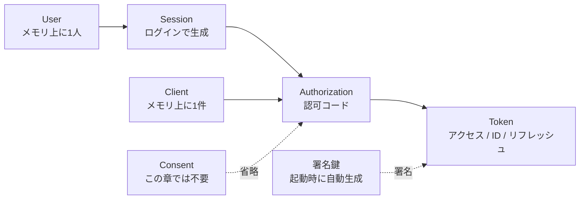
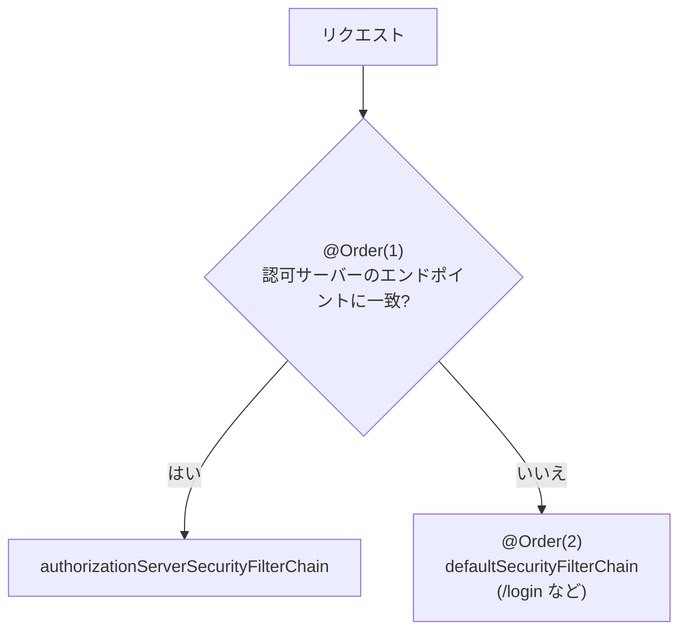
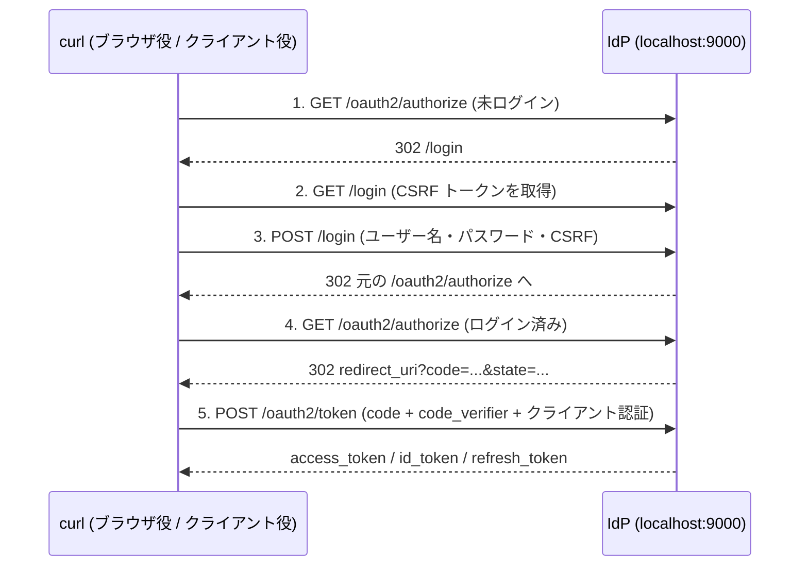

# 第2章 開発環境と最小構成

## この章のゴール

この章を終えると、次の状態になります。

- Java 21 と Maven で、Spring Authorization Server を載せた IdP が `http://localhost:9000` で起動する。
- ディスカバリ (`/.well-known/openid-configuration`) と JWK Set (`/oauth2/jwks`) を curl で取得し、中身を読める。
- ブラウザを使わず curl だけで、認可コード + PKCE のフローを一周し、アクセストークンと ID トークンを得られる。
- 得たトークンのペイロードをデコードして、各クレームの意味を説明できる。
- `IdpApplicationTests` を読んで、「動作をテストで固定する」書き方を説明できる。
- この構成では起動のたびに署名鍵が変わることを理解している (5 章への伏線)。

## ドメインモデル上の位置づけ

1 章のモデルのうち、この章では 6 つすべてを「最小限の形」で一度だけ通します。深掘りは後の章で行います。



| モデル | この章での扱い |
|---|---|
| User | `InMemoryUserDetailsManager` に 1 人 (3 章・6 章・7 章で育てる) |
| Client | `InMemoryRegisteredClientRepository` に 1 件 (7 章で DB へ) |
| Authorization | 認可コードを発行して交換するところまで (4 章で詳しく) |
| Consent | `requireAuthorizationConsent(false)` で省略 (6 章) |
| Session | フォームログインで HTTP セッションができる (10 章で分離) |
| Token | 3 種類が出ることを確認するだけ (5 章) |

## たとえると

IdP を「ホテルのフロント」にたとえます。この章は、フロントのカウンターと名簿だけを置いた「仮オープン」です。

- 宿泊者名簿 (`UserDetailsService`) に、宿泊者が 1 人だけ載っている。
- 提携施設の台帳 (`RegisteredClientRepository`) に、施設が 1 件だけ載っている。
- フロントの印鑑 (署名鍵) は、毎朝新しく彫り直している。

最後の点がこの章のたとえの限界です。実際のホテルなら印鑑は何年も同じものを使い、提携施設も印影を覚えています。毎朝印鑑が変わると、昨日のカードキーは施設側で本物と確かめられなくなります。この問題は 5 章で扱います。

## 必要なもの

| 項目 | 内容 |
|---|---|
| Java | 21 (この教材は Java 21 で確認) |
| Maven | 3.9 系 (確認は 3.9.11) |
| curl / openssl / python3 | 動作確認用。python3 はトークンのデコードにだけ使う |
| ブラウザ | この章では不要 |

```bash
java -version   # 21 であること
mvn -v          # Maven が Java 21 を使っていること
```

## プロジェクトの作り方

Spring Initializr (https://start.spring.io) で作ることもできますが、この教材では `pom.xml` を直接見せます。構成は次の 5 ファイルだけです。

```text
samples/ch02-minimal-idp/
├── pom.xml
└── src
    ├── main
    │   ├── java/com/example/idp
    │   │   ├── IdpApplication.java
    │   │   └── config/SecurityConfig.java
    │   └── resources/application.yml
    └── test/java/com/example/idp/IdpApplicationTests.java
```

`IdpApplication` は `@SpringBootApplication` を付けた `main` メソッドだけのクラスです。設定はすべて `SecurityConfig` に書きます。

### pom.xml の依存関係

`samples/ch02-minimal-idp/pom.xml` (抜粋):

```xml
<parent>
    <groupId>org.springframework.boot</groupId>
    <artifactId>spring-boot-starter-parent</artifactId>
    <version>4.1.2</version>
    <relativePath/>
</parent>

<dependencies>
    <dependency>
        <groupId>org.springframework.boot</groupId>
        <artifactId>spring-boot-starter-webmvc</artifactId>
    </dependency>
    <dependency>
        <groupId>org.springframework.boot</groupId>
        <artifactId>spring-boot-starter-security-oauth2-authorization-server</artifactId>
    </dependency>

    <dependency>
        <groupId>org.springframework.boot</groupId>
        <artifactId>spring-boot-starter-webmvc-test</artifactId>
        <scope>test</scope>
    </dependency>
    <dependency>
        <groupId>org.springframework.boot</groupId>
        <artifactId>spring-boot-starter-security-oauth2-authorization-server-test</artifactId>
        <scope>test</scope>
    </dependency>
</dependencies>
```

| 依存 | 意味 |
|---|---|
| `spring-boot-starter-parent` | バージョン管理と Maven プラグイン設定をまとめた親 POM。Spring Boot 本体や Spring Security のバージョンはここで決まる |
| `spring-boot-starter-webmvc` | サーブレットベースの Web (Spring MVC + 組み込み Tomcat)。以前は `spring-boot-starter-web` と呼ばれていたもの |
| `spring-boot-starter-security-oauth2-authorization-server` | 認可サーバー本体。`mvn dependency:tree` で確かめると、Spring Security 本体 (`spring-boot-starter-security`) と `spring-security-oauth2-authorization-server` 7.1.2 が入り、その下に JWT を扱う `nimbus-jose-jwt` が付いてくる |
| `spring-boot-starter-webmvc-test` | MockMvc など Web 層のテスト部品 |
| `spring-boot-starter-security-oauth2-authorization-server-test` | 認可サーバーのテスト部品 (Spring Security Test を含む) |

#### Boot 4 でスターターが機能別になった点

Spring Boot 3 までは、テストに必要なものはほぼ `spring-boot-starter-test` 1 本に入っていました。Boot 4 では、機能ごとにスターターと「そのテスト用スターター」が対になっています。

- 使う機能のスターター (`spring-boot-starter-xxx`) を入れたら、その機能のテスト用 (`spring-boot-starter-xxx-test`) を `test` スコープで入れる。
- `@AutoConfigureMockMvc` のパッケージも変わり、`org.springframework.boot.webmvc.test.autoconfigure` になった。
- OAuth 2.0 / OIDC 関係のスターターは、`security-oauth2-authorization-server` / `security-oauth2-client` / `security-oauth2-resource-server` と役割ごとに分かれている。

テスト用スターターを入れ忘れると、`MockMvc` や `@AutoConfigureMockMvc` が見つからずコンパイルエラーになります (「つまずきポイント」参照)。

また、Spring Authorization Server は以前は Spring Security とは別プロジェクトでしたが、Spring Security 7 から本体に統合されました。Java のパッケージ名 (`org.springframework.security.oauth2.server.authorization.*`) は従来どおりです。

## SecurityConfig の解説

設定の中心は `samples/ch02-minimal-idp/src/main/java/com/example/idp/config/SecurityConfig.java` です。順に見ます。

### なぜフィルターチェーンを 2 本に分けるのか

IdP には性質の違う 2 種類の入口があります。

| 入口 | 相手 | 未認証のときの望ましい反応 |
|---|---|---|
| プロトコルエンドポイント (`/oauth2/authorize`, `/oauth2/token`, `/oauth2/jwks`, `/.well-known/**` など) | クライアントのプログラム、ブラウザのリダイレクト | `/oauth2/token` なら JSON のエラー、`/oauth2/authorize` ならログイン画面へ誘導 |
| ログイン画面など | 人間 | ログインフォームを表示する |

セキュリティの設計が違うので、`SecurityFilterChain` を 2 本に分け、`@Order` で「プロトコルエンドポイント用が先、それ以外が後」にします。リクエストは先頭から順にチェーンの `securityMatcher` と照合され、最初に一致した 1 本だけが処理します。



### (1) プロトコルエンドポイント用のチェーン

```java
@Bean
@Order(1)
SecurityFilterChain authorizationServerSecurityFilterChain(HttpSecurity http) throws Exception {
    http
        .oauth2AuthorizationServer(authorizationServer -> {
            // このチェーンの対象を「認可サーバーのエンドポイントだけ」に絞る
            http.securityMatcher(authorizationServer.getEndpointsMatcher());
            // OpenID Connect 1.0 を有効化 (ディスカバリ / UserInfo / ID トークン)
            authorizationServer.oidc(withDefaults());
        })
        .authorizeHttpRequests(authorize -> authorize.anyRequest().authenticated())
        // 未ログインのブラウザが /oauth2/authorize に来たらログイン画面へ送る
        .exceptionHandling(exceptions -> exceptions.defaultAuthenticationEntryPointFor(
            new LoginUrlAuthenticationEntryPoint("/login"),
            new MediaTypeRequestMatcher(MediaType.TEXT_HTML)));
    return http.build();
}
```

**`oauth2AuthorizationServer` と `securityMatcher`**

`http.oauth2AuthorizationServer(...)` は、認可サーバーに必要なフィルター群 (認可・トークン・JWK Set など) を `HttpSecurity` に組み込みます。Spring Security 7 での書き方です。

`authorizationServer.getEndpointsMatcher()` は「認可サーバーが公開するエンドポイントのどれか」に一致する `RequestMatcher` です。これを `http.securityMatcher(...)` に渡すことで、このチェーンが担当する URL を認可サーバーのエンドポイントだけに絞っています。絞らないと、このチェーンが全リクエストを飲み込み、2 本目のチェーン (ログイン画面) に到達しません。

**`oidc(withDefaults())`**

OpenID Connect 1.0 の機能を有効にします。`withDefaults()` は「既定の設定のまま有効化する」という意味の `Customizer` です。有効になるのは、ディスカバリ (`/.well-known/openid-configuration`)、UserInfo (`/userinfo`)、ログアウト (`/connect/logout`)、そして ID トークンの発行です。これを呼ばないと、純粋な OAuth 2.0 の認可サーバーになります (`openid` スコープで ID トークンは出ません。この点は未検証)。

**`authorizeHttpRequests(... anyRequest().authenticated())`**

チェーン内の要求は、原則すべて認証が必要という指定です。`/oauth2/token` はクライアント認証、`/oauth2/authorize` はユーザー認証で守られます。一方 `/oauth2/jwks` と `/.well-known/openid-configuration` は、後述の確認で匿名のまま取得できます。認可サーバーのフィルター側で処理されるためです。

**ログイン画面への誘導**

未ログインのブラウザが `/oauth2/authorize` に来たとき、ログイン画面へ送るのが `defaultAuthenticationEntryPointFor` です。`Accept` が `text/html` のリクエスト (= ブラウザ) のときだけ `LoginUrlAuthenticationEntryPoint("/login")` を使います。API クライアントが誤って叩いたときに HTML のリダイレクトを返さないための条件です。リダイレクト先は相対パスの `/login` です (実行結果は後述)。

### (2) ログイン画面用のチェーン

```java
@Bean
@Order(2)
SecurityFilterChain defaultSecurityFilterChain(HttpSecurity http) throws Exception {
    http
        .authorizeHttpRequests(authorize -> authorize.anyRequest().authenticated())
        .formLogin(withDefaults());
    return http.build();
}
```

`securityMatcher` を指定していないので、1 本目に一致しなかった残りのリクエストをすべて受けます。`formLogin(withDefaults())` で、Spring Security が用意するログイン画面 (`/login`) とログイン処理 (`POST /login`) が使えます。CSRF 保護が既定で有効なので、ログインフォームには CSRF トークンが埋め込まれます。curl で操作するときにこれを取り出します。

### UserDetailsService (ユーザーの保管庫)

```java
@Bean
UserDetailsService userDetailsService(PasswordEncoder passwordEncoder) {
    return new InMemoryUserDetailsManager(
        User.withUsername("user")
            .password(passwordEncoder.encode("password"))
            .roles("USER")
            .build());
}

@Bean
PasswordEncoder passwordEncoder() {
    return PasswordEncoderFactories.createDelegatingPasswordEncoder();
}
```

`UserDetailsService` は「ユーザー名からユーザー情報を引く」インターフェースで、ログイン時に呼ばれます。ここではメモリ上に `user` / `password` の 1 人だけを置いています。学習用の固定値であり、本番では使えません。

`PasswordEncoder` は `DelegatingPasswordEncoder` で、保存されるハッシュに `{bcrypt}` のような接頭辞が付きます。将来アルゴリズムを変えても、古いハッシュを検証し続けられる仕組みです。

### RegisteredClient (クライアントの登録内容)

```java
@Bean
RegisteredClientRepository registeredClientRepository(PasswordEncoder passwordEncoder) {
    RegisteredClient webClient = RegisteredClient.withId(UUID.randomUUID().toString())
        .clientId("web-client")
        .clientSecret(passwordEncoder.encode("web-client-secret"))
        .clientAuthenticationMethod(ClientAuthenticationMethod.CLIENT_SECRET_BASIC)
        .authorizationGrantType(AuthorizationGrantType.AUTHORIZATION_CODE)
        .authorizationGrantType(AuthorizationGrantType.REFRESH_TOKEN)
        .redirectUri("http://127.0.0.1:8080/login/oauth2/code/idp")
        .scope(OidcScopes.OPENID)
        .scope(OidcScopes.PROFILE)
        .clientSettings(ClientSettings.builder()
            .requireProofKey(true)
            .requireAuthorizationConsent(false)
            .build())
        .build();
    return new InMemoryRegisteredClientRepository(webClient);
}
```

提携施設の台帳の 1 行にあたります。各項目の意味は次のとおりです。

| 項目 | 意味 |
|---|---|
| `withId(...)` | IdP の内部で使う主キー。クライアントが送る値ではない |
| `clientId` | クライアントを識別する名前。リクエストの `client_id` に使う |
| `clientSecret` | クライアントのパスワード。`PasswordEncoder` でハッシュ化して保存する (平文では持たない) |
| `clientAuthenticationMethod` | トークンエンドポイントでクライアントが身元を示す方法。`CLIENT_SECRET_BASIC` は HTTP Basic 認証 (`Authorization: Basic ...`) |
| `authorizationGrantType` | このクライアントに許すグラント。認可コードと、リフレッシュトークンによる更新 |
| `redirectUri` | 認可コードの戻し先。完全一致で照合され、登録外は拒否される (後述) |
| `scope` | このクライアントが要求してよいスコープ。`openid` を含めると OIDC として扱われ、ID トークンが出る |
| `requireProofKey(true)` | PKCE (RFC 7636) を必須にする。`code_challenge` なしの認可リクエストは拒否される |
| `requireAuthorizationConsent(false)` | 同意画面を出さない。6 章で `true` にして同意画面を作る |

リダイレクト URI がホスト名の `localhost` ではなく `127.0.0.1` なのは、ループバックアドレスを IP リテラルで書くことが推奨されているためです (RFC 8252)。

保管場所は `InMemoryRegisteredClientRepository` で、再起動すると消えます (サンプルではコードで毎回登録し直しているだけです)。永続化は 7 章です。

### AuthorizationServerSettings

```java
@Bean
AuthorizationServerSettings authorizationServerSettings() {
    return AuthorizationServerSettings.builder().build();
}
```

`issuer` (発行者。IdP 自身を表す URL で、トークンの `iss` クレームになる) やエンドポイントのパスなど、サーバー自身の設定です。ここでは何も指定せず、すべて既定値にしています。`issuer` を省略すると、リクエストごとのホスト名とポートから解決されます。検証でも、9102 で起動したときの `iss` は `http://localhost:9102` になりました。別のホスト名で呼んだときの挙動は未検証です。本番では `issuer` を固定するのが安全です (17 章で扱います)。

### application.yml

```yaml
server:
  port: 9000

logging:
  level:
    org.springframework.security: INFO
```

ポート 9000 は、この教材の IdP の固定ポートです (クライアントは 8080、リソースサーバーは 8090)。

## 設定ファイルだけでクライアントを登録する方法

実は、Java の `@Bean` を書かなくても、`application.yml` だけでクライアントを登録できます。Spring Boot の自動構成が `spring.security.oauth2.authorizationserver.client.<名前>.*` を読み、`RegisteredClientRepository` を作ります。

```yaml
spring:
  security:
    user:
      name: user
      password: password
    oauth2:
      authorizationserver:
        client:
          web-client:
            registration:
              client-id: web-client
              client-secret: "{noop}web-client-secret"
              client-authentication-methods:
                - client_secret_basic
              authorization-grant-types:
                - authorization_code
                - refresh_token
              redirect-uris:
                - http://127.0.0.1:8080/login/oauth2/code/idp
              scopes:
                - openid
                - profile
            require-authorization-consent: false
            require-proof-key: true
```

これを検証用の別プロジェクト (`pom.xml` と `IdpApplication` はサンプルと同じ。`SecurityConfig` は置かず、上の YAML だけ) で動かしました。

| 確かめたこと | 結果 |
|---|---|
| 起動する | 起動した。ディスカバリも取得できた |
| 認可コード + PKCE のフロー (後述の手順) | ID トークンまで取得できた |
| `require-proof-key: true` | `code_challenge` なしの認可リクエストは `error=invalid_request` (`OAuth 2.0 Parameter: code_challenge`) で拒否された |
| 未ログインで `/oauth2/authorize` | `/login` にリダイレクトされた |

書き方の注意点です。

- クライアントシークレットには `{noop}` や `{bcrypt}` といったエンコーダー接頭辞が必要です。`{noop}` は平文のままで、学習用です。
- `require-authorization-consent` と `require-proof-key` は `registration` の兄弟として `client.<名前>` の直下に書きます (`registration` の中ではありません)。
- ユーザーは `spring.security.user.*` で 1 人だけ作れます。
- `SecurityFilterChain` も自動構成されたので、検証した範囲では `SecurityConfig` なしで動きました。

では、なぜこの教材ではコードで書くのでしょうか。理由は次のとおりです。

- YAML で設定できる項目は一部です。クライアントの設定項目 (`ClientSettings` / `TokenSettings`) のうち、7 章以降で触るもの (たとえばトークンの寿命の細かい調整や独自の設定) をすべて YAML で書けるかどうかは未検証です。
- 7 章でクライアントを DB に保存するとき、結局 `RegisteredClientRepository` を自分で実装・登録することになります。
- フィルターチェーンを 2 本に分けるなどの設計は、Java で書かないと見えません。

小さな試作では YAML、設計を学ぶこの教材ではコード、という使い分けです。

## 起動して確かめる

```bash
cd samples/ch02-minimal-idp
mvn spring-boot:run
```

`Started IdpApplication in ... seconds` と出れば起動完了です。以降の出力は、検証時のポート (別ポート) をこの教材の 9000 に置き換え、長い値は `...` で省略して載せています。

### ディスカバリ

ディスカバリ (OpenID Connect Discovery 1.0) は、IdP が自分のエンドポイントや対応機能を JSON で公開する仕組みです。クライアントはこの URL だけ知っていれば、他の URL を自動で知ることができます。

```bash
curl -s http://localhost:9000/.well-known/openid-configuration | python3 -m json.tool
```

出力 (抜粋):

```json
{
    "issuer": "http://localhost:9000",
    "authorization_endpoint": "http://localhost:9000/oauth2/authorize",
    "token_endpoint": "http://localhost:9000/oauth2/token",
    "jwks_uri": "http://localhost:9000/oauth2/jwks",
    "userinfo_endpoint": "http://localhost:9000/userinfo",
    "end_session_endpoint": "http://localhost:9000/connect/logout",
    "revocation_endpoint": "http://localhost:9000/oauth2/revoke",
    "introspection_endpoint": "http://localhost:9000/oauth2/introspect",
    "response_types_supported": ["code"],
    "grant_types_supported": [
        "authorization_code",
        "client_credentials",
        "refresh_token",
        "urn:ietf:params:oauth:grant-type:token-exchange"
    ],
    "code_challenge_methods_supported": ["S256"],
    "subject_types_supported": ["public"],
    "id_token_signing_alg_values_supported": ["RS256"],
    "scopes_supported": ["openid"]
}
```

読みどころです。

- `issuer` はトークンの `iss` と一致します。クライアントはトークン検証時にこの値を照合します。
- `response_types_supported` が `code` だけなので、認可コードフローしか使えません。
- `code_challenge_methods_supported` が `S256` だけです。PKCE の `plain` 方式は使えません。
- `id_token_signing_alg_values_supported` は `RS256` (RSA + SHA-256 の署名) です。
- `scopes_supported` が `openid` のみです。`profile` はクライアントの登録には入れていますが、ディスカバリの一覧には出ません。
- `grant_types_supported` には、クライアントに許可していないグラント (`client_credentials` など) も並びます。これは「サーバーが実装している機能」の一覧で、個々のクライアントに許可した範囲ではありません。

出力全体には `token_endpoint_auth_methods_supported` (クライアント認証方式の一覧) なども含まれます。

### JWK Set

JWK (JSON Web Key, RFC 7517) は、鍵を JSON で表す形式です。IdP が署名に使う公開鍵の一覧 (JWK Set) を `jwks_uri` で公開し、クライアントやリソースサーバーはこれでトークンの署名を検証します。

```bash
curl -s http://localhost:9000/oauth2/jwks | python3 -m json.tool
```

```json
{
    "keys": [
        {
            "kty": "RSA",
            "e": "AQAB",
            "kid": "5ae01cde-1515-433f-8c1a-b68f0fc0c49e",
            "n": "r21fd4RLswk6OMxklFKHvYCfEC5MB1NxZiC2n0wxJcrp9-5JgMJjMauVPxiSOHpWTtbAImNkLmxXWAXGzAxkMkEM..."
        }
    ]
}
```

| フィールド | 意味 |
|---|---|
| `kty` | 鍵の種類。`RSA` |
| `n` / `e` | RSA 公開鍵の係数と公開指数 (Base64URL)。ここから公開鍵が組み立てられる |
| `kid` | 鍵の識別子 (key ID)。トークンのヘッダーにも入り、「どの鍵で署名したか」を示す |

公開鍵だけが載っていて、秘密鍵は含まれません。

## curl だけで認可コードフローを一周する

ブラウザとクライアントアプリの役割を、curl で手作業で演じます。流れは次のとおりです。



本来、手順 5 を行うのはクライアントのバックエンドで、手順 1〜4 はユーザーのブラウザです。ここでは `redirect_uri` (`http://127.0.0.1:8080/...`) に何も待ち受けていなくてもかまいません。302 の `Location` ヘッダーから `code` を読み取れば足りるからです。

### 準備: PKCE の code_verifier と code_challenge

PKCE (Proof Key for Code Exchange, RFC 7636) は、認可コードが盗まれても使えないようにする仕組みです。クライアントは最初にランダムな文字列 `code_verifier` を作り、そのハッシュ `code_challenge` だけを認可リクエストで送ります。トークン交換のときに元の `code_verifier` を送り、IdP がハッシュして照合します。

```bash
# code_verifier: 43〜128 文字の URL 安全なランダム文字列
VERIFIER=$(openssl rand -base64 48 | tr '+/' '-_' | tr -d '=\n')

# code_challenge = BASE64URL(SHA256(code_verifier))  (方式 S256)
CHALLENGE=$(printf %s "$VERIFIER" | openssl dgst -sha256 -binary | openssl base64 -A | tr '+/' '-_' | tr -d '=')

echo "verifier=$VERIFIER"
echo "challenge=$CHALLENGE"
```

```text
verifier=3TDd_RFVmxspxFWzjfirBy1-uK0sqe9HyOqiuCnOx0T7CzZhRBSpJGSGeLtX8t6w
challenge=nz_EdSdO_XqxKM7AbsAKtV9A8yw-HkOKqdw9WOPkQlw
```

`tr '+/' '-_' | tr -d '='` は、通常の Base64 を Base64URL (パディングなし) に直す処理です。`openssl` に `printf` で渡すのは、末尾の改行がハッシュに混ざらないようにするためです。

### 1. 認可リクエスト (未ログイン)

クッキー保存用のファイル (`jar`) を使い、ブラウザの代わりにセッションを引き回します。

```bash
B=http://localhost:9000
REDIRECT=http://127.0.0.1:8080/login/oauth2/code/idp
AUTH="$B/oauth2/authorize?response_type=code&client_id=web-client&redirect_uri=$REDIRECT&scope=openid%20profile&state=xyz&code_challenge=$CHALLENGE&code_challenge_method=S256"

curl -s -o /dev/null -D - -c jar -b jar -H 'Accept: text/html' "$AUTH" | grep -iE "^(HTTP|Location)"
```

```text
HTTP/1.1 302
Location: http://localhost:9000/login
```

`Accept: text/html` を付けているのが大事です (ブラウザ役なので)。付けないと、先ほどの `MediaTypeRequestMatcher(TEXT_HTML)` に一致せず、ログイン画面への誘導になりません (未検証。curl は既定で `Accept: */*` を送ります)。`state` は、クライアントが CSRF 対策のために付ける任意の値で、IdP はそのまま戻してくれます。

### 2. ログイン画面から CSRF トークンを取得

```bash
curl -s -c jar -b jar $B/login
```

```html
<form class="login-form" method="post" action="/login">
  <h2>Please sign in</h2>
  ...
  <input name="_csrf" type="hidden" value="L2r4OD9ewkM6Xq_Fy9i9...(省略)" />
  <button type="submit" class="primary">Sign in</button>
</form>
```

CSRF トークンはフォームの隠しフィールド `_csrf` にあります。取り出して変数に入れます。

```bash
CSRF=$(curl -s -c jar -b jar $B/login | grep -o 'name="_csrf" type="hidden" value="[^"]*"' | sed 's/.*value="//;s/"//')
```

### 3. ログイン

```bash
curl -s -o /dev/null -D - -c jar -b jar -d "username=user&password=password&_csrf=$CSRF" $B/login | grep -iE "^(HTTP|Location)"
```

```text
HTTP/1.1 302
Location: http://localhost:9000/oauth2/authorize?response_type=code&client_id=web-client&redirect_uri=http://127.0.0.1:8080/login/oauth2/code/idp&scope=openid%20profile&state=xyz&code_challenge=nz_EdSdO_XqxKM7AbsAKtV9A8yw-HkOKqdw9WOPkQlw&code_challenge_method=S256&continue
```

ログインに成功すると、手順 1 で中断された認可リクエストの URL (末尾に `&continue` が付く) へ戻されます。Spring Security が元のリクエストをセッションに保存しておいてくれるからです。手順 1 から同じ `jar` を使っていることが前提です。

### 4. 認可リクエスト (ログイン済み) → code

```bash
LOC=$(curl -s -o /dev/null -D - -c jar -b jar -H 'Accept: text/html' "$AUTH" | grep -i '^Location' | tr -d '\r')
echo "$LOC"
CODE=$(echo "$LOC" | sed 's/.*code=\([^&]*\).*/\1/')
```

```text
Location: http://127.0.0.1:8080/login/oauth2/code/idp?code=0snc8sNW55pJZ1RDT8wt-VmN9AN2OuT_...&state=xyz
```

同意画面を省略している (`requireAuthorizationConsent(false)`) ので、すぐに `redirect_uri` へ `code` 付きで戻されます。`state=xyz` が往復して戻ってきていることも確認できます。

### 5. トークンリクエスト

```bash
curl -s -u web-client:web-client-secret \
  -d grant_type=authorization_code \
  -d code=$CODE \
  -d redirect_uri=$REDIRECT \
  -d code_verifier=$VERIFIER \
  $B/oauth2/token > tok.json
```

`-u web-client:web-client-secret` が `client_secret_basic` による認証です。`redirect_uri` は認可リクエストと同じ値を送る必要があります。レスポンス (長い値は省略):

```json
{
  "access_token": "eyJraWQiOiI1YWUwMWNk...",
  "refresh_token": "3Hpnh1ugrJz1rMBhwcX2...",
  "scope": "openid profile",
  "id_token": "eyJraWQiOiI1YWUwMWNk...",
  "token_type": "Bearer",
  "expires_in": 299
}
```

- `access_token` はリソースサーバーに見せるカードキー、`id_token` は「誰がいつログインしたか」の証明書です。違いは 5 章で詳しく扱います。
- `refresh_token` が出るのは、クライアントに `REFRESH_TOKEN` グラントを許可したからです。
- `expires_in` が 299 (約 5 分) なのは、Spring Authorization Server の既定のアクセストークン寿命が 5 分だからです。

### トークンのペイロードをデコードして読む

JWT (JSON Web Token, RFC 7519) は、`ヘッダー.ペイロード.署名` を `.` でつないだ文字列で、各部分は Base64URL です。ペイロードを読むだけなら署名検証は不要なので、デコードできます (中身は暗号化されておらず、誰でも読めます)。

```bash
decode() {
  python3 - "$1" <<'EOF'
import sys, base64, json
for part in sys.argv[1].split('.')[:2]:
    part += '=' * (-len(part) % 4)
    print(json.dumps(json.loads(base64.urlsafe_b64decode(part)), indent=2))
EOF
}

decode "$(python3 -c "import json;print(json.load(open('tok.json'))['access_token'])")"
```

アクセストークン (ヘッダーとペイロード):

```json
{
  "kid": "5ae01cde-1515-433f-8c1a-b68f0fc0c49e",
  "alg": "RS256"
}
{
  "sub": "user",
  "aud": "web-client",
  "nbf": 1794303423,
  "scope": [
    "openid",
    "profile"
  ],
  "iss": "http://localhost:9000",
  "exp": 1794303723,
  "iat": 1794303423,
  "jti": "ff707ebe-e367-46e5-a364-536e4c68e0e5"
}
```

ID トークンも同じ関数で読みます。

```json
{
  "kid": "5ae01cde-1515-433f-8c1a-b68f0fc0c49e",
  "alg": "RS256"
}
{
  "sub": "user",
  "aud": "web-client",
  "azp": "web-client",
  "auth_time": 1794303422,
  "iss": "http://localhost:9000",
  "exp": 1794305223,
  "iat": 1794303423,
  "jti": "9bcca2b8-c980-474f-929d-587185fc5b90",
  "sid": "zCYOAx73khgi6fQ8slzLmpilb5LwLeaXxFxCxGHfbus"
}
```

(検証時は別のポートで動かしたため `iss` が異なっていました。ここでは 9000 に置き換えています。署名は元の値のものなので、このペイロードをそのまま検証すると失敗します。)

| クレーム | 意味 |
|---|---|
| `kid` (ヘッダー) | 署名した鍵の ID。JWK Set の `kid` と一致する |
| `alg` (ヘッダー) | 署名アルゴリズム。`RS256` |
| `iss` | 発行者。ディスカバリの `issuer` と同じ |
| `sub` | 主体 (ユーザー) の識別子。ここでは `user` というユーザー名 |
| `aud` | 想定受け手。いずれのトークンも `web-client` |
| `azp` | 認可された当事者 (authorized party)。ID トークンを要求したクライアント |
| `scope` | 許可されたスコープ (アクセストークン) |
| `iat` / `nbf` / `exp` | 発行時刻 / この時刻より前は無効 / 失効時刻 (UNIX 秒) |
| `jti` | トークンごとの一意な ID |
| `auth_time` | ユーザーが実際にログインした時刻 (OpenID Connect Core 1.0) |
| `sid` | セッション ID (12 章のログアウトで使う) |

観察できたことをいくつか挙げます。

- アクセストークンの寿命は `exp - iat = 300` 秒、ID トークンは `1800` 秒 (30 分) でした。
- `profile` スコープを要求しましたが、ID トークンに `name` などのクレームは入っていません。UserInfo も `{"sub":"user"}` だけを返しました。ユーザー属性をクレームにするのは 9 章の課題です。
- `auth_time` はログインした時刻 (`...422`) で、トークン発行時刻 (`...423`) より前です。IdP のセッションがいつ作られたかを表します。
- アクセストークンに `roles` などの権限情報はありません。

### UserInfo でアクセストークンを使う

アクセストークンを持っていけば、`/userinfo` からユーザー情報が取れます。

```bash
AT=$(python3 -c "import json;print(json.load(open('tok.json'))['access_token'])")
curl -s -H "Authorization: Bearer $AT" $B/userinfo
```

```json
{"sub":"user"}
```

## 鍵は起動のたびに変わる

この構成では、署名鍵の設定を書いていません。それでも JWK Set が返ってくるのは、Spring Boot の自動構成が `JWKSource` を用意しているからです。ソース (`OAuth2AuthorizationServerJwtAutoConfiguration`) を調べたところ、起動時に RSA の鍵ペアを生成し、`kid` に `UUID.randomUUID()` を付けていました。

実際に 2 回起動して確かめました。1 回目 (上で使ったもの):

```text
"kid":"5ae01cde-1515-433f-8c1a-b68f0fc0c49e"
```

アプリを止めて、もう一度起動した後:

```text
"kid":"c3627268-9f2b-4ff1-bf91-7ffafd41c999"
```

`kid` が別の値になり、鍵そのものが入れ替わっています。起動前に取得したアクセストークンを、再起動後の IdP の `/userinfo` に送ると 401 になりました。トークンの署名に使った鍵が、もう IdP に存在しないためです。

これは学習用の割り切りです。本番では、IdP を再起動するたびに全ユーザーのトークンが無効になり、複数台構成なら台ごとに鍵が違って検証できません。鍵を固定して管理し、ローテーション (古い鍵と新しい鍵を併存させて入れ替える) する方法は 5 章で扱います。

## テストで動作を固定する: IdpApplicationTests

確かめた動作は、人が curl を打たなくても再確認できるように、テストにして残します。`mvn test` を実行します。

```bash
mvn test
```

```text
[INFO] Tests run: 3, Failures: 0, Errors: 0, Skipped: 0, Time elapsed: 4.289 s -- in com.example.idp.IdpApplicationTests
[INFO] BUILD SUCCESS
```

`samples/ch02-minimal-idp/src/test/java/com/example/idp/IdpApplicationTests.java` は 3 つのテストからなり、さきほどの手動確認と 1 対 1 に対応します。

| 手動確認 | テストメソッド |
|---|---|
| ディスカバリを取得 | `ディスカバリエンドポイントが公開されている` |
| 未ログインの認可リクエストが `/login` に飛ぶ | `未ログインで認可エンドポイントに来るとログイン画面へ送られる` |
| 手順 1〜5 の一周 | `認可コードフローでトークンを取得できる` |

```java
@SpringBootTest
@AutoConfigureMockMvc
class IdpApplicationTests {

    @Autowired
    MockMvc mvc;
```

`@SpringBootTest` はアプリ全体を起動し、`@AutoConfigureMockMvc` が `MockMvc` を用意します。`MockMvc` は実際のポートを開かずに、サーブレットの処理を呼び出すテスト道具です。そのため、ディスカバリのテストでは `issuer` が `http://localhost` (ポートなし) になります。

```java
@Test
void ディスカバリエンドポイントが公開されている() throws Exception {
    mvc.perform(get("/.well-known/openid-configuration"))
        .andExpect(status().isOk())
        .andExpect(jsonPath("$.issuer").value("http://localhost"))
        .andExpect(jsonPath("$.authorization_endpoint").value("http://localhost/oauth2/authorize"))
        .andExpect(jsonPath("$.token_endpoint").value("http://localhost/oauth2/token"))
        .andExpect(jsonPath("$.jwks_uri").value("http://localhost/oauth2/jwks"));
}
```

3 つ目のテストの前半 (ログイン) が、この章でいちばん読んでほしい箇所です。

```java
// 0. フォームログインしてセッションを得る
//    (user() で認証を差し込むと「いつ認証したか」が残らず、ID トークンの auth_time を作れない)
MockHttpSession session = (MockHttpSession) mvc.perform(formLogin().user("user").password("password"))
    .andExpect(authenticated())
    .andReturn().getRequest().getSession(false);
```

テストでログイン済みの状態を作る近道に `user("user")` があります。これは認証済みの `Authentication` を直接差し込むもので、手軽ですが、認可サーバーのテストでは使えません。「いつ認証したか」が残らず、ID トークンの `auth_time` が作れないため、`authenticationTime cannot be null` で失敗します。`formLogin()` で実際にログインして、セッションを引き回します。curl で `jar` を引き回したのと同じ考え方です。

後半は、手動確認の手順 4 と 5 そのものです。

```java
String location = authorize.getResponse().getRedirectedUrl();
assertThat(location).startsWith(REDIRECT_URI);
var params = UriComponentsBuilder.fromUriString(location).build().getQueryParams();
assertThat(params.getFirst("state")).isEqualTo("xyz");
String code = params.getFirst("code");

// 2. トークンリクエスト (クライアントとして)
mvc.perform(post("/oauth2/token")
        .with(httpBasic("web-client", "web-client-secret"))
        .param("grant_type", "authorization_code")
        .param("code", code)
        .param("redirect_uri", REDIRECT_URI)
        .param("code_verifier", verifier))
    .andExpect(status().isOk())
    .andExpect(jsonPath("$.access_token").isNotEmpty())
    .andExpect(jsonPath("$.refresh_token").isNotEmpty())
    .andExpect(jsonPath("$.id_token").isNotEmpty())
    .andExpect(jsonPath("$.token_type").value("Bearer"));
```

`challenge(verifier)` というヘルパーが、`openssl` の代わりに Java で `code_challenge` を計算しています (`MessageDigest` で SHA-256、`Base64.getUrlEncoder().withoutPadding()` で Base64URL)。

テストで動作を固定する考え方のポイントです。

- テスト名に「何が起きるか」を日本語で書く。仕様書として読める。
- 章で説明した挙動は、必ずテストに 1 つ対応させる。後の章で設定を変えて壊したときに、すぐ気づける。
- 後の章のサンプルは、この章のテストを引き継ぎます。差分を足しても、この 3 つが通り続けるはずです。

## つまずきポイント

**1. テスト用スターターを入れていないと、`@AutoConfigureMockMvc` や `MockMvc` が解決できない**

- 症状: `package org.springframework.boot.webmvc.test.autoconfigure does not exist` などのコンパイルエラー。
- 原因: Boot 4 では、テスト部品が機能別のテスト用スターターに分かれている。
- 対処: `spring-boot-starter-webmvc-test` と `spring-boot-starter-security-oauth2-authorization-server-test` を `test` スコープで入れる。import は新しいパッケージにする。

なお、この症状は、記憶にある旧バージョンの情報から推測した内容で、スターターを抜いてのコンパイルまでは確かめていません (未検証)。

**2. 認可リクエストで `redirect_uri` が登録と少しでも違うと、白紙のエラーページ (400) になる**

- 症状: 登録外の `redirect_uri` (例: `http://evil.example/cb`) で `/oauth2/authorize` を呼ぶと、リダイレクトされず `Whitelabel Error Page` の 400 が返る。
- 原因: 登録されていない `redirect_uri` に認可コードを送ると、攻撃者に渡してしまう。そのため、エラーもそこへは返さずに IdP 自身の画面に出す。
- 対処: `redirectUri(...)` の登録を、スキーム・ホスト・ポート・パスまで完全一致させる。`localhost` と `127.0.0.1` を取り違えないこと (別の文字列なので一致しないはずですが、実際に試してはいません。未検証)。

**3. PKCE なしで認可リクエストを送ると `invalid_request`**

- 症状: `redirect_uri?error=invalid_request&error_description=OAuth 2.0 Parameter: code_challenge&...` が返る。
- 原因: `requireProofKey(true)` を設定しているため。
- 対処: `code_challenge` と `code_challenge_method=S256` を付ける。なお、この確認では、未ログインの状態でも (ログインを求められる前に) このエラーが返りました。

**4. トークンエンドポイントが `invalid_grant` (400) や `invalid_client` (401) を返す**

- 症状: `{"error":"invalid_grant"}` または `{"error":"invalid_client"}`。
- 原因: `invalid_grant` は、`code_verifier` が `code_challenge` と合わない、`redirect_uri` が認可リクエストと違う、`code` が使用済み・期限切れ、のいずれか。`invalid_client` はクライアントシークレットが違う (確認したのは、シークレットを間違えた場合の `invalid_client`)。
- 対処: 手順 4 から `code` を取り直し、認可リクエストと同じ `redirect_uri` と、同じ `VERIFIER` を送る。

**5. ログイン POST が通らず `/login` に戻される**

- 症状: ログイン後に元の認可リクエストへ戻らない。CSRF トークンを付けずに `POST /login` すると、`/login` へのリダイレクトが返った (確認した範囲では 302)。
- 原因: CSRF トークンの欠落、または GET `/login` と POST `/login` でクッキー (`jar`) を共有していない。CSRF トークンはセッションに紐づく。
- 対処: `-c jar -b jar` を全コマンドに付け、`GET /login` で取った `_csrf` をそのまま使う。

**6. 再起動したら、保存しておいたトークンが急に 401 になる**

- 症状: 昨日取得したトークンが `/userinfo` で 401。
- 原因: 署名鍵が起動のたびに再生成されるため。
- 対処: この章では仕様どおり。鍵の固定は 5 章。

**7. ポート 9000 が使用中で起動しない**

- 症状: `Port 9000 was already in use`。
- 対処: 先に起動している IdP を止めるか、`mvn spring-boot:run -Dspring-boot.run.arguments=--server.port=9102` のように別ポートで起動する (その場合 `issuer` もそのポートになる)。

## まとめ

- 認可サーバーは `spring-boot-starter-security-oauth2-authorization-server` 1 本で入る。Boot 4 ではテスト用スターターも機能別に分かれている。
- フィルターチェーンは「プロトコルエンドポイント用 (`@Order(1)`)」と「ログイン画面用 (`@Order(2)`)」の 2 本に分ける。1 本目は `oauth2AuthorizationServer` と `securityMatcher(getEndpointsMatcher())` で対象を絞る。
- `oidc(withDefaults())` で OIDC が有効になり、ディスカバリ・UserInfo・ID トークンが使える。
- クライアントは `RegisteredClient` で登録する (`requireProofKey` で PKCE を必須にできる)。YAML だけでも登録できるが、この教材ではコードで書く。
- curl だけで、ログイン (CSRF)、認可コード、トークン交換まで一周でき、トークンは Base64URL をデコードすれば読める。
- 鍵を設定しないと起動のたびに署名鍵が変わり、`kid` も変わる。この問題は 5 章で解決する。

## 次の章へ

最小構成の IdP は動きましたが、ログイン画面と `UserDetailsService` は「そういうもの」として使っただけです。3 章では Spring Security の基礎、つまりフィルターチェーンの仕組み、認証と認可の違い、セッションと CSRF を学び、この章で見た `SecurityConfig` の各行がなぜ必要だったのかを理解します。
