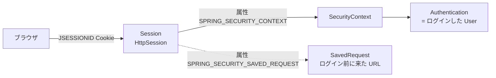
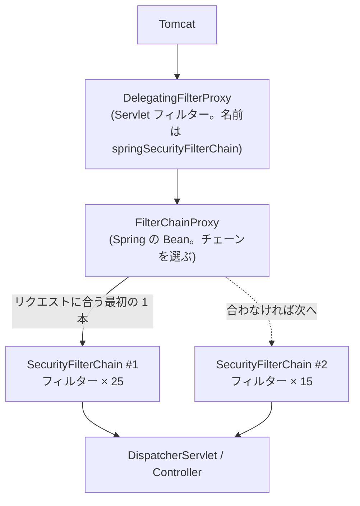
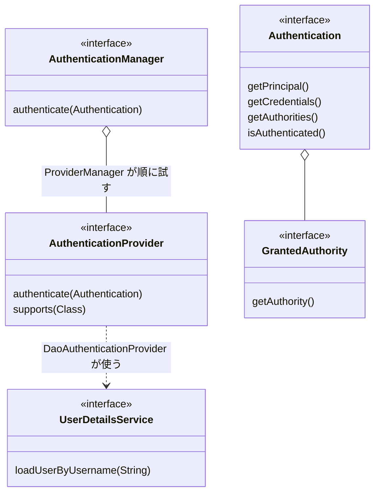
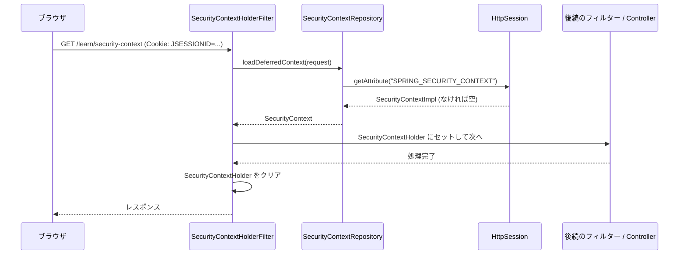
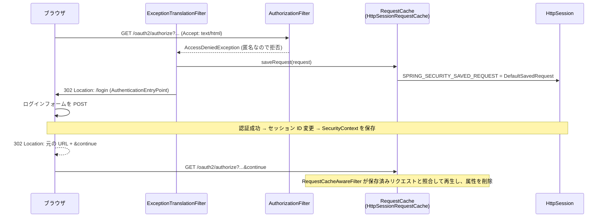

# 第3章 Spring Security の基礎

## この章のゴール

この章を終えると、次の状態になります。

- ブラウザからのリクエストが `DelegatingFilterProxy` → `FilterChainProxy` → `SecurityFilterChain` と進む様子を説明でき、2 本のチェーンのどちらが選ばれるかを URL から判断できる。
- 2 章の IdP の 2 本のチェーンに、実際にどのフィルターが何個入っているかを、実行結果で示せる。
- ログインすると `HttpSession` の `SPRING_SECURITY_CONTEXT` 属性に `SecurityContext` が入り、`JSESSIONID` Cookie がそのキーになることを curl で確かめられる。ログイン前後でセッション ID が変わることも確かめられる。
- 未ログインで `/oauth2/authorize` に来たリクエストが `SavedRequest` として保存され、ログイン後に同じ URL へ戻る仕組みを説明できる。
- CSRF 対策が IdP のどのエンドポイントに効いていて、どれに効いていないかを言える。

## ドメインモデル上の位置づけ

1 章のモデルのうち、この章で扱うのは **Session** と、その中身である「誰がログインしているか」です。Token や Authorization はまだ出てきません。



IdP のログイン状態は、突き詰めると「サーバー側の `HttpSession` に `SecurityContext` が入っているかどうか」です。10 章で「client_id ごとにセッションを分ける」ときは、この入れ物の出し入れを差し替えます。そのために、この章で出し入れの仕組みを丁寧に見ておきます。

## たとえると

IdP を「ホテルのフロント」にたとえます。この章の中心は、フロントに着くまでの**館内の動線と受付の手順**です。

| ホテル | Spring Security |
|---|---|
| 玄関から入ってフロントまでの通路 | `FilterChainProxy` |
| 通路の途中にある受付・手荷物検査・ゲートの並び | `SecurityFilterChain` とその中のフィルター |
| 宿泊客用の通路と、業者用の通路 | 複数の `SecurityFilterChain` |
| 宿泊者名簿への記帳 | `SecurityContext` に `Authentication` を入れる |
| 名簿の置き場所 (フロントの引き出し) | `HttpSession` |
| 引き出しの鍵に付けた番号札 | `JSESSIONID` Cookie |
| 「ご用件は?」と聞かれ、まず記帳を求められる | `AuthenticationEntryPoint` |
| 記帳のあと、元の用件に戻してくれる | `SavedRequest` と `RequestCache` |

合わないところもあります。ホテルの名簿は紙なので持ち出せますが、`SecurityContext` は**サーバー側の入れ物**です。ブラウザが持っているのは番号札 (`JSESSIONID`) だけで、名簿の中身は持っていません。また、実際のホテルでは「記帳したら鍵の番号札を取り替える」ことはしませんが、Spring Security はログイン時に番号札を取り替えます (セッション固定化対策。後述)。

## この章のサンプルでやること

`samples/ch03-security-basics` は 2 章のサンプルのコピーに、観察用の仕掛けを足したものです。差分は次のとおりです。

| ファイル | 内容 |
|---|---|
| `learn/FilterChainInspector.java` | 各 `SecurityFilterChain` のフィルター一覧を作り、起動時にログへ出す (学習用) |
| `learn/LearningController.java` | 現在の `Authentication` と `HttpSession` の属性を返す `/learn/*` エンドポイント (学習用) |
| `config/SecurityConfig.java` | `/learn/*` と `/error` の認可ルール、`admin` ユーザーを追加 |
| `SecurityBasicsTests.java` | この章の挙動を固定する 17 件のテスト |

`learn` パッケージは**学習用**で、本番の IdP には置きません。コード中のコメントにもそう書いてあります。

## リクエストはフィルターを通ってくる

### 3 つの登場人物

Servlet コンテナ (Tomcat) から見ると、Spring Security は「Servlet フィルター 1 個」です。その中で、さらに多数のフィルターが動きます。



- `DelegatingFilterProxy` は、Servlet コンテナに登録される「橋渡し役」のフィルターです。Spring の Bean (`springSecurityFilterChain`) に処理を委譲します。Spring Boot では `SecurityFilterAutoConfiguration` が `DelegatingFilterProxyRegistrationBean` を `springSecurityFilterChain` という名前で登録しています (`javap` で確認)。
- `FilterChainProxy` が、登録されている `SecurityFilterChain` を**登録順に**試し、リクエストに合う**最初の 1 本だけ**を使います (ソースの `getFilters(HttpServletRequest)`)。
- `SecurityFilterChain` は「どのリクエストに適用するか (matcher)」と「通すフィルターの並び」の組です。

### 複数チェーンの選ばれ方

2 章の `SecurityConfig` には、次の 2 本のチェーンがあります。順序は `@Order` で決まります。

`samples/ch03-security-basics/src/main/java/com/example/idp/config/SecurityConfig.java` (2 章から変更なし)

```java
    @Bean
    @Order(1)
    SecurityFilterChain authorizationServerSecurityFilterChain(HttpSecurity http) throws Exception {
        http
            .oauth2AuthorizationServer(authorizationServer -> {
                // このチェーンの対象を「認可サーバーのエンドポイントだけ」に絞る
                http.securityMatcher(authorizationServer.getEndpointsMatcher());
                // OpenID Connect 1.0 を有効化 (ディスカバリ / UserInfo / ID トークン)
                authorizationServer.oidc(withDefaults());
            })
```

1 本目は `securityMatcher` で「認可サーバーのエンドポイントだけ」に絞っています。2 本目 (`@Order(2)`) は `securityMatcher` がないので「すべてのリクエスト (any request)」に合います。そのため**順序が逆だと 1 本目に到達しません**。実際に `@Order` を入れ替えて起動すると、次の例外でアプリケーションが起動しませんでした。

```text
org.springframework.security.web.UnreachableFilterChainException: A filter chain that matches any request [DefaultSecurityFilterChain defined as 'defaultSecurityFilterChain' ...] ... will never get invoked. Please use `HttpSecurity#securityMatcher` to ensure that there is only one filter chain configured for 'any request' and that the 'any request' filter chain is published last.
```

(メッセージは途中を省略しています。「any request のチェーンは最後に置く」と教えてくれます。)

ルールをまとめます。

- `@Order` の小さいチェーンから順に matcher を試す。
- 絞り込みたいチェーンには `securityMatcher` を付け、先に置く。
- 何も絞らない (any request) チェーンは必ず最後に置く。

どの URL がどちらに入るかは、`FilterChainProxy#getFilters(String url)` で確かめられます。テストでこう固定しています。

`samples/ch03-security-basics/src/test/java/com/example/idp/SecurityBasicsTests.java`

```java
    @Test
    void リクエストのURLによって別のチェーンが選ばれる() {
        // FilterChainProxy は登録順 (@Order 順) に matcher を試し、最初に合ったチェーンを使う
        assertThat(filterNames("/oauth2/jwks")).isEqualTo(inspector.describe().get(0).filters());
        assertThat(filterNames("/.well-known/openid-configuration")).isEqualTo(inspector.describe().get(0).filters());
        assertThat(filterNames("/login")).isEqualTo(inspector.describe().get(1).filters());
        assertThat(filterNames("/learn/security-context")).isEqualTo(inspector.describe().get(1).filters());
    }
```

matcher は URL だけでなく **HTTP メソッドも見ます**。`getFilters(String)` はソース上、`FilterInvocation(url, "GET")` で GET のリクエストを作って試すので、POST 専用の `/oauth2/token` は 1 本目に入りません (これもテストにしてあります)。実際のブラウザや curl の POST では 1 本目が使われます。

### 実際に入っているフィルター

`FilterChainInspector` が、各チェーンのフィルターのクラス名を一覧にします。起動時にログへ出し、`/learn/filters` でも同じ内容を JSON で返します。

`FilterChainInspector` (`learn/FilterChainInspector.java`) は、`FilterChainProxy#getFilterChains()` で全チェーンを取り、各チェーンの `getFilters()` のクラス名を並べるだけの Bean です。

起動して得たログ (`mvn spring-boot:run`、ポート番号以外は実行結果のままです) から、フィルター名だけを抜き出します。

**チェーン #1: `OAuth2AuthorizationServerConfigurer$$Lambda` (認可サーバーのエンドポイント用。25 個)**

1. DisableEncodeUrlFilter 2. WebAsyncManagerIntegrationFilter 3. **SecurityContextHolderFilter** 4. AuthorizationServerContextFilter 5. HeaderWriterFilter 6. **CsrfFilter** 7. OidcLogoutEndpointFilter 8. LogoutFilter 9. OAuth2AuthorizationServerMetadataEndpointFilter 10. OAuth2AuthorizationCodeRequestValidatingFilter 11. OidcProviderConfigurationEndpointFilter 12. NimbusJwkSetEndpointFilter 13. OAuth2ProtectedResourceMetadataFilter 14. OAuth2ClientAuthenticationFilter 15. BearerTokenAuthenticationFilter 16. RequestCacheAwareFilter 17. SecurityContextHolderAwareRequestFilter 18. AnonymousAuthenticationFilter 19. **ExceptionTranslationFilter** 20. **AuthorizationFilter** 21. OAuth2AuthorizationEndpointFilter 22. OAuth2TokenEndpointFilter 23. OAuth2TokenIntrospectionEndpointFilter 24. OAuth2TokenRevocationEndpointFilter 25. OidcUserInfoEndpointFilter

**チェーン #2: `any request` (ログイン画面など。15 個)**

1. DisableEncodeUrlFilter 2. WebAsyncManagerIntegrationFilter 3. **SecurityContextHolderFilter** 4. HeaderWriterFilter 5. **CsrfFilter** 6. LogoutFilter 7. **UsernamePasswordAuthenticationFilter** 8. DefaultResourcesFilter 9. DefaultLoginPageGeneratingFilter 10. DefaultLogoutPageGeneratingFilter 11. RequestCacheAwareFilter 12. SecurityContextHolderAwareRequestFilter 13. AnonymousAuthenticationFilter 14. **ExceptionTranslationFilter** 15. **AuthorizationFilter**

読み取れることを挙げます。

- 太字の 4 つ (`SecurityContextHolderFilter` → `CsrfFilter` → `ExceptionTranslationFilter` → `AuthorizationFilter`) は両方のチェーンにあり、この順序で並びます。`ExceptionTranslationFilter` は `AuthorizationFilter` の**直前**にいます。後ろで投げられる例外を受け止める位置だからです (テストで固定しています)。
- ログインフォームの処理 (`UsernamePasswordAuthenticationFilter`) は #2 だけにあります。ログインのしくみは #1 にはありません。
- `OAuth2AuthorizationEndpointFilter` や `OAuth2TokenEndpointFilter` など、プロトコルの処理は #1 のフィルターとして実装されています。`/oauth2/authorize` は Controller ではなくフィルターが処理します。
- #1 の `OAuth2ClientAuthenticationFilter` は、`/oauth2/token` でクライアント (`client_secret_basic` など) を認証します。人間のログインとは別の認証が、別のチェーンで動いています。
- どちらのチェーンにも `SessionManagementFilter` はありませんでした。Spring Security 7 でもセッション固定化対策は働きますが、フィルターではなく、認証フィルターが認証成功時に呼ぶ `SessionAuthenticationStrategy` が担当します (後述)。

どのチェーンが使われたかは、`FilterChainProxy` のトレースログでも見られます。`--logging.level.org.springframework.security.web.FilterChainProxy=TRACE` を付けて起動し、`/oauth2/jwks` と `/learn/security-context` を呼ぶと、次の行が出ました (`(n/N)` の N がそのチェーンのフィルター数です)。

```text
Securing GET /oauth2/jwks
Invoking DisableEncodeUrlFilter (1/25)
Securing GET /learn/security-context
Invoking DisableEncodeUrlFilter (1/15)
Invoking AuthorizationFilter (15/15)
```

## 認証のモデル

ログインの結果を表す型と、それを作る型を整理します。



| 型 | 役割 |
|---|---|
| `Authentication` | 「誰か」を表す。認証前は「ユーザー名とパスワード (未検証)」、認証後は「本人と権限 (検証済み)」を持つ |
| `AuthenticationManager` | `Authentication` を受け取り、検証済みの `Authentication` を返す (失敗なら例外) |
| `AuthenticationProvider` | 特定の種類の認証を実際に行う。`AuthenticationManager` の実装 `ProviderManager` が、対応できるものを順に試す |
| `UserDetailsService` | ユーザー名からユーザー情報 (`UserDetails`) を引く保管庫。2 章の `InMemoryUserDetailsManager` がこれ |
| `GrantedAuthority` | 権限 1 つを表す文字列。`hasRole("ADMIN")` は `ROLE_ADMIN` という権限を探す |

フォームログインでは、`UsernamePasswordAuthenticationFilter` が `AuthenticationManager` に処理を頼み、パスワードの照合が `DaoAuthenticationProvider` ( `UserDetailsService` で引いたユーザーを `PasswordEncoder` で照合する) で行われます。起動ログの `Global AuthenticationManager configured with UserDetailsService bean with name userDetailsService` という 1 行が、2 章で定義した `UserDetailsService` が使われていることを示しています。`ProviderManager` の中身を実行時に列挙することまではしていません (**未検証**。ソースと上記ログによる確認です)。

### ログインした結果の `Authentication`

`LearningController` がいまの `Authentication` を返します。学習用であることを、コメントで明示しています。

`samples/ch03-security-basics/src/main/java/com/example/idp/learn/LearningController.java` (前半を抜粋)

```java
        // SecurityContextHolder (= いまのスレッドに結び付いた SecurityContext)
        SecurityContext context = SecurityContextHolder.getContext();
        Authentication authentication = context.getAuthentication();
        Map<String, Object> auth = new LinkedHashMap<>();
        auth.put("type", authentication.getClass().getSimpleName());
        auth.put("name", authentication.getName());
        auth.put("authenticated", authentication.isAuthenticated());
        auth.put("principalType", authentication.getPrincipal().getClass().getSimpleName());
        auth.put("authorities", authentication.getAuthorities().stream()
            .map(GrantedAuthority::getAuthority).sorted().toList());
        body.put("authentication", auth);
```

後半は `request.getSession(false)` で `HttpSession` を取り出し、属性名とその値のクラス名を返します (観察のためにセッションを新規作成しないよう `false` を渡します)。
セッション ID は漏れると乗っ取りに使えるため、値そのものではなく先頭 6 文字だけ返します。

## SecurityContext とセッション

### 3 つの型の役割

| 型 | 役割 |
|---|---|
| `SecurityContext` | `Authentication` を 1 つ入れるだけの入れ物 |
| `SecurityContextHolder` | 「いまのリクエストを処理しているスレッド」の `SecurityContext` を持つ。Controller やサービスから `getContext()` で取り出せる (既定はスレッドローカル) |
| `SecurityContextRepository` | `SecurityContext` を**リクエストをまたいで**保存・復元する。`loadDeferredContext` / `saveContext` を持つ |

`SecurityContextHolder` はリクエストが終わると空に戻ります。ログイン状態がリクエストをまたいで続くのは、`SecurityContextRepository` が `HttpSession` に保存・復元しているからです。

Spring Security 7 の既定のリポジトリは、`SessionManagementConfigurer` のソースでは `HttpSessionSecurityContextRepository` と `RequestAttributeSecurityContextRepository` を束ねた `DelegatingSecurityContextRepository` です。セッションが使える設定ではこの組み合わせが使われます (ソース確認)。

### 毎リクエストの流れ



- `SecurityContextHolderFilter` はチェーンの 3 番目にいて、リポジトリから `SecurityContext` を**読み込む役**です。実際の読み込みは、中身が必要になるまで遅延されます (`loadDeferredContext`)。
- 読み込むだけで、**保存はしません**。保存するのは、認証に成功した側 (例: `UsernamePasswordAuthenticationFilter` が `AbstractAuthenticationProcessingFilter#successfulAuthentication` で `saveContext` を呼ぶ) です (ソース確認)。旧バージョンの `SecurityContextPersistenceFilter` のように、毎回自動で保存し直すことはしません。
- 未ログインのとき `SecurityContext` は空で、後ろの `AnonymousAuthenticationFilter` が `AnonymousAuthenticationToken` を入れます。

### ログインすると HttpSession の何が変わるか

curl で確かめます。起動は `mvn spring-boot:run -Dspring-boot.run.arguments=--server.port=9000` (動作確認では別ポートを使いましたが、出力中のポート番号だけ 9000 に置き換えて載せます)。以降のコマンドの `A` は、`/oauth2/authorize` の URL です。

```bash
B=http://localhost:9000
A="$B/oauth2/authorize?response_type=code&client_id=web-client&redirect_uri=http://127.0.0.1:8080/login/oauth2/code/idp&scope=openid&code_challenge=E9Melhoa2OwvFrEMTJguCHaoeK1t8URWbuGJSstw-cM&code_challenge_method=S256&state=xyz"
```

**(1) 何も持たずに `/learn/security-context` を呼ぶ**

```text
HTTP/1.1 200
Content-Type: application/json

{"authentication":{"type":"AnonymousAuthenticationToken","name":"anonymousUser","authenticated":true,"principalType":"String","authorities":["ROLE_ANONYMOUS"]},"session":{"exists":false}}
```

未ログインでも `Authentication` は存在します (`AnonymousAuthenticationToken`)。`authenticated: true` ですが、これは「匿名として扱う」という意味で、ログイン済みではありません。セッションは作られていません。

**(2) 未ログインで `/oauth2/authorize` に来る (Cookie を保存する)**

```bash
curl -si -c jar -H 'Accept: text/html' "$A"
curl -s -b jar $B/learn/security-context
```

```text
HTTP/1.1 302
Set-Cookie: JSESSIONID=00D35164E3830FF80149F724C2EAEA3B; Path=/; HttpOnly
Location: http://localhost:9000/login
```

```text
{"authentication":{"type":"AnonymousAuthenticationToken","name":"anonymousUser","authenticated":true,"principalType":"String","authorities":["ROLE_ANONYMOUS"]},"session":{"exists":true,"idPrefix":"00D351","attributes":{"SPRING_SECURITY_SAVED_REQUEST":"DefaultSavedRequest"}}}
```

まだログインしていないのに `JSESSIONID` が発行されました。理由は `SPRING_SECURITY_SAVED_REQUEST` です (次の節)。`SPRING_SECURITY_CONTEXT` はまだありません。

**(3) ログインする**

CSRF トークンが要るので、ログインページから取り出して POST します。

```bash
CSRF=$(curl -s -b jar -c jar $B/login | grep -o 'name="_csrf" type="hidden" value="[^"]*"' | sed 's/.*value="//;s/"//')
curl -si -b jar -c jar -X POST --data-urlencode "_csrf=$CSRF" -d 'username=user&password=password' $B/login
curl -s -b jar $B/learn/security-context
```

```text
HTTP/1.1 302
Set-Cookie: JSESSIONID=FD5ACE651D60D4E30A6B6FC4B6C552FC; Path=/; HttpOnly
Location: http://localhost:9000/oauth2/authorize?response_type=code&client_id=web-client&redirect_uri=http://127.0.0.1:8080/login/oauth2/code/idp&scope=openid&code_challenge=E9Melhoa2OwvFrEMTJguCHaoeK1t8URWbuGJSstw-cM&code_challenge_method=S256&state=xyz&continue
```

```text
{"authentication":{"type":"UsernamePasswordAuthenticationToken","name":"user","authenticated":true,"principalType":"User","authorities":["FACTOR_PASSWORD","ROLE_USER"]},"session":{"exists":true,"idPrefix":"FD5ACE","attributes":{"SPRING_SECURITY_CONTEXT":"SecurityContextImpl","SPRING_SECURITY_SAVED_REQUEST":"DefaultSavedRequest"}}}
```

ここから分かることです。

1. **`SPRING_SECURITY_CONTEXT` に `SecurityContextImpl` が入った。** セッションに入るのは `Authentication` そのものではなく `SecurityContext` です。属性名は `HttpSessionSecurityContextRepository.SPRING_SECURITY_CONTEXT_KEY` という定数 (値は `"SPRING_SECURITY_CONTEXT"`) です。
2. **`JSESSIONID` の値が変わった。** `00D351...` から `FD5ACE...` へ。属性 (`SPRING_SECURITY_SAVED_REQUEST`) は引き継がれています。これがセッション固定化対策です。
3. **`Authentication` の型は `UsernamePasswordAuthenticationToken`、principal は `User` (`UserDetails` の実装)。**
4. **権限に `FACTOR_PASSWORD` が付いている。** Spring Security 7 で入った、「どの認証要素で認証したか」を表す権限です (`FactorGrantedAuthority.PASSWORD_AUTHORITY`)。`DaoAuthenticationProvider` の親クラス `AbstractUserDetailsAuthenticationProvider` が、認証成功時に付けています (ソース確認)。13 章の多要素認証で意味を持ちます。2 章の `roles("USER")` が `ROLE_USER` になっていることも確認できます。
5. ブラウザは、サーバーが決めた値の `JSESSIONID` Cookie だけを持っています。`Authentication` の中身は Cookie にありません。

### セッション固定化対策

セッション固定化攻撃とは、攻撃者が自分で取得した (まだ未ログインの) セッション ID を被害者に使わせ、被害者がログインした後で同じ ID を使って乗っ取る攻撃です。対策は「ログインの瞬間にセッション ID を取り替える」ことです。

Spring Security の既定は `ChangeSessionIdAuthenticationStrategy` です (`SessionManagementConfigurer` のソース確認)。Servlet の `request.changeSessionId()` で、セッションの中身を保ったまま ID だけを変えます。上の (3) で ID が変わったのはこのためです。

テストでも固定していますが、ここに落とし穴がありました。MockMvc で `.session(session)` を渡しただけでは ID が変わりません。`AbstractSessionFixationProtectionStrategy#onAuthentication` が、`request.isRequestedSessionIdValid()` が true のときだけ ID を変えるためです。ブラウザなら `JSESSIONID` Cookie を送るので true ですが、MockMvc では `requestedSessionId` を自分で設定する必要があります。

`samples/ch03-security-basics/src/test/java/com/example/idp/SecurityBasicsTests.java`

```java
    private ResultActions login(MockHttpSession session, String username) throws Exception {
        return mvc.perform(post("/login")
            .session(session)
            .with(request -> {
                request.setRequestedSessionId(session.getId());
                return request;
            })
            .with(csrf())
            .param("username", username)
            .param("password", "password"));
    }
```

```java
    @Test
    void ログインするとセッションIDが変わる_セッション固定化対策() throws Exception {
        MockHttpSession session = new MockHttpSession();
        // 未ログインでも、元のリクエストを覚えるためにセッションが作られる
        authorizeRequest(session);
        String before = session.getId();

        login(session, "user");

        assertThat(session.getId()).isNotEqualTo(before);
        // 変わるのは ID だけで、属性 (覚えておいたリクエスト) は引き継がれる
        assertThat(session.getAttribute(SAVED_REQUEST_ATTR)).isNotNull();
    }
```

### 認証状態は「セッションの属性」で決まる

「ログイン状態の正体は `SPRING_SECURITY_CONTEXT` 属性だ」ということを、テストで確かめています。別のセッションにこの属性をそのままコピーすると、ログイン済みとして扱われます。属性を消すと、同じセッション ID でも未ログインに戻ります。

```java
        // 別のセッション (= 別のブラウザ) に SecurityContext をそのまま移すと、ログイン済みとして扱われる。
        // SecurityContextHolderFilter が毎回 SecurityContextRepository から復元しているため。
        MockHttpSession another = new MockHttpSession();
        another.setAttribute(CONTEXT_ATTR, loggedIn.getAttribute(CONTEXT_ATTR));
        mvc.perform(get("/learn/security-context").session(another))
            .andExpect(jsonPath("$.authentication.name").value("user"));

        // 属性を消せば、同じセッション ID でも未ログインに戻る
        loggedIn.removeAttribute(CONTEXT_ATTR);
        mvc.perform(get("/learn/security-context").session(loggedIn))
            .andExpect(jsonPath("$.authentication.type").value("AnonymousAuthenticationToken"));
```

10 章では、この「`HttpSession` のどの属性に入れるか、どのセッションから取り出すか」を `SecurityContextRepository` の差し替えで変えます。`client_id` ごとに別の属性名 (別のセッション) を使えば、同じブラウザでもクライアントごとに別のログイン状態を持たせられます。ここで押さえておくのは次の 3 点です。

- 読み込み (`SecurityContextHolderFilter`) と保存 (認証フィルター) は、どちらも `SecurityContextRepository` を通る。
- 既定の属性名は `SPRING_SECURITY_CONTEXT` の 1 つだけ。だから 1 ブラウザ = 1 ログイン状態になる。
- セッション ID の変更は、リポジトリとは別に `SessionAuthenticationStrategy` が担当する。

## 未ログインのときの流れ

未ログインで `/oauth2/authorize` に来たときの全体像です。



### ExceptionTranslationFilter と AuthenticationEntryPoint

`AuthorizationFilter` は、認可に失敗すると `AccessDeniedException` を投げます。それを受け止めるのが直前にいる `ExceptionTranslationFilter` です。

- 匿名ユーザーが拒否されたとき → 認証を始めさせる。`AuthenticationEntryPoint` を呼ぶ。
- ログイン済みユーザーが権限不足で拒否されたとき → `AccessDeniedHandler` が 403 を返す。

2 章の 1 本目のチェーンは、`AuthenticationEntryPoint` に `LoginUrlAuthenticationEntryPoint("/login")` を、`MediaTypeRequestMatcher(MediaType.TEXT_HTML)` つき (ブラウザのとき) で登録しています。

```java
            // 未ログインのブラウザが /oauth2/authorize に来たらログイン画面へ送る
            .exceptionHandling(exceptions -> exceptions.defaultAuthenticationEntryPointFor(
                new LoginUrlAuthenticationEntryPoint("/login"),
                new MediaTypeRequestMatcher(MediaType.TEXT_HTML)));
```

`Accept` が `text/html` を受け付けないリクエスト (例: `Accept: application/json`) は、リダイレクトではなく 401 (`WWW-Authenticate: Bearer ...`) になります。curl の既定の `Accept: */*` は `text/html` を受け付ける扱いなので、`/login` へ送られます (2 章で確かめたとおりです)。2 本目のチェーンは `formLogin` が自動でエントリーポイントを設定するので、ブラウザで `/learn/admin` を開くと `/login` へ送られます (テストで固定)。

リダイレクト先は、実際に起動して curl で見ると `Location: http://localhost:9000/login` と絶対 URL です。MockMvc のテストでは相対パス `/login` になります (2 章のテストはこちら)。サーブレットコンテナがリダイレクトを組み立てるかどうかの差です。

### RequestCache と SavedRequest

`ExceptionTranslationFilter` はエントリーポイントを呼ぶ前に、`RequestCache` へリクエストを保存します。既定の実装 `HttpSessionRequestCache` は、`SPRING_SECURITY_SAVED_REQUEST` という名前の `HttpSession` 属性に `DefaultSavedRequest` を入れます。そのため、**未ログインでも `JSESSIONID` が発行されました**。(2) のとおりです。

保存の条件は `RequestCacheConfigurer` のソースで決まっています。CSRF が有効なら GET リクエストだけで、`/favicon.ico`、`Accept: application/json`、`X-Requested-With: XMLHttpRequest`、`multipart/form-data`、`text/event-stream`、WebSocket は保存されません。API 呼び出しの失敗が「ログイン後の戻り先」にならないためです。

ログイン成功後の戻りは、次のとおりに動きます。

1. `formLogin` が使う `SavedRequestAwareAuthenticationSuccessHandler` が保存済みのリクエストを探し、その URL にリダイレクトする。URL の末尾には `continue` というパラメーターが付く (上の (3) の `Location` の `&continue`)。
2. ブラウザがその URL にリクエストする。
3. チェーンにいる `RequestCacheAwareFilter` が、`continue` つきのリクエストを保存済みのものと照合する。
4. 一致したら保存済みのリクエストに置き換えて処理を続け、属性を消す。

(3)(4) の動きを curl で追います。ブラウザがリダイレクトに従う操作です。

```bash
curl -si -b jar -c jar "$A&continue"
curl -s -b jar $B/learn/security-context   # session のところだけ抜粋
```

```text
HTTP/1.1 302
Location: http://127.0.0.1:8080/login/oauth2/code/idp?code=UaEYbqW93n4uilCSsSS9uFVaEZnxknMfauxhRaj9d9o3GXNJW_TfvUkFUHOavx3giK-oBM4j-w6QMmwgD
```

```text
{'exists': True, 'idPrefix': 'FD5ACE', 'attributes': {'SPRING_SECURITY_CONTEXT': 'SecurityContextImpl'}}
```

ログイン済みなので、`/oauth2/authorize` が認可コードつきでクライアントの `redirect_uri` へ 302 を返しました (認可コードの意味は 4 章)。`SPRING_SECURITY_SAVED_REQUEST` は消えています。これが「ログイン後に元の `/oauth2/authorize` へ戻る」仕組みの全体です。IdP の認可リクエストの内容 (`client_id`、`code_challenge` など) は、すべて `SavedRequest` が覚えているので、ログイン画面はそれを知らなくて済みます。

## CSRF 対策

CSRF (Cross-Site Request Forgery) は、ログイン済みのブラウザに、攻撃者のページから「本人の意図しない POST」を送らせる攻撃です。Cookie は自動で付くので、サーバーは本人の操作と区別できません。対策は、HTML のフォームにしか入れられない**ランダムなトークン**を POST に要求することです。`CsrfFilter` がその検査をします。

2 本のチェーンの両方に `CsrfFilter` があります。効き方は違います。

| エンドポイント | チェーン | CSRF |
|---|---|---|
| `POST /login` (ログインフォーム) | #2 | **検査する** |
| `POST /logout` | #2 | **検査する** |
| `/oauth2/token`、`/oauth2/revoke`、`/oauth2/introspect` など | #1 | 対象外 |
| `/oauth2/authorize` (GET) | #1 | 対象外 (GET は元々検査しない) |
| `POST /oauth2/authorize` (同意画面からの送信。6 章) | #1 | 対象外。同意用の `state` で守る |

#1 が対象外なのは、`OAuth2AuthorizationServerConfigurer` が `csrf.ignoringRequestMatchers(this.endpointsMatcher)` を設定するためです (ソース確認)。これらはブラウザの Cookie ではなく、クライアント認証 (`client_secret_basic` など) やトークンで守られた、機械向けのエンドポイントです。実際に、CSRF トークンなしで `/oauth2/token` に誤ったクライアントシークレットで POST すると、`403` ではなくクライアント認証の失敗が返ります。

```bash
curl -si -X POST -u web-client:wrong -d grant_type=client_credentials $B/oauth2/token
```

```text
HTTP/1.1 401
{"error":"invalid_client"}
```

一方、ログインフォームにはトークンが要ります。トークンなしで POST すると 403 です。

```text
$ curl -si -b jar -X POST -d 'username=user&password=password' $B/login
HTTP/1.1 403
```

ログインページの HTML には、`<input name="_csrf" type="hidden" value="...">` が埋め込まれています。`HttpSessionCsrfTokenRepository` はトークンを `HttpSession` に保存します (属性名 `org.springframework.security.web.csrf.HttpSessionCsrfTokenRepository.CSRF_TOKEN`)。そのため、ログインページを取得した時点でセッションが使われます。

ログアウトも同様です。`POST /logout` はトークンが要り、成功するとセッションが無効化されます。テストで固定しています。

```java
        mvc.perform(post("/logout").session(session))
            .andExpect(status().isForbidden());
        assertThat(session.getAttribute(CONTEXT_ATTR)).isNotNull();

        mvc.perform(post("/logout").session(session).with(csrf()))
            .andExpect(status().is3xxRedirection());
        assertThat(session.isInvalid()).isTrue();
```

OIDC の RP-Initiated Logout (`/connect/logout`) は #1 の `OidcLogoutEndpointFilter` が処理しますが、CSRF の扱いは確かめていません (**未検証**)。ログアウトの設計は 12 章で扱います。

## 認可の基本

`authorizeHttpRequests` で「どの URL に誰が入れるか」を宣言します。`AuthorizationFilter` が、`SecurityContext` の `Authentication` と宣言を突き合わせます。

`samples/ch03-security-basics/src/main/java/com/example/idp/config/SecurityConfig.java`

```java
    @Order(2)
    SecurityFilterChain defaultSecurityFilterChain(HttpSecurity http) throws Exception {
        http
            .authorizeHttpRequests(authorize -> authorize
                // 認可の観察用 (第3章): 先に書いたルールが優先される。具体的なルールを上、anyRequest を最後に置く
                .requestMatchers("/learn/admin").hasRole("ADMIN")
                // 未ログインの状態 (AnonymousAuthenticationToken) も観察できるよう、学習用エンドポイントだけ開けている
                .requestMatchers("/learn/security-context", "/learn/filters").permitAll()
                // /error を開けておかないと、CSRF 失敗などの 403 が「ログイン画面へのリダイレクト」に化ける (第3章 つまずきポイント)
                .requestMatchers("/error").permitAll()
                .anyRequest().authenticated())
            .formLogin(withDefaults());
        return http.build();
    }
```

| 宣言 | 意味 |
|---|---|
| `permitAll()` | 誰でも (匿名でも) 通す |
| `authenticated()` | ログイン済みなら通す |
| `hasRole("ADMIN")` | `ROLE_ADMIN` 権限があれば通す (`ROLE_` は自動で付く) |
| `anyRequest()` | 上のどれにも合わなかったすべて |

- ルールは**上から順に**評価され、最初に合ったものが使われます。具体的なものを上に、`anyRequest()` を最後に置きます。
- 拒否されたときの動きは、匿名なら「エントリーポイント (ログインへ)」、ログイン済みなら「403」です。テストで固定しています。

```java
    @Test
    void ROLE_ADMINが必要なURLはUSERだと403でADMINなら通る() throws Exception {
        MockHttpSession user = new MockHttpSession();
        login(user, "user");
        mvc.perform(get("/learn/admin").session(user)).andExpect(status().isForbidden());
        // ...
```

curl でも同じです (`user` でログインした Cookie で `/learn/admin` を呼ぶと `403`)。

## つまずきポイント

### CSRF エラーなのにログイン画面にリダイレクトされる

- 症状: `POST /login` に CSRF トークンを付け忘れると、本来は 403 のはずが `302 Location: /login` になり、ログイン画面に戻される。ログに原因が出ず、パスワードの間違いに見える。
- 原因: CSRF の失敗で 403 が返ると、Tomcat は `/error` へエラーディスパッチします。`/error` が `authenticated()` の対象だと、匿名のエラーディスパッチが拒否され、エントリーポイントが働いて `/login` へのリダイレクトになります。さらに `/error` が `SavedRequest` として保存され、ログイン後の戻り先まで `/error` になります。このサンプルから `/error` の行を外した状態で `POST /login` (トークンなし) を試すと、`HTTP/1.1 302` と `Location: http://localhost:9000/login` が返りました。
- 対処: `.requestMatchers("/error").permitAll()` を入れる。この章のサンプルはそうしてあり、`HTTP/1.1 403` になります。

### ログインしたのに `JSESSIONID` が前と違う、あるいは変わらない

- 症状: 前に控えておいた `JSESSIONID` がログイン後に使えなくなる。逆に、テストでは ID が変わらない。
- 原因: 前者は仕様です (セッション固定化対策)。後者は MockMvc で `requestedSessionId` を設定していないためで、本番の挙動ではありません。
- 対処: クライアント側はログイン後の `Set-Cookie` を必ず受け取る。テストでは `request.setRequestedSessionId(session.getId())` を設定する。

### 未ログインなのにセッションが作られている

- 症状: ログイン前に `JSESSIONID` が発行され、「ログインしていないのにセッションがある」と驚く。
- 原因: `HttpSessionRequestCache` が `SavedRequest` を保存するためにセッションを作る。
- 対処: 仕様なので問題ない。ただし、ヘルスチェックなどが `Accept: text/html` の GET で認証が必要な URL を叩くと、そのたびにセッションが増える。不要ならそういう URL を `permitAll()` にするか、`RequestCache` を `NullRequestCache` に差し替える (差し替えは**未検証**)。

### `@Order` の順序を間違えると起動しない

- 症状: 起動時に `UnreachableFilterChainException`。
- 原因: any request のチェーンが先に並び、後ろのチェーンに到達できない。
- 対処: `securityMatcher` で絞るチェーンを先 (小さい `@Order`) に、絞らないチェーンを最後にする。

## まとめ

- リクエストは `DelegatingFilterProxy` → `FilterChainProxy` → 最初に合った 1 本の `SecurityFilterChain` の順に進む。2 章の IdP では、認可サーバー用の 25 個のフィルターのチェーンと、ログイン用の 15 個のチェーンがあり、`@Order` と `securityMatcher` で振り分けられる。any request のチェーンは最後に置く。
- ログイン状態の正体は、`HttpSession` の `SPRING_SECURITY_CONTEXT` 属性に入った `SecurityContext`。ブラウザが持つのは `JSESSIONID` だけで、`SecurityContextHolderFilter` が毎リクエスト、`SecurityContextRepository` から復元する。
- ログイン成功時に、認証フィルターが `SecurityContext` を保存し、セッション ID を変更する (セッション固定化対策)。Spring Security 7 では認証権限に `FACTOR_PASSWORD` が付く。
- 未ログインの `/oauth2/authorize` は `ExceptionTranslationFilter` が受け止め、リクエストを `SPRING_SECURITY_SAVED_REQUEST` に保存して `/login` へ送る。ログイン後は `continue` つきの URL で元のリクエストに戻る。
- CSRF 検査は、ログインフォームとログアウト (チェーン #2) に効く。`/oauth2/token` などのプロトコルエンドポイント (チェーン #1) は対象外で、クライアント認証で守られる。
- `authorizeHttpRequests` は上から順に評価する。`/error` を開けておかないと、403 がログインへのリダイレクトに見える。

## 次の章へ

この章で、「ログインしたブラウザ」が何を持ち、IdP がどのように見分けているかが分かりました。次の 4 章では、このログイン済みのセッションを使って、認可コードフローと PKCE の中身を 1 ステップずつ追います。`/oauth2/authorize` が何を検証して認可コードを発行するのかを、今回のフィルターの並びと照らし合わせて読めるはずです。
