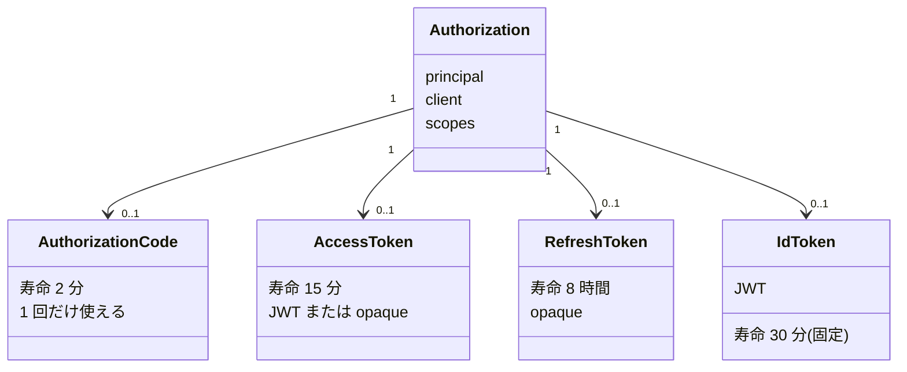

# 第5章 トークン

## この章のゴール

- IdP が発行する 4 種類のトークン (認可コード / アクセストークン / リフレッシュトークン / ID トークン) を、「誰が誰に見せるものか」「寿命」「形式」で説明できる。
- この IdP が発行した JWT (アクセストークン・ID トークン) をデコードして、各クレームの意味を言える。
- 署名鍵を `JWKSource<SecurityContext>` Bean で定義して鍵ファイルに保存 (リポジトリには置かない) し、`/oauth2/jwks` の公開鍵でテストから署名を検証できる。
- `TokenSettings` の全項目と、自己完結型 (JWT) / 参照型 (opaque) の違いを説明でき、参照型を `/oauth2/introspect` で読める。
- トークンの失効 (`/oauth2/revoke`) と、リフレッシュトークンのローテーションの挙動を、実際に動かして確かめている。

完成形のサンプルは `samples/ch05-tokens` です。`mvn test` で 21 件 (うちこの章の 18 件) が通ります。

## ドメインモデル上の位置づけ

1 章のモデルのうち、この章は **Token** と、その発行の根拠になる **Authorization** を扱います。Token は Authorization (「誰が」「どのクライアントに」「何を許したか」) から派生して作られます。



図の寿命はこの章のサンプルの設定値です。ID トークンだけは設定で変えられません (後述)。

## たとえると

ホテルで考えます。チェックインのとき、フロント (IdP) は本人確認のうえで次のものを渡します。

- **認可コード**: 引換券。提携施設 (クライアント) の係員が、フロントの裏口で 1 回だけカードキーと交換できる。
- **アクセストークン**: カードキー。客室やジムの扉 (リソースサーバー) にかざす。扉は「どの階・どの時間帯に使えるか」が刻印されているのを読む。
- **リフレッシュトークン**: 延泊用の引換証。カードキーの期限が切れたとき、フロントで新しいカードキーに替えてもらう。
- **ID トークン**: 宿泊者証明書。「この人が、いつ、どうやって本人確認されたか」を提携施設に伝えるもので、扉にはかざさない。

自己完結型は「刻印を読めば扉が自分で判断できるカードキー」、参照型は「番号だけが書かれていて、扉がフロントに電話して中身を確認するカードキー」です。

たとえが合わない箇所があります。実際のカードキーは紛失したらフロントが登録を消せば全扉で使えなくなりますが、自己完結型のアクセストークンは、扉がフロントに電話しない限り、失効が扉に伝わりません (後述)。

## 4 種類のトークンの比較

| 種類 | 誰が誰に見せる | 寿命 (この章の web-client) | 形式 |
|---|---|---|---|
| 認可コード | クライアントが IdP の `/oauth2/token` に見せる | 2 分 (既定 5 分)。1 回限り | opaque (ただのランダム文字列) |
| アクセストークン | クライアントがリソースサーバーに見せる | 15 分 (既定 5 分) | JWT (既定) または opaque |
| リフレッシュトークン | クライアントが IdP の `/oauth2/token` に見せる | 8 時間 (既定 60 分) | opaque |
| ID トークン | IdP がクライアントに渡す。クライアントが検証して読む | 30 分 (固定) | JWT |

押さえておく点です。

- ID トークンは **クライアントが読むためのもの**で、リソースサーバーに渡してはいけません。アクセストークンはクライアントにとって **中身を読む必要のない通行証**です (読めても、読む前提にしない)。
- 認可コードとリフレッシュトークンは、実際の接続先が IdP 自身です。外部に見せる相手が「IdP だけ」なので、中身を持たない opaque で足ります。
- 認可コード自体は第4章で扱いました。この章では残りの 3 つを扱います。

## JWT の構造

JWT (JSON Web Token、RFC 7519) は、`.` で区切った 3 つの部分を Base64URL で表した文字列です。

```
<ヘッダー>.<ペイロード>.<署名>
```

- **ヘッダー**: 署名アルゴリズム (`alg`) と、どの鍵で署名したか (`kid`)。
- **ペイロード**: クレーム (claim。トークンが主張する事実) の JSON。
- **署名**: ヘッダーとペイロードの文字列に対する署名。

署名付きの JWT は JWS (JSON Web Signature、RFC 7515) の一種です。**署名は改ざん検知のためで、暗号化ではありません**。ペイロードは誰でもデコードして読めるので、秘密情報を入れてはいけません。

### 標準クレーム

| クレーム | 意味 |
|---|---|
| `iss` | issuer。発行者 (IdP の URL) |
| `sub` | subject。誰についてのトークンか (ユーザーの識別子) |
| `aud` | audience。誰に宛てたトークンか |
| `exp` | expiration time。この時刻以降は無効 (UNIX 秒) |
| `iat` | issued at。発行時刻 |
| `nbf` | not before。この時刻より前は無効 |
| `jti` | JWT ID。トークンごとの一意な ID |
| `scope` | (RFC 8693 で定義。RFC 9068 が JWT アクセストークンでの使い方を定める) 許可された権限の一覧 |

### 実物をデコードする

サンプルを `--server.port=9155` で起動し (本文ではポートを 9000 に置き換えています)、`web-client` で認可コードフローを通してトークンを取りました。レスポンスのキーは次のとおりです。

```
access_token, refresh_token, scope, id_token, token_type, expires_in
```

`expires_in` は `899` でした (15 分 = 900 秒のうち、発行から応答までの 1 秒が引かれています)。

アクセストークンのヘッダーとペイロードをデコードした結果です。

```json
{"kid": "joyVSzRhbwuCdsFldPyMYuXG-YQPkDhxDdT9Gn2QHdU", "alg": "RS256"}
{"sub": "user", "aud": "web-client", "nbf": 1794303454, "scope": ["openid", "profile"],
 "iss": "http://localhost:9000", "exp": 1794304354, "iat": 1794303454,
 "jti": "1ab76e93-8e7c-4216-bae8-5b7cc1721bf7"}
```

署名部分は 256 バイト (RSA 2048 ビット) でした。読み取れることは次のとおりです。

- `exp - iat = 900` 秒。`accessTokenTimeToLive(15 分)` がそのまま入っています。
- `nbf` は `iat` と同じ値です。
- `aud` は **クライアントの `client_id`** (`web-client`) です。この IdP は、リソースサーバーの識別子を `aud` に入れる仕組みを既定では持っていません (カスタマイズは応用編9章で扱います)。
- `scope` は文字列ではなく **配列**で入ります。次に出てくる introspection のレスポンスでは、同じ値が半角スペース区切りの文字列になります。

同じ認可で発行された ID トークンです。

```json
{"kid": "joyVSzRhbwuCdsFldPyMYuXG-YQPkDhxDdT9Gn2QHdU", "alg": "RS256"}
{"sub": "user", "aud": "web-client", "azp": "web-client", "auth_time": 1794303454,
 "iss": "http://localhost:9000", "exp": 1794305254, "iat": 1794303454,
 "nonce": "n-0S6_WzA2Mj", "jti": "649f5248-e0af-41f9-a7bf-c7434cbc1aa1",
 "sid": "5eUCJt-OW41IuXzHzzfkDhuAMB56709XXIILRo39CuQ"}
```

### アクセストークンと ID トークンの違い

| 項目 | アクセストークン | ID トークン |
|---|---|---|
| 用途 | リソースサーバー (API) への通行証 | クライアントが「誰がログインしたか」を知る |
| 受け取る人 | リソースサーバーが読む | クライアントが読む |
| `exp - iat` | `accessTokenTimeToLive` (15 分) | 30 分 (固定) |
| `scope` | あり | なし |
| `nbf` | あり | なし |
| `nonce` | なし | あり (認可リクエストで送ったとき)。リプレイ対策 |
| `auth_time` | なし | あり。ユーザーが認証した時刻 |
| `sid` | なし | あり。IdP 側のセッション ID。ログアウト連携で使う (応用編12章) |
| `azp` | なし | あり。authorized party (トークンを受け取るクライアント) |

`aud` はどちらも `web-client` ですが、意味が違います。ID トークンの `aud` はOpenID Connect Core 1.0 で「クライアントの `client_id` を含める」と決まっています。アクセストークンの `aud` は、本来は API を表す識別子が入る場所で、この章の既定動作では暫定的に `client_id` が入っているだけです。

ID トークンの 30 分は、`JwtGenerator` のソースで確かめました (`issuedAt.plus(30, ChronoUnit.MINUTES)`)。`TokenSettings` に ID トークンの寿命を変える項目はありません。

## 署名鍵と JWK

JWT の署名は、IdP の秘密鍵で行います。受け取る側は、IdP が公開している **JWK Set** (JSON Web Key Set、RFC 7517。公開鍵の一覧) を `/oauth2/jwks` から取得し、署名を検証します。ディスカバリ (`/.well-known/openid-configuration`) の `jwks_uri` がその場所を教えます。

### ch02 の自動設定は起動のたびに鍵を変える

第2章のサンプルは `JWKSource` を定義していません。Spring Boot の自動設定が起動時に RSA 鍵ペアを生成します。ch02 を 2 回起動して `/oauth2/jwks` を見ると、`kid` が毎回変わりました。

```
1 回目: {"keys":[{"kty":"RSA","e":"AQAB","kid":"9deb93c1-4972-49c1-97a3-c6b37e0250ea","n":"hqpy7Ll...
2 回目: {"keys":[{"kty":"RSA","e":"AQAB","kid":"3d6b5367-81a1-47a4-a11f-2d9b1337ff56","n":"u02BiWw...
```

再起動すると、再起動前に発行したトークンの署名は新しい鍵では検証できません。複数台構成でも、台ごとに鍵が違ってしまいます。そこでこの章では、鍵をファイルに保存して再起動しても同じ鍵を使うようにします。

### 秘密鍵をリポジトリに置かない

鍵を固定する一番手軽な方法は、秘密鍵のファイルをリポジトリに入れてしまうことです。しかしそれは、動いても「秘密鍵をコミットする」悪い手本になります。公開された秘密鍵では、誰でも有効なトークンを偽造できます。

そこでこのサンプルは、**秘密鍵をリポジトリに置かず、初回起動時に生成します**。

- 鍵ファイルのパスはプロパティ `idp.jwk.key-file` で指定する (既定は `./keys/idp-signing-key.pem`)。
- ファイルがあれば読み、無ければ RSA 2048 を生成して PKCS#8 の PEM で書き出す。可能なら所有者だけが読み書きできるパーミッション (`rw-------`) にする。
- どちらの場合も、起動ログに「読み込んだ」「生成した」を出す。
- `samples/ch05-tokens/.gitignore` で `keys/` を除外し、うっかりコミットしないようにする。

> **注意: ファイルに秘密鍵を保存するのは学習用の割り切りです。** 本番では、秘密鍵をファイルとして配るのではなく、シークレット管理や KMS (鍵管理サービス) から取得します (応用編17章)。

### JWKSource Bean を自分で定義する

`JWKSource<SecurityContext>` の Bean を 1 つ定義すると、自動設定の鍵生成は使われなくなります (`/oauth2/jwks` に自分の鍵だけが出ることで確認しました)。

`samples/ch05-tokens/src/main/java/com/example/idp/config/JwkConfig.java`

```java
@Bean
JWKSource<SecurityContext> jwkSource(
        @Value("${idp.jwk.key-file:./keys/idp-signing-key.pem}") Path keyFile) throws Exception {
    return new ImmutableJWKSet<>(new JWKSet(loadOrCreate(keyFile)));
}

/** 鍵ファイルがあれば読み、無ければ RSA 2048 を生成して PKCS#8 PEM で書き出す。 */
static RSAKey loadOrCreate(Path keyFile) throws Exception {
    RSAPrivateCrtKey privateKey;
    if (Files.exists(keyFile)) {
        privateKey = readPrivateKey(keyFile);
        log.info("署名鍵を読み込みました: {}", keyFile.toAbsolutePath());
    } else {
        KeyPairGenerator generator = KeyPairGenerator.getInstance("RSA");
        generator.initialize(2048);
        KeyPair keyPair = generator.generateKeyPair();
        privateKey = (RSAPrivateCrtKey) keyPair.getPrivate();
        writePrivateKey(keyFile, privateKey);
        log.info("署名鍵が無かったので新しく生成しました: {}", keyFile.toAbsolutePath());
    }
    return toRsaKey(privateKey);
}

private static RSAKey toRsaKey(RSAPrivateCrtKey privateKey) throws Exception {
    // CRT 形式の秘密鍵には公開指数が入っているので、公開鍵は秘密鍵から復元できる
    RSAPublicKey publicKey = (RSAPublicKey) KeyFactory.getInstance("RSA")
        .generatePublic(new RSAPublicKeySpec(privateKey.getModulus(), privateKey.getPublicExponent()));
    RSAKey withoutKid = new RSAKey.Builder(publicKey).privateKey(privateKey).build();
    return new RSAKey.Builder(withoutKid)
        .keyID(thumbprint(withoutKid))
        .build();
}

private static String thumbprint(RSAKey key) throws JOSEException {
    return key.computeThumbprint().toString();
}
```

`RSAKey` や `JWKSet` は Nimbus JOSE + JWT (`com.nimbusds.jose.jwk.*`) のクラスです。Authorization Server が内部で使っているライブラリで、追加の依存は要りません (このサンプルでは `nimbus-jose-jwt` 10.9.1)。PEM の読み書き (`readPrivateKey` / `writePrivateKey`) は `JwkConfig.java` を見てください。

### kid は鍵から導く

`kid` (key ID) には、固定の文字列ではなく **JWK Thumbprint** (RFC 7638。鍵の必須フィールドから計算したハッシュ) を使いました。Nimbus の `JWK.computeThumbprint()` が返す Base64URL 文字列です。

- 同じ鍵なら必ず同じ `kid` になる。再起動しても変わらない。
- 鍵が変われば `kid` も変わる。「鍵だけ入れ替えて `kid` が同じまま」という事故が起きない。

この性質が、鍵ローテーション (新しい鍵を追加し、しばらく新旧を並べて公開し、古い鍵を外す) の土台になります。リソースサーバーは JWT ヘッダーの `kid` で、jwks に並んだ複数の鍵から検証に使う鍵を選びます。ローテーションの実装は応用編17章で扱います。

### /oauth2/jwks の中身

初回起動 (鍵ファイルなし) のログと `/oauth2/jwks` です。

```
署名鍵が無かったので新しく生成しました: .../samples/ch05-tokens/keys/idp-signing-key.pem
$ curl -s http://localhost:9000/oauth2/jwks
{"keys":[{"kty":"RSA","e":"AQAB","kid":"joyVSzRhbwuCdsFldPyMYuXG-YQPkDhxDdT9Gn2QHdU","n":"9fmb0AzUZybbv9TzsUQ_IJ3nZg8GF4QhtfJMJl0ide16hgoAFh3BJV3lbM22qhO3x6RKXZR3GOwXwQs2k5K0eW29U0148B5N..."}]}
```

アプリを止めてもう一度起動すると、ログは `署名鍵を読み込みました: ...` になり、`/oauth2/jwks` のレスポンスは 1 バイトも違わず同じでした (`cmp` で確認)。

- `kty`: 鍵の種類 (RSA)。
- `n` / `e`: RSA 公開鍵の modulus と公開指数。
- `kid`: JWT ヘッダーの `kid` と同じ値 (次の節のテストでも確かめています)。
- 秘密鍵の成分 (`d` など) は出ません。テストでも `isPrivate()` が `false` であることを確かめています。

### テストで署名を検証する

`samples/ch05-tokens/src/test/java/com/example/idp/TokensTests.java`

```java
@Test
void アクセストークンとIDトークンの署名をjwksの公開鍵で検証できる() throws Exception {
    Map<String, Object> tokens = issueTokens(WEB, WEB_SECRET, "openid profile", "n-0S6_WzA2Mj");
    RSAKey publicKey = fetchPublicKey();

    for (String name : List.of("access_token", "id_token")) {
        SignedJWT jwt = SignedJWT.parse((String) tokens.get(name));
        // ヘッダーの kid で jwks から鍵を選ぶ (鍵が複数あるときの選び方)
        assertThat(jwt.getHeader().getKeyID()).isEqualTo(publicKey.getKeyID());
        assertThat(jwt.getHeader().getAlgorithm().getName()).isEqualTo("RS256");
        assertThat(jwt.verify(new RSASSAVerifier(publicKey))).as(name).isTrue();
    }
}
```

`fetchPublicKey()` は `/oauth2/jwks` のレスポンスを `JWKSet.parse` して先頭の `RSAKey` を返します。リソースサーバーが行うのと同じ手順です。ペイロードの `sub` を `admin` に書き換えると `verify` が `false` になることも、別のテストで固定しています。

鍵ファイルの扱いは `JwkConfigTests` で固定しています。テストの鍵ファイルは `src/test/resources/application.properties` の `idp.jwk.key-file` で `target/` 配下に向けているので、リポジトリの `keys/` は汚れません。

- `鍵ファイルが無ければ生成され_所有者だけが読める`: 存在しないパスで起動すると PEM が作られ、パーミッションが `rw-------` になる。
- `同じ鍵ファイルを見る2つのアプリケーションコンテキストでkidと公開鍵が一致する`: 同じファイルで 2 回起動し、`kid` と公開鍵が同じ。
- `別の鍵ファイルを使うと鍵もkidも変わる`: 鍵が変われば `kid` も変わる。

## TokenSettings

`TokenSettings` は `RegisteredClient` ごとに指定する、トークンの設定です。`javap` で調べた、実在するメソッドは次の 8 つで全部です。

| 設定 | 既定値 | web-client の値 | 内容 |
|---|---|---|---|
| `authorizationCodeTimeToLive` | 5 分 | 2 分 | 認可コードの寿命 |
| `accessTokenTimeToLive` | 5 分 | 15 分 | アクセストークンの寿命 |
| `accessTokenFormat` | `SELF_CONTAINED` | `SELF_CONTAINED` | `SELF_CONTAINED` (JWT) か `REFERENCE` (opaque) |
| `refreshTokenTimeToLive` | 60 分 | 8 時間 | リフレッシュトークンの寿命 |
| `reuseRefreshTokens` | `true` | `false` | `false` なら更新のたびに新しいリフレッシュトークンを発行 |
| `idTokenSignatureAlgorithm` | `RS256` | `RS256` | ID トークンの署名アルゴリズム |
| `deviceCodeTimeToLive` | 5 分 | (未指定) | デバイスコードの寿命。デバイスフロー用 (応用編16章) |
| `x509CertificateBoundAccessTokens` | `false` | (未指定) | mTLS のクライアント証明書にアクセストークンを結びつける。この章では扱わない (未検証) |

既定値は `TokenSettings` のソースの Javadoc とデフォルト設定で確認しました (`x509CertificateBoundAccessTokens` と `deviceCodeTimeToLive` はこの章のテストで動かしていません)。

`samples/ch05-tokens/src/main/java/com/example/idp/config/SecurityConfig.java` (`web-client` の一部)

```java
// 自己完結型 (JWT)。既定値と違う項目にコメントを付けている
.tokenSettings(TokenSettings.builder()
    .authorizationCodeTimeToLive(Duration.ofMinutes(2))   // 既定 5 分
    .accessTokenTimeToLive(Duration.ofMinutes(15))        // 既定 5 分
    .refreshTokenTimeToLive(Duration.ofHours(8))          // 既定 60 分
    .reuseRefreshTokens(false)                            // 既定 true。更新のたびに新しいリフレッシュトークンを発行する
    .accessTokenFormat(OAuth2TokenFormat.SELF_CONTAINED)  // 既定。JWT
    .idTokenSignatureAlgorithm(SignatureAlgorithm.RS256)  // 既定
    .build())
```

`TokensTests` の `クライアントごとのTokenSettingsが反映されている` が、web-client と opaque-client の各値を固定します。寿命は発行された JWT の `exp - iat` (15 分) と、リフレッシュトークンの introspection の `exp - iat` (8 時間 = 28800 秒) でも確かめています。

寿命の考え方は、短くするほど漏れたときの被害が小さく、長くするほどユーザーに再ログインを求める頻度が減ります。アクセストークンを短く、リフレッシュトークンを長めにするのが定石です。

## 自己完結型 (JWT) と参照型 (opaque)

| | 自己完結型 (SELF_CONTAINED) | 参照型 (REFERENCE) |
|---|---|---|
| 形式 | JWT | ランダム文字列 |
| 検証の方法 | 署名と `exp` などを、受け取った側が自分で検証 | IdP の `/oauth2/introspect` に問い合わせる |
| 中身が見えるか | 誰でもデコードできる | 見えない |
| 失効の反映 | 受け取った側が IdP に聞かない限り反映されない | 問い合わせるたびに反映される |
| IdP への負荷 | 小さい (鍵を取得すれば済む) | 検証のたびに問い合わせが来る |

参照型を使うクライアント `opaque-client` を足しました。違いは `accessTokenFormat(REFERENCE)` だけです。

`samples/ch05-tokens/src/main/java/com/example/idp/config/SecurityConfig.java` (`opaque-client` の一部)

```java
.tokenSettings(TokenSettings.builder()
    .accessTokenFormat(OAuth2TokenFormat.REFERENCE)
    .build())
```

認可コードフローを通すと、アクセストークンが JWT ではなくなります (レスポンスの `expires_in` は既定の 5 分なので `299`)。ID トークンは参照型クライアントでも JWT のままでした。

```
"access_token": "z4ezVHw1eIxbe2cl6ICd5vvsFeAQ9aKd_oBBS-HwygWrgAm3X9_6iVXqCvbiKoDyrJJqAwMhBuHJUHPfvB2-_hPepCLoHeknl7RiQCCELzhpDF5WglT_OFL2AZt2FVAJ"
```

### introspection で中身を得る

`/oauth2/introspect` (Token Introspection、RFC 7662) は、トークンを渡すと IdP が有効性と中身を返すエンドポイントです。**クライアント認証が必要**で、認証なしで POST すると `302` (ログイン画面へのリダイレクト) が返りました。

```
$ curl -s -u opaque-client:opaque-client-secret http://localhost:9000/oauth2/introspect -d token=$OPAQUE_ACCESS_TOKEN
{"active":true,"sub":"user","aud":["opaque-client"],"nbf":1794303455,"scope":"openid profile","iss":"http://localhost:9000","exp":1794303755,"iat":1794303455,"jti":"6b2f2c7b-8eb3-4aed-ab80-573ad4da5f46","client_id":"opaque-client","token_type":"Bearer"}
```

JWT のクレームとほぼ同じ内容が得られます。違いは次の 3 点です。

- `active` が付く。RFC 7662 で必須の項目です。
- `scope` が半角スペース区切りの文字列になる (JWT では配列)。
- `client_id` と `token_type` が付く。

JWT のアクセストークンも introspection できます。リフレッシュトークンも `token_type_hint=refresh_token` を付けて調べられますが、返るのは `active` / `client_id` / `iat` / `exp` だけでした。知らないトークンは `{"active":false}` だけが返ります。

```
$ curl -s -u web-client:web-client-secret http://localhost:9000/oauth2/introspect -d token=$WEB_REFRESH_TOKEN -d token_type_hint=refresh_token
{"active":true,"client_id":"web-client","iat":1794303454,"exp":1794332254}
$ curl -s -u web-client:web-client-secret http://localhost:9000/oauth2/introspect -d token=abc
{"active":false}
```

なお、参照型のアクセストークンで `/userinfo` を呼ぶと `401` でした (JWT のアクセストークンでは `{"sub":"user"}` が返ります)。原因はソースで確かめました。`OAuth2AuthorizationServerConfigurer` は、UserInfo エンドポイントを有効にすると `oauth2ResourceServer(...jwt(Customizer.withDefaults()))` を足します。つまりベアラートークンを **JWT として**検証する設定で、opaque のトークンは JWT として読めず、認証の段階で拒否されます。その後の `OidcUserInfoAuthenticationProvider` は、認証済みトークンを使って認可の保管庫から ID トークンなどを引きます。参照型のアクセストークンで UserInfo を使いたい場合は、この部分の設定を変える必要があります (この章では扱いません)。この挙動は `参照型のアクセストークンでは_userinfoは401になる` で固定しています。

## 失効 (revoke)

`/oauth2/revoke` (Token Revocation、RFC 7009) は、クライアントがトークンを無効にするエンドポイントです。成功すれば `200` を返します (存在しないトークンを渡しても `200` でした。RFC 7009 は、無効なトークンの失効要求も成功として扱うよう定めています)。こちらもクライアント認証が必要です。

### JWT のアクセストークンを失効させると

実際に確かめました。`web-client` のアクセストークン (JWT) を失効させます。

```
$ curl -s -o /dev/null -w "%{http_code}\n" -u web-client:web-client-secret http://localhost:9000/oauth2/revoke -d token=$WEB_ACCESS_TOKEN -d token_type_hint=access_token
200
$ curl -s -u web-client:web-client-secret http://localhost:9000/oauth2/introspect -d token=$WEB_ACCESS_TOKEN
{"active":false}
$ curl -s -o /dev/null -w "%{http_code}\n" -H "Authorization: Bearer $WEB_ACCESS_TOKEN" http://localhost:9000/userinfo
401
```

IdP に聞く方式 (introspection と、IdP 自身の `/userinfo`) では、失効が即座に反映されました。では、IdP に聞かず署名と `exp` だけを自前で検証するリソースサーバーはどうなるか。それはテストで確かめました。リソースサーバーの検証器として `NimbusJwtDecoder.withPublicKey(...)` を使います (`spring-security-oauth2-jose` に入っています)。

`samples/ch05-tokens/src/test/java/com/example/idp/TokensTests.java`

```java
NimbusJwtDecoder selfVerifier = NimbusJwtDecoder.withPublicKey(
    fetchPublicKey().toRSAPublicKey()).build();
assertThat(selfVerifier.decode(accessToken).getSubject()).isEqualTo("user");
assertThat(introspect(WEB, WEB_SECRET, accessToken).get("active")).isEqualTo(true);

mvc.perform(post("/oauth2/revoke")
        .with(httpBasic(WEB, WEB_SECRET))
        .param("token", accessToken)
        .param("token_type_hint", "access_token"))
    .andExpect(status().isOk());

// IdP に聞く方式 (introspection) では無効になる
assertThat(introspect(WEB, WEB_SECRET, accessToken)).isEqualTo(Map.of("active", false));
// しかし署名と exp だけを見る自前検証は、失効を知らないので通ってしまう
Jwt stillValid = selfVerifier.decode(accessToken);
assertThat(stillValid.getSubject()).isEqualTo("user");
```

| 検証の方法 | 失効後の結果 |
|---|---|
| `/oauth2/introspect` | `{"active":false}` |
| IdP の `/userinfo` | `401` |
| 署名と `exp` だけを見る自前検証 (`NimbusJwtDecoder`) | **有効なまま (デコードに成功)** |

自前検証のリソースサーバーは、失効を知る手段を持ちません。JWT のアクセストークンは「発行したら `exp` まで有効」と割り切り、寿命を短くして被害を抑えます。すぐに止めたい API だけ introspection を併用する、という設計もあります。この選択がホテルのたとえで言う「扉がフロントに電話するかどうか」です。リソースサーバーの実装は 8 章で扱います。

### リフレッシュトークンを失効させると

`opaque-client` でリフレッシュトークンを失効させ、同じ認可で発行されたアクセストークンを introspection したところ、どちらも `active: false` になりました (`リフレッシュトークンを失効させると同じ認可のアクセストークンも無効になる` で固定)。リフレッシュトークンの失効は、その認可の下で出したアクセストークンも道連れにします。ただしこれが効くのは introspection のように IdP に聞く場合だけで、前節のとおり JWT を自前検証するリソースサーバーには届きません。

## リフレッシュトークンのローテーション

`reuseRefreshTokens` の違いを確かめました。

**`reuseRefreshTokens(false)` (web-client)**: 更新のたびに新しいリフレッシュトークンが返り、使い終えた古いものは使えなくなります。

```
$ curl -s -u web-client:web-client-secret http://localhost:9000/oauth2/token -d grant_type=refresh_token -d refresh_token=$OLD_RT
{'access_token': 'eyJraWQiOiJ...', 'refresh_token': '4H0xq4TaCJ_VI0ZMh0iWspKlg...', 'scope': 'openid profile', 'id_token': 'eyJraWQiOiJ...', 'token_type': 'Bearer', 'expires_in': 899}
(古いものと新しいものは別の値)
$ curl -s -u web-client:web-client-secret http://localhost:9000/oauth2/token -d grant_type=refresh_token -d refresh_token=$OLD_RT
{"error":"invalid_grant"}
```

(1 つ目のレスポンスは、読みやすいように長い値を `...` で省略し、キーと値を Python の辞書表記で出力したものです。)

古いリフレッシュトークンを再提示しても `invalid_grant` になるだけで、**新しいリフレッシュトークンは有効なまま**でした (introspection で `active: true` を確認)。つまりこのサンプルの設定では、「盗まれた古いトークンが使われたら発行済みの新しいものも失効させる」という検知まではしてくれません。これを実現するにはカスタマイズが必要です (応用編17章)。

**`reuseRefreshTokens(true)` (既定。opaque-client)**: 同じリフレッシュトークンが返り続けます。更新の前後でリフレッシュトークンの introspection の `exp` を比べると、1 秒以上待って更新しても同じ値で、**期限は延びません** (`reuseRefreshTokensがtrueでも更新でリフレッシュトークンの期限は延びない` で固定)。発行から `refreshTokenTimeToLive` が過ぎれば、更新を繰り返していても再ログインが必要です。

どちらを選ぶかは、リフレッシュトークンが漏れたときの被害と実装の手間の兼ね合いです。参考になるのが RFC 9700 (OAuth 2.0 Security Best Current Practice) で、public client (クライアント認証を持てないクライアント。SPA やモバイルアプリ) のリフレッシュトークンは、**送信者制約 (トークンを特定のクライアントに結びつける仕組み) かローテーションのどちらかで守る**よう求めています。

この IdP では、4 章で確かめたとおり、public client (認証方式 `NONE`) には認可コード交換でリフレッシュトークンを発行しません。リフレッシュトークンを持つのは、この章の `web-client` のように、クライアントシークレットで認証できる confidential client です。それでも `reuseRefreshTokens(false)` にしておけば、リフレッシュトークンが漏れたときに「正規のクライアントが先に使うと、漏れたものが使えなくなる」ので被害を抑えられます。

テストは `reuseRefreshTokensがfalseだと更新のたびに新しいリフレッシュトークンになり_古いものは使えない` と `reuseRefreshTokensが既定のtrueだと同じリフレッシュトークンが返り続ける` が固定します。

## つまずきポイント

- **症状**: 再起動したら、さっきまで通っていたトークンが `invalid_token` になる。
  **原因**: `JWKSource` を定義しておらず、自動設定が起動のたびに新しい鍵を作っている。あるいは鍵ファイルを消した (`kid` も変わる)。
  **対処**: `JWKSource<SecurityContext>` Bean を定義して鍵ファイルから読む。ただし発行済みトークンの保管庫 (`OAuth2AuthorizationService`) はメモリ上なので、再起動で消えるのは変わらない (7 章で永続化する)。
- **症状**: `/oauth2/introspect` を叩くと `302` でログイン画面に飛ばされる。
  **原因**: クライアント認証がない。
  **対処**: `-u client_id:client_secret` (Basic 認証) を付ける。
- **症状**: JWT のアクセストークンを失効させたのに、API がまだ通る。
  **原因**: そのリソースサーバーが署名と `exp` だけを検証している。失効は IdP の保管庫にしか反映されない。
  **対処**: アクセストークンの寿命を短くする。すぐに止めたい API だけ introspection を使う。
- **症状**: リフレッシュトークンを再利用したら `invalid_grant` になる。
  **原因**: `reuseRefreshTokens(false)` では、更新のたびに古いトークンが無効になる。
  **対処**: クライアントは更新のレスポンスで返ってきた新しいリフレッシュトークンを保存し直す。
- **症状**: ID トークンの寿命を `TokenSettings` で変えたいが、項目が無い。
  **原因**: ID トークンの寿命は 30 分固定で、設定項目が無い。
  **対処**: 9 章のトークンカスタマイズで扱う。
- **症状**: 参照型のアクセストークンで `/userinfo` が `401` になる。
  **原因**: UserInfo エンドポイントのベアラートークン検証が JWT 専用になっている。
  **対処**: UserInfo には JWT のアクセストークンを使う (参照型で使うには設定の変更が必要)。
- **症状**: `keys/idp-signing-key.pem` をコミットしそうになった。
  **原因**: 鍵ファイルは初回起動で生成されるため、作業ツリーに秘密鍵が現れる。
  **対処**: `.gitignore` の `keys/` を消さない。誤ってコミットしたら、その鍵は漏れたものとして破棄して作り直す。

## まとめ

- トークンは 4 種類あり、見せる相手・寿命・形式が違う。認可コードとリフレッシュトークンは IdP だけが読む opaque、アクセストークンは JWT か opaque、ID トークンはクライアントが読む JWT。
- JWT は「ヘッダー.ペイロード.署名」で、署名は改ざん検知であって暗号化ではない。署名鍵は `JWKSource<SecurityContext>` Bean でファイルに保存して固定する (秘密鍵はリポジトリに置かず、初回起動で生成する)。公開鍵は `/oauth2/jwks` で配り、`kid` は鍵から導く (鍵が変われば `kid` も変わる) ので、ローテーションの土台になる。
- アクセストークンの `aud` は既定では `client_id` で、ID トークンは `nonce` / `auth_time` / `sid` / `azp` を持つ。ID トークンの寿命は 30 分固定。
- `TokenSettings` で寿命・形式・リフレッシュトークンの扱いを調整する。参照型は `/oauth2/introspect` で中身を得る。
- 失効は IdP に聞く方式には即座に反映されるが、JWT を署名と `exp` だけで自前検証するリソースサーバーには反映されない。
- `reuseRefreshTokens(false)` で更新のたびにリフレッシュトークンが入れ替わり、古いものは `invalid_grant` になる。`true` では同じトークンが返り、期限も延びない。

## 次の章へ

ここまでは、ログイン画面と同意は ch02 の簡素なもの (同意なし) で済ませてきました。次の章では、ユーザー認証 (ログイン画面) と同意画面を作ります。トークンに入るユーザーの情報は、ここで決まります。
