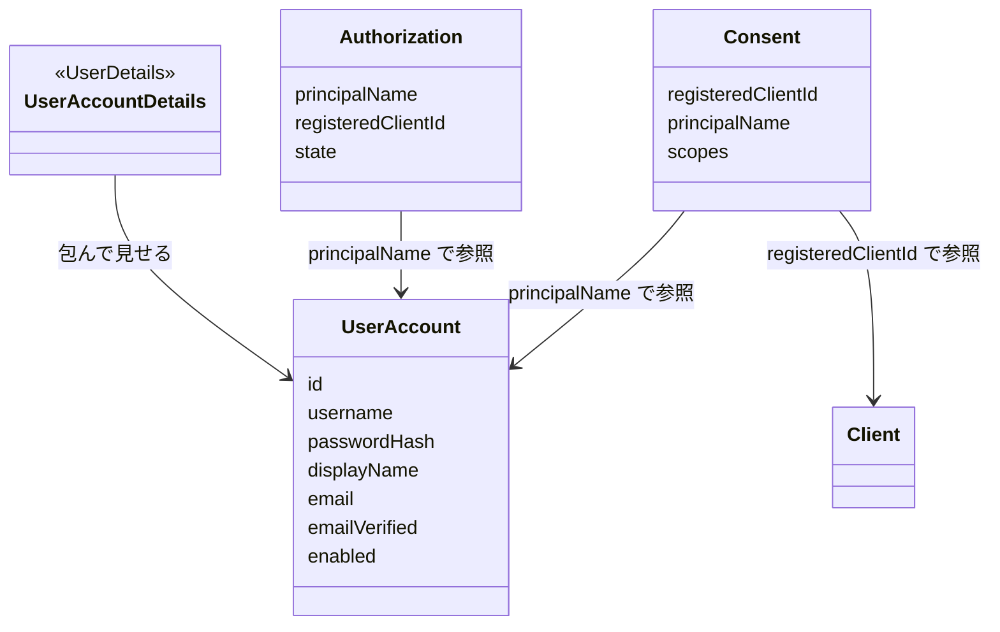
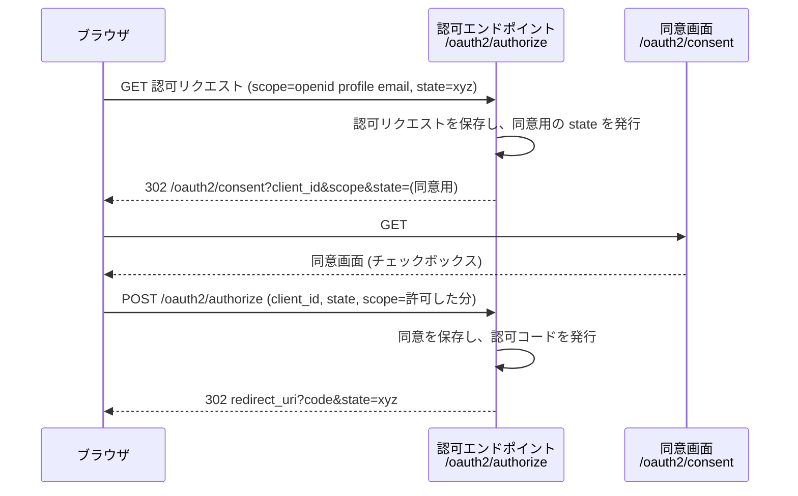

# 第6章 ユーザー認証と同意画面

## この章のゴール

- ユーザーを `UserAccount` というドメインモデルで表し、Spring Security の `UserDetails` にはアダプターで接続できる。
- `DelegatingPasswordEncoder` の `{bcrypt}` などの接頭辞が何のためにあるか、古いハッシュをログイン時に移行する方法を説明できる。
- Thymeleaf で作った自前の `/login` からログインし、ログイン後に元の認可リクエストへ戻ることを確認できる。
- `requireAuthorizationConsent(true)` のクライアントで、自前の同意画面 (`/oauth2/consent`) の表示、同意の保存、2 回目以降の省略、一部だけ同意・拒否の挙動を説明できる。
- 同意された scope (`openid` / `profile` / `email`) に応じて、ID トークンと `/userinfo` に載るクレームが変わることを確認できる。

この章のサンプルは [samples/ch06-login-consent](../../samples/ch06-login-consent) です。2 章の最小構成に、この章の差分だけを足してあります。`mvn test` で 23 件のテストが通ります。

## ドメインモデル上の位置づけ

1 章のモデルのうち、この章では **User** と **Consent** を実体にします。Authorization (認可リクエストの進行状況) は 4 章で扱ったものを、同意待ちの状態まで広げて使います。



`Consent` は「どのユーザーが、どのクライアントに、どの scope を許したか」の記録です。キーは `(registeredClientId, principalName)` の組で、クライアントとユーザーの組み合わせごとに 1 件だけ存在します。

## たとえると

ホテルで考えます。

- **ログイン** は、フロントでのチェックインです。宿泊者名簿と本人確認書類で「この人は宿泊者本人だ」とフロントが確かめます。
- **同意** は、提携ジム (クライアント) を使うときの確認書です。「ジムが、あなたの氏名と部屋番号を受け取ってよいですか」と、フロントが宿泊者に尋ねます。
- **パスワードのハッシュ** は、名簿に身分証のコピーを置かず「照合用の印」だけを置くことに当たります。

合わない点もあります。ホテルの確認書は書いたその場限りですが、同意は `(クライアント, ユーザー)` の組で保存され、次回以降は聞かれません。また、ホテルでは宿泊者名簿の書式が施設ごとに違っても構いませんが、IdP では「ユーザーとは何か」を自分たちで決め、Spring Security の型とは切り離しておく必要があります。

## 1. ユーザーを UserAccount として定義する

### ドメインモデルとフレームワークの型を分ける

Spring Security にはユーザーを表す `UserDetails` があります。これを継承してユーザークラスを作ることもできますが、この教材では分けます。

- `UserDetails` は「認証のために Spring Security が知りたいこと」(パスワード、権限、有効か) の形をしています。表示名やメールアドレスのような、IdP の業務で意味を持つ属性が入る場所ではありません。
- ドメインのクラスが `UserDetails` を継承すると、Spring Security のバージョンアップで変わった契約にドメイン側が引きずられます。7 章で DB に永続化するときも、フレームワークの型をそのまま保存する形になってしまいます。
- 分けておけば、`UserAccount` は純粋な Java のクラスのまま単体でテストできます。フレームワークとの接続は 1 か所 (アダプター) に閉じます。

### UserAccount

`samples/ch06-login-consent/src/main/java/com/example/idp/user/UserAccount.java` (抜粋)

```java
public record UserAccount(
        String id,
        String username,
        String passwordHash,
        String displayName,
        String email,
        boolean emailVerified,
        boolean enabled) implements Serializable {

    /** パスワードハッシュだけ差し替えた新しいインスタンス (record は不変なので copy で表現する)。 */
    public UserAccount withPasswordHash(String newPasswordHash) {
        return new UserAccount(id, username, newPasswordHash, displayName, email, emailVerified, enabled);
    }
}
```

`id` は変更されない内部 ID、`username` は人が入力するログイン名です。ログイン名は変更されうるので、別の値として持ちます。`Serializable` を付けているのは、ログイン中のユーザーとして HTTP セッションに載るためです。セッションを外部ストアに置く構成 (18 章) では直列化されます。

### UserDetails へのアダプター

`samples/ch06-login-consent/src/main/java/com/example/idp/user/UserAccountDetails.java` (抜粋)

```java
public class UserAccountDetails implements UserDetails {

    private final UserAccount account;

    public UserAccountDetails(UserAccount account) {
        this.account = account;
    }

    // getAuthorities などは省略

    @Override
    public String getPassword() {
        return account.passwordHash();
    }

    /** Principal の名前 (Authentication#getName) になる。認可コードや同意の「誰の」はこの値で引かれる。 */
    @Override
    public String getUsername() {
        return account.username();
    }

    /** false を返すとログインが DisabledException で失敗する。 */
    @Override
    public boolean isEnabled() {
        return account.enabled();
    }
}
```

`getUsername()` の値が、認証後の `Authentication#getName()` になります。以降の認可コード、同意、ID トークンの `sub` は、この値でユーザーを指します。この章では `sub` もこのログイン名です。ログイン名が変わると `sub` も変わる点は、「つまずきポイント」で触れます。

### リポジトリと UserDetailsService

`UserAccountRepository` は `findByUsername` と `save` だけのインターフェースで、この章の実装は `ConcurrentHashMap` に入れるだけの `InMemoryUserAccountRepository` です。DB 実装への差し替えは、8 章で 7 章の永続化と統合するときに行います。

ログイン時にユーザーを引くのが `UserDetailsService` です。

`UserAccountDetailsService` は、`loadUserByUsername` でリポジトリから `UserAccount` を引き、`UserAccountDetails` に包んで返します。見つからなければ `UsernameNotFoundException` です。

`UserDetailsPasswordService` も実装している理由は、次の節で説明します。

## 2. パスワードの扱い

### 平文を保存しない、接頭辞で方式を見分ける

`UserAccount` が持つのはパスワードそのものではなく、ハッシュです。ハッシュは一方向の変換なので、保存された値から元のパスワードは取り出せません。ログイン時は、入力されたパスワードを同じ方法で変換して、保存された値と照合します。

`PasswordEncoder` の標準的な実装が `DelegatingPasswordEncoder` で、保存する値の先頭に方式の名前を付けます。

```text
{bcrypt}$2a$10$...        ← 現在の標準 (bcrypt)
{SHA-256}{salt}hash...    ← 古いシステムから持ち込んだ形式
{noop}password            ← 平文 (テスト専用。使ってはいけない)
```

先頭の `{...}` を見て、検証に使うエンコーダーを選びます。新しく保存するときは常に標準の方式 (`{bcrypt}`) を使います。こうしておくと、方式を後から変えても、古い方式で保存済みのユーザーを同時に動かし続けられます。

`samples/ch06-login-consent/src/main/java/com/example/idp/user/UserConfig.java` (抜粋)

```java
    @Bean
    PasswordEncoder passwordEncoder() {
        return PasswordEncoderFactories.createDelegatingPasswordEncoder();
    }
```

### ハッシュの移行

古い方式のハッシュは、ユーザーが次にログインした瞬間に書き換えるのが定石です。平文のパスワードが手元にあるのはログインの瞬間だけで、保存済みのハッシュから別の方式のハッシュは作れないためです。

仕組みは次のとおりです。

1. `DelegatingPasswordEncoder` は、接頭辞が標準 (`bcrypt`) でない値を「再エンコードが必要」と判断します (ソースで確認: `upgradeEncodingNonNull`)。
2. `DaoAuthenticationProvider` は、パスワード照合に成功したあと、`UserDetailsPasswordService` の Bean があれば `updatePassword` を呼びます。
3. 私たちの `updatePassword` は、新しいハッシュで `UserAccount` を保存し直します。

`samples/ch06-login-consent/src/main/java/com/example/idp/user/UserAccountDetailsService.java` (抜粋)

```java
    @Override
    public UserDetails updatePassword(UserDetails user, String newPassword) {
        UserAccount updated = repository.findByUsername(user.getUsername())
            .orElseThrow(() -> new UsernameNotFoundException("user not found: " + user.getUsername()))
            .withPasswordHash(newPassword);
        repository.save(updated);
        return new UserAccountDetails(updated);
    }
```

サンプルの初期ユーザーは 3 人です (パスワードがソースに書いてあるので、本番では使えません)。

| ログイン名 | パスワード | 状態 |
|---|---|---|
| alice | password | 通常のユーザー (`{bcrypt}`) |
| bob | legacy-pass | 旧システムから来た想定 (`{SHA-256}`)。ログインすると `{bcrypt}` に書き換わる |
| carol | password | 無効化されている (`enabled = false`) |

## 3. 自前のログイン画面

2 章では `formLogin(withDefaults())` で、Spring Security が生成する既定のログイン画面を使いました。この章ではそれを自前の Thymeleaf のページに置き換えます。

### 設定

`samples/ch06-login-consent/src/main/java/com/example/idp/config/SecurityConfig.java` (抜粋)

```java
    @Bean
    @Order(2)
    SecurityFilterChain defaultSecurityFilterChain(HttpSecurity http) throws Exception {
        http
            .authorizeHttpRequests(authorize -> authorize.anyRequest().authenticated())
            // loginPage を指定すると既定のログイン画面は生成されない。
            // permitAll() を付けないと、ログイン画面自体が「要ログイン」になってリダイレクトが無限に続く。
            .formLogin(form -> form.loginPage("/login").permitAll());
        return http.build();
    }
```

`loginPage("/login")` を指定すると、次の 3 つが決まります。

- GET `/login`: ログイン画面の表示。私たちの `LoginController` が HTML を返します。
- POST `/login`: 認証の処理。こちらは Spring Security のフィルターが受けます。コントローラーは書きません。
- 失敗時の遷移先は `/login?error`。

`LoginController` は、`@GetMapping("/login")` で `"login"` (テンプレート名) を返すだけのコントローラーです (`web/LoginController.java`)。

### 画面

`samples/ch06-login-consent/src/main/resources/templates/login.html` (抜粋)

```html
  <p class="error" th:if="${param.error}">ログイン名またはパスワードが正しくありません。</p>
  <p th:if="${param.logout}">ログアウトしました。</p>

  <!-- th:action を使うと Thymeleaf が CSRF トークンの hidden フィールドを自動で差し込む -->
  <form method="post" th:action="@{/login}">
    <label for="username">ログイン名</label>
    <input type="text" id="username" name="username" autofocus required>
    <label for="password">パスワード</label>
    <input type="password" id="password" name="password" required>
    <button type="submit">ログイン</button>
  </form>
```

押さえる点が 3 つあります。

- **フィールド名**: `username` と `password` は Spring Security の既定の名前です。変えるなら `form.usernameParameter(...)` で合わせます。
- **CSRF トークン**: CSRF (Cross-Site Request Forgery) は、別のサイトから、ログイン中のユーザーのブラウザを使って勝手に POST させる攻撃です。Spring Security はフォームの POST にトークンを要求します。`th:action` を使うと Thymeleaf が `<input type="hidden" name="_csrf" ...>` を自動で埋め込みます。`action="/login"` と普通の属性で書くと埋め込まれず、ログインが 403 になります。
- **エラー表示**: `/login?error` のとき `param.error` が真になります。ユーザーが存在しない、パスワードが違う、アカウントが無効、のどれでも同じ文言にしています。区別して見せると、ログイン名の存在確認に使われてしまうためです。

### ログイン後に元の認可リクエストへ戻る

クライアントから `/oauth2/authorize` に来た未ログインのブラウザは `/login` に送られます。このとき Spring Security は、元のリクエスト (URL とクエリ) をセッションに保存します。ログインに成功すると、保存したリクエストに戻します。保存するのは `ExceptionTranslationFilter` が使う `RequestCache`、`/login` へ送るのは 2 章の設定にある `LoginUrlAuthenticationEntryPoint("/login")` です (3 章で扱った仕組みです)。

実際に動かして確かめます (`--server.port=9106` で起動し、以降の出力ではポートを 9000 に置き換えています)。

```text
== 未ログインで /oauth2/authorize
HTTP/1.1 302
Location: http://localhost:9000/login

== パスワード違い
HTTP/1.1 302
Location: http://localhost:9000/login?error

== 正しいパスワード (最初の認可リクエストと同じセッション)
HTTP/1.1 302
Location: http://localhost:9000/oauth2/authorize?response_type=code&client_id=web-client&redirect_uri=http://127.0.0.1:8080/login/oauth2/code/idp&scope=openid%20profile%20email&state=xyz&code_challenge=HJBdp...&code_challenge_method=S256&continue

== CSRF トークン無しで POST /login
403
```

元の認可リクエストの URL に、末尾の `continue` (保存済みリクエストの再開を示す印) が付いて戻っています。直接 `/login` を開いてログインした場合は、保存されたリクエストが無いので `/` に遷移します。この IdP には `/` のページが無いので、404 になります (つまずきポイント参照)。

## 4. 同意の仕組み

### 何が起きるか

クライアントの設定で `requireAuthorizationConsent(true)` にすると、認可エンドポイントは認可コードを発行する前に、ユーザーの同意を確認します。

`samples/ch06-login-consent/src/main/java/com/example/idp/config/SecurityConfig.java` (抜粋)

```java
            .clientSettings(ClientSettings.builder()
                .requireProofKey(true)
                .requireAuthorizationConsent(true)
                .build())
```

ソース (`OAuth2AuthorizationCodeRequestAuthenticationProvider#isAuthorizationConsentRequired`) で確かめた判定は次のとおりです。

1. クライアントが `requireAuthorizationConsent(false)` なら、同意は要りません。
2. 要求された scope が `openid` だけなら、同意は要りません。
3. 保存済みの同意が、要求された scope をすべて含んでいるなら、同意は要りません。
4. それ以外は同意が必要です。

同意が必要なときの流れは次のとおりです。



認可サーバーは、元の認可リクエストの内容を自分の側に保存したうえで、同意用の `state` を発行します。同意画面に渡す `state` は、クライアントが付けた `state` (`xyz`) とは別の値です。同意の POST で受け取った `state` から、保存済みの認可リクエストを引き直します。

### 既定の同意画面と自前の同意画面

`consentPage` を指定しなければ、認可サーバーは組み込みの同意画面 (`DefaultConsentPage`) を返します。ソースを読むと、チェックボックス (`name="scope"`)、hidden の `client_id` と `state`、`/oauth2/authorize` への POST でできた画面です。

自前の画面にするには、同意が必要になったときのリダイレクト先を指定します。

`samples/ch06-login-consent/src/main/java/com/example/idp/config/SecurityConfig.java` (抜粋)

```java
                // 同意が必要なときの飛び先を自前の画面にする
                authorizationServer.authorizationEndpoint(endpoint -> endpoint.consentPage("/oauth2/consent"));
```

認可サーバーは、この URL にブラウザをリダイレクトします。実際のリダイレクトは次のとおりです。

```text
Location: http://localhost:9000/oauth2/consent?scope=openid%20profile%20email&client_id=web-client&state=TmQxy...%3D
```

渡されるのは `client_id`、`scope` (空白区切り)、`state` の 3 つだけです。

### 同意画面のコントローラー

`samples/ch06-login-consent/src/main/java/com/example/idp/web/ConsentController.java` (抜粋)

```java
    @GetMapping("/oauth2/consent")
    String consent(Principal principal,
                   Model model,
                   @RequestParam(OAuth2ParameterNames.CLIENT_ID) String clientId,
                   @RequestParam(OAuth2ParameterNames.SCOPE) String scope,
                   @RequestParam(OAuth2ParameterNames.STATE) String state) {

        RegisteredClient client = registeredClientRepository.findByClientId(clientId);
        OAuth2AuthorizationConsent previous = (client == null) ? null
            : consentService.findById(client.getId(), principal.getName());
        Set<String> previouslyApproved = (previous == null) ? Set.of() : previous.getScopes();

        Map<String, String> toApprove = new LinkedHashMap<>();
        Map<String, String> alreadyApproved = new LinkedHashMap<>();
        for (String requested : new TreeSet<>(Arrays.asList(scope.split(" ")))) {
            // openid は同意の対象にしない (認可サーバー側も自動承認する)
            if (requested.isEmpty() || OidcScopes.OPENID.equals(requested)) {
                continue;
            }
            String description = SCOPE_DESCRIPTIONS.getOrDefault(requested, requested);
            (previouslyApproved.contains(requested) ? alreadyApproved : toApprove).put(requested, description);
        }
```

このコントローラーがやるのは、画面に出す材料の整理だけです。

- クライアントの表示名と、ログイン中のユーザー名を出します。
- 要求された scope を「これから許可を求めるもの」と「前回までに許可済みのもの」に分けます。前回の同意は `OAuth2AuthorizationConsentService` から引きます。
- `openid` は一覧に出しません。

ここで受け取る `scope` は、ブラウザ経由のただのクエリパラメーターです。画面の表示に使うだけで、何に同意できるかの最終判断には使いません。判断は、POST を受けた認可サーバーが、`state` から引いた元の認可リクエストと突き合わせて行います。

### 同意の POST

`samples/ch06-login-consent/src/main/resources/templates/consent.html` (抜粋)

```html
  <form method="post" th:action="@{/oauth2/authorize}">
    <input type="hidden" name="client_id" th:value="${clientId}">
    <input type="hidden" name="state" th:value="${state}">

    <div th:if="${!toApprove.isEmpty()}">
      <p>次の権限を許可しますか。</p>
      <div th:each="entry : ${toApprove}">
        <label>
          <input type="checkbox" name="scope" th:value="${entry.key}" checked>
          <span th:text="${entry.value}">説明</span> (<code th:text="${entry.key}">scope</code>)
        </label>
      </div>
    </div>
```

POST 先は `/oauth2/authorize`、パラメーターは次の 3 つです。

| パラメーター | 内容 |
|---|---|
| `client_id` | 同意の対象のクライアント |
| `state` | 同意画面に渡された `state` をそのまま返す |
| `scope` | 許可する scope。チェックされた数だけ、同じ名前で繰り返す |

CSRF トークン (`_csrf`) も必要です。認可エンドポイントは認可サーバー用のフィルターチェーンの中にあり、CSRF 保護が有効だからです。`th:action` が自動で埋め込みます。

「拒否」は、`scope` を 1 つも付けない POST です。画面では別のフォームにして、`client_id` と `state` だけを送っています。

### OAuth2AuthorizationConsent に保存されるもの

同意に応じると、認可サーバーは `OAuth2AuthorizationConsent` を保存します。中身は次の 3 つだけです (ソースで確認)。

- `registeredClientId`: クライアントの内部 ID (`client_id` の文字列ではなく `RegisteredClient#getId()`)
- `principalName`: ユーザーの名前 (この章では `alice` など)
- `authorities`: `SCOPE_profile` のように、scope に `SCOPE_` を付けた `GrantedAuthority` の集合。`getScopes()` が接頭辞を外して返します

テストで保存された内容を確かめています。`profile` と `email` に同意すると、画面で選ばせていない `openid` も一緒に保存されます。`openid` は同意の対象外ですが、承認済みとして扱われるためです。

### 2 回目以降、一部だけ同意、拒否

どれもテストで固定してあります。

**2 回目以降**: 同じ scope で認可リクエストを出すと、同意画面を経由せずに、すぐ認可コードが返ります。前の判定の 3 番目 (保存済みの同意が要求を含む) に当たります。返る `state` は、クライアントが付けた値 (例: `s2`) です。

**要求が増えたとき**: 前回 `profile` に同意済みで、今回 `profile email` を求められると、同意画面が出ます。画面には差分の `email` だけがチェックボックスで並び、`profile` は「すでに許可済みの権限」に出ます。

**一部だけ同意**: `openid profile email` を求められて `profile` だけチェックして許可した場合、同意として保存されるのは `openid` と `profile` です。クライアントにも認可コードが返り、トークンレスポンスの `scope` は `openid profile` になります。クライアントは「要求したものがすべて通るとは限らない」前提で、レスポンスの `scope` を見る必要があります。

**拒否**: 1 つも scope を選ばずに POST すると、クライアントの `redirect_uri` にエラーで戻ります。実際の出力は次のとおりです。

```text
Location: http://127.0.0.1:8080/login/oauth2/code/idp?error=access_denied&error_description=OAuth%202.0%20Parameter%3A%20client_id&error_uri=https%3A%2F%2Fdatatracker.ietf.org%2Fdoc%2Fhtml%2Frfc6749%23section-4.1.2.1&state=b1
```

`state` はクライアントが付けた値 (`b1`) に戻っています。同意は保存されず、保存済みの認可リクエストも破棄されます。

ただし、**すでに同意済みの scope があるユーザーが、追加分だけを拒否した場合は、拒否として扱われません**。認可サーバーは「保存済みの同意 + 今回の選択」が空でなければ、そのまま認可コードを発行します。実際にこの操作 (前回 `profile` に同意済みで、`email` を加えた要求を拒否) をすると、`error` は付かず `code` が返り、スコープは前回の `openid profile` のままです。「追加分の拒否」と「同意全体の取り消し」は別の操作で、取り消しは同意の削除として別に作る必要があります。

また、同意として送る scope が元の認可リクエストに含まれていなければ (画面を改ざんして `email` を足して送るなど)、`invalid_scope` が返ります。

```text
Location: http://127.0.0.1:8080/login/oauth2/code/idp?error=invalid_scope&error_description=OAuth%202.0%20Parameter%3A%20scope&error_uri=...&state=b2
```

## 5. scope とクレームの関係

### 何を載せるか

OpenID Connect Core 1.0 の 5.4 節は、`profile` / `email` などの scope に対応する標準クレームを定めています。この章で扱うのは次の対応です。

| scope | 載せるクレーム | `UserAccount` の属性 |
|---|---|---|
| `openid` | `sub` (常に) | `username` |
| `profile` | `name`, `preferred_username` | `displayName`, `username` |
| `email` | `email`, `email_verified` | `email`, `emailVerified` |

ここでの scope は、ユーザーが同意して、実際に承認された scope です。クライアントが要求しただけで、同意されなかった scope のクレームは載せません。

### 規則を 1 か所に置く

ID トークンと UserInfo の両方に同じ規則を使うため、「scope → クレーム」の変換を 1 つのクラスに集めています。

`samples/ch06-login-consent/src/main/java/com/example/idp/token/ScopedClaims.java` (抜粋)

```java
    Map<String, Object> claimsFor(UserAccount account, Set<String> scopes) {
        Map<String, Object> claims = new LinkedHashMap<>();
        if (scopes.contains(OidcScopes.PROFILE)) {
            claims.put(StandardClaimNames.NAME, account.displayName());
            claims.put(StandardClaimNames.PREFERRED_USERNAME, account.username());
        }
        if (scopes.contains(OidcScopes.EMAIL)) {
            claims.put(StandardClaimNames.EMAIL, account.email());
            claims.put(StandardClaimNames.EMAIL_VERIFIED, account.emailVerified());
        }
        return claims;
    }
```

### ID トークンへの載せ方

トークンの中身を変えるには `OAuth2TokenCustomizer<JwtEncodingContext>` を使います。この Bean があると、認可サーバーはトークンを作る前に呼びます。ここでは ID トークンのときだけクレームを足します。

`samples/ch06-login-consent/src/main/java/com/example/idp/token/ScopedClaims.java` (抜粋)

```java
    public OAuth2TokenCustomizer<JwtEncodingContext> idTokenCustomizer() {
        return context -> {
            if (!"id_token".equals(context.getTokenType().getValue())) {
                return;
            }
            // 同意されて承認された scope だけで判断する (クライアントが要求しただけの scope は含まれない)
            Set<String> authorizedScopes = context.getAuthorizedScopes();
            repository.findByUsername(context.getPrincipal().getName()).ifPresent(account ->
                context.getClaims().claims(claims -> claims.putAll(claimsFor(account, authorizedScopes))));
        };
    }
```

`context.getTokenType().getValue()` が `id_token` のときだけ処理するのがポイントです。同じカスタマイザーが、アクセストークン (JWT 形式のとき) の生成でも呼ばれます。判定しないと、アクセストークンにも `name` や `email` が入ります。

### UserInfo への載せ方

`/userinfo` の応答は、既定の実装だと ID トークンのクレームから scope で絞り込んで返します (ソースで確認: `DefaultOidcUserInfoMapper`)。この章では、`UserAccount` から直接組み立てる自前のマッパーに差し替えています。アクセストークンの scope で出し分けます。

`samples/ch06-login-consent/src/main/java/com/example/idp/token/ScopedClaims.java` (抜粋)

```java
    public Function<OidcUserInfoAuthenticationContext, OidcUserInfo> userInfoMapper() {
        return context -> {
            String username = context.getAuthorization().getPrincipalName();
            UserAccount account = repository.findByUsername(username)
                .orElseThrow(() -> new OAuth2AuthenticationException(OAuth2ErrorCodes.INVALID_TOKEN));
            Map<String, Object> claims = new LinkedHashMap<>();
            // sub は必須クレームで、ID トークンの sub と一致していなければならない
            claims.put(StandardClaimNames.SUB, username);
            claims.putAll(claimsFor(account, context.getAccessToken().getScopes()));
            return new OidcUserInfo(claims);
        };
    }
```

`UserAccount` を引き直すので、ID トークンの発行後にメールアドレスが変わったときは、`/userinfo` には新しい値が出ます。ID トークンは発行時点の値のままです。

### 設定への登録

`samples/ch06-login-consent/src/main/java/com/example/idp/config/SecurityConfig.java` (抜粋)

```java
                authorizationServer.oidc(oidc -> oidc
                    .userInfoEndpoint(userInfo -> userInfo.userInfoMapper(scopedClaims.userInfoMapper())));
```

```java
    @Bean
    OAuth2TokenCustomizer<JwtEncodingContext> idTokenCustomizer(ScopedClaims scopedClaims) {
        return scopedClaims.idTokenCustomizer();
    }
```

本格的なクレームのカスタマイズ (カスタムクレーム、アクセストークンへの追加、`sub` の設計) は応用編 9 章で扱います。この章は、scope に応じた標準クレームまでです。

## 6. 動作確認

サンプルを `--server.port=9106` で起動して、curl で最後まで通しました (以降の出力ではポートを 9000 に置き換えています)。alice でログインし、`openid profile email` を求め、同意画面で `profile` だけを許可した場合です。

トークンレスポンス (長い値は省略):

```text
{'access_token': 'eyJraWQiOiI1MDlhYTc4...', 'refresh_token': 'olkp_dEr-FiDqyR76zme...', 'scope': 'openid profile', 'id_token': 'eyJraWQiOiI1MDlhYTc4...', 'token_type': 'Bearer', 'expires_in': 299}
```

`scope` は、要求した `openid profile email` ではなく、同意された `openid profile` です。

ID トークンの payload:

```json
{
 "sub": "alice",
 "aud": "web-client",
 "azp": "web-client",
 "auth_time": 1794303673,
 "iss": "http://localhost:9000",
 "name": "Alice Example",
 "preferred_username": "alice",
 "exp": 1794305481,
 "iat": 1794303681,
 "jti": "b8c99a43-ea4b-4b38-9fa9-4cc13a1c4b60",
 "sid": "MXpoixrViEf_1IkEw5oopJ_-fC10h4GItsyHdOcCciE"
}
```

`email` は、要求されたのに同意されていないので載っていません。`/userinfo` も同じ結果です。

```text
$ curl -H "Authorization: Bearer $ACCESS_TOKEN" http://localhost:9000/userinfo
{"sub":"alice","name":"Alice Example","preferred_username":"alice"}
```

そのほか、実際に起動して確かめたことは次のとおりです。

- 同じ scope (`openid profile`) の 2 回目の認可リクエストは、同意画面を出さずにすぐ `code` と `state` で返る。
- `openid` だけの認可リクエストは、同意画面を出さずに `code` を返す。
- bob (`{SHA-256}`) が `legacy-pass` でログインできる (ハッシュが書き換わることは、起動したサーバーでは確認できないため、テストで確認しています)。
- carol (無効) は正しいパスワードでも `/login?error` に戻る。
- Playwright でブラウザからログイン → 同意画面 → 「許可する」まで操作し、クライアントの `redirect_uri` への遷移まで確認した (そこにクライアントは動いていないので、遷移先は接続エラーになる)。

## テスト

この章のテストは 3 クラス、合計 23 件です (`mvn test`)。

| クラス | 件数 | 確かめていること |
|---|---|---|
| `LoginTests` | 8 | 自前ログイン画面と CSRF の hidden、ログイン成功・失敗、存在しないユーザー、無効ユーザー、CSRF 無しの 403、ログイン後に元の認可リクエストへ戻る、旧ハッシュの bcrypt への書き換え |
| `ConsentTests` | 11 | 同意画面へのリダイレクト、画面の中身、同意後のコード発行と保存、2 回目の省略、差分だけ表示、一部だけ同意、拒否、同意済みがある状態での拒否、改ざんの `invalid_scope`、`openid` だけ、別ユーザーに引き継がれない |
| `ScopedClaimsTests` | 4 | `openid` だけ、`profile`、`email`、同意しなかった scope のクレームが出ないこと (ID トークンと UserInfo の両方) |

テストを書くときの注意が 2 つあります。

- 認証を `user("alice")` で差し込むと、ID トークン生成が `authenticationTime cannot be null` で失敗します。`FlowSupport#login` は実際に `/login` へ POST して、セッションを引き回します。
- テストクラスの間で Spring のコンテキストが共有されるため、メモリ上の同意も残ります。同意を扱うテストでは、`@BeforeEach` で前のテストの同意を消しています。

## つまずきポイント

### ログイン画面が「リダイレクトが多すぎます」になる

- 症状: `/login` を開くとブラウザが無限にリダイレクトし、エラーになる。
- 原因: `loginPage("/login")` を指定したのに `permitAll()` を付けていない。ログイン画面自体が「要ログイン」の扱いになり、`/login` から `/login` へ送られ続ける。
- 対処: `form.loginPage("/login").permitAll()` にする。

### ログインの POST が 403 になる

- 症状: 正しいパスワードでもログインが 403 になる。同意画面の「許可する」が 403 になるのも同じ原因。
- 原因: CSRF トークンが送られていない (認可エンドポイントも CSRF 保護の対象)。フォームを `action="/login"` と書いている、または Thymeleaf を通さない静的 HTML にしている。
- 対処: `th:action="@{/login}"` を使う。静的 HTML にするなら、トークンを自前で埋める。

### 同意画面を出しても、すぐコードが返ってしまう

- 症状: `requireAuthorizationConsent(true)` にしたのに、同意画面が出ない。
- 原因 1: 要求した scope が `openid` だけ。`openid` は同意の対象外。
- 原因 2: すでに同意が保存されている。`InMemoryOAuth2AuthorizationConsentService` は再起動するまで残るので、開発中は忘れがち。
- 対処: 試すときは別の scope を足すか、サーバーを再起動する。

### 同意画面で拒否したのにコードが発行された

- 症状: 「拒否する」を押したのに、`error` ではなく `code` が返る。
- 原因: そのユーザーが同じクライアントに、すでに別の scope で同意済み。認可サーバーは「保存済みの同意 + 今回の選択」が空でなければ拒否扱いにしない。
- 対処: 追加分の拒否は仕様として、前回までの範囲で成功する。同意全体を取り消したいなら、同意を削除する操作を別に用意する。

### 直接 /login を開いてログインすると 404 になる

- 症状: クライアント経由ではなく、ブラウザで `/login` を直接開いてログインすると、`/` で 404 になる。
- 原因: 保存された元のリクエストが無いとき、ログイン後の遷移先は `/`。この IdP には `/` のページがない。
- 対処: `/` に簡単なページを置くか、`defaultSuccessUrl` を指定する。この章では扱わない。

### ログイン名を変えると sub が変わる

- 症状 (設計上の注意): ユーザーがログイン名を変更すると、クライアントから見て別人になる。
- 原因: この章では `sub` が `username` と同じ。同意や認可の `principalName` も `username` で引いている。
- 対処: 安定した ID (`UserAccount#id`) を `sub` にする設計がある。これは 9 章のトークンのカスタマイズで扱う。

## まとめ

- ユーザーは `UserAccount` というドメインのクラスで表し、Spring Security の `UserDetails` へはアダプターで接続する。こうするとフレームワークの変更や永続化の方式から、ドメインを切り離せる。
- パスワードはハッシュで保存し、`DelegatingPasswordEncoder` の接頭辞で方式を見分ける。`UserDetailsPasswordService` を実装すると、古い方式のハッシュをログイン時に `{bcrypt}` へ書き換えられる。
- 自前のログイン画面は、`formLogin(form -> form.loginPage("/login").permitAll())` と Thymeleaf で作る。`th:action` が CSRF トークンを埋め、ログイン後は保存済みの認可リクエストへ戻る。
- `requireAuthorizationConsent(true)` のとき、`openid` 以外の scope が保存済みの同意に無ければ、`consentPage` へリダイレクトされる。同意画面が受け取るのは `client_id` / `scope` / `state`、POST 先は `/oauth2/authorize` で、拒否は scope を付けない POST になる。
- 同意は `(クライアント, ユーザー)` ごとに `OAuth2AuthorizationConsent` として保存され、次回以降は省略される。一部だけの同意では、同意した分だけが保存され、トークンの `scope` にも反映される。
- ID トークンと `/userinfo` のクレームは、同意された scope で出し分ける。規則を 1 か所に置くと、両者がずれない。

## 次の章へ

ここまでのユーザー、認可、同意はすべてメモリ上にあり、再起動すると消えます。7 章では、クライアント・認可・同意・ユーザーを JDBC で永続化します。7 章のサンプルも 2 章からの差分なので、この章の `UserAccount` と組み合わせるのは 8 章の統合です。
