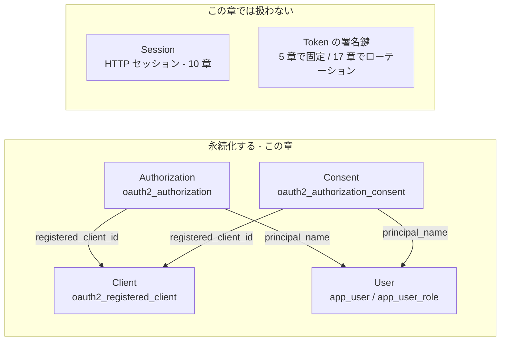

# 第7章 永続化

## この章のゴール

この章を終えると、次の状態になります。

- クライアント・認可・同意・ユーザーの 4 つが、メモリではなく DB (H2 のファイル) に保存される。IdP を止めて起動し直しても消えない。
- 起動し直す前に発行したリフレッシュトークンで、起動し直した IdP からトークンを更新できる。
- スキーマは jar に同梱された SQL を元に、Flyway のマイグレーションとして管理されている。
- `oauth2_authorization` などの各列が何を表すか、実際の行を見て説明できる。
- 署名鍵がメモリ上のままだと何が困るかを、実行結果で説明できる。5 章で扱った署名鍵の固定は、このサンプルには取り込んでいません (サンプルは 2 章 + この章の差分のため)。8 章で 5 章の鍵固定と統合します。

完成形は 3 行で言えます。**「台帳 (Client / User) も、宿泊記録 (Authorization / Consent) も DB に書く。それ以外は 2 章のまま」**です。

## ドメインモデル上の位置づけ

1 章で整理した 6 つの概念のうち、「あとで読み戻す必要があるもの」を DB に移します。



| ドメイン上の概念 | 担当するインターフェース | JDBC 実装 | テーブル |
|---|---|---|---|
| Client | `RegisteredClientRepository` | `JdbcRegisteredClientRepository` | `oauth2_registered_client` |
| Authorization (と、その中の Token) | `OAuth2AuthorizationService` | `JdbcOAuth2AuthorizationService` | `oauth2_authorization` |
| Consent | `OAuth2AuthorizationConsentService` | `JdbcOAuth2AuthorizationConsentService` | `oauth2_authorization_consent` |
| User | `UserDetailsService` (Spring Security) | 自前 (`JdbcUserDetailsService`) | `app_user` / `app_user_role` |

Token は「Authorization の中に入っている」点に注意してください。トークン専用のテーブルはなく、コード・アクセストークン・ID トークン・リフレッシュトークンはすべて `oauth2_authorization` の 1 行の中の列です。

## たとえると

ホテルのフロントが、紙の帳簿ではなく **付箋 1 枚** で全部を管理していたとします。付箋は朝礼 (= 再起動) で捨てられます。提携施設の名簿も、発行済みカードキーの控えも、「このお客様は〇〇の利用に同意済み」というメモも消え、お客様は全員もう一度チェックインし直しです。

永続化とは、付箋をやめて **金庫に入れた台帳** に書くことです。台帳は 4 冊に分かれています。

| 台帳 | 中身 |
|---|---|
| 提携施設名簿 | Client |
| カードキー発行控え | Authorization |
| 利用同意の記録 | Consent |
| 宿泊者名簿 | User |

このたとえが合わないところが 2 つあります。

- 本物の台帳は人が読むものですが、IdP の台帳 (特に `attributes` 列) は Java オブジェクトを JSON にした **機械向けの記録** です。人が手で書き換える前提ではありません。
- カードキー自体の「合鍵を作る道具」(署名鍵) は、この台帳には入っていません。5 章で見たとおり別の管理です。この章の終わりで、これが何を引き起こすかを実際に確かめます。

## メモリ実装のままだと何が困るか

2 章の `InMemory…` 系の実装は、データを JVM のヒープに持ちます。次の 3 つが困ります。

1. **再起動で全部消える**。発行済みのリフレッシュトークン、同意済みのスコープ、(管理画面などで) 登録したクライアントがなくなる。ユーザーは全員ログインし直し、クライアント側のリフレッシュは `invalid_grant` で失敗する。
2. **複数台構成にできない**。2 台の IdP を並べると、A に作った認可コードを B に持って行っても見つからない。状態は共有ストアに置く必要がある。
3. **デプロイのたびに状態が飛ぶ**。ローリングアップデートのたびにユーザーが影響を受ける。

2 は「サーバーを 1 台に固定する」か「状態を共有 DB に置く」かの二択で、IdP では後者を選ぶのが普通です。なお、ログイン後の HTTP セッションは別の問題で、この章では扱いません (10 章)。

## 4 つのインターフェースを jar で確かめる

置き換える対象のインターフェースを `javap` で確かめます。

```bash
J=~/.m2/repository/org/springframework/security/spring-security-oauth2-authorization-server/7.1.2/spring-security-oauth2-authorization-server-7.1.2.jar
javap -cp $J org.springframework.security.oauth2.server.authorization.client.RegisteredClientRepository
javap -cp $J org.springframework.security.oauth2.server.authorization.OAuth2AuthorizationService
javap -cp $J org.springframework.security.oauth2.server.authorization.OAuth2AuthorizationConsentService
```

実行結果 (抜粋):

```text
public interface ...RegisteredClientRepository {
  public abstract void save(RegisteredClient);
  public abstract RegisteredClient findById(String);
  public abstract RegisteredClient findByClientId(String);
}
public interface ...OAuth2AuthorizationService {
  public abstract void save(OAuth2Authorization);
  public abstract void remove(OAuth2Authorization);
  public abstract OAuth2Authorization findById(String);
  public abstract OAuth2Authorization findByToken(String, OAuth2TokenType);
}
public interface ...OAuth2AuthorizationConsentService {
  public abstract void save(OAuth2AuthorizationConsent);
  public abstract void remove(OAuth2AuthorizationConsent);
  public abstract OAuth2AuthorizationConsent findById(String, String);
}
```

どれも「保存・削除・主キーで検索」と、必要なら「トークンで検索」だけの小さなインターフェースです。`RegisteredClientRepository` には `remove` も一覧取得もありません。**クライアントの削除や一覧は標準では提供されない**ので、管理機能は自分で作ります (16 章)。

User は Spring Security 本体の `UserDetailsService` で、メソッドは `loadUserByUsername(String)` 1 つです。

## JDBC 実装に切り替える

### 依存関係

`samples/ch07-persistence/pom.xml` に、ch02 から次の 3 つを足しています。

```xml
<dependency>
    <groupId>org.springframework.boot</groupId>
    <artifactId>spring-boot-starter-jdbc</artifactId>
</dependency>
<dependency>
    <groupId>org.springframework.boot</groupId>
    <artifactId>spring-boot-starter-flyway</artifactId>
</dependency>
<dependency>
    <groupId>com.h2database</groupId>
    <artifactId>h2</artifactId>
    <scope>runtime</scope>
</dependency>
```

### Bean の差し替え

`samples/ch07-persistence/src/main/java/com/example/idp/config/SecurityConfig.java` (抜粋):

```java
@Bean
RegisteredClientRepository registeredClientRepository(JdbcTemplate jdbcTemplate) {
    return new JdbcRegisteredClientRepository(jdbcTemplate);
}

@Bean
OAuth2AuthorizationService authorizationService(JdbcTemplate jdbcTemplate,
        RegisteredClientRepository registeredClientRepository) {
    return new JdbcOAuth2AuthorizationService(jdbcTemplate, registeredClientRepository);
}

@Bean
OAuth2AuthorizationConsentService authorizationConsentService(JdbcTemplate jdbcTemplate,
        RegisteredClientRepository registeredClientRepository) {
    return new JdbcOAuth2AuthorizationConsentService(jdbcTemplate, registeredClientRepository);
}
```

2 章にあった `InMemoryRegisteredClientRepository` と `InMemoryUserDetailsManager` の Bean は削除しました。`OAuth2AuthorizationService` と `OAuth2AuthorizationConsentService` は、2 章では Bean を書かなくてもメモリ実装が自動で使われていた (未定義のとき既定値が使われる) ので、ここで初めて明示しています。

`JdbcOAuth2AuthorizationService` と `JdbcOAuth2AuthorizationConsentService` が `RegisteredClientRepository` を受け取るのは、行から `OAuth2Authorization` を復元するときに `registered_client_id` から `RegisteredClient` を引き直すためです。

### jar に同梱されているスキーマ SQL

テーブル定義は、実装クラスと同じ jar の中に入っています。

```bash
unzip -l $J | grep '\.sql'
```

実行結果:

```text
     1122  ...  org/springframework/security/oauth2/server/authorization/client/oauth2-registered-client-schema.sql
     2169  ...  org/springframework/security/oauth2/server/authorization/oauth2-authorization-schema.sql
      232  ...  org/springframework/security/oauth2/server/authorization/oauth2-authorization-consent-schema.sql
```

(ソース jar にも同じ 3 ファイルがあります。) 内容を `unzip -p` で取り出して、そのまま Flyway のマイグレーションにしました。

```bash
M=src/main/resources/db/migration
unzip -p $J org/springframework/security/oauth2/server/authorization/client/oauth2-registered-client-schema.sql > $M/V1__oauth2_registered_client.sql
unzip -p $J org/springframework/security/oauth2/server/authorization/oauth2-authorization-schema.sql           > $M/V2__oauth2_authorization.sql
unzip -p $J org/springframework/security/oauth2/server/authorization/oauth2-authorization-consent-schema.sql   > $M/V3__oauth2_authorization_consent.sql
```

| ファイル | 内容 |
|---|---|
| `V1__oauth2_registered_client.sql` | jar 同梱のまま |
| `V2__oauth2_authorization.sql` | jar 同梱のまま |
| `V3__oauth2_authorization_consent.sql` | jar 同梱のまま |
| `V4__users.sql` | 自前の `app_user` / `app_user_role` (後述) |

jar の SQL を**書き換えずに** V1〜V3 にしたのは、Spring Security のバージョンアップでスキーマが変わったとき、差分を `V5__...` として追加するだけで追えるようにするためです。Flyway は適用済みのファイルを書き換えるとチェックサム不一致で起動を止めるので、「同梱 SQL をそのまま取り込み、変更は新しいファイルで足す」運用が安全です。

### DB 設定 (H2 ファイルモード)

`samples/ch07-persistence/src/main/resources/application.yml`:

```yaml
spring:
  datasource:
    # ファイルモードの H2。target/ 配下に作るので、アプリを止めて再起動してもデータが残る。
    # (mvn clean するとファイルごと消える。コミットされる場所には作らない)
    url: jdbc:h2:file:./target/idp-db
    username: sa
    password: ""
  flyway:
    enabled: true
```

起動すると、Flyway が 4 つのマイグレーションを適用します (実行結果から抜粋、時刻は省略)。

```text
Database: jdbc:h2:file:./target/idp-db (H2 2.4)
Current version of schema "PUBLIC": << Empty Schema >>
Migrating schema "PUBLIC" to version "1 - oauth2 registered client"
Migrating schema "PUBLIC" to version "2 - oauth2 authorization"
Migrating schema "PUBLIC" to version "3 - oauth2 authorization consent"
Migrating schema "PUBLIC" to version "4 - users"
Successfully applied 4 migrations to schema "PUBLIC", now at version v4
```

2 回目以降の起動では `Schema "PUBLIC" is up to date. No migration necessary.` と出て、何も実行されません。

(H2 2.4.240 を使うと Flyway 12.4.0 が「検証済みの最新は 2.3.232」という WARN を出しますが、このサンプルでは問題なく動きました。)

## テーブル設計を読み解く

フローを 1 回通した後の行を実際に見ます。H2 に接続するクライアントを別途入れる代わりに、H2 の jar が持つ `Shell` を使います (アプリを止めてから実行します。ファイルモードの H2 は同時に 2 プロセスから開けないためです)。

```bash
H2=~/.m2/repository/com/h2database/h2/2.4.240/h2-2.4.240.jar
java -cp $H2 org.h2.tools.Shell -url jdbc:h2:file:./target/idp-db -user sa -password "" -sql "SELECT ..."
```

### oauth2_registered_client (Client)

```text
ID           | 7c93df2e-b05c-4994-8d54-aa9d22b556e6
CLIENT_ID    | web-client
CLIENT_ID_ISSUED_AT | 2026-11-10 09:37:46.739545
CLIENT_SECRET | {bcrypt}$2a$10$HorccdyJq7dophlFPWpGteacH4QVJ9b6qf8hr3ctRwZZKLvFRkQEe
CLIENT_NAME  | Web Client
CLIENT_AUTHENTICATION_METHODS | client_secret_basic
AUTHORIZATION_GRANT_TYPES     | refresh_token,authorization_code
REDIRECT_URIS | http://127.0.0.1:8080/login/oauth2/code/idp
SCOPES       | openid,profile
```

(実際は 1 行の表形式で出力されます。読みやすいように縦に並べ直しました。)

| 列 | 意味 |
|---|---|
| `id` | 内部の主キー (UUID)。`oauth2_authorization` などはこちらを参照する |
| `client_id` | プロトコルで使う識別子。`id` とは別物 |
| `client_secret` | **ハッシュ**。`{bcrypt}` は `DelegatingPasswordEncoder` のアルゴリズム接頭辞 |
| `client_authentication_methods` / `authorization_grant_types` / `redirect_uris` / `scopes` | カンマ区切りの文字列。1 列に複数値を入れる設計 |
| `client_settings` / `token_settings` | JSON 文字列 (次の項) |

`id` と `client_id` を取り違えやすい点に注意してください。`JdbcRegisteredClientRepository.save()` は **`id` で** 新規か更新かを判定します (ソース jar の `save` が `findBy(PK_FILTER, registeredClient.getId())` で存在確認している)。この性質がシード処理の書き方に効きます。

`client_settings` と `token_settings` は、Java の設定オブジェクトを JSON にしたものです。

```json
{"@class":"java.util.Collections$UnmodifiableMap","settings.client.require-proof-key":true,"settings.client.require-authorization-consent":false}
```

```json
{"@class":"java.util.Collections$UnmodifiableMap","settings.token.reuse-refresh-tokens":true,...,
 "settings.token.access-token-time-to-live":["java.time.Duration","PT5M"],
 "settings.token.access-token-format":{"@class":"org.springframework.security.oauth2.server.authorization.settings.OAuth2TokenFormat","value":"self-contained"},
 "settings.token.refresh-token-time-to-live":["java.time.Duration","PT1H"],...}
```

`"@class"` や `["java.time.Duration","PT5M"]` といった型情報つきの形が、Jackson の「型情報つきシリアライズ」の跡です (後述)。有効期限がここに入っていることから、トークンの有効期限 (5 分 / 1 時間) は **クライアントごとに DB の行として持てる** こともわかります。

### oauth2_authorization (Authorization と Token)

ログインして認可コードフローを通した直後の行です。

```text
ID                       | 950b4e44-dc16-4074-b9dd-c513d5c2da96
REGISTERED_CLIENT_ID     | 7c93df2e-b05c-4994-8d54-aa9d22b556e6   <- oauth2_registered_client.id
PRINCIPAL_NAME           | user
AUTHORIZATION_GRANT_TYPE | authorization_code
AUTHORIZED_SCOPES        | openid,profile
STATE                    | null
ACCESS_TOKEN_ISSUED_AT   | 2026-11-10 09:37:54.548213
ACCESS_TOKEN_EXPIRES_AT  | 2026-11-10 09:42:54.548213
ACCESS_TOKEN_TYPE        | Bearer
ACCESS_TOKEN_SCOPES      | openid,profile
REFRESH_TOKEN_ISSUED_AT  | 2026-11-10 09:37:54.621231
REFRESH_TOKEN_EXPIRES_AT | 2026-11-10 10:37:54.621231
```

列は「共通部」と「トークン種別ごとの 4 点セット」に分かれます。

| 列 | 意味 |
|---|---|
| `id` | この認可 1 件の主キー |
| `registered_client_id` | どのクライアントへの認可か (Client への外部キー相当。DB の外部キー制約はない) |
| `principal_name` | 誰の認可か (User。ユーザー名の文字列) |
| `authorization_grant_type` | どのグラントで作られたか |
| `authorized_scopes` | 認可されたスコープ (カンマ区切り) |
| `attributes` | 認可の途中状態 (認可リクエスト、ログイン中の `Authentication` など)。JSON |
| `state` | **認可サーバーが発行した** state。同意画面を挟むとき、「どの認可の同意か」を引き当てる鍵として使う。クライアントが渡した `state` ではない (そちらは `attributes` 内の認可リクエストの JSON に入る)。同意が不要なフローでは `null` |
| `*_value` | トークンの値そのもの。`authorization_code` / `access_token` / `oidc_id_token` / `refresh_token` / `user_code` / `device_code` の 6 種 |
| `*_issued_at` / `*_expires_at` | そのトークンの発行・失効時刻 |
| `*_metadata` | そのトークンの付帯情報 (クレーム、無効化済みかどうか)。JSON |

注目点がいくつかあります。

**1 つの認可コードフロー = 1 行**です。認可コードを発行した時点で行ができ、トークンを発行するとき同じ行に `access_token_*` などが追記されます。リフレッシュで新しいアクセストークンを発行すると、同じ行が更新されます (行は増えません。リフレッシュ後も `oauth2_authorization` は 1 行のままでした。後述の件数を参照)。

**トークン値はそのまま入っています**。クライアントに返した値と、DB の値を比べました (先頭 40 文字)。

```text
DB   access_token_value  : eyJraWQiOiIyYmYxNTU5Zi04ODUwLTRlMTQtYjRi...
応答 access_token        : eyJraWQiOiIyYmYxNTU5Zi04ODUwLTRlMTQtYjRi...
DB   refresh_token_value : qE6CB8RWThIQD53dUR2d3JWiwgWte4_-ge-eQgaI...
応答 refresh_token       : qE6CB8RWThIQD53dUR2d3JWiwgWte4_-ge-eQgaI...
```

(`PersistenceTests` でも、フローを通したあとの行のトークン値がレスポンスと一致することを確認しています。) つまり **DB が漏れると、有効なリフレッシュトークンがそのまま使われてしまいます**。DB のアクセス制限、バックアップの管理、必要に応じた列の暗号化は運用側の責任です (17 章)。クライアントのシークレットはハッシュで保存するのに、トークンはそうでないことを覚えておいてください。

**使用済みの認可コードも残ります**。`authorization_code_metadata` には使用済みを示す `"metadata.token.invalidated":true` が入っていました。

```json
{"@class":"java.util.Collections$UnmodifiableMap","metadata.token.invalidated":true}
```

リフレッシュトークンの `*_metadata` は `"metadata.token.invalidated":false` で、アクセストークンの `*_metadata` にはクレームが入っています。

```json
{"@class":"java.util.Collections$UnmodifiableMap","org.springframework.security.oauth2.server.authorization.settings.OAuth2TokenFormat":"self-contained","metadata.token.claims":{"@class":"java.util.Collections$UnmodifiableMap","sub":"user","aud":["java.util.Collections$SingletonList",["web-client"]],"nbf":["java.time.Instant",1794303474.548212689],"scope":["java.util.Collections$UnmodifiableSet",["openid","profile"]],"iss":["java.net.URL","http://localhost:9107"],...,"jti":"da0cfff4-3fb8-484d-81b4-9946eadaac19"},"metadata.token.invalidated":false}
```

(`iss` のポート番号は確認に使った 9107 のままです。)

**`state` 列は「同意画面のための一時的な目印」です**。ソース jar で確かめた流れは次のとおりです。

1. 同意が必要な認可リクエストが来ると、`OAuth2AuthorizationCodeRequestAuthenticationProvider` が **認可サーバー自身で** state を生成し、`state` という attribute として Authorization を保存する。`JdbcOAuth2AuthorizationService` は attribute の `state` を `state` 列にも書く (列は検索用)。この時点ではコードは未発行。
2. 同意画面の hidden フィールドにこの state が入る。ブラウザが同意を送信すると、`OAuth2AuthorizationConsentAuthenticationProvider` が `findByToken(state, new OAuth2TokenType("state"))` で行を引き当てる。`state = ?` で検索するのはこのため。
3. 同意が確定すると attribute の `state` は取り除かれ、コードが発行される。つまり `state` 列は `null` に戻る。

クライアントがリクエストに付けた `state` は別物で、`attributes` 内の認可リクエストの JSON に入り、最後にリダイレクト URL に付いて返ります。テスト `同意ありのフローでは_stateカラムに認可サーバー発行のstateが入り_同意後は消える` で、同意画面の hidden フィールドの値と `state` 列が一致すること、クライアントの `client-state-xyz` とは違うこと、コード未発行であること、同意後はその state では行が引き当てられなくなる (列が `null` に戻る) ことを確かめています。なお、この章で最初に見た同意なしのフローでは、上の行のとおり `state` 列は `null` でした。

**`attributes` には、ログイン中のユーザーの `Authentication` が丸ごと入ります**。長さは 2064 文字でした。途中に次のようなものが見えます。

```json
"java.security.Principal":{"@class":"org.springframework.security.authentication.UsernamePasswordAuthenticationToken","authenticated":true,
 "authorities":[...,[{"@class":"...SimpleGrantedAuthority","authority":"ROLE_USER"},{"@class":"...FactorGrantedAuthority","authority":"FACTOR_PASSWORD","issuedAt":1794303474.252668600}]],
 "credentials":null,"details":{"@class":"...WebAuthenticationDetails","remoteAddress":"127.0.0.1","sessionId":"30BB5F45..."},
 "principal":{"@class":"...User",...,"enabled":true,"password":null,...
```

`credentials` も `password` も `null` です (認証後に消去されている) が、`remoteAddress` や `sessionId` は残ります。この列には個人情報に近いものが入る、と意識しておく価値があります。

### oauth2_authorization_consent (Consent)

`authorities` 列に、同意したスコープが `SCOPE_` 付きのカンマ区切りで入ります。主キーは `(registered_client_id, principal_name)` の複合で、「このユーザーがこのクライアントに同意した」という 1 組につき 1 行です。テスト `同意を保存して読み戻せる` で、`openid` と `profile` を保存すると `SCOPE_openid,SCOPE_profile` (順不同) として入ることを確認しています。同意画面そのものは 6 章で作りました。

## attributes に Java オブジェクトが JSON で入る仕組み

JDBC 実装は、`Map<String, Object>` である attributes / metadata / settings を **Jackson で JSON にして列に入れ**、読むときに戻します。値が `Object` なので、そのまま JSON にすると「これは何クラスだったか」が失われます。そこで型名を JSON に埋め込みます (上の `"@class"` や `["java.time.Duration","PT5M"]`)。

Spring Security 7.1.2 での実際の実装を、ソース jar で確かめました。

- `JdbcOAuth2AuthorizationService` の内部クラス `Jackson3` は、`SecurityJacksonModules.getModules(...)` で得たモジュールを使って **Jackson 3** の `tools.jackson.databind.json.JsonMapper` を作る。
- 使う実装クラスは `JsonMapperOAuth2AuthorizationRowMapper` (読み) と `JsonMapperOAuth2AuthorizationParametersMapper` (書き)。Jackson 2 の `ObjectMapper` を使う旧クラス (`OAuth2AuthorizationRowMapper` など) は `@Deprecated(forRemoval = true, since = "7.0")` になっている。`JdbcRegisteredClientRepository` も同様。
- Spring Boot 4.1.2 の環境で解決される Jackson 3 は `tools.jackson.core:jackson-databind:3.1.7`。
- `SecurityJacksonModules.getModules` は、Spring Security が持つモジュール (`CoreJacksonModule`、`OAuth2AuthorizationServerJacksonModule` など) を集め、`activateDefaultTyping(validator, DefaultTyping.NON_FINAL, JsonTypeInfo.As.PROPERTY)` で型情報の埋め込みを有効にする。**final でないクラスは `@class` つきで書かれ**、読むときは `PolymorphicTypeValidator` (許可リスト) にある型だけが復元される。
- `OAuth2AuthorizationServerJacksonModule` は、許可リストに `OAuth2AuthorizationRequest`、`OAuth2TokenFormat`、署名アルゴリズム (`SignatureAlgorithm` / `MacAlgorithm`)、`URL` などを追加し、いくつかの型に Mixin (Jackson の注釈を後付けするクラス) を当てている。

許可リストがあるのは、DB の内容を信用しすぎないためです。型名を JSON から読んで任意のクラスをインスタンス化できると、DB を書き換えられた攻撃者が危険なクラスを動かせてしまいます (Jackson のデシリアライズ脆弱性として知られる攻撃)。

### 独自の型を入れると何が起きるか

`OAuth2Authorization` の attribute には独自の値を入れられます (9 章のトークンのカスタマイズなどで使います)。許可リストにない独自クラスを入れたとき何が起きるかを、`PersistenceTests` で確かめました。

```java
public static class TenantInfo {          // final でないクラス
    private String tenantId;
    // 引数なしコンストラクタ、getter/setter
}
...
OAuth2Authorization authorization = OAuth2Authorization.withRegisteredClient(client)
    .principalName("user")
    .authorizationGrantType(AuthorizationGrantType.AUTHORIZATION_CODE)
    .attribute("tenant", new TenantInfo("t-001"))
    .build();

JdbcOAuth2AuthorizationService standard = new JdbcOAuth2AuthorizationService(jdbc, clients);
standard.save(authorization);                       // 保存はできる
standard.findById(authorization.getId());           // 読み戻しで失敗する
```

読み戻しの例外 (実行結果):

```text
java.lang.IllegalArgumentException: Could not resolve type id 'com.example.idp.PersistenceTests$TenantInfo'
as a subtype of `java.lang.Object`: Configured `PolymorphicTypeValidator`
(of type `tools.jackson.databind.jsontype.BasicPolymorphicTypeValidator`) denied resolution
```

**保存は成功して、読み戻しで初めて失敗する**のが厄介な点です。しかも失敗するのは、その認可を読むとき (トークンエンドポイントでコードやリフレッシュトークンを検索するとき) なので、本番では「ある日からそのユーザーのトークン更新だけが 500 になる」という形で現れます。

対処は、許可リストに型を足した `JsonMapper` を作って、`JdbcOAuth2AuthorizationService` の `RowMapper` と `ParametersMapper` に渡すことです。

```java
JsonMapper mapper = JsonMapper.builder()
    .addModules(SecurityJacksonModules.getModules(getClass().getClassLoader(),
        BasicPolymorphicTypeValidator.builder().allowIfSubType(TenantInfo.class)))
    .build();
JdbcOAuth2AuthorizationService custom = new JdbcOAuth2AuthorizationService(jdbc, clients);
JsonMapperOAuth2AuthorizationRowMapper rowMapper = new JsonMapperOAuth2AuthorizationRowMapper(clients, mapper);
rowMapper.setLobHandler(new DefaultLobHandler());
custom.setAuthorizationRowMapper(rowMapper);
custom.setAuthorizationParametersMapper(new JsonMapperOAuth2AuthorizationParametersMapper(mapper));
```

この状態では `findById` で `TenantInfo` が復元され、`getTenantId()` が `t-001` を返しました。注意点をまとめます。

- 許可リストへの追加は、`allowIfSubType` で **型を 1 つずつ明示する**。パッケージ全体を許可する書き方は、許可リストの意味を弱めるので避ける。
- `setLobHandler` を呼ぶのを忘れない。自分で `RowMapper` を作ると、サービスが内部で作る `RowMapper` に設定してくれる `LobHandler` が設定されないため (ソース jar の確認結果。テストでは `DefaultLobHandler` を渡した)。
- `RegisteredClient` 側 (`client_settings` など) の独自設定も同じ仕組みだが、`JdbcRegisteredClientRepository` に対する同様の差し替えは、このサンプルでは **未検証**。
- **final なクラスや `record` も同じです**。`DefaultTyping.NON_FINAL` から「final は型名なし」と推測しましたが、実際に確かめると違いました。値の宣言上の型が `Object` なので、final なクラスも `record` も `@class` つきで保存されます。

  ```text
  {"@class":"java.util.Collections$UnmodifiableMap","t":{"@class":"com.example.idp.PersistenceTests$FinalTenant","tenantId":"t-003"}}
  {"@class":"java.util.Collections$UnmodifiableMap","t":{"@class":"com.example.idp.PersistenceTests$TenantRecord","tenantId":"x"}}
  ```

  読み戻しも許可リストで拒否されます (`Could not resolve type id '...$TenantRecord' ... denied resolution`)。テスト `finalなクラスやrecordも型名つきで保存され_許可リストになければ読み戻せない` で固定しています。許可リストに足した場合に `record` が復元できるかまでは確かめていません (**未検証**)。型名に頼りたくなければ、独自の値は `String` や `Map` で入れるのが安全です。
- 型名 (クラスの完全修飾名) が JSON に入るので、**クラスを改名・移動すると既存の行が読めなくなる**。

## クライアントの初期登録 (シード処理)

2 章ではコードで `RegisteredClient` を組み立ててメモリに入れていました。DB になると、**起動のたびに登録処理を走らせるとどうなるか**を考える必要があります。

`samples/ch07-persistence/src/main/java/com/example/idp/seed/DataSeeder.java` (抜粋):

```java
private void seedClient() {
    // JdbcRegisteredClientRepository.save() は「id」で新規/更新を判定する。
    // id は毎回 UUID を作るので、client_id で存在確認しないと起動のたびに別行が増える。
    if (clients.findByClientId("web-client") != null) {
        return;
    }
    clients.save(RegisteredClient.withId(UUID.randomUUID().toString())
        .clientId("web-client")
        // client_secret は必ずハッシュにして保存する (DB が漏れても元の値が分からないように)
        .clientSecret(passwordEncoder.encode("web-client-secret"))
        ...
        .build());
}
```

ポイントは 2 つです。

- **冪等にする**。`save()` が `id` で判定するため、毎回 `UUID.randomUUID()` で作ると 2 回目の起動で `client_id` が重複する別の行が増えます。`findByClientId` で先に確認します。
- **シークレットはハッシュで保存する**。`passwordEncoder.encode(...)` を通すのを忘れると、平文が DB に入ります。検証時は `{bcrypt}` の接頭辞が付いているかで判別できます。

この「あれば何もしない」方式には副作用があります。**コード側のクライアント設定 (リダイレクト URI やスコープ) を変えても、既存の行は更新されません**。設定変更は Flyway のマイグレーション (SQL の `UPDATE`) で行うか、管理 API を作って更新します (16 章)。

動作確認として、2 回目の起動後に件数を数えると増えていませんでした。

```text
CLIENTS | USERS | AUTHS
1       | 1     | 1
```

(1 回目の起動で `web-client` を登録し、フローを 1 回通し、止めて、2 回目の起動をした後の値です。)

## ユーザーの永続化

User は、この教材では **自前の `app_user` / `app_user_role` テーブル**で持ちます。`samples/ch07-persistence/src/main/resources/db/migration/V4__users.sql`:

```sql
CREATE TABLE app_user (
    username varchar(100) NOT NULL,
    password varchar(200) NOT NULL,
    enabled boolean NOT NULL DEFAULT TRUE,
    PRIMARY KEY (username)
);

CREATE TABLE app_user_role (
    username varchar(100) NOT NULL,
    role varchar(50) NOT NULL,
    PRIMARY KEY (username, role),
    FOREIGN KEY (username) REFERENCES app_user (username)
);
```

`UserDetailsService` の実装は 2 本の SELECT だけです。`samples/ch07-persistence/src/main/java/com/example/idp/user/JdbcUserDetailsService.java` (抜粋):

```java
@Override
public UserDetails loadUserByUsername(String username) throws UsernameNotFoundException {
    List<UserRow> rows = jdbcTemplate.query(
        "SELECT username, password, enabled FROM app_user WHERE username = ?",
        (rs, i) -> new UserRow(rs.getString("username"), rs.getString("password"), rs.getBoolean("enabled")),
        username);
    if (rows.isEmpty()) {
        throw new UsernameNotFoundException("user not found: " + username);
    }
    UserRow row = rows.get(0);
    List<SimpleGrantedAuthority> authorities = jdbcTemplate.query(
        "SELECT role FROM app_user_role WHERE username = ?",
        // User.roles() と同じ規約で ROLE_ を付ける
        (rs, i) -> new SimpleGrantedAuthority("ROLE_" + rs.getString("role")),
        username);
    return User.withUsername(row.username())
        .password(row.password())
        .disabled(!row.enabled())
        .authorities(authorities)
        .build();
}
```

Spring Security には、標準のテーブル (`users` / `authorities`) を前提にした `JdbcUserDetailsManager` もあります。標準テーブルのまま使うなら実装を書かなくて済み、ユーザー作成・パスワード変更のメソッドも付いてきます。一方で IdP のユーザーは、メールアドレス、表示名、MFA の設定 (13 章)、外部 IdP との紐付け (14 章) など **列を足していくことがほぼ確実** です。このため、この教材では最初から自前のテーブルにしました。標準テーブルを使う場合の動作はこのサンプルでは **未検証** です。

パスワードは `{bcrypt}...` 形式のハッシュで入っています (`PasswordEncoder` を通して保存している。`password` 列に平文は入らない)。

```text
USERNAME | PASSWORD                                                             | ENABLED
user     | {bcrypt}$2a$10$koq.biUxOv8D3b9BvGl44usLOpue1H08YLawU3XXkrVMl/p466Nj2 | TRUE
```

## 再起動をまたいでリフレッシュする

ここまでの仕組みで、再起動をまたいで状態が残ることを確かめます。

### 1. 起動してフローを通す

```bash
cd samples/ch07-persistence
mvn spring-boot:run -Dspring-boot.run.arguments=--server.port=9000
```

(確認時は `--server.port=9107` で実行しました。以降の出力のポート番号は 9000 に読み替えてください。) ログイン → 認可リクエスト → トークンリクエストを `curl` で通した結果です。

```text
login 302 -> http://localhost:9000/
http://127.0.0.1:8080/login/oauth2/code/idp?code=7-GCWjUdd...&state=xyz
{
    "access_token": "eyJraWQiOiIyYmYxNTU5Zi04ODUwLTRlMTQtYjRiMC01MDE0MWNmYjJlOGQiLCJhbGciOiJSUzI1NiJ9...",
    "refresh_token": "qE6CB8RWThIQD53dUR2d3JWiwgWte4_-ge-eQgaIfhh78t8gpGyuCRrqnMj...",
    "scope": "openid profile",
    "id_token": "eyJraWQiOiIyYmYxNTU5Zi04ODUwLTRlMTQtYjRiMC01MDE0MWNmYjJlOGQiLCJhbGciOiJSUzI1NiJ9...",
    "token_type": "Bearer",
    "expires_in": 299
}
```

このときの JWKS の `kid` は `2bf1559f-8850-4e14-b4b0-50141cfb2e8d` でした。

### 2. IdP を止めて、もう一度起動する

プロセスを止め、同じコマンドで起動し直します。ログには次のように出ます。

```text
Successfully validated 4 migrations (execution time 00:00.021s)
Current version of schema "PUBLIC": 4
Schema "PUBLIC" is up to date. No migration necessary.
Started IdpApplication in 2.886 seconds
```

### 3. 起動前のリフレッシュトークンを使う

```bash
curl -s -u web-client:web-client-secret \
  -d grant_type=refresh_token -d "refresh_token=$RT" \
  http://localhost:9000/oauth2/token
```

```text
{
    "access_token": "eyJraWQiOiIwMjUwZTJiZS1lMTlhLTQwZjUtYjU0ZC03MGM1YzcyYzkxNjAiLCJhbGciOiJSUzI1NiJ9...",
    "refresh_token": "qE6CB8RWThIQD53dUR2d3JWiwgWte4_-ge-eQgaIfhh78t8gpGyuCRrqnMjyIpKBewe_nkIgy18ugQoHQhxw9WraCJHYcR4-pX...",
    "scope": "openid profile",
    "id_token": "eyJraWQiOiIwMjUwZTJiZS1lMTlhLTQwZjUtYjU0ZC03MGM1YzcyYzkxNjAiLCJhbGciOiJSUzI1NiJ9...",
    "token_type": "Bearer",
    "expires_in": 299
}
```

再起動前に発行したリフレッシュトークンで、新しいアクセストークンと ID トークンが発行されました。認可の保管庫だけをメモリ実装 (`InMemoryOAuth2AuthorizationService`) に戻して同じことをすると、ここは `400` の `invalid_grant` になります。テスト `認可をメモリに持つと再起動相当でリフレッシュがinvalid_grantになる` で確かめています (DB は同じものを共有し、違うのは認可の保管先だけです)。リフレッシュトークンの値が同じなのは、クライアントの `settings.token.reuse-refresh-tokens` が `true` (上の `token_settings` を参照) のためで、トークンを使い回す設定です。ローテーションさせる設定は、この章では扱いません。

### 4. 署名鍵が変わった

2 の後の JWKS の `kid` は `0250e2be-e19a-40f5-b54d-70c5c72c9160` で、1 のときと違います。新しく発行された JWT のヘッダーの `kid` も、新しい値になっています。

| | 起動 1 回目 | 起動 2 回目 |
|---|---|---|
| JWKS の `kid` | `2bf1559f-...` | `0250e2be-...` |
| 1 回目に発行したアクセストークンの `kid` | `2bf1559f-...` | (同じ) |
| 更新後のアクセストークンの `kid` | | `0250e2be-...` |

**サンプルの署名鍵は、起動のたびに作り直されます**。2 章から `JWKSource` を定義しておらず、起動ごとに自動で RSA 鍵が作られる構成のままだからです。DB に入れたのは認可の記録であって、署名鍵ではありません。何が起きるかを、起動後の `/userinfo` (自分自身が発行したアクセストークンを検証する) で確かめました。

```text
old: HTTP/1.1 401
     WWW-Authenticate: Bearer error="invalid_token", error_description="An error occurred while attempting to decode the Jwt: Signed JWT rejected: Another algorithm expected, or no matching key(s) found", ...
new: {"sub":"user"} [200]
```

整理すると次のとおりです。

- **リフレッシュトークンは使える**。値は DB に入っていて、IdP が自分で照合するだけだから。
- **再起動前に発行済みの JWT (アクセストークン・ID トークン) は検証に失敗する**。署名した鍵がもう IdP の JWKS にないから。リソースサーバーが JWKS をキャッシュしていても、鍵が変わった時点で新しいトークンしか通らない。
- 結果として、アクセストークンの有効期限 (5 分) より短い間隔で再起動すると、クライアントは更新するまでの間エラーを受け取る。リフレッシュで新しいトークンを得れば復旧する。

署名鍵の固定は 5 章、ローテーションは 17 章の主題です。このサンプルは 2 章 + この章の差分なので 5 章の鍵固定を取り込んでおらず、8 章で統合します。複数台構成にするなら、**全台が同じ鍵を持つ**必要があり、この章の JDBC 化だけでは足りません。

## 期限切れの認可は溜まり続ける

`JdbcOAuth2AuthorizationService` の公開メソッドは `save` / `remove` / `findById` / `findByToken` と、`RowMapper` などの差し替え用の setter だけでした (ソース jar で確認)。**期限切れの行を自動で消す仕組みは付いていません**。

- 認可コードの行は、使用済み (`invalidated: true`) になっても、期限が過ぎても残る。
- リフレッシュトークンを使わなくなったユーザーの行も、ずっと残る。

放置すると `oauth2_authorization` は単調に増え、`access_token_value` などの BLOB 列のせいでサイズも大きくなります。定期的な `DELETE` (期限切れのトークンしか持たない行を消す) を実装する必要があります。設計と実装は応用編 18 章で扱います。

## テスト

`samples/ch07-persistence/src/test/` の構成です。

- `src/test/resources/application.properties`: テストはインメモリ H2 (`jdbc:h2:mem:ch07-test;DB_CLOSE_DELAY=-1`) を使う。ファイルの DB には触らない。
- `IdpApplicationTests`: 2 章のテスト 3 件。JDBC 実装に変えても同じテストが通る (つまり差し替えで挙動が変わっていない)。
- `PersistenceTests`: この章の 10 件。
- `MemoryImplementationTests`: 比較用の 1 件 (メモリ実装だと再起動相当でリフレッシュが失敗する)。

| テスト名 | 確認すること |
|---|---|
| JDBC実装でも認可コードフローが通りトークンが発行される | フロー全体 |
| フローを通すと認可の行がDBに保存されトークン値がそのまま入っている | 行の存在、トークン値の一致、attributes / metadata が `@class` つき JSON |
| 再起動相当の別コンテキストから同じリフレッシュトークンで更新できる | 同じ DB を見る 2 つ目のアプリで更新できる、`kid` が変わる、古い JWT が 401 になる |
| 初期データの投入は何度実行しても行が増えない | シードの冪等性 |
| クライアントシークレットとユーザーのパスワードはハッシュで保存される | `{bcrypt}` 接頭辞、平文が入っていない |
| ユーザーをDBから読み込める | ロール付与、存在しないユーザーの例外 |
| 同意を保存して読み戻せる | consent の保存と `SCOPE_` 付きの `authorities` |
| 独自の型をattributesに入れるには許可リストへの登録が必要 | 標準では読み戻せず、許可リスト追加で読み戻せる |
| finalなクラスやrecordも型名つきで保存され_許可リストになければ読み戻せない | final / record も `@class` つきで保存され、標準では読み戻せない |
| 同意ありのフローでは_stateカラムに認可サーバー発行のstateが入り_同意後は消える | `state` 列は同意画面の hidden フィールドと一致し、クライアントの state ではない。同意後はその state で引き当てられなくなる |

「再起動相当」のテストでは、`SpringApplicationBuilder` でもう 1 つ `IdpApplication` を (ランダムポートで) 起動しています。Bean もメモリも 1 つ目と共有しない独立したアプリケーションで、共有しているのは DB (インメモリ H2 を `DB_CLOSE_DELAY=-1` で JVM の寿命まで保持) だけです。したがって「別アプリのリフレッシュが通る」ことは、**状態が DB にしかない**ことの証明になります。

```bash
mvn test
```

結果は `Tests run: 14, Failures: 0, Errors: 0` (`IdpApplicationTests` 3 件 + `PersistenceTests` 10 件 + `MemoryImplementationTests` 1 件) でした。

## PostgreSQL などを使うとき

サンプルは H2 ですが、本番では PostgreSQL などを使うのが普通です。変わる点を、**同梱スキーマと実装のソースを根拠に**挙げます。実際に PostgreSQL へ接続しての確認は、この章では **未検証**です。

jar 同梱の `oauth2-authorization-schema.sql` の冒頭コメントに、次の指示があります。

- PostgreSQL では、`blob` で定義された**すべての列を `text`** に変える (PostgreSQL に `blob` 型がないため)。
- PostgreSQL では、`timestamp` を **`timestamptz`** に変える (時刻を正確に保存するため)。`oauth2-registered-client-schema.sql` にも同じ指示がある。
- MySQL では、JDBC URL に `preserveInstants=true&connectionTimeZone=UTC&forceConnectionTimeZoneToSession=true` を足す。

`JdbcOAuth2AuthorizationService` は、起動時に `DatabaseMetaData` で各列の型を調べ (`getColumnMetadata`)、`BLOB` なら `byte[]` として、`CLOB` なら文字列として読み書きし、どちらでもなければ `rs.getString` で読む実装になっています (ソース jar で確認)。そのため、スキーマ側を直せばコードの変更はいらない作りです。

もう 1 つ、Flyway の依存関係が増えます。Flyway 10 以降は DB ごとのモジュールが別 artifact になっているため、PostgreSQL ではそれを足します。Spring Boot 4.1.2 の親 POM (`spring-boot-starter-parent`) で試すと、バージョンを書かなくても次のとおり解決できました (`mvn dependency:tree` の結果)。

```xml
<dependency>
    <groupId>org.flywaydb</groupId>
    <artifactId>flyway-database-postgresql</artifactId>   <!-- Boot 管理: 12.4.0 -->
</dependency>
<dependency>
    <groupId>org.postgresql</groupId>
    <artifactId>postgresql</artifactId>                   <!-- Boot 管理: 42.7.14 -->
</dependency>
```

確かめたのは「依存関係が解決できること」までです。この環境には Docker デーモンがなく、実際に PostgreSQL へ接続して Flyway と IdP を動かすことは **未検証**です。

## つまずきポイント

**症状: 起動のたびに `oauth2_registered_client` に同じ `client_id` の行が増える**
- 原因: シードで `RegisteredClient.withId(UUID.randomUUID().toString())` を毎回作って `save` している。`save` は `id` で新規/更新を判定するため、毎回別の行として入る。
- 対処: `findByClientId` で先に存在確認する (`DataSeeder` の方法)。

**症状: 再起動後、リフレッシュはできるのに、リソースサーバーが前のアクセストークンを 401 にする**
- 原因: 署名鍵が起動ごとに変わるため、旧鍵で署名した JWT は検証できない (上の実行結果)。DB の問題ではない。
- 対処: 署名鍵を永続化する (5 章で固定、17 章でローテーション)。それまでは、クライアントにリフレッシュで取り直させる。

**症状: ある認可を読むときだけ `Could not resolve type id ... denied resolution` で失敗する**
- 原因: `attributes` / `*_metadata` に、許可リストにない独自クラスを入れた。保存は成功するので、読み戻すまで気づかない。
- 対処: `SecurityJacksonModules.getModules(loader, builder)` に `allowIfSubType` で型を足した `JsonMapper` を作り、`RowMapper` と `ParametersMapper` に渡す。値を `String` / `Map` にして避ける方法もある。

**症状: PostgreSQL で `oauth2_authorization` を作る SQL が `blob` で失敗する**
- 原因: 同梱 SQL は `blob` / `timestamp` のままで、PostgreSQL 向けには書き換えが要る。
- 対処: 同梱 SQL の冒頭コメントの指示どおり、`blob` を `text`、`timestamp` を `timestamptz` にする。**Flyway のマイグレーションに取り込んでから適用済みのファイルを書き換えるとチェックサム不一致になる**ので、最初から変えたものをコミットするか、新しい `V` ファイルで直す。

**症状: `mvn clean` したら、ユーザーもクライアントも消えた**
- 原因: H2 のデータファイルを `target/` に置いているため。
- 対処: 学習用の意図した挙動。本番では `target/` には置かず、外部の DB を使う。次の起動ではシードが再実行され、`web-client` と `user` だけは復活する。

**症状: ログインはできるが、IDトークン発行で `authenticationTime cannot be null` が出る (テスト)**
- 原因: MockMvc で `user("user")` を使うと、認証時刻が残らない。
- 対処: `formLogin()` で実際にログインしてセッションを引き回す (`PersistenceTests` の `runAuthorizationCodeFlow`)。

## まとめ

- Client / Authorization / Consent / User の 4 つが、それぞれ `RegisteredClientRepository` / `OAuth2AuthorizationService` / `OAuth2AuthorizationConsentService` / `UserDetailsService` に対応する。前の 3 つには JDBC 実装があり、Bean を差し替えるだけで使える。
- テーブル定義は jar に同梱されている。書き換えずに Flyway の `V1`〜`V3` として取り込み、自前のテーブルは `V4` 以降に足す。
- 1 回の認可コードフローは `oauth2_authorization` の 1 行になる。トークンの値は暗号化・ハッシュ化されずにそのまま入り、`attributes` / `*_metadata` は型名つきの Jackson 3 の JSON になる。独自の型は許可リストに足さないと読み戻せない。
- シードは `client_id` で存在確認して冪等にする。`client_secret` とパスワードは必ずハッシュで保存する。
- 再起動をまたいでもリフレッシュトークンは使えるが、署名鍵がメモリ上のままだと、再起動前に発行した JWT は検証できなくなる。
- 期限切れの認可は自動で消えない。掃除は自分で実装する (18 章)。

## 次の章へ

ここまでで、IdP は「再起動しても台帳が残る」状態になりました。次の 8 章では、4〜7 章の差分を 1 つの IdP に統合し、実際のクライアント (Web アプリ) とリソースサーバーをつないで、基礎編の完成形を動かします。
