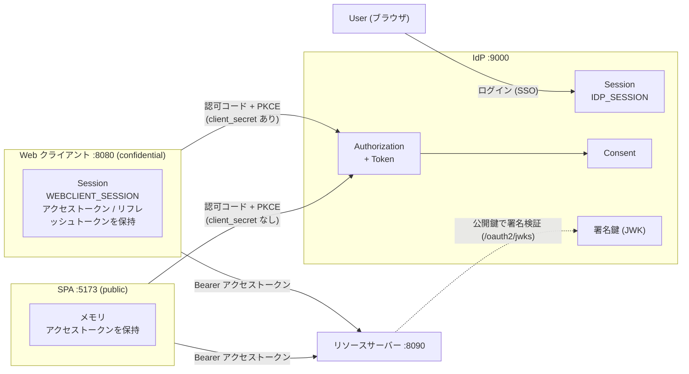
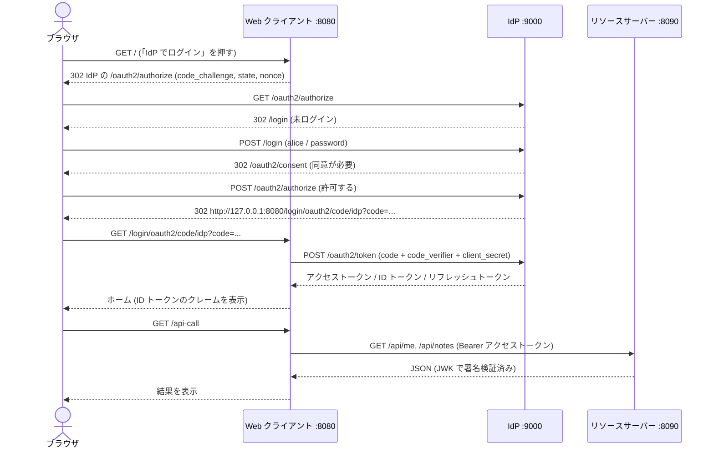
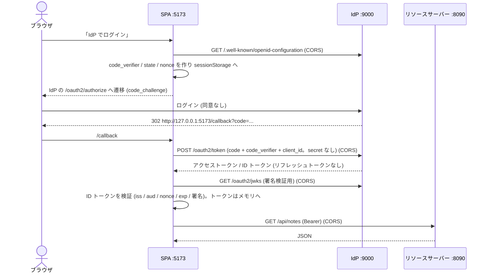

# 第8章 クライアントとリソースサーバーをつなぐ

基礎編の最終章です。4〜7 章で別々に作った差分を 1 つの IdP に統合し、実際のクライアント (Web アプリと SPA) とリソースサーバーをつなぎます。応用編 (9〜19 章) のサンプルは、この章の IdP をコピーして出発します。

## この章のゴール

- 4〜7 章の差分 (クライアント 2 種、署名鍵のファイル化、自前のログイン / 同意画面、JDBC 永続化) を統合した IdP が、`mvn test` で 86 件通る。
- IdP・リソースサーバー・Web クライアント・SPA の 4 つを実ポート (9000 / 8090 / 8080 / 5173) で起動し、ブラウザで「ログイン → 同意 → API 呼び出し」を通せる。Playwright の E2E で自動化してある。
- 統合して初めて出る問題 (独自 `UserDetails` と Jackson の許可リスト、`/error`、issuer、Cookie の衝突、CORS) を、症状を再現したうえで説明できる。
- 1 章の「IdP のセッション」と「クライアントのセッション」が別物であることを、実物で確かめられる (クライアントからログアウトしても、IdP にログインが残る)。
- 基礎編の完成形にまだ無いものを一覧にでき、どの章で扱うかが分かる。

## ドメインモデル上の位置づけ

1 章のモデル (User / Client / Authorization / Consent / Session / Token) に、**Client の実体** (Web アプリと SPA) と **リソースサーバー** を足した全体図です。



ポイントは 3 つです。

- **Session は 3 つある**: IdP のセッション、Web クライアントのセッション、SPA のメモリ。1 章のとおり、クライアントのログイン状態と IdP のログイン状態は別物です。
- **Token の宛先が分かれる**: ID トークンはクライアント宛て、アクセストークンはリソースサーバー宛て、リフレッシュトークンは IdP 宛てです。
- **リソースサーバーは IdP に問い合わせない**: JWT の署名を公開鍵で検証するだけです。

## たとえると

ホテルで言うと、IdP はフロント、Web クライアントと SPA は提携施設 (レストランとスパ)、リソースサーバーはジムの扉です。

宿泊客はフロントで本人確認をして、提携施設の求めに応じてカードキー (アクセストークン) を受け取ります。施設の係員は、受け取ったカードキーをジムの読み取り機にかざします。読み取り機はフロントに電話せず、カードキーの刻印 (署名) と有効期限だけで通すかを決めます。

- **フロントの本人確認と、施設の会員登録は別物**: 施設の会員証 (クライアントのセッション) を返却しても、フロントでの本人確認 (IdP のセッション) は残っています。もう一度施設に行けば、フロントで名乗り直さずに会員証が作れます。これが本章で実物を見る SSO です。
- 合わない点 1: ホテルの読み取り機は「どの扉用のカードキーか」を見ますが、この章のアクセストークンは、既定では `aud` (宛先) がクライアントの ID のままで、リソースサーバー宛てにはなっていません。扉を区別できていない状態で、9 章で直します。
- 合わない点 2: SPA は「メモ帳に書き留めておけない係員」です。トークンはメモリだけに持つので、ページを開き直すと手元から消えます (後述)。

## 構成と起動

`samples/ch08-integration/` の下に 4 つのプロジェクトと E2E があります。

| ディレクトリ | 中身 | ポート |
|---|---|---|
| `idp/` | IdP | 9000 |
| `resource-server/` | ノート API (`/api/me`、`/api/notes`) | 8090 |
| `web-client/` | `oauth2Login` の Web アプリ (Thymeleaf) | 8080 |
| `spa/` | TypeScript + Vite の SPA。OAuth ライブラリは使わない | 5173 |
| `e2e/` | Playwright のスクリプト | - |

起動手順は `samples/ch08-integration/README.md` にあります。**IdP を最初に起動**します。Web クライアントは起動時に IdP のディスカバリを取りに行き、IdP が止まっていると `Unable to resolve Configuration with the provided Issuer of "http://localhost:9000"` で起動に失敗します (確認済み)。

ブラウザで開くホスト名は意図して分けています。理由は「Cookie の衝突」の節で説明します。

| アプリ | 開く URL |
|---|---|
| IdP | `http://localhost:9000` |
| Web クライアント | `http://127.0.0.1:8080` |
| SPA | `http://127.0.0.1:5173` |

## IdP: 4〜7 章をどう 1 つにしたか

### 統合の対応表

| 章 | 取り込んだもの | 置き場所 (`com.example.idp` 配下) |
|---|---|---|
| 4 | `web-client` (confidential) と `spa-client` (public)、PKCE 必須 | `client/ClientRegistrations` |
| 5 | 署名鍵のファイル化、`TokenSettings` | `config/JwkConfig`、`client/ClientRegistrations` |
| 6 | `UserAccount`、自前ログイン / 同意画面、scope に応じたクレーム | `user/`、`web/`、`token/ScopedClaims` |
| 7 | JDBC の 3 つの保管庫、Flyway (V1〜V3 は同梱スキーマのまま)、冪等なシード | `config/PersistenceConfig`、`seed/DataSeeder`、`db/migration/` |
| 8 | `/` ホーム、`/error`、CORS、issuer 固定、`api.read` | `web/`、`config/` |

パッケージは責務で分けました。応用編で差分を足すとき、どこに置くかが決まるようにするためです。

| パッケージ | 責務 | 応用編で足す例 |
|---|---|---|
| `config` | フィルターチェーン、鍵、CORS、JDBC の Bean | 10・11 章のセッション / 認証ポリシー |
| `user` | `UserAccount` とその保管 | 13 章の MFA 設定、14 章の外部 IdP 連携 |
| `client` | クライアントの定義 | 16 章のクライアント管理 |
| `token` | クレームの組み立て | 9 章のトークンのカスタマイズ |
| `web` | ログイン・同意・ホームの画面 | 12 章のログアウト画面 |
| `seed` | 初期データ | - |

ユーザーを保存する `app_user` テーブルは、7 章の `username / password / enabled` + ロール表から、6 章の `UserAccount` の属性に合わせて作り直しました (`V4__app_user.sql`)。`JdbcUserAccountRepository` が `UserAccountRepository` を JDBC で実装し、6 章のメモリ実装を置き換えます。クライアントは `web-client` が同意あり、`spa-client` が同意なしです。同意を出すかどうかはクライアントごとの方針なので、サードパーティ想定の Web クライアントでは出し、自社 SPA 想定の SPA では出しません。

`samples/ch08-integration/idp/src/main/java/com/example/idp/client/ClientRegistrations.java` (抜粋)

```java
    public static RegisteredClient spaClient(Duration accessTokenTimeToLive) {
        return RegisteredClient.withId(UUID.randomUUID().toString())
            .clientId("spa-client")
            .clientName("SPA Client")
            // public client は秘密を持たないので、クライアント認証は NONE。clientSecret も設定しない
            .clientAuthenticationMethod(ClientAuthenticationMethod.NONE)
            .authorizationGrantType(AuthorizationGrantType.AUTHORIZATION_CODE)
            // 登録しても public client にリフレッシュトークンは発行されない (4 章)。SPA は認可コードフローをやり直す
            .authorizationGrantType(AuthorizationGrantType.REFRESH_TOKEN)
            .redirectUri("http://127.0.0.1:5173/callback")
            .postLogoutRedirectUri("http://127.0.0.1:5173/")
            .scope(OidcScopes.OPENID)
            .scope(OidcScopes.PROFILE)
            .scope(OidcScopes.EMAIL)
            .scope(SCOPE_API_READ)
```

API 用の scope `api.read` は両クライアントに許可しました。アクセストークンの寿命は `idp.token.access-token-ttl` (既定 15 分) で変えられます。動作確認で期限切れを早く見るためで、クライアントの設定は初回起動のときに DB へ入り、以後は書き換わりません。変えるときは DB を作り直します。

## 統合で初めて出た問題

### 1. 独自の `UserDetails` は、そのままでは JDBC の認可サービスと組み合わせられない

7 章で、JDBC の `OAuth2AuthorizationService` は attributes を Jackson で型名つき JSON にして保存し、読み戻すときは許可リストにある型しか復元しないと説明しました。ログイン中のユーザー (`Authentication` の principal) も attributes に入ります。7 章のユーザーは Spring Security 標準の `User` だったので許可リストに入っていましたが、6 章の `UserAccountDetails` は独自クラスです。

**何が起きるか** を、許可リストに登録しない状態で実際に確かめました。認可コードの発行までは成功し、**トークンエンドポイントで 500 になります** (コードを読み戻す時点で失敗する)。MockMvc では例外がそのまま上がります。

```text
Could not resolve type id 'com.example.idp.user.UserAccountDetails' as a subtype of `java.lang.Object`:
Configured `PolymorphicTypeValidator` (of type `tools.jackson.databind.jsontype.BasicPolymorphicTypeValidator`) denied resolution
```

しかも、保存された JSON を見ると、もう 1 つ問題が見つかりました。

```text
"principal":{"@class":"com.example.idp.user.UserAccountDetails","account":{"id":"u-001","username":"alice",
"passwordHash":"{bcrypt}$2a$10$8qq4460mqJDt66RVeFvtMO2LjhvLdua2D1HfYQEdmnN6UkrxWsSBS", ... },
"accountNonExpired":true, ..., "password":"{bcrypt}$2a$10$8qq4460mqJDt66RVeFvtMO2LjhvLdua2D1HfYQEdmnN6UkrxWsSBS","username":"alice"}
```

**パスワードハッシュが DB に保存されています。** 認証が済むと Spring Security は `Authentication` の資格情報と、principal が `CredentialsContainer` ならそのパスワードも消します。標準の `User` は `CredentialsContainer` なので消えますが、`UserAccountDetails` は実装していなかったためです。対処は 3 点です。

1. `CredentialsContainer` を実装して、認証後にハッシュを手放す。
2. Jackson の許可リストに型を 1 つだけ足す。
3. 保存・復元の形を決める Mixin (Jackson の注釈を後付けするクラス) を当てる。

`samples/ch08-integration/idp/src/main/java/com/example/idp/user/UserAccountDetails.java` (抜粋)

```java
public class UserAccountDetails implements UserDetails, CredentialsContainer {

    // eraseCredentials() で差し替えるので final にしない
    private UserAccount account;
    ...
    /** 認証が済んだらパスワードハッシュを手放す (User クラスと同じ振る舞い)。 */
    @Override
    public void eraseCredentials() {
        this.account = account.withPasswordHash(null);
    }
```

`samples/ch08-integration/idp/src/main/java/com/example/idp/user/UserAccountDetailsMixin.java` (抜粋)

```java
@JsonAutoDetect(fieldVisibility = JsonAutoDetect.Visibility.ANY,
    getterVisibility = JsonAutoDetect.Visibility.NONE,
    isGetterVisibility = JsonAutoDetect.Visibility.NONE)
@JsonIgnoreProperties(ignoreUnknown = true)
public abstract class UserAccountDetailsMixin {

    @JsonCreator
    protected UserAccountDetailsMixin(@JsonProperty("account") UserAccount account) {
    }
}
```

フィールドの `account` だけを保存し、`getUsername()` などの導出される値は保存しません。復元は `account` を受け取るコンストラクターです。

`samples/ch08-integration/idp/src/main/java/com/example/idp/config/PersistenceConfig.java` (抜粋)

```java
        JsonMapper mapper = JsonMapper.builder()
            .addModules(SecurityJacksonModules.getModules(getClass().getClassLoader(),
                // 型を 1 つずつ明示する。パッケージ丸ごとの許可は、許可リストの意味を弱める
                BasicPolymorphicTypeValidator.builder().allowIfSubType(UserAccountDetails.class)))
            .addMixIn(UserAccountDetails.class, UserAccountDetailsMixin.class)
            .build();

        JdbcOAuth2AuthorizationService service =
            new JdbcOAuth2AuthorizationService(jdbcTemplate, registeredClientRepository);
        JsonMapperOAuth2AuthorizationRowMapper rowMapper =
            new JsonMapperOAuth2AuthorizationRowMapper(registeredClientRepository, mapper);
        // 自前で RowMapper を作ると LobHandler が設定されない。忘れると BLOB 列が読めない
        rowMapper.setLobHandler(new DefaultLobHandler());
        service.setAuthorizationRowMapper(rowMapper);
        service.setAuthorizationParametersMapper(new JsonMapperOAuth2AuthorizationParametersMapper(mapper));
```

対処後は、保存された principal が次の形になりました (ハッシュは `null`)。

```text
"principal":{"@class":"com.example.idp.user.UserAccountDetails","account":{"id":"u-001","username":"alice","passwordHash":null,"displayName":"Alice Example","email":"alice@example.com","emailVerified":true,"enabled":true}}
```

**もう 1 つの落とし穴: `equals` / `hashCode`。** 対処後もテストが 1 件落ちました。ID トークンから `sid` と `auth_time` が消えていたのです。認可サーバーは、ID トークンに入れる `sid` を決めるために、ログイン中のセッション (`SessionRegistry`) を **ユーザーオブジェクトをキーにして** 探します (ソースの `OAuth2AuthorizationCodeAuthenticationProvider#getSessionInformation` で確認)。DB から復元した principal は別のインスタンスなので、`equals` を定義していないと一致せず、セッションが見つかりません。標準の `User` は `username` で `equals` を定義しているので気づけません。`UserAccountDetails` には `id` による `equals` / `hashCode` を足しました。

```java
    @Override
    public boolean equals(Object other) {
        return other instanceof UserAccountDetails that && account.id().equals(that.account.id());
    }
```

この 3 点 (ハッシュを残さない、許可リスト + Mixin、`equals`) は、`UserAccountDetailsTests` と `PersistenceTests` で固定しています。特に「許可リストなしの標準 `JdbcOAuth2AuthorizationService` では読み戻せない」ことと、「別コンテキスト (再起動相当) からリフレッシュが通る」ことをテストにしました。

### 2. `/error` と、直接 `/login` したあとの 404

4 章で確かめたとおり、`/error` を認証必須のままにすると、未ログインでの 400 などのエラーページが `/login` へのリダイレクトに化けます。`/error` は `permitAll` にして、簡素なエラーページ (`templates/error.html`) を用意しました。例外メッセージやスタックトレースは出さず、HTTP ステータスと固定の案内だけを出します。

`samples/ch08-integration/idp/src/main/java/com/example/idp/config/WebSecurityConfig.java` (抜粋)

```java
            .authorizeHttpRequests(authorize -> authorize
                // /error を認証必須にすると、未ログイン時の 400 や 403 のエラーページが /login へのリダイレクトに化ける
                .requestMatchers("/error").permitAll()
                .anyRequest().authenticated())
```

実サーバーで、未ログインのまま登録外の `redirect_uri` を送った結果です。

```text
$ curl -s -i 'http://localhost:9000/oauth2/authorize?response_type=code&client_id=web-client&redirect_uri=http://evil.example/cb&scope=openid&code_challenge=x&code_challenge_method=S256' -H 'Accept: text/html'
HTTP/1.1 400
  <p>リクエストを処理できませんでした。(<span id="error-status">400</span>
  <p>リクエストの内容 (登録されていない redirect_uri など) を確認してください。</p>
```

4 章では、同じ操作が `/login` への 302 になっていました。

また、クライアントを経由せずに `/login` を直接開いてログインすると、ログイン後の飛び先 (既定は `/`) が無く 404 になります (6 章のつまずきポイント)。IdP の `/` に、ログイン中のユーザーを表示するだけのホーム画面 (`HomeController`、`templates/home.html`) を置きました。IdP のセッションが残っていることを目で確かめる用途にも使え、ここから POST `/logout` で IdP のログアウトもできます。

### 3. issuer を固定する

2 章から `AuthorizationServerSettings` に issuer を指定していませんでした。省略すると、リクエストの URL から解決されます。つまり `127.0.0.1` で開くか `localhost` で開くかで、ID トークンの `iss` が変わります。クライアントとリソースサーバーは `iss` の完全一致を検証するので、固定します。

`samples/ch08-integration/idp/src/main/java/com/example/idp/config/AuthorizationServerConfig.java` (抜粋)

```java
        return AuthorizationServerSettings.builder().issuer("http://localhost:9000").build();
```

固定後は、`127.0.0.1` でディスカバリを取っても `issuer` は `http://localhost:9000` のままです (`IdpApplicationTests` で固定。実サーバーでも確認済み)。

### 4. Cookie はホスト名単位で、ポートを区別しない

Cookie の送信先はホスト名 (とパス) で決まり、**ポートは見られません**。`localhost:9000` の IdP と `localhost:8080` の Web クライアントは、同じホスト名なので Cookie を共有します。どちらも既定のセッション Cookie 名 `JSESSIONID` だと、お互いのセッションを上書きします。

**衝突の症状を再現しました。** IdP と Web クライアントを `--server.servlet.session.cookie.name=JSESSIONID` で起動し、ブラウザで両方を `localhost` で開いてログインします。Web クライアントを `localhost` で開くと `redirect_uri` も `localhost` になるので、再現の間だけ IdP の DB で `web-client` に `http://localhost:8080/login/oauth2/code/idp` を追加しておきます (再現手順は README、スクリプトは `e2e/cookie-collision.cjs`)。

```text
最終 URL: http://localhost:8080/login?error
画面の文言: Login with OAuth 2.0 Invalid credentials Study IdP
localhost の Cookie: ["JSESSIONID (localhost)"]
遷移: http://localhost:8080/   JSESSIONID=(なし)
      http://localhost:9000/login   JSESSIONID=7D7B411A
      http://localhost:8080/login?...   JSESSIONID=80777E9E
```

IdP でパスワードを入力し、同意まで成功しているのに、クライアントに戻った直後に `/login?error` へ飛ばされます。`JSESSIONID` が 1 つしかなく、値が途中で入れ替わっています。クライアントは認可リクエストの内容 (`state` など) を自分のセッションに保存してから IdP に送るので、戻ってきたときに IdP が上書きしたセッションを見ると、保存した内容が見つかりません。画面の文言は「Invalid credentials」で、原因とは無関係に見えます。Web クライアントのログ (DEBUG) では、コールバックを受けてから 4 ms 後に `/login?error` へリダイレクトしており、IdP へのトークン取得は行っていませんでした。ログには失敗理由が出ないので、「認可リクエストを保存したセッションが見つからない」という説明は、この挙動からの推測です (エラーコードそのものは未確認)。

対処は 2 段構えにしました。

- **Cookie 名をアプリごとに変える**: IdP は `IDP_SESSION`、Web クライアントは `WEBCLIENT_SESSION` (`application.yml` の `server.servlet.session.cookie.name`)。Cookie 名を変えただけで、**同じ `localhost` で開いても** ログインが通ることも確かめました (上のスクリプトを名前を戻さずに実行)。
- **開くホスト名も分ける**: IdP は `localhost`、クライアントは `127.0.0.1`。名前を変え忘れても衝突しない、二重の防御です。`redirect_uri` は文字列の完全一致で検証されるので、`http://127.0.0.1:8080/...` で登録しているクライアントに `localhost` で来ると 400 になります (`FailureCaseTests`)。

Cookie 名の設定は、実サーバーでないと確かめられません。`RealServerTests` が実際に起動して `Set-Cookie` を確認しています (MockMvc はコンテナの Cookie 設定を再現しません)。

### 5. SPA から IdP を呼ぶための CORS

SPA (`http://127.0.0.1:5173`) の JavaScript から、別オリジンの IdP (`http://localhost:9000`) の `/oauth2/token`、`/userinfo`、ディスカバリ、JWK を `fetch` で呼びます。ブラウザは同一オリジンポリシーで、CORS (Cross-Origin Resource Sharing。別オリジンへの呼び出しを、サーバーが許可ヘッダーで許す仕組み) の許可が無い応答を JavaScript に渡しません。最小限だけ許可します。

`samples/ch08-integration/idp/src/main/java/com/example/idp/config/CorsConfig.java` (抜粋)

```java
        CorsConfiguration configuration = new CorsConfiguration();
        configuration.setAllowedOrigins(allowedOrigins);
        configuration.setAllowedMethods(List.of("GET", "POST"));
        configuration.setAllowedHeaders(List.of("Authorization", "Content-Type"));
        configuration.setAllowCredentials(false);
        configuration.setMaxAge(3600L);

        UrlBasedCorsConfigurationSource source = new UrlBasedCorsConfigurationSource();
        for (String path : List.of("/oauth2/token", "/userinfo", "/.well-known/openid-configuration",
                "/oauth2/jwks")) {
            source.registerCorsConfiguration(path, configuration);
        }
```

- オリジンは SPA の 1 つだけ (`idp.cors.allowed-origins`)。`*` にしない。
- パスは JavaScript が直接呼ぶ 4 つだけ。`/oauth2/authorize` や `/login` は画面遷移なので許可しない。
- Cookie などの資格情報は許可しない。SPA は `Authorization` ヘッダーでトークンを送ります。

フィルターチェーンには `.cors(withDefaults())` を、プロトコル用 (1 本目) とそれ以外 (2 本目) の **両方** に付けました。ブラウザが先に送る事前確認 (プリフライト、OPTIONS) が、1 本目のチェーンの対象 (プロトコルエンドポイントの URL 一致。トークンエンドポイントは POST だけと推測) に入らず 2 本目に来ると考えたためです。この推測と、片方だけで足りるかどうかは確かめていません (**未検証**)。実サーバーでの確認結果です。

```text
$ curl -s -i -X OPTIONS http://localhost:9000/oauth2/token -H 'Origin: http://127.0.0.1:5173' -H 'Access-Control-Request-Method: POST' -H 'Access-Control-Request-Headers: content-type'
HTTP/1.1 200
Access-Control-Allow-Origin: http://127.0.0.1:5173
Access-Control-Allow-Methods: GET,POST
Access-Control-Allow-Headers: content-type
Access-Control-Max-Age: 3600

$ curl -s -i -X OPTIONS http://localhost:9000/oauth2/token -H 'Origin: http://evil.example' -H 'Access-Control-Request-Method: POST'
HTTP/1.1 403
```

CORS を設定しなかったときにブラウザがどう見せるかは、この章では確かめていません (**未検証**)。

## リソースサーバー

IdP が発行した JWT を、IdP の公開鍵で検証して API を守ります。`GET /api/me` はトークンの `sub` と scope を返し、`GET /api/notes` は `SCOPE_api.read` が必要です。

`samples/ch08-integration/resource-server/src/main/resources/application.yml` (抜粋)

```yaml
spring:
  security:
    oauth2:
      resourceserver:
        jwt:
          # iss クレームがこの値と完全一致するトークンだけを受け付ける。IdP の issuer 設定と同じ値にする
          issuer-uri: http://localhost:9000
          # 署名検証用の公開鍵の置き場。issuer-uri と一緒に書くと、iss の検証だけに issuer-uri を使い、
          # 起動時に IdP へ問い合わせない (IdP が止まっていても起動できる。ApiTests で確認)
          jwk-set-uri: http://localhost:9000/oauth2/jwks
```

スターターは `spring-boot-starter-security-oauth2-resource-server`、テスト用は `spring-boot-starter-security-oauth2-resource-server-test` です。`issuer-uri` だけを書くと起動時にディスカバリを取りに行くので、Web クライアントと同じく IdP が止まっていると起動できなくなります。`jwk-set-uri` を併記すると、その問い合わせが要りません (テストは IdP を起動せずに通ります)。

`samples/ch08-integration/resource-server/src/main/java/com/example/resource/config/SecurityConfig.java` (抜粋)

```java
            .authorizeHttpRequests(authorize -> authorize
                // scope claim は "SCOPE_" を付けた権限になる (api.read → SCOPE_api.read)
                .requestMatchers("/api/notes").hasAuthority("SCOPE_api.read")
                // /api/me は有効なトークンならどの scope でも呼べる
                .requestMatchers("/api/**").authenticated()
                .anyRequest().denyAll())
            .oauth2ResourceServer(oauth2 -> oauth2.jwt(withDefaults()))
            // Cookie を使わず毎回トークンで認証する API なので、セッションは作らない
            .sessionManagement(session -> session.sessionCreationPolicy(SessionCreationPolicy.STATELESS))
            // CSRF はブラウザが Cookie を自動送信することを悪用する攻撃。Authorization ヘッダーは自動では付かないので不要
            .csrf(AbstractHttpConfigurer::disable)
            .cors(withDefaults());
```

CORS は SPA のオリジンから GET だけ、`Authorization` ヘッダーだけを許可します (`CorsConfig`)。

テスト (`ApiTests`、13 件) は、本物の IdP を起動せずに、テスト用の鍵で署名した JWT を自分で作り、その公開鍵を小さな HTTP サーバーで配ります。JWT の検証 (署名・期限・`iss`) は、本番と同じ自動構成のコードで動きます。固定している挙動は次のとおりです。

| 状況 | 結果 |
|---|---|
| トークンなし | 401 (`WWW-Authenticate: Bearer resource_metadata=...`) |
| 署名が違う / 改ざん / `iss` が違う / 期限切れ | 401 |
| `api.read` が無いトークンで `/api/notes` | 403 |
| `api.read` が無くても `/api/me` | 200 |
| `/api/notes` の持ち主 | トークンの `sub` で決まる |
| 認証エラーの応答 | CORS ヘッダーが付く (付かないと、ブラウザには原因の分からない CORS エラーに見える) |

`WWW-Authenticate` に `resource_metadata` (保護リソースメタデータの場所。RFC 9728) が付くのは Spring Security 7 の挙動で、実サーバーでも確認しました。

**`aud` について正直に書きます。** IdP が発行するアクセストークンの `aud` は、既定ではクライアントの `client_id` です (`/api/me` の結果に `"aud": ["web-client"]` と出ます)。リソースサーバーは `aud` を検証していないので、`spa-client` 用に発行されたトークンでも、`web-client` 用のトークンでも、署名と `iss` が正しければ同じように通ります。本来は「このリソースサーバー宛て」のトークンだけを受け付けるべきです。`aud` にリソースサーバーの識別子を入れる設計と検証は、9 章で扱います。

## Web クライアント

`oauth2Login` で IdP にログインし、ID トークンのクレームを画面に出します。API は `OAuth2AuthorizedClientManager` と `RestClient` で呼びます。

`samples/ch08-integration/web-client/src/main/resources/application.yml` (抜粋)

```yaml
spring:
  security:
    oauth2:
      client:
        registration:
          idp:
            client-id: web-client
            client-secret: web-client-secret   # 学習用の固定値。本番では環境変数やシークレット管理から渡す
            client-authentication-method: client_secret_basic
            authorization-grant-type: authorization_code
            redirect-uri: "{baseUrl}/login/oauth2/code/{registrationId}"
            scope: openid,profile,email,api.read
        provider:
          idp:
            # 起動時に {issuer-uri}/.well-known/openid-configuration を取りに行く。IdP を先に起動しておくこと
            issuer-uri: http://localhost:9000
```

スターターは `spring-boot-starter-security-oauth2-client` です。PKCE の設定は書いていません。IdP は `web-client` にも PKCE を必須にしていますが、Spring Security 7.1.2 の `oauth2Login` は、`client_secret` を持つクライアントにも既定で `code_challenge` (S256) を付けます (`WebClientTests` で確認。実際の認可リクエストにも付いていました)。

`samples/ch08-integration/web-client/src/main/java/com/example/client/config/ResourceServerClientConfig.java` (抜粋)

```java
        DefaultOAuth2AuthorizedClientManager manager =
            new DefaultOAuth2AuthorizedClientManager(registrations, authorizedClients);
        manager.setAuthorizedClientProvider(OAuth2AuthorizedClientProviderBuilder.builder()
            .authorizationCode()
            .refreshToken()
            .build());
        ...
        OAuth2ClientHttpRequestInterceptor interceptor = new OAuth2ClientHttpRequestInterceptor(manager);
        // どのクライアント登録 (application.yml の idp) のトークンを付けるか
        interceptor.setClientRegistrationIdResolver(request -> "idp");
        return RestClient.builder().baseUrl(baseUrl).requestInterceptor(interceptor).build();
```

`OAuth2ClientHttpRequestInterceptor` は `RestClient` のリクエストにアクセストークンを付け、期限が近ければ `OAuth2AuthorizedClientManager` 経由でリフレッシュトークンで更新します。コントローラーは `resourceServer.get().uri("/api/me").retrieve().body(Map.class)` と書くだけです。

ログアウトは **このアプリのセッションを消すだけ** にしました (`logout.logoutSuccessUrl("/")`)。IdP と連動するログアウトは 12 章で扱います。

## SPA

OAuth ライブラリを使わず、認可コード + PKCE を `fetch` と Web Crypto で実装しました。仕組みを読むための実装で、ファイルは責務で分けています。

| ファイル | 責務 |
|---|---|
| `src/pkce.ts` | 乱数、`code_verifier`、S256 の `code_challenge` |
| `src/idtoken.ts` | ID トークンの検証 (中身と署名) |
| `src/oidc.ts` | ディスカバリ、認可リクエスト、コールバック処理、API 呼び出し |
| `src/main.ts` | 画面の操作 |

`samples/ch08-integration/spa/src/pkce.ts` (抜粋)

```ts
/** 暗号論的乱数 (crypto.getRandomValues) から作ったランダム文字列。Math.random() は予測できるので使わない。 */
export function randomString(byteLength = 32): string {
  return base64url(crypto.getRandomValues(new Uint8Array(byteLength)));
}

/** code_challenge = BASE64URL(SHA256(ASCII(code_verifier)))  (RFC 7636 §4.2 の S256) */
export async function s256Challenge(verifier: string): Promise<string> {
  const digest = await crypto.subtle.digest("SHA-256", new TextEncoder().encode(verifier));
  return base64url(new Uint8Array(digest));
}
```

RFC 7636 付録 B の例で S256 が計算できることなどを、vitest 10 件で固定しています。

### 何をどこに置くか

| 値 | 置き場所 | 理由 |
|---|---|---|
| `code_verifier` / `state` / `nonce` | `sessionStorage` | 認可リクエストを送ってから IdP から戻るまで、ページ遷移をまたいで覚える必要がある。タブごとに独立し、タブを閉じると消える。`localStorage` だと別タブにも残る。使い終わったら (コールバックの最初に) すぐ消す |
| アクセストークン / ID トークン | **メモリ** (モジュールの変数) | ストレージに置くと、XSS (悪意のあるスクリプトの混入) で読み出されたあとも長く使われる。メモリならリロードで消える |

同じオリジンで動く JavaScript は `sessionStorage` も読めるので、これは万全の防御ではありません。トークンのように価値が高く、再取得できるものだけをメモリに寄せています。メモリに置いても困らないのは、IdP のセッションが残っていれば、ログインし直しが画面遷移だけで済むからです (後述)。

### ID トークンの検証

`src/idtoken.ts` が、OpenID Connect Core 1.0 §3.1.3.7 の検証のうち、次を実装しています。

- `iss` が IdP の issuer と完全一致
- `aud` に自分の `client_id` が含まれる (複数なら `azp` が自分)
- `nonce` が認可リクエストで送った値と一致
- `exp` が過ぎていない (時計のずれは 60 秒まで許す)

加えて **署名** も検証します。仕様は、ID トークンをトークンエンドポイントから TLS で直接受け取った場合は、署名検証を省略してよいとしています (サーバーの身元を TLS が保証するため)。しかしこの教材は `http` で動かしているので、省略しません。IdP の `jwks_uri` から公開鍵 (`jwks`) を取り、ヘッダーの `kid` に合う鍵で RS256 を Web Crypto で検証します (CORS で JWK を許可しているのはこのためです)。本番で `https` を使い、トークンを直接受け取るだけなら、省略も仕様上は許されますが、検証しておくほうが安全側です。

アクセストークンは、SPA にとっては単なる文字列で、検証しません。検証するのはリソースサーバーです。

### 期限切れとリフレッシュトークン

`spa-client` には `REFRESH_TOKEN` を登録していますが、public client にはリフレッシュトークンが発行されません (4 章)。アクセストークンの期限が切れたら (手元の期限、または API が 401)、認可コードフローをやり直します。中断した操作は `sessionStorage` に覚えておき、戻ってきたら続きを実行します。IdP のセッションが残っていれば、パスワードを聞かれずに戻ります。

## 動かして確かめる

### Web クライアント: ログイン → 同意 → API 呼び出し



E2E スクリプト (`e2e/run.cjs`) の実行結果です。IdP は空の DB で、アクセストークンの寿命を 75 秒にして起動しています。

```text
--- A. Web クライアント (http://127.0.0.1:8080) ---
IdP のログイン画面: http://localhost:9000/login
同意画面: アクセスの許可 / Web Client (web-client) が alice のアカウントへのアクセスを求めています。
同意の対象 scope: api.read, email, profile
ID トークンのクレーム: {"aud":"[web-client]","auth_time":"2026-11-22T10:32:30Z","azp":"web-client","email":"alice@example.com",
  "email_verified":"true","iss":"http://localhost:9000","name":"Alice Example","nonce":"...","preferred_username":"alice","sid":"...","sub":"alice", ...}
GET /api/me    -> {sub=alice, aud=[web-client], iss=http://localhost:9000, scope=[openid, profile, api.read, email]}
GET /api/notes -> {notes=[{id=1, title=ホテルのチェックイン手順}, {id=2, title=スパの予約メモ}], owner=alice}
```

ID トークンには `sid` (IdP のセッション ID の派生値) と `auth_time` が入っています。1 つ目の問題 (`equals`) を直していなければ、ここに出ません。

### アクセストークンの更新

```text
1 回目のアクセストークン: 末尾=vcikqrkg 期限=2026-11-22T10:33:44.737096458Z
20 秒待ちます (期限の 60 秒前を過ぎるまで)...
2 回目のアクセストークン: 末尾=BfihSegQ 期限=2026-11-22T10:34:05.181492849Z
```

画面に出した「アクセストークンの末尾 8 文字」が変わり、期限が延びています。ユーザーは何も操作せず、`OAuth2AuthorizedClientManager` がリフレッシュトークンで更新しました。寿命 75 秒に対して、20 秒待った時点 (期限まで残り 55 秒) で更新されたのは、`DefaultOAuth2AuthorizedClientManager` が期限の 60 秒前から更新の対象にするためです (既定の時計のずれの許容 60 秒。20 秒待つ前に同じ画面を開いたときは、トークンは変わりませんでした)。寿命が 60 秒以下だと、毎回更新になります。IdP が `reuseRefreshTokens(false)` なので、リフレッシュトークンも新しいものに入れ替わっています。リフレッシュトークンを更新すると、同じ認可の中のアクセストークンは 1 つだけで、古いアクセストークンは IdP では引けなくなります (`PersistenceTests` で、更新前に `/userinfo` を呼んでいる理由です)。

### クライアントのセッションと IdP のセッションは別物 (SSO)

```text
クライアントからログアウトしました
SSO: 再ログインでパスワードは聞かれませんでした (ログイン画面の表示回数 1)
IdP のホーム画面: Alice Example としてログイン中
```

Web クライアントの「ログアウト」を押すと、`WEBCLIENT_SESSION` が消え、画面は「ログインしていません」に戻ります。しかし IdP の `IDP_SESSION` は残っているので、もう一度「IdP でログイン」を押すと、ログイン画面も同意画面も経由せずにクライアントに戻ります (同意は保存済みです)。`http://localhost:9000/` を開くと、まだログイン中と表示されます。1 章の「IdP の『ログイン』とクライアントの『ログイン』を同じものだと思う」の実物です。クライアントのログアウトと IdP のログアウトを連動させるのは 12 章です。

### SPA: ログイン → API 呼び出し → 期限切れ



```text
--- B. SPA (http://127.0.0.1:5173)  ---
status: ログイン済み: Alice Example
アクセストークン: {"scope":"openid profile api.read email","expiresAt":"2026-11-22T10:34:06.468Z","refreshToken":"なし (public client には発行されない)"}
UserInfo -> {"sub":"alice","name":"Alice Example","preferred_username":"alice","email":"alice@example.com","email_verified":true}
GET /api/me -> { "sub": "alice", "aud": [ "spa-client" ], "iss": "http://localhost:9000", "scope": [ "openid", "profile", "api.read", "email" ] }
GET /api/notes -> {"notes":[{"id":1,"title":"ホテルのチェックイン手順"},{"id":2,"title":"スパの予約メモ"}],"owner":"alice"}
77 秒待ちます (アクセストークンの期限切れまで)...
再ログイン後のアクセストークン期限: 2026-11-22T10:35:23.846Z (前: 2026-11-22T10:34:06.468Z)
期限切れ後: 画面遷移だけで戻り、ログイン画面の表示回数は 1 のまま
リロード後: メモリのトークンは消えている
E2E: すべて成功
```

期限が切れたあとに「GET /api/notes」を押すと、SPA は IdP へ遷移し、IdP のセッションが残っているのでパスワードを聞かれずに戻り、中断した `/api/notes` の結果が出ました。リロードすると、メモリのトークンは消えて「ログインしていません」に戻ります。`/api/me` の `aud` が `["spa-client"]` なのも、先ほどの `aud` の話のとおりです。

ブラウザ A (Web クライアントで IdP にログイン済み) で SPA を開くと、SPA のログインもパスワード無しで通りました (`e2e/run.cjs` のシナリオ C。2 つのクライアントが 1 つの IdP セッションを共有する SSO)。その ID トークンの `sid` は、Web クライアントのものと一致していました。

E2E の最終行は `E2E: すべて成功` で、終了コードは 0 です。

## テスト結果

| プロジェクト | 件数 | 主な内容 |
|---|---|---|
| `idp` | 86 | 4〜7 章の主要な挙動 (PKCE、失敗ケース、署名検証、同意、クレーム、JDBC、再起動相当のリフレッシュ、シードの冪等性) と、本章の CORS・エラーページ・Cookie 名・ホーム・`UserAccountDetails` |
| `resource-server` | 13 | 401 / 403、署名・`iss`・期限、CORS |
| `web-client` | 6 | PKCE が付く、ログイン前後の画面、Cookie 名 |
| `spa` (vitest) | 10 | PKCE、ID トークンの検証 |

## 基礎編の完成形でまだ足りないもの

動くところまで来ましたが、本番の IdP としては足りないものが残っています。応用編で順に埋めます。

| 足りないもの | 現状 | 扱う章 |
|---|---|---|
| `client_id` ごとのセッション分離 | `IDP_SESSION` は 1 つで全クライアントが共有 (SSO) | 10 |
| クライアント別の認証ポリシー | 全クライアントが同じパスワード認証 | 11 |
| ログアウト連動 | クライアントのログアウトは IdP に届かない | 12 |
| `aud` の設計と検証 | `aud` は `client_id`。リソースサーバーは検証しない | 9 |
| 多要素認証 | パスワードだけ | 13 |
| 鍵ローテーション | 鍵は 1 つ、ファイルに平文 | 17 |
| 期限切れ認可の掃除 | `oauth2_authorization` は溜まり続ける | 18 |
| 外部 IdP 連携、マルチテナント | なし | 14、15 |
| 追加のグラントとクライアント管理 | クライアントはシードで固定 | 16 |
| 本番向けの秘密情報の扱い、https | 固定のパスワードと `http` | 17 |

## 応用編でこの IdP をコピーして使うときの注意

- **DB と鍵は引き継がない**: `idp/target/idp-db*` と `idp/keys/` はコピーせず、新しいプロジェクトで作り直してください。クライアントの定義は初回起動時に DB へ入るだけなので、`ClientRegistrations` を変えたら DB を作り直す必要があります。
- **テストのクラス名と DB 名**: テストは `jdbc:h2:mem:ch08-test` を共有します。コピーしたら章に合わせて変えてください。
- **コピーした IdP と元の IdP の同時起動はできません** (ポート 9000、`IDP_SESSION`)。
- `UserAccountDetails` を変更するとき (属性の追加など)、Mixin、許可リスト、`equals` の 3 点を忘れずに。DB に保存された認可は、クラスを改名・移動すると読めなくなります。

## つまずきポイント

**症状: トークンエンドポイントが 500 になる (または、ある日からトークンの更新だけが 500 になる)**
- 原因: `attributes` に入ったログイン中のユーザーが、Jackson の許可リストに無い型だった。認可コードの発行は成功し、読み戻すときに初めて失敗する。
- 対処: 許可リストに型を足し、Mixin を当てた `JsonMapper` を、`RowMapper` と `ParametersMapper` の両方に渡す。

**症状: ID トークンに `sid` と `auth_time` が入らない**
- 原因: 独自の `UserDetails` に `equals` / `hashCode` が無く、`SessionRegistry` が DB から復元したユーザーと一致しない。
- 対処: 内部 ID による `equals` / `hashCode` を実装する。

**症状: DB の `attributes` にパスワードハッシュが入っている**
- 原因: 独自の `UserDetails` が `CredentialsContainer` を実装しておらず、認証後に消されない。
- 対処: `eraseCredentials()` でハッシュを手放す。

**症状: IdP でログインして同意まで済んだのに、クライアントに戻ると `/login?error` (「Invalid credentials」)**
- 原因: IdP とクライアントを同じホスト名で開き、セッション Cookie 名がどちらも `JSESSIONID` で、お互いのセッションを上書きした。
- 対処: Cookie 名をアプリごとに変え、開くホスト名も分ける。

**症状: クライアントに `localhost` で入ると `redirect_uri` のエラー (400)**
- 原因: `redirect_uri` は登録した文字列と完全一致で検証される。`127.0.0.1` で登録していると、`localhost` では一致しない。
- 対処: 登録したホスト名で開く。

**症状: Web クライアントが `Unable to resolve Configuration with the provided Issuer` で起動しない**
- 原因: `issuer-uri` を指定すると起動時に IdP のディスカバリを取りに行くが、IdP が止まっている。
- 対処: IdP を先に起動する。

**症状: アクセストークンの更新を確かめたいのに、毎回更新される / まったく更新されない**
- 原因: `OAuth2AuthorizedClientManager` は期限の 60 秒前から更新する。寿命が 60 秒以下だと毎回更新になり、長いと更新までに待ち時間がかかる。
- 対処: 寿命を 75 秒程度にして、期限の 60 秒前を過ぎてから呼ぶ。IdP を空の DB で起動し直す (`idp.token.access-token-ttl`)。

**症状: SPA の API 呼び出しがブラウザで失敗する (CORS)**
- 原因: SPA のオリジンが IdP / リソースサーバーの許可リストに無い。IdP では `localhost` と `127.0.0.1` を別のオリジンとして扱う。
- 対処: SPA は `http://127.0.0.1:5173` で開く。許可するオリジンは `idp.cors.allowed-origins` と `resource-server.cors.allowed-origins`。

## まとめ

- 4〜7 章の差分を `config` / `user` / `client` / `token` / `web` / `seed` に分けて統合した。独自の `UserDetails` は、許可リストと Mixin、`CredentialsContainer`、`equals` の 3 点が揃わないと、JDBC の認可サービスと組み合わせられない。
- IdP の issuer は固定し、`/error` は `permitAll` にする。Cookie はホスト名単位でポートを区別しないので、セッション Cookie 名をアプリごとに変え、IdP と Web クライアントは別のホスト名で開く。
- リソースサーバーは JWT を公開鍵で検証し、scope で API を守る。401 (トークンが無い・不正) と 403 (scope 不足) を区別できる。`aud` は 9 章までは検証していない。
- Web クライアントは `oauth2Login` と `OAuth2AuthorizedClientManager` で、PKCE・API 呼び出し・リフレッシュトークンによる更新を行う。ログアウトはクライアントのセッションを消すだけで、IdP のログインは残る (SSO)。
- SPA は PKCE と state を自前で実装し、検証用の値は `sessionStorage`、トークンはメモリに置く。public client にはリフレッシュトークンが出ないので、期限切れは認可コードフローのやり直しになる。
- 基礎編の完成形に足りないもの (セッション分離、ログアウト連動、`aud`、MFA、鍵ローテーション、掃除) は応用編で埋める。

## 次の章へ

基礎編はここまでです。動く IdP、2 種類のクライアント、リソースサーバーがそろい、1 章のモデルを実物で確かめられました。次の 9 章からは応用編で、まずアクセストークンのカスタマイズ (`aud` の設計、クレームの追加) を扱い、この章で正直に書いた「リソースサーバーが宛先を検証していない」問題を解消します。
